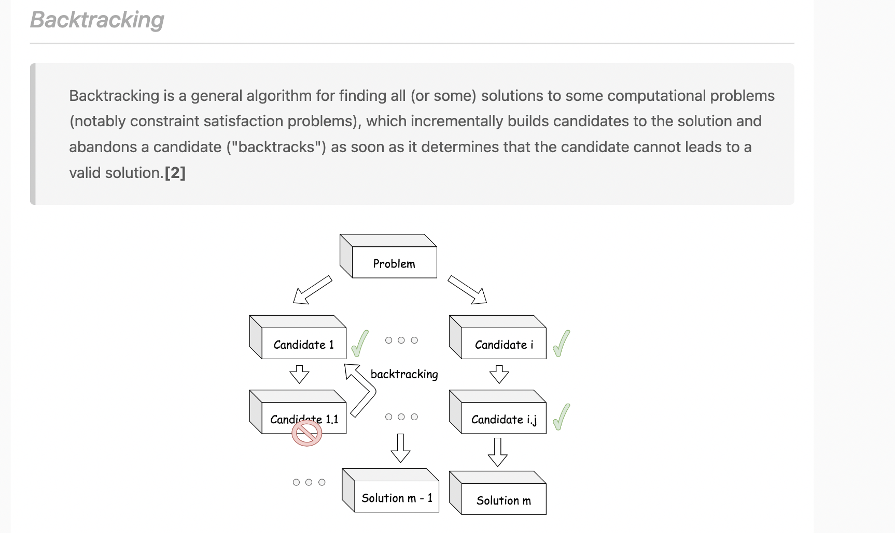

# Backtracking

> **Scope** — Systematic search with undo: the choose/explore/un-choose skeleton, `start_idx` control, duplicate skipping, pruning, and exactly one canonical template per must-know shape — the long tail of worked solutions and the hard-tier state-carrying templates live in its two satellites.
> **See also**: [backtrack_examples.md](./backtrack_examples.md) — the worked LC solutions for these templates; [backtrack_advanced.md](./backtrack_advanced.md) — Trie-pruned grid search, expression building, deletion budgets, memoised partitioning; [dfs.md](./dfs.md) — traversal without the undo step; [recursion.md](./recursion.md) — recursion mechanics; [tree_backtrack.md](./tree_backtrack.md) — root→leaf path problems; [dp.md](./dp.md) — when memoising the search beats exploring it.

## LeetCode Problem Lists

- [Backtracking](https://leetcode.com/problem-list/backtracking/)
- [Recursion](https://leetcode.com/problem-list/recursion/)

## Overview

Backtracking is a **brute-force search over a decision tree**: at each step we make a
choice, recurse deeper, then **undo** the choice ("backtrack") to try the next one. It is
the go-to pattern for generating **all** subsets / permutations / combinations, or finding
**any/one** valid configuration under constraints (N-Queens, Sudoku, word search).

### Key Properties

- **Core idea**: `choose → explore (recurse) → un-choose (undo)`
- **Time Complexity**: exponential — `O(b^d)`, where `b` = branching factor, `d` = decision-tree depth
- **Space Complexity**: `O(d)` recursion depth (excluding the output list)
- **When to Use**: the problem asks for *all* / *every* / *how many* configurations, or to *place / fill / partition* under constraints
- **Optimization path**: Backtrack (brute force) → add **pruning** → often → **DP** (memoize overlapping subproblems)
- **Algorithm**: DFS + recursion
- **Common data structures**: `dict` (counter for dedup), `set` (visited / constraints), `array`/`list` (the route)

### The 3 things every backtrack tracks

| Element | Meaning |
| ------- | ------- |
| **Route** | choices made so far (the current path) |
| **Choice list** | choices available right now |
| **End condition** | leaf of the decision tree — record the route and return |

<p align="center"></p>

> The three rows above map onto [Template 1](#template-1-choose--explore--un-choose--lc-216-) —
> `path` is the route, the `for` loop is the choice list, the `if` at the top is the end condition.

### Time Complexity by Problem Type

| Problem type      | Typical Time      | Space (excl. output) | Example      |
| ----------------- | ----------------- | -------------------- | ------------ |
| Subsets           | O(2^n · n)        | O(n)                 | LC 78, 90    |
| Permutations      | O(n! · n)         | O(n)                 | LC 46, 47    |
| Combinations      | O(C(n,k) · k)     | O(k)                 | LC 77        |
| Combination Sum   | exponential       | O(target / min)      | LC 39, 40    |
| Partitioning      | O(2^n · n)        | O(n)                 | LC 131       |
| N-Queens          | O(n!)             | O(n)                 | LC 51        |

> The trailing `· n` / `· k` is the cost of copying each valid path into the result.
> **Pruning** trims branches and the constant factor but does **not** change the worst-case class.

### References

- [labuladong — Backtracking framework](https://labuladong.online/algo/essential-technique/backtrack-framework/#%E4%B8%80%E3%80%81%E5%85%A8%E6%8E%92%E5%88%97%E9%97%AE%E9%A2%98)
- [labuladong — Two views of backtracking](https://labuladong.online/algo/practice-in-action/two-views-of-backtrack/)
    - [Sudoku](https://labuladong.online/algo/practice-in-action/sudoku/)
    - [Generate parentheses](https://labuladong.online/algo/practice-in-action/generate-parentheses/)
    - [Partition to k equal sum subsets](https://labuladong.online/algo/practice-in-action/partition-to-k-equal-sum-subsets/)
- [LeetCode — A general approach to backtracking (Java)](https://leetcode.com/problems/subsets/solutions/27281/a-general-approach-to-backtracking-questions-in-java-subsets-permutations-combination-sum-palindrome-partitioning/)

## Recognition

The input size is the first tell: backtracking is exponential, so the constraints are small
(see the constraint ruler in [complexity_cheatsheet.md](./complexity_cheatsheet.md)).

| Signal in the statement | Constraint cue | Reach for | Not this if |
|---|---|---|---|
| "return **all** combinations of k numbers", "find all valid ways to pick" | n ≤ 20 | [Template 1](#template-1-choose--explore--un-choose--lc-216-) choose → explore → un-choose | only a **count** or a yes/no is asked → [dp.md](./dp.md) |
| "the same number may be chosen an unlimited number of times" vs "each number used once" | target ≤ 500 | [Template 2](#template-2-start_idx--i-vs-i--1--lc-39-) `i` vs `i + 1` | order matters (`[1, 3]` ≠ `[3, 1]`) → [Template 5](#template-5-permutations--lc-46-) |
| "return all possible subsets", "the power set" | n ≤ 10 | [Template 3](#template-3-subsets--lc-78-) record at every node | the input has duplicates → [Template 4](#template-4-subsets-ii-skip-same-level-duplicates--lc-90-) |
| "may contain duplicates", "must not contain duplicate subsets / combinations" | n ≤ 10 | [Template 4](#template-4-subsets-ii-skip-same-level-duplicates--lc-90-) sort + same-level skip | |
| "all possible permutations", "every ordering" | n ≤ 8 | [Template 5](#template-5-permutations--lc-46-) `used[]`, loop from 0 | the answer is a set, not an ordering → [Template 3](#template-3-subsets--lc-78-) |
| "all combinations of k numbers out of 1..n" | C(n, k) small | [Template 6](#template-6-combinations--lc-77) size gate | |
| "unique combinations that **sum to target**" | n ≤ 100, target ≤ 30 | [Template 7](#template-7-combination-sum--lc-39--lc-40-) sort + `break` + skip | only the number of ways → [knapsack.md](./knapsack.md) |
| "**partition** s so that every piece is a palindrome / valid octet / word" | n ≤ 16 | [Template 8](#template-8-palindrome-partitioning--lc-131-) choose where to cut | only whether, or the minimum cuts → [dp.md](./dp.md) |
| "sequentially adjacent cells", "a cell may not be used more than once" | m, n ≤ 6 | [Template 9](#template-9-grid--word-search--lc-79-) mark, recurse, restore | many words on one board → [backtrack_advanced.md](./backtrack_advanced.md) Trie |
| "place n queens so no two attack each other" | n ≤ 9 | [Template 10](#template-10-n-queens--lc-51) one row per depth + 3 sets | |
| "fill the grid so every row, column and box …" | fixed 9×9 | [Template 11](#template-11-sudoku-solver--lc-37) one cell per depth | |
| a constraint on each choice ("`perm[i]` divisible by `i`") | n ≤ 15 | [Template 12](#template-12-pruning-at-the-choice--lc-526-) test before recursing | the same state recurs → bitmask DP, [dp_bitmask.md](./dp_bitmask.md) |
| "divide into **k subsets with equal sums**", "form a square" | n ≤ 16 | [Template 13](#template-13-k-bucket-partitioning--lc-698--lc-473) k buckets, desc | |
| a path **and** a running sum carried down a tree or grid | | [Template 14](#template-14-when-to-undo--mutable-vs-immutable-state--lc-113-) undo only the mutable part | |

## Problem Categories

Four shapes cover almost every backtracking question. The taxonomy below decides **which
template you reach for**; the code for each lives in [Templates & Algorithms](#templates--algorithms)
and the fully worked solutions in [backtrack_examples.md](./backtrack_examples.md).

| # | Shape | `start_idx`? | Canonical template | LC |
|---|-------|--------------|--------------------|----|
| 1 | Subsets | ✅ `i + 1` | [Template 3](#template-3-subsets--lc-78-) / [Template 4](#template-4-subsets-ii-skip-same-level-duplicates--lc-90-) | 78, 90 |
| 2 | Permutations | ❌ `used[]` | [Template 5](#template-5-permutations--lc-46-) | 46, 47 |
| 3 | Combinations | ✅ `i + 1` | [Template 6](#template-6-combinations--lc-77) | 77, 216 |
| 4 | Combination Sum | ✅ `i` (reuse) or `i + 1` | [Template 7](#template-7-combination-sum--lc-39--lc-40-) | 39, 40 |
| 5 | Partitioning | ✅ `i + 1` on a substring / bucket | [Template 8](#template-8-palindrome-partitioning--lc-131-) / [Template 13](#template-13-k-bucket-partitioning--lc-698--lc-473) | 131, 698, 473 |
| 6 | Grid / word search | ❌ mark-and-restore the cell | [Template 9](#template-9-grid--word-search--lc-79-) | 79, 980, 1219 |
| 7 | Constraint satisfaction | ❌ one row / cell per depth | [Template 10](#template-10-n-queens--lc-51) / [Template 11](#template-11-sudoku-solver--lc-37) | 51, 37 |
| 8 | Parentheses / string building | ❌ counters as constraints | [backtrack_examples.md](./backtrack_examples.md#8-generate-parentheses--lc-22) | 20, 22, 93 |

### Type Notes

Working notes per shape — the mnemonic for the loop body, and the gotcha.

- Type 1) : `Subsets`
    - Problems : LC 78, 90, 17
    - [Programmer Carl (leetcode-master) — 0078 Subsets](https://github.com/youngyangyang04/leetcode-master/blob/master/problems/0078.%E5%AD%90%E9%9B%86.md)
    - helper call + `start_idx` + for loop + `pop()`
    - record every node of the tree; `start_idx` keeps already-used numbers out
    - No `contains` check: `start_idx` already uses each element at most once (`contains` is the permutations idiom)
- `Subsets II`
    - LC 90
    - `start_idx` + backtrack + same-level dedup
    - dedup: sort and skip `i > start and a[i] == a[i-1]`, or loop over a counter

- Type 2) : `Permutations`
    - Problems : LC 46, 47
    - helper call + `used[]` + `pop()`
    - loop from 0 every level; `used[]` keeps the numbers already on the path out
    - `NO NEED` to use start_idx

- Type 3) : `Combinations`
    - LC 77
    - helper call + `start_idx` + for loop + stop at `len(path) == k` + `pop()`

- Type 4) : `Others`

- Parentheses
    - LC 20, LC 22

## Templates & Algorithms

### Template Comparison Table

| Template | Shape | Loop / next index | Undo | LC |
|---|---|---|---|---|
| 1 | choose → explore → un-choose | `for i in start..n` | `path.pop()` | 216 |
| 2 | `start_idx` control | `i` (reuse) vs `i + 1` (once) | `path.pop()` | 39 vs 40 |
| 3 | Subsets | record at **every** node, `i + 1` | `path.pop()` | 78 |
| 4 | Subsets II | `i > start && a[i] == a[i-1]` skip | `path.pop()` | 90 |
| 5 | Permutations | scan **all**, skip `used[i]` | `pop()` + `used[i] = False` | 46, 47 |
| 6 | Combinations | stop at `len(path) == k` | `pop()` | 77 |
| 7 | Combination Sum | `i` reuse / `i + 1` once + `break` prune | `pop()` | 39, 40 |
| 8 | Palindrome partition | `for end in start..n-1`, palindrome gate | `pop()` | 131 |
| 9 | Grid / word search | 4-way from each cell | restore the cell | 79 |
| 10 | N-Queens | one row per depth, 3 constraint sets | remove from all 3 sets | 51 |
| 11 | Sudoku | one empty cell per depth, row/col/box sets | reset cell + sets | 37 |
| 12 | Pruning at the choice | test before recursing, `break` on a sorted pool | — | 526 |
| 13 | k-bucket partition | for each bucket, sorted desc | `buckets[i] -= v` | 698, 473 |
| 14 | Mutable vs immutable state | — | undo **only** mutable state | 113, 1740 |

### Template 1: choose → explore → un-choose — LC 216 ⭐⭐⭐⭐⭐

**Recognise** — "return **all** combinations / every valid way to pick …", "find **any**
arrangement that satisfies …". The input is small: n ≤ 10–20 for subsets (2^n), n ≤ 8–10 for
orderings (n!). A bound like that is the problem telling you exponential search is expected.

**Key point** — `path` always holds exactly the choices on the way from the root to the current
node of the decision tree: every `append` is matched by one `pop` after the recursive call
returns, so when the loop moves to the next choice the path is the parent's path again.

The three things every backtrack tracks map onto the code: `path` is the **route**, the `for`
loop is the **choice list**, and the `if` at the top is the **end condition**.

```python
# python
# LC 216 - Combination Sum III
# IDEA: choose a digit, explore with the digits after it, un-choose; record at the leaf
# time = O(C(9,k) * k), space = O(k)   at most C(9,k) leaves, O(k) to copy each
def combinationSum3(k, n):
    res = []
    path = []

    def backtrack(start, remain):
        if len(path) == k:                 # end condition: a leaf of the decision tree
            if remain == 0:
                res.append(path[:])        # copy: path keeps changing after this line
            return
        for digit in range(start, 10):     # choice list: the digits not tried yet, in order
            if digit > remain:             # digits ascend, so every later one is too big
                break
            path.append(digit)             # 1) choose
            backtrack(digit + 1, remain - digit)   # 2) explore (digit + 1 -> each used once)
            path.pop()                     # 3) un-choose

    backtrack(1, n)
    return res
```

```java
// java
// LC 216 - Combination Sum III
// IDEA: choose a digit, explore with the digits after it, un-choose; record at the leaf
// time = O(C(9,k) * k), space = O(k)
public List<List<Integer>> combinationSum3(int k, int n) {
    List<List<Integer>> res = new ArrayList<>();
    backtrack(1, n, k, new ArrayList<>(), res);
    return res;
}

private void backtrack(int start, int remain, int k, List<Integer> path, List<List<Integer>> res) {
    if (path.size() == k) {                     // end condition
        if (remain == 0) {
            res.add(new ArrayList<>(path));     // copy, not the live reference
        }
        return;
    }
    for (int digit = start; digit <= 9; digit++) {
        if (digit > remain) {                   // ascending digits: the rest are too big
            break;
        }
        path.add(digit);                        // 1) choose
        backtrack(digit + 1, remain - digit, k, path, res);   // 2) explore
        path.remove(path.size() - 1);           // 3) un-choose
    }
}
```

**Complexity**
- **Time O(C(9,k) · k)**: the `for digit` loop with `digit + 1` visits each k-subset of 1..9 at
  most once, and `path[:]` costs O(k) per leaf. In general a backtrack is **O(b^d · w)**:
  branching factor `b` from the `for` loop, depth `d` from the end condition, `w` the work at a leaf.
- **Space O(k)**: the recursion is at most `k` frames deep, and `path` holds at most `k` digits
  (the output list is not counted).

**Traps**
- `res.append(path)` without the copy: every entry is the same list, and after the last `pop()`
  it is empty, so LC 216 `k = 3, n = 7` returns `[[]]`.
- Forgetting the `pop()`: the next branch starts from the previous branch's path, which only
  grows, so it is never again of length `k` at the right sum — `k = 3, n = 9` returns `[]`.
- `break` is only legal because the choices are **sorted** (`range` ascends). On an unsorted
  pool it skips valid later choices; use `continue`, or sort first.

**Drill** — LC 216 ⭐ · LC 77 *(no sum, size `k` only)* · LC 17 *(the choice list is the digit's letters)* · LC 22 *(the choice list is "open or close", gated by counts)*

### Template 2: `start_idx` — `i` vs `i + 1` — LC 39 ⭐⭐⭐⭐⭐

**Recognise** — "combinations", "subsets", "each number may be used **once**" or "the same number
may be chosen **an unlimited number of times**", and `[2, 3]` counts as the same answer as `[3, 2]`.

**Key point** — the loop starts at `start_idx`, so a path only ever lists choices in index order:
each set is built once, in one order. What you pass as the next start decides reuse — `i` keeps
the current element available (unbounded), `i + 1` moves past it (once).

| Pass | Meaning | Analogy | Examples |
| ---- | ------- | ------- | -------- |
| `i`     | Reuse the **same element again** | **Unbounded knapsack** (infinite supply) | LC 39 (Combination Sum), LC 518 (Coin Change II) |
| `i + 1` | Use **each element at most once** | **0/1 knapsack**, subsets | LC 40 (Combination Sum II), LC 78/90 (Subsets), LC 131, LC 494 |

```python
# python
# LC 39 - Combination Sum
# IDEA: pass i (not i + 1) so a candidate can be picked again; start_idx keeps each set in one order
# time = O(n^(T/M + 1)), space = O(T/M)   T = target, M = smallest candidate
def combinationSum(candidates, target):
    candidates.sort()                      # sorted, so the first too-big candidate ends the loop
    res = []
    path = []

    def backtrack(start, remain):
        if remain == 0:
            res.append(path[:])
            return
        for i in range(start, len(candidates)):
            if candidates[i] > remain:     # every candidate after i is bigger still
                break
            path.append(candidates[i])
            backtrack(i, remain - candidates[i])   # i: the same candidate stays available
            path.pop()

    backtrack(0, target)
    return res
```

```java
// java
// LC 39 - Combination Sum
// IDEA: pass i (not i + 1) so a candidate can be picked again; start_idx keeps each set in one order
// time = O(n^(T/M + 1)), space = O(T/M)
public List<List<Integer>> combinationSum(int[] candidates, int target) {
    Arrays.sort(candidates);
    List<List<Integer>> res = new ArrayList<>();
    backtrack(candidates, 0, target, new ArrayList<>(), res);
    return res;
}

private void backtrack(int[] candidates, int start, int remain, List<Integer> path, List<List<Integer>> res) {
    if (remain == 0) {
        res.add(new ArrayList<>(path));
        return;
    }
    for (int i = start; i < candidates.length; i++) {
        if (candidates[i] > remain) {           // sorted: the rest are bigger
            break;
        }
        path.add(candidates[i]);
        backtrack(candidates, i, remain - candidates[i], path, res);   // i: reuse allowed
        path.remove(path.size() - 1);
    }
}
```

**Complexity**
- **Time O(n^(T/M + 1))**: every level of the tree has up to `n` choices (the `for i` loop), and
  because `i` is passed back, the depth only ends when `remain` runs out — at most `T/M` picks of
  the smallest candidate.
- **Space O(T/M)**: the recursion depth and `path` length are both bounded by `T/M`.

**Traps**
- Passing `i + 1` on LC 39: `[2, 3, 6, 7], 7` loses `[2, 2, 3]` because 2 can no longer repeat.
- Passing `0` instead of `start`: `[2, 3]` and `[3, 2]` are both built, and LC 39 `[2, 3, 6, 7], 7`
  returns `[[2, 2, 3], [2, 3, 2], [3, 2, 2], [7]]`.
- Passing `i` on LC 78: the same element is appended forever, and the recursion never ends.

**Not this if** — the order of choices matters (`[1, 3]` and `[3, 1]` are different answers):
that is a permutation, which tracks `used[]` instead of a `start_idx`
([Template 5](#template-5-permutations--lc-46-)). LC 377 (Combination Sum IV) is the same: order
matters there, so every call loops from 0, and since it only **counts**, it is a DP rather than a backtrack.

**Drill** — LC 39 ⭐ · LC 40 *(`i + 1` plus a duplicate skip)* · LC 216 *(fixed size k)* · LC 518 *(only the count: the knapsack DP)*

### Template 3: Subsets — LC 78 ⭐⭐⭐⭐⭐

**Recognise** — "return all possible subsets (the power set)", "the solution set must not contain
duplicate subsets"; elements are distinct. n ≤ 10 → 2^n · n is about 10⁴.

**Key point** — every node of the decision tree is a subset, not only the leaves: record `path`
on **entry** to each call (pre-order). `i + 1` makes each element used at most once, and the
index order makes each subset appear exactly once.

```python
# python
# LC 78 - Subsets
# IDEA: record the path at EVERY node (pre-order); pass i + 1 so each element is used once
# time = O(2^n * n), space = O(n)   2^n subsets, O(n) to copy each
def subsets(nums):
    res = []
    path = []

    def backtrack(start):
        res.append(path[:])                # every node is an answer, the empty set included
        for i in range(start, len(nums)):
            path.append(nums[i])
            backtrack(i + 1)
            path.pop()

    backtrack(0)
    return res
```

```java
// java
// LC 78 - Subsets
// IDEA: record the path at EVERY node (pre-order); pass i + 1 so each element is used once
// time = O(2^n * n), space = O(n)
public List<List<Integer>> subsets(int[] nums) {
    List<List<Integer>> res = new ArrayList<>();
    backtrack(nums, 0, new ArrayList<>(), res);
    return res;
}

private void backtrack(int[] nums, int start, List<Integer> path, List<List<Integer>> res) {
    res.add(new ArrayList<>(path));             // every node is an answer
    for (int i = start; i < nums.length; i++) {
        path.add(nums[i]);
        backtrack(nums, i + 1, path, res);      // i + 1: each element used once
        path.remove(path.size() - 1);
    }
}
```

**Complexity**
- **Time O(2^n · n)**: the tree has one node per subset, 2^n of them, and `path[:]` copies up to
  `n` elements at each.
- **Space O(n)**: recursion depth and `path` are both at most `n` (output excluded).

**Dry run**

```text
nums = [1, 2, 3]       record on entry, then try i = start .. n-1
start=0  []          -> [1] -> start=1 [1]     -> [1,2] -> start=2 [1,2] -> [1,2,3]
                                               -> [1,3]
                     -> [2] -> start=2 [2]     -> [2,3]
                     -> [3]
res = [], [1], [1,2], [1,2,3], [1,3], [2], [2,3], [3]
```

**Traps**
- A `res.contains(path)` / `path not in res` check "to avoid duplicates": `start_idx` already
  guarantees each subset once, and the scan makes each record O(2^n · n).
- A `path.contains(nums[i])` check: that is the permutations idiom; `i + 1` already uses each
  element at most once.
- Recording only at a leaf (`if start == len(nums)`) keeps just the subsets that end on the last
  element: `[1, 2, 3]` returns `[[1, 2, 3], [1, 3], [2, 3], [3]]`.

**Not this if** — the input has duplicates (`[1, 2, 2]`): sort and skip same-level repeats,
[Template 4](#template-4-subsets-ii-skip-same-level-duplicates--lc-90-).

**Drill** — LC 78 ⭐ · LC 90 *(duplicates)* · LC 1863 *(sum of XOR over all subsets)* · LC 2597 *(a constraint between chosen elements)*

### Template 4: Subsets II (skip same-level duplicates) — LC 90 ⭐⭐⭐⭐⭐

**Recognise** — Template 3's wording, but "nums **may contain duplicates**" and "must not contain
duplicate subsets". n ≤ 10.

**Key point** — after sorting, equal values sit next to each other. Two siblings that pick the same
value start identical subtrees, so take only the **first** of a run at each level
(`i > start and nums[i] == nums[i-1]`); a deeper level may still take the next copy.

```python
# python
# LC 90 - Subsets II
# IDEA: sort, then skip a value equal to the previous one at the SAME level (i > start)
# time = O(2^n * n), space = O(n)   the O(n log n) sort is dominated
def subsetsWithDup(nums):
    nums.sort()                            # duplicates become adjacent
    res = []
    path = []

    def backtrack(start):
        res.append(path[:])
        for i in range(start, len(nums)):
            if i > start and nums[i] == nums[i - 1]:   # same level, same value: same subtree
                continue
            path.append(nums[i])
            backtrack(i + 1)
            path.pop()

    backtrack(0)
    return res
```

```java
// java
// LC 90 - Subsets II
// IDEA: sort, then skip a value equal to the previous one at the SAME level (i > start)
// time = O(2^n * n), space = O(n)
public List<List<Integer>> subsetsWithDup(int[] nums) {
    Arrays.sort(nums);
    List<List<Integer>> res = new ArrayList<>();
    backtrack(nums, 0, new ArrayList<>(), res);
    return res;
}

private void backtrack(int[] nums, int start, List<Integer> path, List<List<Integer>> res) {
    res.add(new ArrayList<>(path));
    for (int i = start; i < nums.length; i++) {
        if (i > start && nums[i] == nums[i - 1]) {   // same level, same value: skip
            continue;
        }
        path.add(nums[i]);
        backtrack(nums, i + 1, path, res);
        path.remove(path.size() - 1);
    }
}
```

**Complexity**
- **Time O(2^n · n)**: at worst (all values distinct) the tree is Template 3's; the skip only
  removes nodes. The `sort` is O(n log n) and is dominated.
- **Space O(n)**: recursion depth and `path`.

**Traps**
- `i > 0` instead of `i > start`: at `path = [1, 2]`, start = 2, the second `2` is skipped, so
  `[1, 2, 2]` returns without `[1, 2, 2]`.
- No `sort()`: `[2, 1, 2]` puts the 2s apart, and both `[2, 1]` and `[1, 2]` come out.

**Not this if** — the answer is a permutation with duplicates (LC 47): the skip needs the
`used[]` form, `!used[i-1]`, below.

**Drill** — LC 90 ⭐ · LC 40 *(the same skip, with a target)* · LC 47 *(the permutation form of the skip)* · LC 491 *(unsorted input: a per-level `set` instead)*

#### Duplicate skipping — the same-level skip rule ⭐⭐⭐⭐⭐

We do **not** skip every duplicate — only a duplicate appearing at the *same recursion level*.
Two siblings that choose equal values grow identical subtrees; a parent and its child choosing
equal values build `[2, 2]`, which is a different answer. Three spellings of the same rule:

| Spelling | Skip when | Needs a sort? | Used by |
|---|---|---|---|
| index-based | `i > start and a[i] == a[i-1]` | yes | LC 40, LC 90 |
| visited-based | `i > 0 and a[i] == a[i-1] and not used[i-1]` | yes | LC 47, LC 996 |
| counter-based | loop over the **distinct** values, take one while `count[x] > 0` | no | LC 47 |

In the visited-based form, `not used[i-1]` means the previous copy was tried at this level and
undone, so `a[i]` would repeat its subtree; `used[i-1]` means it is on the current path, one
level up, and `a[i]` is its legitimate next copy.

### Template 5: Permutations — LC 46 ⭐⭐⭐⭐⭐

**Recognise** — "return all possible **permutations**", "every arrangement / ordering", "in any
order"; `[1, 2]` and `[2, 1]` are different answers. n ≤ 6–8 → n! · n is fine.

**Key point** — order matters, so every level may pick **any** element not already on the path:
the loop starts at 0, and `used[i]` (not a `start_idx`) is what keeps an element from appearing
twice. `used` is set on choose and cleared on un-choose, so it always describes exactly `path`.

```python
# python
# LC 46 - Permutations
# IDEA: BACKTRACK with a `used` array: loop from 0 every level, skip what is already on the path
# time = O(n! * n), space = O(n)     n! permutations, O(n) to copy each
def permute(nums):
    res = []
    path = []
    used = [False] * len(nums)

    def backtrack():
        if len(path) == len(nums):
            res.append(path[:])            # copy the path
            return
        for i in range(len(nums)):
            if used[i]:
                continue
            used[i] = True                 # choose
            path.append(nums[i])
            backtrack()                    # explore
            path.pop()                     # un-choose
            used[i] = False

    backtrack()
    return res
```

```java
// java
// LC 46 - Permutations
// IDEA: BACKTRACK with a `used` array: loop from 0 every level, skip what is already on the path
// time = O(n! * n), space = O(n)
public List<List<Integer>> permute(int[] nums) {
    List<List<Integer>> res = new ArrayList<>();
    backtrack(nums, new boolean[nums.length], new ArrayList<>(), res);
    return res;
}

private void backtrack(int[] nums, boolean[] used, List<Integer> path, List<List<Integer>> res) {
    if (path.size() == nums.length) {
        res.add(new ArrayList<>(path));
        return;
    }
    for (int i = 0; i < nums.length; i++) {     // no start index: order matters
        if (used[i]) {
            continue;
        }
        used[i] = true;                         // choose
        path.add(nums[i]);
        backtrack(nums, used, path, res);       // explore
        path.remove(path.size() - 1);           // un-choose
        used[i] = false;
    }
}
```

**Complexity**
- **Time O(n! · n)**: level `d` of the tree tries `n - d` unused elements, so there are n! leaves,
  and each costs O(n) to copy. The `for i` loop scans all `n` indexes at every node.
- **Space O(n)**: `used`, `path` and the recursion depth.

**Traps**
- `path.contains(nums[i])` instead of `used[i]`: an O(n) check per choice, and wrong as soon as
  values repeat — `[1, 1, 2]` can never place the second `1`, and returns `[]`.
- A `res.contains(path)` check before recording: an O(n! · n) scan per leaf, and unnecessary for
  distinct input.
- Clearing `used[i]` but not popping (or the reverse): `used` no longer describes `path`, and later
  permutations come out too long or missing an element.

**Not this if** — the answer is a set, not an ordering (`[1, 2]` = `[2, 1]`): pass a
`start_idx`, [Template 3](#template-3-subsets--lc-78-) / [Template 6](#template-6-combinations--lc-77).

**Drill** — LC 46 ⭐ · LC 47 *(duplicates: below)* · LC 784 *(two choices per letter)* · LC 526 *(prune at the choice: [Template 12](#template-12-pruning-at-the-choice--lc-526-))* · LC 996 *(adjacent pairs must sum to a square)*

#### Permutations with duplicates — LC 47

> **Key point** — loop over the **distinct** values of a `Counter` instead of the indexes, so two
> equal values can never be siblings and no permutation is built twice.

**Reduces to**: [Template 5](#template-5-permutations--lc-46-) — with `count[value]` in place of
`used[i]`: decrement on choose, increment back on un-choose. The sorted `used[]` alternative is the
visited-based row of [Duplicate skipping](#duplicate-skipping--the-same-level-skip-rule-).

```python
# python
# LC 47 - Permutations II
# IDEA: BACKTRACK over a Counter of distinct values (decrement on choose, increment on un-choose)
# time = O(n! * n), space = O(n)     duplicates only prune, they do not change the bound
from collections import Counter

def permuteUnique(nums):
    res = []
    path = []
    count = Counter(nums)

    def backtrack():
        if len(path) == len(nums):
            res.append(path[:])
            return
        for value in count:                # each DISTINCT value once per level
            if count[value] == 0:
                continue
            path.append(value)
            count[value] -= 1
            backtrack()
            path.pop()                     # undo both: the path and the count
            count[value] += 1

    backtrack()
    return res
```

### Template 6: Combinations — LC 77

**Recognise** — "return all possible combinations of **k** numbers chosen from 1..n". The size is
fixed; order does not matter. C(n, k) small, e.g. n ≤ 20.

**Key point** — Template 1 with the end condition `len(path) == k`: `start_idx` keeps each
combination in increasing order, so each one is built exactly once, and the recursion stops the
moment it has `k` numbers.

```python
# python
# LC 77 - Combinations
# IDEA: start_idx + a size gate; stop as soon as len(path) == k
# time = O(C(n,k) * k), space = O(k)   one copy per combination
def combine(n, k):
    res = []
    path = []

    def backtrack(start):
        if len(path) == k:
            res.append(path[:])            # path[:] and list(path) are both a copy
            return
        for i in range(start, n + 1):      # numbers are 1..n, so the bound is n + 1
            path.append(i)
            backtrack(i + 1)
            path.pop()

    backtrack(1)
    return res
```

```java
// java
// LC 77 - Combinations
// IDEA: start_idx + a size gate; stop as soon as path.size() == k
// time = O(C(n,k) * k), space = O(k)
public List<List<Integer>> combine(int n, int k) {
    List<List<Integer>> res = new ArrayList<>();
    backtrack(1, n, k, new ArrayList<>(), res);
    return res;
}

private void backtrack(int start, int n, int k, List<Integer> path, List<List<Integer>> res) {
    if (path.size() == k) {
        res.add(new ArrayList<>(path));
        return;
    }
    for (int i = start; i <= n; i++) {
        path.add(i);
        backtrack(i + 1, n, k, path, res);
        path.remove(path.size() - 1);
    }
}
```

**Complexity**
- **Time O(C(n,k) · k)**: there are C(n,k) leaves and each copy is O(k). The inner nodes add at
  most a factor of k more, which the bound absorbs.
- **Space O(k)**: the recursion stops at depth `k`.

**Traps**
- `range(start, n)` on a 1-indexed problem: `n` is never chosen, so `n = 4, k = 2` misses
  `[1, 4]`, `[2, 4]`, `[3, 4]`.
- Without an upper-bound prune the loop also starts branches that cannot reach size `k`. Capping
  `i` at `n - (k - len(path)) + 1` removes them; the class is unchanged, the constant is not.

**Drill** — LC 77 ⭐ · LC 216 *(a sum constraint on top)* · LC 17 *(one choice list per position)* · LC 1286 *(an iterator over the same order)*

### Template 7: Combination Sum — LC 39 / LC 40 ⭐⭐⭐⭐

**Recognise** — "find all unique combinations in `candidates` where the numbers **sum to
`target`**". LC 39: "the same number may be chosen an unlimited number of times". LC 40: "each
number may only be used **once**", and the input may hold duplicates.

**Key point** — after `sort()`, two prunings are safe: `break` once a candidate overshoots (every
later one is bigger), and skip a value equal to its left neighbour at the same level (it would
repeat that neighbour's subtree). LC 39 passes `i`; LC 40 passes `i + 1` — the code for LC 39 is
[Template 2](#template-2-start_idx--i-vs-i--1--lc-39-); the one below is LC 40.

```python
# python
# LC 40 - Combination Sum II
# IDEA: sort; skip same-level duplicates; break once the sum overshoots; pass i + 1 (use once)
# time = O(2^n * n), space = O(n)    each candidate used at most once
def combinationSum2(candidates, target):
    candidates.sort()
    res = []
    path = []

    def backtrack(start, remain):
        if remain == 0:
            res.append(path[:])
            return
        for i in range(start, len(candidates)):
            if i > start and candidates[i] == candidates[i - 1]:   # same level, same value
                continue
            if candidates[i] > remain:     # sorted: everything after i overshoots too
                break
            path.append(candidates[i])
            backtrack(i + 1, remain - candidates[i])   # i + 1: each candidate once
            path.pop()

    backtrack(0, target)
    return res
```

```java
// java
// LC 40 - Combination Sum II
// IDEA: sort; skip same-level duplicates; break once the sum overshoots; pass i + 1 (use once)
// time = O(2^n * n), space = O(n)
public List<List<Integer>> combinationSum2(int[] candidates, int target) {
    Arrays.sort(candidates);
    List<List<Integer>> res = new ArrayList<>();
    backtrack(candidates, 0, target, new ArrayList<>(), res);
    return res;
}

private void backtrack(int[] candidates, int start, int remain, List<Integer> path, List<List<Integer>> res) {
    if (remain == 0) {
        res.add(new ArrayList<>(path));
        return;
    }
    for (int i = start; i < candidates.length; i++) {
        if (i > start && candidates[i] == candidates[i - 1]) {   // skip duplicates
            continue;
        }
        if (candidates[i] > remain) {           // sorted: stop
            break;
        }
        path.add(candidates[i]);
        backtrack(candidates, i + 1, remain - candidates[i], path, res);
        path.remove(path.size() - 1);
    }
}
```

**Complexity**
- **Time O(2^n · n)** for LC 40: with `i + 1` each candidate is in or out, so at most 2^n paths,
  each copied in O(n). LC 39's reuse makes it O(n^(T/M + 1)) instead (Template 2).
- **Space O(n)**: recursion depth and `path` (LC 39: O(T/M)).

**Traps**
- `break` without the `sort()`: `[10, 1, 2, 7, 6, 1, 5], 8` stops at `10` and returns `[]`.
- No duplicate skip on LC 40: the two `1`s in that same input give `[1, 2, 5]` and `[1, 7]` twice.
- Skipping with `i > 0` instead of `i > start` drops `[1, 1, 6]`.

**Drill** — LC 39 ⭐ · LC 40 ⭐ · LC 216 *(fixed size k, digits 1–9)* · LC 377 *(order matters and only a count is asked: DP)*

### Template 8: Palindrome Partitioning — LC 131 ⭐⭐⭐⭐⭐

**Recognise** — "**partition** `s` such that **every substring** of the partition is a
palindrome / a valid IP octet / a dictionary word; return **all** possible partitions". n ≤ 16.

**Key point** — Every other template on this page chooses **which element to take**; a
partitioning problem chooses **where to cut**. Standing at `start`, the choice list is every
prefix `s[start..end]` of the rest; take it only if it passes the gate, then recurse from
`end + 1`. Reaching `start == n` means every piece passed, so `path` is a complete answer.

That reframing is the whole problem. A string of `n` characters has `n - 1` gaps, and a
partition is just **a subset of gaps to cut** — so LC 131 is
[LC 78 Subsets](#template-3-subsets--lc-78-) wearing a costume, with `is_palindrome` as the filter.

```python
# python
# LC 131 - Palindrome Partitioning
# IDEA: choose WHERE TO CUT: try every prefix s[start..end] that is a palindrome, recurse from end + 1
# time = O(2^n * n), space = O(n)    2^(n-1) cut sets, O(n) per palindrome check + copy
def partition(s):
    n = len(s)
    res = []
    path = []

    def is_palindrome(lo, hi):
        while lo < hi:
            if s[lo] != s[hi]:
                return False
            lo += 1
            hi -= 1
        return True

    def backtrack(start):
        if start == n:                     # no string left: every piece passed the gate
            res.append(path[:])
            return
        for end in range(start, n):        # every prefix, including the whole rest
            if is_palindrome(start, end):
                path.append(s[start:end + 1])
                backtrack(end + 1)         # recurse on the REST, from end + 1
                path.pop()

    backtrack(0)
    return res
```

```java
// java
// LC 131 - Palindrome Partitioning
// IDEA: choose WHERE TO CUT: try every prefix s[start..end] that is a palindrome, recurse from end + 1
// time = O(2^n * n), space = O(n)
public List<List<String>> partition(String s) {
    List<List<String>> res = new ArrayList<>();
    backtrack(s, 0, new ArrayList<>(), res);
    return res;
}

private void backtrack(String s, int start, List<String> path, List<List<String>> res) {
    if (start == s.length()) {
        res.add(new ArrayList<>(path));
        return;
    }
    for (int end = start; end < s.length(); end++) {
        if (isPalindrome(s, start, end)) {
            path.add(s.substring(start, end + 1));
            backtrack(s, end + 1, path, res);    // the rest starts after this piece
            path.remove(path.size() - 1);
        }
    }
}

private boolean isPalindrome(String s, int lo, int hi) {
    while (lo < hi) {
        if (s.charAt(lo) != s.charAt(hi)) {
            return false;
        }
        lo++;
        hi--;
    }
    return true;
}
```

**Complexity**
- **Time O(2^n · n)**: `2^(n-1)` candidate partitions (a subset of the `n - 1` gaps), and for each
  piece the `is_palindrome` gate and the copy cost O(n).
- **Space O(n)**: recursion depth and `path` are at most `n` pieces.

**Dry run**

```text
s = "aab"        gaps:  a|a|b  ->  2 gaps  ->  2^2 = 4 candidate partitions

start=0  "a"   ok ─┬─ start=1  "a"   ok ── start=2  "b" ok ── start=3  ["a","a","b"]
                   └─ start=1  "ab"  no  (not a palindrome — branch dies here)
start=0  "aa"  ok ─── start=2  "b"   ok ─────────────────── start=3  ["aa","b"]
start=0  "aab" no  (not a palindrome)
```

**Traps**
- **Recurse from `end + 1`, not from `start + 1`.** After cutting a 2-character piece,
  `start + 1` re-consumes its second character: `"aab"` returns `["aa", "a", "b"]`. This is the
  partitioning form of the `i` vs `i + 1` question in [Template 2](#template-2-start_idx--i-vs-i--1--lc-39-).
- **Copy the path at the leaf** (`path[:]` / `new ArrayList<>(path)`), or every answer is the same
  emptied list. A slicing version that passes `path + [piece]` sidesteps it — a new list per call,
  which is also why it needs no `pop()`; see [Template 14](#template-14-when-to-undo--mutable-vs-immutable-state--lc-113-).
- A slicing version that recurses on `s[i:]` reads well but copies O(n) per call; carry `start`.

**Not this if** — the question only asks **whether** a partition exists (LC 139) or for the
**minimum** number of cuts (LC 132): enumerating every partition is waste, so drop the path and it
becomes DP over `start`. This is the canonical **backtrack → DP** step from [Key Properties](#key-properties).

**Drill** — LC 131 ⭐ · LC 93 *(gate = valid octet, exactly 4 pieces)* · LC 140 *(gate = dictionary word, memoise `start`)* · LC 842 *(the gate depends on the last two pieces)*

#### Pattern — one gate, three knobs

The shape is fixed; three knobs turn it into every other partitioning problem:

| Knob | LC 131 | Swap it for… |
|------|--------|--------------|
| **the gate** `is_valid(piece)` | `piece == piece[::-1]` | `0 <= int(piece) <= 255` and no leading zero → LC 93; `piece in wordDict` → LC 140 |
| **the cut range** `for end in …` | every prefix, `start .. n-1` | a capped length — `<= 3` for an IP octet, `<= maxWordLen` for a dictionary |
| **the end condition** | `start == n` | `start == n` **and** `len(path) == 4` (LC 93 needs exactly four pieces) |

#### Making the gate O(1) — the precomputed palindrome table ⭐⭐⭐

The gate sits in the innermost loop and costs `O(n)` per call. Precompute
`dp[i][j] = "is s[i..j] a palindrome"` in `O(n^2)` first, and every gate check becomes
`O(1)`. The output is still exponential, so the **complexity class does not change** — but
it is a real constant-factor win, and naming it is the follow-up an interviewer is waiting
for.

```python
# python
# LC 131 - Palindrome Partitioning (precomputed palindrome table)
# IDEA : BACKTRACK + DP gate. dp[i][j] is built bottom-up so dp[i+1][j-1] is already known.
# time = O(2^n * n), space = O(n^2)   the O(n^2) table replaces an O(n) check per cut
def partition(s):
    n = len(s)
    dp = [[False] * n for _ in range(n)]
    for i in range(n - 1, -1, -1):          # i descends so the inner span is ready
        for j in range(i, n):
            dp[i][j] = s[i] == s[j] and (j - i < 2 or dp[i + 1][j - 1])

    res, path = [], []

    def backtrack(start):
        if start == n:
            res.append(path[:])             # copy — `path` is one shared list here
            return
        for end in range(start, n):
            if dp[start][end]:              # O(1) gate
                path.append(s[start:end + 1])
                backtrack(end + 1)          # `end + 1`, not `start + 1`
                path.pop()

    backtrack(0)
    return res
```

#### Similar problems — the partitioning family

| LC | Problem | What changes vs LC 131 |
|----|---------|------------------------|
| 93 | Restore IP Addresses | gate = `0..255` with no leading zero; cut length capped at 3; the end condition also demands exactly 4 pieces ([worked](./backtrack_examples.md#9-restore-ip-addresses--lc-93)) |
| 140 | Word Break II | gate = `piece in wordDict`; needs memoisation on `start`, or `"aaaa…aaab"` explodes ([worked](./backtrack_examples.md#11-word-break-ii--lc-140)) |
| 139 | Word Break | same search, but it only asks *whether* — so drop the path and it collapses to DP/BFS over `start` |
| 132 | Palindrome Partitioning II | asks for the **minimum number of cuts**, not every partition — enumerate nothing, DP over `start` |
| 842 | Split Array into Fibonacci Sequence | gate = "this piece equals the previous two summed", so the recursion carries the last two values as state |
| 306 | Additive Number | LC 842's yes/no twin — return on the first success instead of collecting |
| 816 | Ambiguous Coordinates | a two-level partition: cut into 2 pieces, then place a decimal point inside each |
| 291 | Word Pattern II | partition + a bijection `char -> piece` that **must** be undone on backtrack |
| 698 | Partition to K Equal Sum Subsets | partitions a **multiset into k buckets**, not a sequence into contiguous pieces — a different template ([Template 13](#template-13-k-bucket-partitioning--lc-698--lc-473)) |

### Template 9: Grid / Word Search — LC 79 ⭐⭐⭐⭐

**Recognise** — "the word can be constructed from letters of **sequentially adjacent** cells",
"the same cell may **not be used more than once**", "a path that visits each cell at most once".
m, n ≤ 6 and a short word: 4^L per start is fine.

**Key point** — a cell is marked while it is on the **current** path and restored the moment the
path leaves it. Mark once before the first recursive call, restore once after the last, so every
call below sees the mark and every sibling path finds the cell free again.

The `visited[][]` matrix variant and the count/max variants (LC 980, LC 1219) are in
[backtrack_examples.md §3](./backtrack_examples.md#3-word-search--lc-79-).

```python
# python
# LC 79 - Word Search
# IDEA: DFS + backtracking: mark the cell, try 4 directions, restore the cell, then return
# time = O(m * n * 4^L), space = O(L)   L = len(word); 4 directions, minus the one we came from
def exist(board, word):
    rows, cols = len(board), len(board[0])

    def dfs(r, c, idx):
        if r < 0 or r >= rows or c < 0 or c >= cols:
            return False
        if board[r][c] != word[idx]:       # also rejects "#", a cell on the current path
            return False
        if idx == len(word) - 1:
            return True

        saved = board[r][c]
        board[r][c] = "#"                  # mark: on the current path
        found = (dfs(r + 1, c, idx + 1) or
                 dfs(r - 1, c, idx + 1) or
                 dfs(r, c + 1, idx + 1) or
                 dfs(r, c - 1, idx + 1))
        board[r][c] = saved                # restore BEFORE returning
        return found

    for r in range(rows):
        for c in range(cols):
            if dfs(r, c, 0):
                return True
    return False
```

```java
// java
// LC 79 - Word Search
// IDEA: DFS + backtracking: mark the cell, try 4 directions, restore the cell, then return
// time = O(m * n * 4^L), space = O(L)
public boolean exist(char[][] board, String word) {
    for (int r = 0; r < board.length; r++) {
        for (int c = 0; c < board[0].length; c++) {
            if (dfs(board, word, r, c, 0)) {
                return true;
            }
        }
    }
    return false;
}

private boolean dfs(char[][] board, String word, int r, int c, int idx) {
    if (r < 0 || r >= board.length || c < 0 || c >= board[0].length) {
        return false;
    }
    if (board[r][c] != word.charAt(idx)) {
        return false;
    }
    if (idx == word.length() - 1) {
        return true;
    }
    char saved = board[r][c];
    board[r][c] = '#';                          // mark
    boolean found = dfs(board, word, r + 1, c, idx + 1)
            || dfs(board, word, r - 1, c, idx + 1)
            || dfs(board, word, r, c + 1, idx + 1)
            || dfs(board, word, r, c - 1, idx + 1);
    board[r][c] = saved;                        // restore before returning
    return found;
}
```

**Complexity**
- **Time O(m · n · 4^L)**: the double loop tries every cell as a start, and each `dfs` branches
  4 ways (3 after the first step, since the previous cell is marked) for up to `L` levels.
- **Space O(L)**: recursion depth is at most the word length; the board is marked in place.

**Traps**
- `return dfs(...) or dfs(...)` straight after the mark: the restore line is never reached, so a
  failed start leaves `"#"` behind for every later start. `[["B", "A", "A"]]`, `"AAB"` returns
  `False`: the try from the middle `A` marks the right-hand `A`, which the right-hand start then
  needs. Save `found`, restore, **then** return.
- Restoring between the four calls (`mark; dfs(down); restore; dfs(up) …`): a later branch can walk
  back onto this cell and reuse it — `"ABCB"` returns `True`.
- Checking `idx == len(word)` *after* the bounds check: a word that ends on the last cell of the
  board is rejected, because the next call is out of bounds before it can report success.

**Not this if** — many words against the same board (LC 212): one DFS per word repeats the same
prefixes; walk a Trie instead ([backtrack_advanced.md](./backtrack_advanced.md)). And if a cell
never has to be **released** (count islands, flood fill), it is plain DFS with a permanent visited mark.

**Drill** — LC 79 ⭐ · LC 1219 *(maximise over every path)* · LC 980 *(count paths that cover every cell)* · LC 212 *(many words: Trie pruning)*

#### How long a mark lasts — every call below it, nothing beside it (LC 1219) ⭐⭐⭐⭐

After `grid[y][x] = -1`, **who sees the `-1`, and until when?** Getting this exactly right is
what makes mark-and-restore correct, and the answer is about *frames*, not about single calls:

> **Rule** — a cell marked in frame A stays marked for **every** recursive call A makes — all
> four directions, and every call those make in turn — and is restored only after the **last**
> of them returns. Nothing outside A's subtree ever sees the mark: not A's caller's other
> branches, and not the next start cell.

```python
# python
# time = O(g * 3^g), space = O(g)   g = gold cells (<= 25); after the first step a path has <= 3 unvisited directions
# LC 1219 - Path with Maximum Gold
# IDEA : DFS + backtrack from every gold cell; -1 marks "on the CURRENT path"
# https://github.com/yennanliu/CS_basics/blob/master/leetcode_python/Backtracking/path-with-maximum-gold.py
class Solution(object):
    def getMaximumGold(self, grid):
        self.max_gold = 0
        for y in range(len(grid)):
            for x in range(len(grid[0])):
                if grid[y][x] > 0:
                    self.dfs_helper(grid, x, y, 0)
        return self.max_gold

    def dfs_helper(self, grid, x, y, cur_gold):
        if x < 0 or x >= len(grid[0]) or y < 0 or y >= len(grid):
            return
        if grid[y][x] <= 0:           # 0 = no gold, -1 = already on THIS path
            return

        cur_gold += grid[y][x]        # int: this frame's own copy, never undone
        self.max_gold = max(self.max_gold, cur_gold)

        cache = grid[y][x]
        grid[y][x] = -1               # ---- mark: from here ...
        self.dfs_helper(grid, x + 1, y, cur_gold)   # every one of these four calls,
        self.dfs_helper(grid, x - 1, y, cur_gold)   # and every call THEY make,
        self.dfs_helper(grid, x, y + 1, cur_gold)   # sees (y, x) as -1
        self.dfs_helper(grid, x, y - 1, cur_gold)
        grid[y][x] = cache            # ---- ... to here: undo after the LAST branch returns
```

**The trace** — `grid = [[1, 2], [3, 4]]`, one launch from `(0, 0)`, cells written as
`(row, col)`, indentation = recursion depth. This is the real output of the code above with a
print after each mark and each undo; calls that hit a wall or a `-1` return silently and are
not shown.

```text
 1 enter (0,0) mark  -> [-1,  2] [ 3,  4]  cur=1
 2   enter (0,1) mark  -> [-1, -1] [ 3,  4]  cur=3        (0,0) still -1
 3     enter (1,1) mark  -> [-1, -1] [ 3, -1]  cur=7
 4       enter (1,0) mark  -> [-1, -1] [-1, -1]  cur=10   whole path 1->2->4->3 marked
 5       leave (1,0) undo  -> [-1, -1] [ 3, -1]
 6     leave (1,1) undo  -> [-1, -1] [ 3,  4]
 7   leave (0,1) undo  -> [-1,  2] [ 3,  4]               (0,1) free again, (0,0) is NOT
 8   enter (1,0) mark  -> [-1,  2] [-1,  4]  cur=4        (0,0)'s next direction: down
 9     enter (1,1) mark  -> [-1,  2] [-1, -1]  cur=8
10       enter (0,1) mark  -> [-1, -1] [-1, -1]  cur=10   (0,1) collected AGAIN, on a new path
11       leave (0,1) undo  -> [-1,  2] [-1, -1]
12     leave (1,1) undo  -> [-1,  2] [-1,  4]
13   leave (1,0) undo  -> [-1,  2] [ 3,  4]
14 leave (0,0) undo  -> [ 1,  2] [ 3,  4]               grid exactly as it started
```

Read it for three things:

1. **`(0,0)` is `-1` from step 1 to step 14** — across *both* of its branches (right at 2–7,
   down at 8–13). The mark belongs to the frame, so all four of its calls share it; that is what
   stops a path from stepping back onto a cell it already holds.
2. **`(0,1)` is restored at step 7, before `(0,0)` tries its next direction** — so at step 10
   the down-first path walks onto `(0,1)` and collects its `2` again. Sibling branches are
   *different paths*, and a cell used by one must be free for the other. This is the whole
   reason for the undo.
3. **Undos run in reverse order of marks** (5, 6, 7 · 11, 12, 13 · 14). Each frame restores
   only the cell it marked itself, so the stack unwinds the grid one cell at a time.

| Code running | Sees `(0,0)` as `-1`? | Why |
|---|---|---|
| `(0,0)`'s four calls, and every call below them | ✅ yes | they run between the mark and the undo |
| the launch loop's next start, e.g. `dfs(0, 1)` | ❌ no | `(0,0)` undid itself before returning |
| a sibling branch, e.g. step 8's `(1,0)` looking at `(0,1)` | — | `(0,1)` is free: its own frame undid it at step 7 |

**Why the child sees the parent's mark at all.** There is one `grid` list, and every frame is
handed a reference to that same object — so a write in any frame is visible to every other
until someone writes it back. `cur_gold` is an `int`: `+=` rebinds a local name, every frame
holds its own, and there is nothing to undo. Same rule as LC 113's `cur_sum` vs `cache` in
[Template 14](#template-14-when-to-undo--mutable-vs-immutable-state--lc-113-).

**Two ways to get the window wrong** — both run against the problem's own examples:

| Mistake | What happens |
|---|---|
| no undo at all | the first launch erases gold for every later launch — Example 1 returns `23`, not `24` |
| undo **between** the four calls (`mark; dfs(right); undo; dfs(left) ...`) | after the first branch returns, a later branch can walk back onto this cell, which can walk back onto it again — `RecursionError` on Example 1 |

> Mark **once**, before the first recursive call; undo **once**, after the last. Anything that
> returns in between — the `return (dfs(...) or dfs(...))` above — skips the undo just as
> surely. The full three-style comparison of this problem (where to guard, where to accumulate)
> is [dfs.md Template 9](./dfs.md#template-9-grid-dfs-with-restore-backtracking--lc-1219).

### Template 10: N-Queens — LC 51

**Recognise** — "place **n** queens / pieces so that no two attack each other", "return all
distinct board configurations"; one piece per row is forced. n ≤ 9.

**Key point** — recursion depth = row, so two queens can never share a row. Three sets hold
the columns and both diagonals already taken (`row - col` is constant on one diagonal,
`row + col` on the other), so "is this square attacked?" is three O(1) lookups.

```python
# python
# LC 51 - N-Queens
# IDEA: one row per depth; cols / diag1 (row - col) / diag2 (row + col) sets make the attack test O(1)
# time = O(n!), space = O(n^2)       n choices, then at most n-1, ...; the board is n^2
def solveNQueens(n):
    result = []
    board = [["."] * n for _ in range(n)]
    cols = set()
    diag1 = set()   # row - col: top-left to bottom-right
    diag2 = set()   # row + col: top-right to bottom-left

    def backtrack(row):
        if row == n:
            result.append(["".join(r) for r in board])
            return
        for col in range(n):
            if col in cols or (row - col) in diag1 or (row + col) in diag2:
                continue
            cols.add(col)
            diag1.add(row - col)
            diag2.add(row + col)
            board[row][col] = "Q"
            backtrack(row + 1)
            board[row][col] = "."          # undo all four pieces of state
            cols.remove(col)
            diag1.remove(row - col)
            diag2.remove(row + col)

    backtrack(0)
    return result
```

```java
// java
// LC 51 - N-Queens
// IDEA: one row per depth; boolean arrays for columns and both diagonals make the attack test O(1)
// time = O(n!), space = O(n^2)
public List<List<String>> solveNQueens(int n) {
    List<List<String>> result = new ArrayList<>();
    char[][] board = new char[n][n];
    for (char[] row : board) {
        Arrays.fill(row, '.');
    }
    // diag1 is indexed by row - col + n - 1 so it is never negative
    place(0, n, board, new boolean[n], new boolean[2 * n - 1], new boolean[2 * n - 1], result);
    return result;
}

private void place(int row, int n, char[][] board, boolean[] cols, boolean[] diag1,
                   boolean[] diag2, List<List<String>> result) {
    if (row == n) {
        List<String> rows = new ArrayList<>();
        for (char[] r : board) {
            rows.add(new String(r));
        }
        result.add(rows);
        return;
    }
    for (int col = 0; col < n; col++) {
        int d1 = row - col + n - 1;
        int d2 = row + col;
        if (cols[col] || diag1[d1] || diag2[d2]) {
            continue;
        }
        cols[col] = diag1[d1] = diag2[d2] = true;
        board[row][col] = 'Q';
        place(row + 1, n, board, cols, diag1, diag2, result);
        board[row][col] = '.';
        cols[col] = diag1[d1] = diag2[d2] = false;
    }
}
```

**Complexity**
- **Time O(n!)**: row 0 tries `n` columns, row 1 at most `n - 1` free ones, and so on; the
  three-set test is O(1), so each node costs O(1) plus O(n²) to build a finished board.
- **Space O(n²)**: the board. The sets and the recursion are O(n).

**Traps**
- Checking only `cols`: two queens on a diagonal pass, and `n = 4` returns all 24 permutations
  instead of its 2 boards.
- `row - col` as a Java array index: it is negative below the main diagonal; offset by `n - 1`.
- Undoing the board but not the sets (or one set but not all three): later rows see phantom
  attacks, and `n = 4` returns no boards at all.

**Drill** — LC 51 ⭐ · LC 52 *(count only: drop the board)* · LC 1001 *(the same diagonal keys, queried)*

### Template 11: Sudoku Solver — LC 37

**Recognise** — "fill the empty cells so that every row, column and 3×3 box contains 1–9 exactly
once", "the input has **exactly one** solution". The board is fixed at 9×9.

**Key point** — the recursion walks the empty cells in a fixed order, one per depth. `rows`,
`cols` and `boxes` always hold exactly the digits on the board, so each candidate test is O(1),
and the first time every empty cell is filled the board is the answer — return `True` all the way up.

```python
# python
# LC 37 - Sudoku Solver
# IDEA: one empty cell per depth; row / col / box sets make each digit test O(1); stop at the first fill
# time = O(9^m), space = O(m)        m = blank cells; the sets are a fixed 3 x 9
def solveSudoku(board):
    rows = [set() for _ in range(9)]
    cols = [set() for _ in range(9)]
    boxes = [set() for _ in range(9)]
    empty = []
    for r in range(9):
        for c in range(9):
            if board[r][c] == ".":
                empty.append((r, c))
            else:
                digit = board[r][c]
                rows[r].add(digit)
                cols[c].add(digit)
                boxes[(r // 3) * 3 + c // 3].add(digit)

    def backtrack(idx):
        if idx == len(empty):
            return True                    # every blank filled: done
        r, c = empty[idx]
        box = (r // 3) * 3 + c // 3
        for digit in "123456789":
            if digit in rows[r] or digit in cols[c] or digit in boxes[box]:
                continue
            board[r][c] = digit
            rows[r].add(digit)
            cols[c].add(digit)
            boxes[box].add(digit)
            if backtrack(idx + 1):
                return True                # keep the board as it is
            board[r][c] = "."
            rows[r].remove(digit)
            cols[c].remove(digit)
            boxes[box].remove(digit)
        return False

    backtrack(0)
```

```java
// java
// LC 37 - Sudoku Solver
// IDEA: one empty cell per depth; boolean tables for row / col / box; stop at the first fill
// time = O(9^m), space = O(m)
public void solveSudoku(char[][] board) {
    boolean[][] rows = new boolean[9][10];
    boolean[][] cols = new boolean[9][10];
    boolean[][] boxes = new boolean[9][10];
    List<int[]> empty = new ArrayList<>();
    for (int r = 0; r < 9; r++) {
        for (int c = 0; c < 9; c++) {
            if (board[r][c] == '.') {
                empty.add(new int[]{r, c});
            } else {
                int d = board[r][c] - '0';
                rows[r][d] = true;
                cols[c][d] = true;
                boxes[(r / 3) * 3 + c / 3][d] = true;
            }
        }
    }
    fill(0, board, empty, rows, cols, boxes);
}

private boolean fill(int idx, char[][] board, List<int[]> empty,
                     boolean[][] rows, boolean[][] cols, boolean[][] boxes) {
    if (idx == empty.size()) {
        return true;
    }
    int r = empty.get(idx)[0];
    int c = empty.get(idx)[1];
    int box = (r / 3) * 3 + c / 3;
    for (int d = 1; d <= 9; d++) {
        if (rows[r][d] || cols[c][d] || boxes[box][d]) {
            continue;
        }
        board[r][c] = (char) ('0' + d);
        rows[r][d] = cols[c][d] = boxes[box][d] = true;
        if (fill(idx + 1, board, empty, rows, cols, boxes)) {
            return true;
        }
        board[r][c] = '.';
        rows[r][d] = cols[c][d] = boxes[box][d] = false;
    }
    return false;
}
```

**Complexity**
- **Time O(9^m)**: up to 9 digits for each of the `m` blanks; the three tables make each test
  O(1). In practice the constraints cut this to milliseconds per board.
- **Space O(m)**: the `empty` list and the recursion depth; the tables are a fixed 3 × 81.

**Traps**
- Not returning `True` up the stack: the loop carries on after the board is solved, the undo
  lines wipe it, and the function ends with the original blanks.
- The box index `(r // 3) * 3 + c // 3` written with `/` in Python: a float index, `TypeError`.

**Not this if** — the board is too slow with plain backtracking (a harder variant, or many
boards): place a digit and **propagate** it to its peers, failing as soon as a cell has zero
candidates — [backtrack_advanced.md](./backtrack_advanced.md#template-4-constraint-propagation-early-termination).

**Drill** — LC 37 ⭐ · LC 36 *(the validity check alone)* · LC 51 *(the same set-per-constraint idea)*

### Template 12: Pruning at the Choice — LC 526 ⭐⭐⭐⭐

**Recognise** — the brute-force tree is n! or 2^n with n ≤ 15–20, and a **constraint on each
choice** ("`perm[i]` is divisible by `i` or `i` divides it", "the sum must not exceed target")
rules most branches out long before a leaf.

**Key point** — test the constraint **before** recursing, at the choice, not at the leaf. A
branch that fails is never entered, so the whole subtree under it costs nothing — the tree that
is searched is only the tree of valid prefixes.

```python
# python
# LC 526 - Beautiful Arrangement
# IDEA: fill position pos = 1..n; try only a value that passes the divisibility test AT THE CHOICE
# time = O(n!) worst case, far fewer after the prune, space = O(n)
def countArrangement(n):
    used = [False] * (n + 1)

    def backtrack(pos):
        if pos > n:
            return 1                       # every position filled with a legal value
        count = 0
        for value in range(1, n + 1):
            if used[value]:
                continue
            if value % pos != 0 and pos % value != 0:   # prune here, not at the leaf
                continue
            used[value] = True
            count += backtrack(pos + 1)
            used[value] = False
        return count

    return backtrack(1)
```

```java
// java
// LC 526 - Beautiful Arrangement
// IDEA: fill position pos = 1..n; try only a value that passes the divisibility test AT THE CHOICE
// time = O(n!) worst case, far fewer after the prune, space = O(n)
public int countArrangement(int n) {
    return count(1, n, new boolean[n + 1]);
}

private int count(int pos, int n, boolean[] used) {
    if (pos > n) {
        return 1;
    }
    int total = 0;
    for (int value = 1; value <= n; value++) {
        if (used[value]) {
            continue;
        }
        if (value % pos != 0 && pos % value != 0) {   // prune at the choice
            continue;
        }
        used[value] = true;
        total += count(pos + 1, n, used);
        used[value] = false;
    }
    return total;
}
```

**Complexity**
- **Time O(n!)** worst case — the `for value` loop at each of `n` levels — but the divisibility
  `continue` removes most branches at their root: `n = 15` makes under a million calls, against
  15! ≈ 1.3 × 10¹² leaves unpruned.
- **Space O(n)**: `used` and the recursion depth.

**Traps**
- Building the full permutation and checking it at the leaf: correct, but it visits all 15! leaves
  for `n = 15`, which never finishes.
- `break` where only `continue` is sound: the values are not sorted by "passes the test", so one
  failing value says nothing about the next.

**Not this if** — the same **state** recurs through different paths (here: the set of used values
at a given position): memoise on a bitmask of `used`, and it is DP — O(n · 2^n)
([dp_bitmask.md](./dp_bitmask.md)).

**Drill** — LC 526 ⭐ · LC 39 *(sorted pool: `break` on overshoot)* · LC 40 *(plus the duplicate skip)* · LC 698 *(three prunings at once: [Template 13](#template-13-k-bucket-partitioning--lc-698--lc-473))*

#### Four kinds of pruning

| Kind | What it cuts | Spelling | LC |
|---|---|---|---|
| **Constraint** | a choice that already breaks a rule | test before recursing, `continue` | 51, 526 |
| **Bound** | a branch that can no longer reach the target | sort, then `break` once the sum overshoots | 39, 40, 216 |
| **Symmetry** | a branch that repeats a sibling's subtree | `i > start and a[i] == a[i-1]` after a sort; skip an equal bucket | 40, 90, 698 |
| **Memoisation** | a state reached again through another path | cache on the state, not the path | 140, 698 |

Pruning trims branches and the constant factor; it does **not** change the worst-case class.

### Template 13: k-Bucket Partitioning — LC 698 / LC 473

**Recognise** — "divide the array into **k non-empty subsets** whose sums are all equal",
"use every matchstick to form a square". n ≤ 16, k ≤ n.

**Key point** — recurse over the **numbers**, and at each one try every bucket it fits in. Only
bucket **sums** matter for what comes next, so two buckets with the same sum are interchangeable:
try the first, skip the rest. Sorting descending makes a too-big number fail at the top of the tree.

```python
# python
# LC 698 - Partition to K Equal Sum Subsets
# IDEA: place each number (largest first) into a bucket; skip a bucket whose sum equals the previous one
# time = O(k^n) worst case, space = O(n)   memoising on a used-mask instead gives O(n * 2^n)
def canPartitionKSubsets(nums, k):
    total = sum(nums)
    if total % k != 0:
        return False
    target = total // k
    nums.sort(reverse=True)                # large numbers fail early
    if nums[0] > target:
        return False

    buckets = [0] * k

    def backtrack(index):
        if index == len(nums):
            return True                    # every number placed, no bucket over target
        for i in range(k):
            if buckets[i] + nums[index] > target:
                continue
            if i > 0 and buckets[i] == buckets[i - 1]:   # same sum: same subtree
                continue
            buckets[i] += nums[index]
            if backtrack(index + 1):
                return True                # return up the stack at once
            buckets[i] -= nums[index]
        return False

    return backtrack(0)
```

```java
// java
// LC 698 - Partition to K Equal Sum Subsets
// IDEA: place each number (largest first) into a bucket; skip a bucket whose sum equals the previous one
// time = O(k^n) worst case, space = O(n)
public boolean canPartitionKSubsets(int[] nums, int k) {
    int total = 0;
    for (int x : nums) {
        total += x;
    }
    if (total % k != 0) {
        return false;
    }
    Arrays.sort(nums);                          // ascending: walk it from the end
    int target = total / k;
    if (nums[nums.length - 1] > target) {
        return false;
    }
    return place(nums, nums.length - 1, new int[k], target);
}

private boolean place(int[] nums, int index, int[] buckets, int target) {
    if (index < 0) {
        return true;
    }
    for (int i = 0; i < buckets.length; i++) {
        if (buckets[i] + nums[index] > target) {
            continue;
        }
        if (i > 0 && buckets[i] == buckets[i - 1]) {   // same sum: same subtree
            continue;
        }
        buckets[i] += nums[index];
        if (place(nums, index - 1, buckets, target)) {
            return true;                        // decision problem: stop at the first success
        }
        buckets[i] -= nums[index];
    }
    return false;
}
```

**Complexity**
- **Time O(k^n)** worst case: each of the `n` numbers tries up to `k` buckets. The three prunings
  (`total % k`, descending order, equal-bucket skip) make it fast in practice, but do not change
  the class.
- **Space O(n)**: the recursion depth; `buckets` is O(k).

**Traps**
- Ascending order: small numbers fill every bucket part-way before a large one is found not to
  fit. On `[3, 3, 10, 2, 6, 5, 10, 6, 8, 3, 2, 1, 6, 10, 7, 2], k = 6` (no answer) it makes about
  2 million calls, against 163 descending.
- Without the equal-sum skip, the k empty buckets give k! relabellings of every partition: the
  same input takes about 500,000 calls instead of 163.
- Ignoring the result of `backtrack(index + 1)`: the undo runs after the success, the loop goes on,
  and the function returns `False` — even for LC 698's first example `[4, 3, 2, 3, 5, 2, 1], k = 4`.

**Not this if** — n ≤ 16 and the plain search times out: memoise on a bitmask of used numbers
(`dp[mask]` = the fill of the current bucket), which is O(n · 2^n) — [dp_bitmask.md](./dp_bitmask.md).

**Drill** — LC 698 ⭐ · LC 473 *(k fixed at 4)* · LC 2305 *(minimise the largest bucket)* · LC 1723 *(the same, with jobs and workers)*

> **Variation — LC 473 (Matchsticks to Square)**: *the exact same k-bucket template with `k`
> hard-coded to 4* and `target = perimeter // 4`. Same three prunings apply: fail fast if
> `sum % 4 != 0` or `max(nums) > target`, sort **descending** first, and `if buckets[i] == 0:
> break` after an undo (trying a second *empty* bucket only relabels the same partition).

### Template 14: When to Undo — Mutable vs Immutable State — LC 113 ⭐⭐⭐⭐

**Recognise** — any backtrack that carries **two kinds** of state down the recursion: a running
number (sum, length, depth) and a collection (path, visited set, board). The question is which of
them needs an undo line.

**Key point** — only state that is **shared by reference** needs an undo. A `list`, `set`, board
or `StringBuilder` is one object every frame writes to, so a child's change is visible to the
parent until it is undone. An `int` or `str` is rebound locally (`cur_sum += x` makes a new value
in this frame), so the parent's copy never changed and there is nothing to undo.

| Data Type | Need Backtrack? | Reason |
|-----------|-----------------|--------|
| Primitive types (`int`, `char`, `boolean`, etc.) | ❌ No | Passed by value; each recursive call gets its own copy |
| Mutable objects (`List`, `Set`, `Map`, `StringBuilder`, etc.) | ✅ Yes | Passed by reference; modifications affect all recursive calls |
| Immutable objects (`String`, `Integer`, etc.) | ❌ No | Modifications create new instances |

```python
# python
# LC 113 - Path Sum II
# IDEA: carry cur_sum (int, never undone) and cache (list, popped after both children)
# time = O(n^2), space = O(n)        O(n) root-to-leaf paths, O(n) to copy each
class Solution(object):
    def pathSum(self, root, targetSum):
        self.res = []
        if not root:
            return self.res
        self.helper(root, targetSum, 0, [])
        return self.res

    def helper(self, root, targetSum, cur_sum, cache):
        if not root:
            return

        cur_sum += root.val        # int  -> rebinds LOCAL name to a NEW int (immutable)
        cache.append(root.val)     # list -> mutates the ONE shared list

        if not root.left and not root.right and cur_sum == targetSum:
            self.res.append(cache[:])   # snapshot, else later pops corrupt it

        self.helper(root.left,  targetSum, cur_sum, cache)
        self.helper(root.right, targetSum, cur_sum, cache)

        cache.pop()                # MUST backtrack the list ...
        # ... and NO `cur_sum -= root.val`: the int never changed for the parent
```

```java
// java
// LC 113 - Path Sum II
// IDEA: curSum is an int (a copy per frame, never undone); path is one shared List (undone)
// time = O(n^2), space = O(n)
public List<List<Integer>> pathSum(TreeNode root, int targetSum) {
    List<List<Integer>> res = new ArrayList<>();
    helper(root, targetSum, 0, new ArrayList<>(), res);
    return res;
}

private void helper(TreeNode node, int targetSum, int curSum, List<Integer> path,
                    List<List<Integer>> res) {
    if (node == null) {
        return;
    }
    curSum += node.val;                         // int: this frame's own copy
    path.add(node.val);                         // List: the one shared object
    if (node.left == null && node.right == null && curSum == targetSum) {
        res.add(new ArrayList<>(path));
    }
    helper(node.left, targetSum, curSum, path, res);
    helper(node.right, targetSum, curSum, path, res);
    path.remove(path.size() - 1);               // undo the List, never the int
}
```

**Complexity**
- **Time O(n²)**: every node is visited once, and each of up to O(n) root-to-leaf matches copies a
  path of up to `n` values (`cache[:]`).
- **Space O(n)**: one shared `cache` plus the recursion depth, both at most the tree height.

**Dry run** — parent at `cur_sum = 5`, `cache = [5]`, step into a child of value `3`:

| | Going DOWN into child | Coming back UP to parent |
|---|---|---|
| **`cache` (list)** | `cache.append(3)` → `[5, 3]` (same object) | without `pop()` it stays `[5, 3]` → **parent corrupted → backtrack required** |
| **`cur_sum` (int)** | `cur_sum + 3` → `8` (new int, local) | child frame destroyed → parent's `cur_sum` still `5` → **no backtrack needed** |

Walk the tree `1 → (2, 3)` without `cache.pop()`, then with it:

```text
without pop                      with pop
visit 1: cache = [1]             visit 1: cache = [1]
visit 2: cache = [1,2]           visit 2: cache = [1,2]
return                           return -> pop() => [1]
visit 3: cache = [1,2,3]  wrong  visit 3: cache = [1,3]   correct
```

**Traps**
- No `cache.pop()`: the left child's value leaks into the right child's path, as in the walk above,
  and LC 113's first example reports `[5, 4, 11, 2]` as `[5, 4, 11, 7, 2]`.
- Undoing the `int` as well (`cur_sum -= root.val` after the calls): harmless in Python, but it
  signals the wrong mental model — and on a field (`self.cur_sum`) the asymmetry flips: a field
  **is** shared and does need the undo.
- `res.append(cache)` without the copy: every answer is the same list, empty by the end.
- The same rule decides LC 79's index: `dfs(..., idx + 1)` passes a new `int`, so there is no
  `idx -= 1` to write; LC 1740's `dist + 1` likewise needs no undo.

**Not this if** — every call passes a **new** collection (`path + [node.val]`): each branch owns
its own copy and no `pop()` is needed — the form [tree_backtrack.md](./tree_backtrack.md) uses.
The trade-off is O(n) copying per call against one shared list with an undo. See also
[python_trick.md §1-54](https://github.com/yennanliu/CS_basics/blob/master/doc/cheatsheet/python_trick.md).

**Drill** — LC 113 ⭐ · LC 112 *(no path to keep: no undo at all)* · LC 257 *(a string path: immutable, no undo)* · LC 1219 *(a mutable grid mark: undo required)*

## Drill Path

| Stage | Problems (easy → hard) | What it adds |
|---|---|---|
| **Core** ⭐ | LC 78 · LC 39 · LC 40 · LC 46 · LC 17 · LC 22 · LC 79 · LC 131 · LC 51 | subsets, reuse vs once, the duplicate skip, permutations, a choice list per position, counters as constraints, grid mark-and-restore, cutting, one row per depth |
| **Practice** | LC 77 · LC 90 · LC 216 · LC 47 · LC 93 · LC 526 · LC 1219 · LC 113 | a size gate, duplicates in subsets and permutations, octet partitioning, pruning at the choice, maximising over grid paths, the mutable/immutable undo |
| **Stretch** | LC 698 · LC 473 · LC 37 · LC 212 · LC 980 · LC 301 | k buckets, a solver that stops at the first fill, Trie-pruned grid search, covering every cell, a deletion budget |
## Summary & Quick Reference

### Decision Table — which backtrack shape? ⭐⭐⭐⭐⭐

| Problem Type      | Use `start_idx`? | Example Problem |
|-------------------|------------------|-----------------|
| Subsets           | ✅ Yes           | Leetcode 78     |
| Combinations      | ✅ Yes           | Leetcode 77     |
| Combination Sum   | ✅ Yes           | Leetcode 39     |
| Permutations      | ❌ No            | Leetcode 46     |
| N-Queens          | ❌ No            | Leetcode 51     |
| Partitioning      | ✅ Yes           | Leetcode 131    |

#### Sort, dedup, prune — when

| Question | Answer |
|---|---|
| Sort the input first? | Yes whenever you must **skip duplicates** (LC 40, 47, 90, 996) or want a `break` prune on a sorted candidate pool (LC 39, 216) |
| Skip duplicates how? | Same level only: `i > start && a[i] == a[i-1]` (index-based, LC 40/90) or `i > 0 && a[i] == a[i-1] && !used[i-1]` (visited-based, LC 47/996); a `Counter` is the third spelling |
| `break` or `continue`? | `break` when the pool is **sorted** and overflowing kills the whole tail (LC 39, 216); `continue` when only this one candidate is invalid (LC 698 bucket full) |
| Prune where? | **Before** recursing — check the constraint at the choice, not at the leaf (LC 526, 996) |
| When to stop pruning and memoise? | When the same *state* (not the same path) recurs — that is the [DP](./dp.md) boundary |

#### Problems that need `start_idx`

Combinations, subsets and multi-use elements: order does not matter, earlier choices must not
be revisited.

| Problem | Use of `start_idx` | Why? |
|--------|------------------|------|
| `Subsets` (Leetcode 78) | ✅ Yes | To avoid duplicate subsets |
| `Combination Sum` (Leetcode 39) | ✅ Yes | Reuse allowed, but in order |
| `Combination Sum II` (Leetcode 40) | ✅ Yes | No reuse, skip duplicates |
| `Combinations` (Leetcode 77) | ✅ Yes | Choose k out of n, in order |
| `Palindrome Partitioning` | ✅ Yes | Explore substrings from `start` |

#### Problems that do not use `start_idx`

Permutation-shaped problems: order matters, every ordering is a distinct answer, and earlier
choices are revisited.

| Problem | Use of `start_idx` | Why Not? |
|--------|------------------|---------|
| `Permutations` (Leetcode 46) | ❌ No | All orderings are valid |
| `Permutations II` (Leetcode 47) | ❌ No | Just skip duplicates smartly |
| `N-Queens` | ❌ No | One row per recursion depth |
| `Word Break II` | ❌ No | Choices depend on substring matches |

### Termination Condition Patterns

Three shapes of base case (fragments — pick the one the problem's "done" condition matches):

```python
# python
if len(current) == target_length:   # fixed-size result (permutations, combinations of size k)
    result.append(current[:])
    return

if sum(current) == target:          # value-based result (subset sum, coin change)
    result.append(current[:])
    return

if index == len(input):             # exhausted input (string partition, IP addresses)
    if is_valid(current):
        result.append(result_repr)
    return
```

### Branching Factor & Pruning Reference

| Problem | Branching Factor | Depth | Pruning | Worst Case |
|---------|----------------|-------|---------|------------|
| Subsets | 2 | n | None | O(2^n) |
| Permutations | n, n-1, ... | n | Used-set | O(n!) |
| Combinations | n-k+1 | k | Start index | O(C(n,k)) |
| N-Queens | n | n | 3 sets | O(n!) → much better in practice |
| Sudoku | 9 | 81 | Row/col/box | O(9^81) → O(1) per board in practice |

> Worst-case classes are in the [Time Complexity by Problem Type](#time-complexity-by-problem-type)
> table above; this table is about **what prunes them**.

### Related Topics

- [backtrack_examples.md](./backtrack_examples.md) — worked LC solutions for every template here
- [backtrack_advanced.md](./backtrack_advanced.md) — Trie-pruned grid search (LC 212), expression building (LC 282), deletion budgets (LC 301), memoised / generic partitioning
- [tree_backtrack.md](./tree_backtrack.md) — root→leaf path backtracking on an explicit tree
- [dfs.md](./dfs.md) — DFS traversal without the undo step
- [dp.md](./dp.md) / [knapsack.md](./knapsack.md) — the memoised end of the same search
