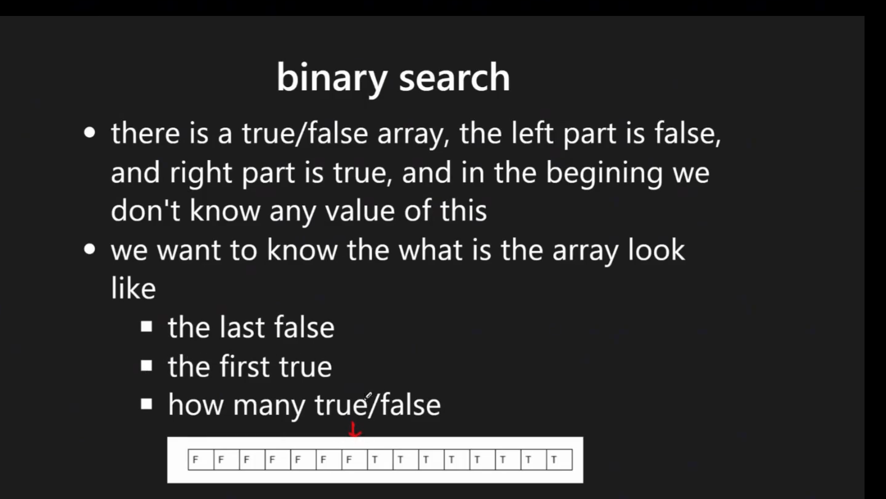

# Binary Search

> **Scope** — Halving a **monotonic** search space — the loop-invariant reasoning behind `l <= r` vs `l < r`, the boundary (lower/upper bound) templates, rotated arrays, and floating-point and 2D search.
> **See also** — *deep dives split out of this file*: [binary_search_on_answer.md](./binary_search_on_answer.md) — searching the *answer space*: the `canFinish` / `isValid` predicate, minimise-maximum vs maximise-minimum, and value-domain counting; [binary_search_examples.md](./binary_search_examples.md) — the worked-problem archive, one canonical solution per problem.
> *Neighbouring sheets*: [patience_sorting.md](./patience_sorting.md) — Template 5's scan told as the card game, with reconstruction, the pile/Dilworth proof and the LIS-reduction problems; [sort.md](./sort.md) — getting the array sorted first; [advanced_divide_and_conquer.md](./advanced_divide_and_conquer.md) — halving *with* a merge step; [bst.md](./bst.md) — the same invariant as a data structure; [heap.md](./heap.md) — k-th element without ordering; [monotonic_stack.md](./monotonic_stack.md) — the *positional* "next greater", which is the pattern lower bound is most often confused with.

## LeetCode Problem Lists

- [Binary Search](https://leetcode.com/problem-list/binary-search/)

## Overview

**Binary Search** is an efficient algorithm to find a target value in a **sorted search space** using two pointers.

### Key Properties
- **Time Complexity**: O(log n)
- **Space Complexity**: O(1) iterative, O(log n) recursive
- **Prerequisites**: Sorted array OR monotonic property
- **Search Space**: Not limited to fully sorted arrays - works with:
  - Fully sorted arrays
  - Partially sorted arrays
  - Rotated sorted arrays
  - Any space with monotonic properties

### Core Algorithm Steps
1. **Define boundaries**: Initialize `left` and `right` pointers to include all possible cases
2. **Define return values**: Determine what to return (index, value, -1, etc.)
3. **Define exit condition**: Choose appropriate loop condition (`<=`, `<`, or `< -1`)
4. **Update pointers**: Move boundaries based on comparison with target

### When to Use Binary Search
- **Sorted arrays**: Classic use case for finding exact values
- **Monotonic functions**: If `condition(k)` implies `condition(k+1)`, binary search applies
- **Search boundaries**: Finding first/last occurrence of a value
- **Optimization problems**: Finding minimum/maximum values satisfying constraints

### References
- **Frameworks**:
  - [labuladong Binary Search Framework](https://labuladong.online/algo/essential-technique/binary-search-framework/)
  - [Binary Search 101 Handbook](https://leetcode.com/problems/binary-search/discuss/423162/Binary-Search-101-The-Ultimate-Binary-Search-Handbook)
- **Problem Collections**:
  - [Binary Search in Action](https://labuladong.online/algo/frequency-interview/binary-search-in-action/)
  - [Binary Search Problem Set](https://labuladong.online/algo/problem-set/binary-search/)
- **Python Tools**:
  - [Python bisect module](https://github.com/yennanliu/CS_basics/blob/master/doc/cheatsheet/python_trick.md) - maintains sorted order during insertions
  - [Python Universal Binary Search Template](https://leetcode.com/discuss/general-discussion/786126/python-powerful-ultimate-binary-search-template-solved-many-problems) - one template, many problems

<p align="center"></p>

## Recognition

Constraint cues follow the ruler in [complexity_cheatsheet.md](./complexity_cheatsheet.md).

| Signal in the statement | Constraint cue | Reach for | Not this if |
|---|---|---|---|
| "sorted array … return the index of `target`, or -1" | "must run in O(log n)" | [Template 1](#template-1-exact-match-on-a-closed-interval--lc-704-) exact match | duplicates and "first / last" → Template 2 |
| "first and last position", "insert position", "smallest value **>=** x", "largest value **<=** x" | n ≤ 10⁵, one O(log n) query per element | [Template 2](#template-2-lower-and-upper-bound--lc-34-) lower / upper bound | "the **first element to the right** that is bigger" is positional → [monotonic_stack.md](./monotonic_stack.md) |
| "how often does `value` occur in `arr[left..right]`", many queries | q ≤ 10⁵ queries | [Template 2](#template-2-lower-and-upper-bound--lc-34-), the [LC 2080 variant](#variant--count-in-a-range-upper-bound--lower-bound-lc-2080-) | the array is updated between queries → BIT / `SortedList` |
| "sorted array rotated at an unknown pivot … find the minimum" | O(log n) required | [Template 3](#template-3-rotated-array-minimum--lc-153-) | duplicates (LC 154) make the worst case O(n) |
| "rotated sorted array … search for `target`" | O(log n) required | [Template 4](#template-4-search-a-rotated-array--lc-33-) | |
| "longest increasing / chained subsequence", an O(n²) DP asked to become faster | n ≤ 10⁵ rules out O(n²) | [Template 5](#template-5-lower-bound-on-a-maintained-tails-array--lc-300-) `tails` + lower bound | the **number** of longest subsequences (LC 673) → O(n²) DP |
| "m x n matrix, rows sorted, first of each row > last of the previous" | O(log(m·n)) | [Template 6](#template-6-2d-matrix-as-one-sorted-array--lc-74) | only rows and columns sorted (LC 240) → staircase search, O(m + n) |
| "peak element", "mountain array", "`nums[i] != nums[i + 1]`" | O(log n) required | [Template 7](#template-7-peak-finding-by-slope--lc-162-) | |
| "array of unknown size", a `reader` with no length, a paginated API | the target's index p, O(log p) | [Template 8](#template-8-exponential-galloping-search--lc-702-) | |
| "minimize the maximum", "smallest speed / capacity / divisor such that …" | answer range up to 10⁹ | [binary_search_on_answer.md](./binary_search_on_answer.md) | |
| "return a real number within 10⁻⁵" | | [§2.2](#22-floating-point-binary-search) floating point | |

## Understanding Binary Search Pointer Behavior

### Core Insight: What Do `l` and `r` Actually Mean?

This is the **fundamental concept** that makes binary search work and explains why returning `l` is correct for insertion position problems like LC 35.

#### During the Loop: The Search Space Invariant

Throughout the binary search loop `while (l <= r)`:

- **Everything left of `l`** is strictly `< target`
- **Everything right of `r`** is strictly `> target`
- The possible location of `target` is always inside `[l, r]`

Each iteration removes half the search space while preserving this invariant.

The loop itself is [Template 1](#template-1-exact-match-on-a-closed-interval--lc-704-) below.

#### When the Loop Ends: Pointer Positions

The loop terminates when `l > r`, which means `l == r + 1`.

At this exact moment, the array is split into two parts:

```text
Visual Representation:

index:     0   ...   r   l   ...   n-1
value:   [< target]  gap  [> target]
```

**Key Properties When Loop Ends:**

1. `r` is the **last element smaller than target**
2. `l` is the **first element greater than or equal to target**
3. There is **no index between r and l** (since `r = l - 1`)

This is why `l` is the correct insertion position!

#### Visual Example

Let's trace through `nums = [1, 3, 5, 6], target = 4`:

```text
Initial:
l=0, r=3
[1, 3, 5, 6]
 l        r

Step 1:
mid = 1, nums[1] = 3
3 < 4, so l = mid + 1 = 2
[1, 3, 5, 6]
       l  r

Step 2:
mid = 2, nums[2] = 5
5 > 4, so r = mid - 1 = 1
[1, 3, 5, 6]
    r  l

Loop ends (l > r):
- r points to 3 (last element < 4)
- l points to 5 (first element > 4)
- Insertion position is l = 2
```

### Summary Table

| State | `l` Position | `r` Position | Meaning |
|-------|-------------|--------------|---------|
| **During loop** | First unchecked index >= target | Last unchecked index <= target | Search space is `[l, r]` |
| **Loop ends** | First element >= target | Last element < target | `l` is insertion point |
| **Visual** | `... r \| l ...` | No gap between them | `l = r + 1` |

### Application: Search Insert Position (LC 35)

> **Key point** — when the loop exits, `nums[0..l-1] < target` and `nums[l..] > target`, so
> `l` is the insert position and needs no special case.

**Reduces to**: [Template 1](#template-1-exact-match-on-a-closed-interval--lc-704-) — return `l` instead of -1.

```java
// java
// LC 35 - Search Insert Position
// IDEA: Template 1 unchanged; on a miss the exit position l is the insert position
// time = O(log n), space = O(1)
public int searchInsert(int[] nums, int target) {
    if (nums == null || nums.length == 0) {
        return 0;
    }

    int l = 0;
    int r = nums.length - 1;

    while (l <= r) {
        int mid = l + (r - l) / 2;

        if (nums[mid] == target) {
            return mid;
        } else if (nums[mid] < target) {
            l = mid + 1;
        } else {
            r = mid - 1;
        }
    }

    // Key insight: l is always the correct insertion position
    return l;
}
```

**Why this works without special cases:**

1. If target exists: we return mid during the loop
2. If target doesn't exist:
   - Loop ends with `l > r`
   - By invariant: `nums[0..l-1] < target` and `nums[l..end] >= target`
   - Therefore `l` is exactly where target should be inserted

### Common Mistake to Avoid

```java
// ❌ WRONG: Trying to handle "between mid and mid+1" during the loop
while (l <= r) {
    int mid = l + (r - l) / 2;
    if (nums[mid] == target) return mid;

    // This is unnecessary and error-prone!
    // ❌ WRONG — can cause index out of bounds
    if (mid + 1 <= nums.length - 1 && target < nums[mid+1] && target > nums[mid]) {
        return mid + 1;
    }
    // ...
}
```

**Why this is wrong:** Binary search naturally converges to the correct position. Trust the pointer invariant and just return `l` after the loop.

---

## 1) Binary Search Types & Patterns

### 1.1) Types at a Glance

**Basic Binary Search — LC 704** ([Template 1](#template-1-exact-match-on-a-closed-interval--lc-704-))
- **Purpose**: Find exact target value in sorted array
- **Return**: Index of target, or -1 if not found
- **Complexity**: O(log n)

**Search in Rotated Array** ([Template 3](#template-3-rotated-array-minimum--lc-153-), [Template 4](#template-4-search-a-rotated-array--lc-33-))
- **Key Concept**: Determine which half is sorted, then decide search direction
- **Applications**: Find target, find minimum element

**Find Boundaries — left / right, i.e. lower / upper bound** ([Template 2](#template-2-lower-and-upper-bound--lc-34-))
- **Purpose**: Find the first / last index satisfying a predicate instead of an exact value
- **Return**: The partition point — never `return mid`

**Search in 2D Matrix** ([Template 6](#template-6-2d-matrix-as-one-sorted-array--lc-74))
- **Approach 1**: Flatten matrix using `row = idx / cols`, `col = idx % cols`
- **Approach 2**: Row-by-row binary search
- **Time**: O(log(m×n))

**Binary Search on Answer Space** (§1.4)
- **Purpose**: Search a *range of candidate answers*, not an array
- **Return**: The boundary of a monotone feasibility predicate

**Binary Search into an Array You Maintain — the `tails` pattern** ([Template 5](#template-5-lower-bound-on-a-maintained-tails-array--lc-300-))
- **Purpose**: Collapse an `O(n²)` "best per achieved length" DP into one lower-bound lookup
- **Return**: The size of the maintained array (a length, not the chain)

**Peak Finding** ([Template 7](#template-7-peak-finding-by-slope--lc-162-))
- **Purpose**: Find any local maximum by following the slope at `mid`

**No Right End — Exponential Search** ([Template 8](#template-8-exponential-galloping-search--lc-702-))
- **Purpose**: Double the index to find a right end, then search inside it

### Template 1: Exact Match on a Closed Interval — LC 704 ⭐⭐⭐⭐⭐

**Recognise** — "given a **sorted** array and a `target`, return its index, or -1", and the
statement insists on O(log n). With n ≤ 10⁴–10⁵ a linear scan passes, so the O(log n) line is
the whole point of the question.

**Key point** — every index left of `left` holds a value `< target` and every index right of
`right` a value `> target`, so `target` can only be inside `[left, right]`. Each pass drops
`mid` and one half; when `left > right` the window is empty and `left` is where `target`
would be inserted.

```python
# python
# LC 704 - Binary Search
# IDEA: closed window [left, right]; drop mid and the half that cannot hold target
# time = O(log n), space = O(1)
def search(nums, target):
    left, right = 0, len(nums) - 1
    while left <= right:                      # <= : a one-element window is still a candidate
        mid = left + (right - left) // 2      # // : an int index, never a float
        if nums[mid] == target:
            return mid
        elif nums[mid] < target:
            left = mid + 1                    # nums[..mid] are all < target
        else:
            right = mid - 1                   # nums[mid..] are all > target
    return -1                                 # window empty; left is the insert position
```

```java
// java
// LC 704 - Binary Search
// IDEA: closed window [left, right]; drop mid and the half that cannot hold target
// time = O(log n), space = O(1)
public int search(int[] nums, int target) {
    int left = 0;
    int right = nums.length - 1;
    while (left <= right) {
        int mid = left + (right - left) / 2;  // no overflow, unlike (left + right) / 2
        if (nums[mid] == target) {
            return mid;
        } else if (nums[mid] < target) {
            left = mid + 1;
        } else {
            right = mid - 1;
        }
    }
    return -1;
}
```

**Complexity**
- **Time O(log n)**: each pass of `while left <= right` at least halves `right - left + 1`, so
  the loop runs at most ⌊log₂ n⌋ + 1 times.
- **Space O(1)**: only `left`, `right` and `mid`. A recursive version costs O(log n) stack.

**Dry run**

```text
nums = [-1, 0, 3, 5, 9, 12], target = 9
left right mid nums[mid]  action
0    5     2   3          3 < 9  -> left = 3
3    5     4   9          found  -> return 4

target = 2 (absent)
0    5     2   3          3 > 2  -> right = 1
0    1     0   -1         -1 < 2 -> left = 1
1    1     1   0          0 < 2  -> left = 2
left = 2 > right = 1 -> return -1   (left = 2 is the insert position, LC 35)
```

**Traps**
- `while left < right` with `right = mid - 1` never tests the last candidate: `nums = [5]`,
  `target = 5` returns -1.
- `left = mid` without the `+ 1` loops forever once the window has two elements:
  `nums = [1, 3]`, `target = 3` keeps `mid = 0`.
- `mid = (left + right) / 2` overflows in Java when `left + right > 2³¹ − 1`, and is a float in
  Python 3 (`nums[2.5]` raises `TypeError`). Write `left + (right - left) // 2`.
- With duplicates it returns *an* index, not the first: `[2, 2, 2]`, `target = 2` returns 1.
  First / last occurrence is Template 2.
- Handling "target sits between `mid` and `mid + 1`" inside the loop is unnecessary and reads
  `nums[mid + 1]` out of bounds; trust the invariant and use `left` after the loop.

**Not this if** — the question is *where* `target` would go or where its run of duplicates
starts (LC 34, LC 35, LC 278): there is no `== target` exit, so use
[Template 2](#template-2-lower-and-upper-bound--lc-34-).

**Drill** — LC 704 ⭐ · LC 35 *(return `left` instead of -1)* · LC 374 *(the comparison is an
API call)* · LC 69 *(search `x` with `mid * mid <= n`, keep the last that passes)*

### Template 2: Lower and Upper Bound — LC 34 ⭐⭐⭐⭐⭐

**Recognise** — "find the **first and last position**", "the **insert** position", "the
**smallest** value **>=** x", "the **largest** value **<=** x", "most recent timestamp before
t". The answer is a *partition point*, not a match, and the input may have duplicates.
n ≤ 10⁵ with one query per element → sort once, then O(log n) per query.

**Key point** — never test equality: `findLeft` sends `==` left (`<`), `findRight` sends it
right (`<=`). On exit `right == left - 1` and the pair straddles the partition, so `findLeft`
returns the first index `>= target` and `findRight` the last index `<= target`; the target
exists exactly when `first <= last`.

```python
# python
# LC 34 - Find First and Last Position of Element in Sorted Array
# IDEA: two partition searches; the one-character difference (< vs <=) decides
#       which way equality falls, and first <= last is the existence check
# time = O(log n), space = O(1)
class Solution(object):
    def searchRange(self, nums, target):
        first = self.findLeft(nums, target)
        last = self.findRight(nums, target)
        if first <= last:                     # absent -> both land in the same gap, first = last + 1
            return [first, last]
        return [-1, -1]

    def findLeft(self, nums, target):
        """first index with nums[i] >= target  (== bisect_left)"""
        left, right = 0, len(nums) - 1
        while left <= right:
            mid = left + (right - left) // 2
            if nums[mid] < target:            # strict < : equality goes to else, pushes right leftwards
                left = mid + 1
            else:
                right = mid - 1
        return left

    def findRight(self, nums, target):
        """last index with nums[i] <= target  (== bisect_right - 1)"""
        left, right = 0, len(nums) - 1
        while left <= right:
            mid = left + (right - left) // 2
            if nums[mid] <= target:           # <= : equality goes to if, pushes left rightwards
                left = mid + 1
            else:
                right = mid - 1
        return right
```

```java
// java
// LC 34 - Find First and Last Position of Element in Sorted Array
// IDEA: two partition searches, differing only in < vs <=
// time = O(log n), space = O(1)
public int[] searchRange(int[] nums, int target) {
    int first = findLeft(nums, target);
    int last = findRight(nums, target);
    return first <= last ? new int[]{first, last} : new int[]{-1, -1};
}

private int findLeft(int[] nums, int target) {
    int left = 0, right = nums.length - 1;
    while (left <= right) {
        int mid = left + (right - left) / 2;
        if (nums[mid] < target) left = mid + 1;   // strict <
        else right = mid - 1;
    }
    return left;
}

private int findRight(int[] nums, int target) {
    int left = 0, right = nums.length - 1;
    while (left <= right) {
        int mid = left + (right - left) / 2;
        if (nums[mid] <= target) left = mid + 1;  // <= (the only difference)
        else right = mid - 1;
    }
    return right;
}
```

**Complexity**
- **Time O(log n)**: two `while left <= right` loops, each halving the window; neither stops
  early on a match, so each runs the full ⌈log₂ n⌉ passes.
- **Space O(1)**: two pointers per search. Sorting first (when the input is not sorted) adds
  O(n log n) time once, not per query.

**Dry run**

```text
nums = [5, 7, 7, 8, 8, 10], target = 8
findLeft (strict <, return left):
  l=0 r=5  mid=2  7 <  8  -> l=3
  l=3 r=5  mid=4  8 !< 8  -> r=3
  l=3 r=3  mid=3  8 !< 8  -> r=2
  exit, return l=3          first index of 8
findRight (<=, return right):
  l=0 r=5  mid=2  7 <= 8  -> l=3
  l=3 r=5  mid=4  8 <= 8  -> l=5
  l=5 r=5  mid=5  10 > 8  -> r=4
  exit, return r=4          last index of 8
3 <= 4 -> [3, 4]

target = 6 (absent): findLeft -> 1, findRight -> 0, 1 > 0 -> [-1, -1]
```

**Traps**
- `return mid` on `nums[mid] == target` lands anywhere inside a run of duplicates:
  `[8, 8, 8]` returns index 1 for both ends.
- Returning `right` from `findLeft` (or `left` from `findRight`) is off by one: the **left
  search returns `left`, the right search returns `right`**.
- Mixing boundary styles: `hi = len(nums)` needs `while lo < hi` and `hi = mid`;
  `right = len(nums) - 1` needs `while left <= right` and `right = mid - 1`. One from each
  loops forever or skips the last index.
- Pre-checking `if target not in nums` is O(n) and throws away the O(log n) the problem asks
  for. `[]` needs no special case: `left = 0 > right = -1` gives `[-1, -1]`.
- When the answer is an **original index** of an unsorted input (LC 436), sort `(value, index)`
  pairs, not the values alone, or the index is lost.

**Not this if** — "the first element **to the right** that is bigger" depends on array order,
so it is a positional scan → [monotonic_stack.md](./monotonic_stack.md). The test: if
shuffling the input would not change the answer, it is a bound query; if it would, it is a
stack (see *Core Idea: Lower Bound vs Monotonic Stack* below).

**Drill** — LC 34 ⭐ · LC 35 *(`findLeft` alone, unvalidated)* · LC 278 *(`findLeft` on a
boolean API)* · LC 744 *(upper bound, then wrap with `% n`)* · LC 981 *(floor query per key)*
· LC 2080 *(count = upper − lower, below)*

#### Recognition — "the smallest value >= target" is a Lower Bound ⭐⭐⭐⭐⭐

Before choosing a template, read the problem's own wording. A query phrased as
*「最小的 value >= target」* — **the smallest value that is at least X** — is a
lower bound, no matter how the problem dresses it up (intervals, timestamps, spell
strengths, LIS tails).

##### Pattern: Sort Once, Then One Bound Query per Element

| Wording in the problem | What you are asking for | Template |
|---|---|---|
| "smallest value **>=** X", "first one that is at least X" | **lower bound** | `findLeft` → `l` (`bisect_left`) |
| "smallest value **>** X", "strictly greater" | **upper bound** | `findRight` → `r + 1` (`bisect_right`) |
| "largest value **<=** X", "floor", "most recent before X" | **upper bound − 1** | `findRight` → `r` (`bisect_right - 1`) |
| "largest value **<** X" | **lower bound − 1** | `findLeft` → `l - 1` (`bisect_left - 1`) |

The shape is always the same three lines — and when the answer must be the element's
**original position**, pair the value with its index *before* sorting so the sort keeps
them glued together:

```python
# python - the generic "sort once, lower-bound each query" shape
# IDEA: sort (value, original index) pairs once, then one bisect_left per query
# time = O(n log n) build + O(log n) per query, space = O(n)
import bisect

def first_at_least(raw, queries):
    pairs = sorted((v, i) for i, v in enumerate(raw))   # keep each value WITH its original index
    keys = [v for v, _ in pairs]                        # bisect needs a plain sorted list
    answers = []
    for x in queries:
        j = bisect.bisect_left(keys, x)                 # first value >= x
        answers.append(pairs[j][1] if j < len(keys) else -1)   # sorted position -> original index
    return answers
```

```java
// java - the same query, hand-rolled (identical to findLeft in the template above)
// IDEA: strict < pushes equality left, so l ends on the first key >= x
// time = O(log N), space = O(1)
private int lowerBound(int[] keys, int x) {
    int l = 0, r = keys.length - 1;
    while (l <= r) {
        int mid = l + (r - l) / 2;
        if (keys[mid] < x) l = mid + 1;   // strict < → equality falls right, pushing l left
        else r = mid - 1;
    }
    return l;                              // l == keys.length → no value >= x
}
```

##### Core Idea: Lower Bound vs Monotonic Stack

These two get confused constantly, because both sound like "find the next bigger thing".
They answer **different questions**:

```text
Monotonic stack : for each i, the FIRST element to its LEFT / RIGHT that is > (or <) nums[i]
                  -> a POSITIONAL neighbour; array order is the whole point

Lower bound     : for each query x, the SMALLEST value >= x in the WHOLE set
                  -> a VALUE ranking; position is irrelevant, so sort first
```

**Test to apply**: if reordering the input would change the answer, it is a monotonic
stack (a nearest-neighbour scan). If it would not — you would still want the same
minimal value — it is a lower bound, so sort once and binary search.

LC 436 (Find Right Interval) is the clean example of the second: it wants the interval
whose `start` is the **minimum start `>= end_i`** across *all* intervals, not the nearest
interval sitting to the right in the input array — so it is binary search, not a
monotonic stack.

```text
current.end
     ↓
all intervals' starts (sorted)
     ↓
first start >= end          → lower bound
```

> Worked solution for LC 436 — including the sort-with-index recipe — lives in
> [binary_search_examples.md](./binary_search_examples.md) §16.

##### Similar Problems: Bound Queries on a Sorted Set

| LC # | Problem | The query, in bound form |
|------|---------|--------------------------|
| **436** | Find Right Interval | smallest `start >= end_i` → lower bound, answer is the original index |
| **35** | Search Insert Position | smallest index with `nums[i] >= target` → lower bound, unvalidated |
| **34** | Find First and Last Position of Element in Sorted Array | lower bound and upper bound − 1 together |
| **744** | Find Smallest Letter Greater Than Target | strictly `>` → upper bound, then wrap with `% n` |
| **981** | Time Based Key-Value Store | largest `timestamp <= query` → upper bound − 1, per key |
| **1146** | Snapshot Array | same floor query, on a per-index version list |
| **300** | Longest Increasing Subsequence (O(N log N)) | smallest tail `>= x`, then overwrite it — [Template 5](#template-5-lower-bound-on-a-maintained-tails-array--lc-300-) |
| **2300** | Successful Pairs of Spells and Potions | smallest potion `>= ceil(success / spell)`, then count the suffix |
| **1170** | Compare Strings by Frequency of the Smallest Character | count of words with freq `>` query → `n - upperBound` |

> **If the set mutates between queries** (insertions arriving over time), a sorted array
> plus binary search is no longer enough — reach for `SortedList` / a BST / a BIT instead.

#### Pattern: Two Independent Boundary Searches

A sorted array with duplicates looks like **three blocks**:

```text
nums = [5, 7, 7, 8, 8, 10],  target = 8

  [ < target ] [ == target ] [ > target ]
   5  7  7       8  8          10
   0  1  2       3  4          5
                 ^  ^
              first  last
```

Because the equal block is **contiguous**, one exact-match binary search is useless (it lands anywhere inside the block). Instead run **two separate searches**, each looking for a *block edge*:

- `findLeft`  → first index where `nums[i] >= target` (start of the equal block)
- `findRight` → last index where `nums[i] <= target` (end of the equal block)

##### Core Idea ⭐⭐⭐⭐⭐

**Key Idea**: Don't search for the value — search for the **partition point** between "too small" and "big enough". Never `return mid` early; keep shrinking to squeeze the pointer onto the edge.

The two helpers are **the same code differing by one character** (`<` vs `<=`) and they **never test equality at all**:

| Helper | Condition to move `l` | Where equality goes | Return |
|--------|----------------------|---------------------|--------|
| `findLeft`  | `nums[mid] < target`  | into the `else` → `r = mid - 1` (push left) | `l` |
| `findRight` | `nums[mid] <= target` | into the `if`   → `l = mid + 1` (push right) | `r` |

**Why this works** — on exit, `l` and `r` have crossed with `r == l - 1`, and they straddle the partition:

```text
after findLeft :  everything left of l is  < target   → l = first index >= target
after findRight:  everything right of r is > target   → r = last  index <= target
```

**Why `[l, r]` is also the validity check** (no need to re-read `nums`):

```text
target present  → l = first equal idx, r = last equal idx  → l <= r  ✅
target absent   → both searches collapse to the same gap:
                  l = insertion point p,  r = p - 1        → l >  r  ❌ return [-1,-1]
```

**Equivalence to Python `bisect`** — memorize this mapping, it makes the two helpers unforgettable:

```python
findLeft(nums, target)  ==  bisect.bisect_left(nums, target)       # count of elements < target
findRight(nums, target) ==  bisect.bisect_right(nums, target) - 1  # count of elements <= target, minus 1
```

##### Alternative 1: One Helper, Called Twice (`target` and `target + 1`) ⭐⭐⭐⭐⭐

Cleanest trick — write only `bisect_left`, then note that the last occurrence of `target`
is one slot before the first occurrence of `target + 1`:

```python
# python - LC 34, half-open boundary [lo, hi)
# IDEA: one bisect_left helper; last of target = first of target + 1, minus 1
# time = O(log N), space = O(1)
class Solution:
    def searchRange(self, nums, target):
        def search(x):
            """first index i where nums[i] >= x  (== bisect_left)"""
            lo, hi = 0, len(nums)          # NOTE: hi = len(nums), NOT len-1
            while lo < hi:
                mid = (lo + hi) // 2
                if nums[mid] < x:
                    lo = mid + 1
                else:
                    hi = mid               # NOTE: no -1 (half-open)
            return lo

        lo = search(target)
        hi = search(target + 1) - 1        # last idx of target = first idx of target+1, minus 1
        return [lo, hi] if lo <= hi else [-1, -1]
```

##### Alternative 2: Track `bound` on Equality (most explicit)

Keeps the `nums[mid] == target` branch, and records the best candidate seen so far:

```python
# python - LC 34, explicit "record then keep searching"
# IDEA: on a match record mid as the bound, then keep searching toward that side
# time = O(log N), space = O(1)
class Solution:
    def searchRange(self, nums, target):
        def find_bound(is_first):
            l, r = 0, len(nums) - 1
            bound = -1
            while l <= r:
                mid = l + (r - l) // 2
                if nums[mid] == target:
                    bound = mid                      # record candidate
                    if is_first:
                        r = mid - 1                  # DON'T return — keep going left
                    else:
                        l = mid + 1                  # keep going right
                elif nums[mid] < target:
                    l = mid + 1
                else:
                    r = mid - 1
            return bound

        left = find_bound(True)
        if left == -1:                               # early exit: target absent
            return [-1, -1]
        return [left, find_bound(False)]
```

##### Alternative 3: `bisect` One-Liner (interview fallback / sanity check)

```python
# python - LC 34 via bisect
# IDEA: bisect_left / bisect_right are findLeft and findRight + 1
# time = O(log N), space = O(1)
import bisect
class Solution:
    def searchRange(self, nums, target):
        left = bisect.bisect_left(nums, target)
        if left >= len(nums) or nums[left] != target:
            return [-1, -1]
        return [left, bisect.bisect_right(nums, target) - 1]
```

##### Template Comparison

| Template | Boundary | Loop | Update on "too small" | Return | Best when |
|----------|----------|------|----------------------|--------|-----------|
| Two helpers `<` / `<=` | Closed `[l, r]` | `l <= r` | `l = mid + 1` / `r = mid - 1` | `l` / `r` | Recommended — symmetric, no equality branch, `l <= r` validates |
| One helper, `target` & `target+1` | Half-open `[lo, hi)` | `lo < hi` | `lo = mid + 1` / `hi = mid` | `lo` | Least code to memorize; only works for integer targets |
| Track `bound` on `==` | Closed `[l, r]` | `l <= r` | keeps 3-way `if/elif/else` | `bound` | Most readable when explaining out loud |
| `bisect_left` / `bisect_right` | — | — | — | — | Python interviews where library use is allowed |

##### Similar Problems

| LC # | Problem | Key Difference |
|------|---------|---------------|
| **34** | Find First and Last Position of Element in Sorted Array | Baseline — both boundaries |
| **35** | Search Insert Position | `findLeft` alone, return `l` unvalidated |
| **704** | Binary Search | Exact match only, no duplicates to handle |
| **278** | First Bad Version | `findLeft` on a boolean predicate instead of `<` |
| **852 / 162** | Peak Index / Find Peak Element | Boundary on `nums[mid] < nums[mid+1]` |
| **744** | Find Smallest Letter Greater Than Target | `bisect_right` + wraparound modulo |
| **1146** | Snapshot Array | `bisect` on version list per index |
| **658** | Find K Closest Elements | `findLeft` to locate window start, then expand |
| **300** | Longest Increasing Subsequence (O(N log N)) | `bisect_left` to replace tails — [Template 5](#template-5-lower-bound-on-a-maintained-tails-array--lc-300-) |
| **981** | Time Based Key-Value Store | `findRight` (largest timestamp `<=` query) |
| **436** | Find Right Interval | `findLeft` on sorted starts |
| **1898** | Maximum Number of Removable Characters | Boundary search on answer + feasibility check |
| **2080** | Range Frequency Queries | Per-value index list; count = upper bound − lower bound — next section |

#### Variant — Count in a Range: Upper Bound − Lower Bound (LC 2080) ⭐⭐⭐⭐

> **Key point** — the indices of one value, collected left to right, are already sorted, so
> "how many in `[left, right]`" is `bisect_right(right) − bisect_left(left)` on that list.

**Reduces to**: [Template 2](#template-2-lower-and-upper-bound--lc-34-) — both bounds, on a per-value index list instead of the input.

LC 34 finds **where** a block of equal values starts and ends. Subtract the two ends and you
get **how many** elements fall in the block. That subtraction counts the elements of a sorted
list inside any closed range `[lo, hi]`:

```text
count of x in [lo, hi]  =  (# elements <= hi)  -  (# elements < lo)          # O(log N)
                        =  bisect_right(xs, hi) - bisect_left(xs, lo)
                        =  lower_bound(xs, hi + 1) - lower_bound(xs, lo)   # integers only
```

**The precondition that differs from LC 34.** The input array is **not sorted**, and sorting it
would destroy the positions the query asks about. So the binary search does not run on the
input. It runs on a sorted list that you **build**: for each value, the list of indices where
it appears. That list is sorted for free, because a left-to-right scan appends indices in
increasing order.

```text
"how often does value v appear in arr[left..right]?"
    -> the indices of v form a sorted list
    -> the question becomes "how many of those indices fall in [left, right]?"
    -> two bound queries on that list
```

##### Core Idea

```text
arr      = [12, 33, 4, 56, 22, 2, 34, 33, 22, 12, 34, 56]
index      0   1   2  3   4   5  6   7   8   9   10  11

positions[33] = [1, 7]          positions[22] = [4, 8]

query(0, 11, 33):  bisect_right([1,7], 11) = 2   (both indices <= 11)
                   bisect_left ([1,7],  0) = 0   (no index  <  0)
                   -> 2 - 0 = 2 ✓

query(5, 7, 22):   bisect_right([4,8], 7)  = 1   (4 <= 7, 8 > 7)
                   bisect_left ([4,8], 5)  = 1   (4 <  5)
                   -> 1 - 1 = 0 ✓   (index 4 is before the range, index 8 is after it)
```

The two bounds are LC 34's `findLeft` and `findRight + 1`, so nothing new has to be
memorised. It is this card's **Alternative 1** (`search(target)` and `search(target + 1)`)
applied to a range instead of one value.

```python
# python
# LC 2080 - Range Frequency Queries
# IDEA: value -> sorted list of its indices (built in one scan),
#       then count the indices inside [left, right] with two bound queries
# time = O(n) build, O(log n) per query, space = O(n)
import bisect
from collections import defaultdict

class RangeFreqQuery(object):

    def __init__(self, arr):
        # value -> every index it appears at; appended left to right, so already sorted
        self.positions = defaultdict(list)
        for idx, val in enumerate(arr):
            self.positions[val].append(idx)

    def query(self, left, right, value):
        # `in` check first, so the defaultdict does not grow an empty list per miss
        if value not in self.positions:
            return 0
        idx_list = self.positions[value]

        start = bisect.bisect_left(idx_list, left)    # first index >= left
        end = bisect.bisect_right(idx_list, right)    # first index >  right
        # idx_list[start:end] are exactly the indices in [left, right]
        return end - start
```

```java
// java
// LC 2080 - Range Frequency Queries
// IDEA: same lists; one hand-rolled lowerBound, called with left and right + 1
// time = O(n) build, O(log n) per query, space = O(n)
class RangeFreqQuery {
    private final Map<Integer, List<Integer>> positions = new HashMap<>();

    public RangeFreqQuery(int[] arr) {
        for (int i = 0; i < arr.length; i++) {
            positions.computeIfAbsent(arr[i], k -> new ArrayList<>()).add(i);
        }
    }

    public int query(int left, int right, int value) {
        List<Integer> idx = positions.get(value);
        if (idx == null) {
            return 0;
        }
        // right + 1 turns "<= right" into "< right + 1", so one helper serves both ends
        return lowerBound(idx, right + 1) - lowerBound(idx, left);
    }

    /** first position whose index is >= target (half-open [l, r), == bisect_left) */
    private int lowerBound(List<Integer> idx, int target) {
        int l = 0, r = idx.size();
        while (l < r) {
            int mid = l + (r - l) / 2;
            if (idx.get(mid) < target) l = mid + 1;
            else r = mid;
        }
        return l;
    }
}
```

**Why not the alternatives:**

| Approach | Build | Per query | Verdict |
|---|---|---|---|
| Scan `arr[left..right]` and count | — | `O(n)` | `10^5` queries × `10^5` elements = `10^10` → TLE |
| Prefix count per value: `pre[v][i]` = count of `v` in `arr[0..i)` | `O(n · distinct)` | `O(1)` | `10^4` values × `10^5` cells → memory and build time blow up |
| **Index list per value + two bounds** | `O(n)` | `O(log n)` | Every index is stored once, so the lists hold `n` entries in total |

**Each query is `O(log N)`**: two binary searches on one value's index list, which is at most
`N` long and usually much shorter. The `O(N)` scan in the constructor runs once and is not a
sort, because it produces the lists already sorted.

##### Common Pitfalls

- ❌ `bisect_left` on both ends → drops the occurrence sitting exactly at `right`. The right end
  is `bisect_right` (or `lower_bound(right + 1)`), because the range is **inclusive**.
- ❌ `self.positions[value]` on a `defaultdict` for an absent value → returns `0` correctly but
  inserts an empty list per miss. Check `in` first.
- ❌ Sorting `arr` to "make it binary-searchable" → the query is about **positions**, and sorting
  throws them away. Sort the *indices of each value*, which the scan already did.
- ❌ Reaching for a segment tree → it works, but each node has to merge a frequency map, which is
  heavier and slower than this, for a problem that has no updates.

##### Similar Problems: Count or Jump Inside a Per-Key Index List

| LC # | Problem | What changes |
|------|---------|--------------|
| **2080** | Range Frequency Queries | Baseline: count = `bisect_right(right) - bisect_left(left)` |
| **792** | Number of Matching Subsequences | Per-**char** index list; `upper_bound` jumps to the next occurrence after the current position |
| **1157** | Online Majority Element In Subarray | Same count query, used to **verify** a candidate picked by random sampling (or a segment tree) |
| **981** | Time Based Key-Value Store | Per-**key** timestamp list; a single floor query (upper bound − 1) instead of a count |
| **1146** | Snapshot Array | Per-**index** version list; the same floor query |
| **2055** | Plates Between Candles | Sorted candle positions; two bounds find the innermost candles, then a prefix sum counts the plates |

> **If `arr` mutates between queries** (`update(i, v)`), the lists stop being cheap to maintain,
> because moving an index between two value lists is `O(n)` with plain arrays. Use `SortedList`
> per value, or a BIT / segment tree keyed by position.

### Template 3: Rotated Array Minimum — LC 153 ⭐⭐⭐⭐⭐

**Recognise** — "a sorted array of **unique** values was **rotated** at an unknown pivot …
find the minimum" (or the rotation count, or the pivot index), in O(log n). The array is two
ascending runs, the left run entirely above the right one.

**Key point** — compare `nums[mid]` with `nums[right]`, never with `target`: if
`nums[mid] < nums[right]` then `mid..right` is one ascending run, so the minimum is at `mid` or
to its left (`right = mid`); otherwise the drop is strictly right of `mid` (`left = mid + 1`).
The minimum is always inside `[left, right]`, and the loop stops when one index is left.

```python
# python
# LC 153 - Find Minimum in Rotated Sorted Array
# IDEA: closed squeeze [left, right] down to one candidate; nums[right] tells which run mid is in
# time = O(log n), space = O(1)
def findMin(nums):
    left, right = 0, len(nums) - 1
    while left < right:                       # stop at one candidate, not zero
        mid = left + (right - left) // 2
        if nums[mid] < nums[right]:
            right = mid                       # mid..right ascending: min is mid or left of it
        else:
            left = mid + 1                    # mid is in the high run: min is right of mid
    return nums[left]
```

```java
// java
// LC 153 - Find Minimum in Rotated Sorted Array
// IDEA: closed squeeze [left, right] down to one candidate; nums[right] tells which run mid is in
// time = O(log n), space = O(1)
public int findMin(int[] nums) {
    int left = 0, right = nums.length - 1;
    while (left < right) {
        int mid = left + (right - left) / 2;
        if (nums[mid] < nums[right]) {
            right = mid;       // keep mid: it may be the minimum
        } else {
            left = mid + 1;
        }
    }
    return nums[left];
}
```

**Complexity**
- **Time O(log n)**: `while left < right` halves the window each pass; `right = mid` still
  shrinks it because `mid < right` whenever `left < right`.
- **Space O(1)**: two pointers.

**Dry run**

```text
nums = [3, 4, 5, 1, 2]
left right mid nums[mid] nums[right]  action
0    4     2   5         2            5 >= 2 -> left = 3
3    4     3   1         2            1 < 2  -> right = 3
left == right = 3 -> return 1
```

**Traps**
- Comparing with `nums[left]` instead of `nums[right]` breaks on an unrotated array:
  `[1, 2, 3]` sends `left` past the minimum, because "left run sorted" no longer means
  "minimum is to the right".
- `right = mid - 1` throws the minimum away when it sits at `mid`: `[3, 1, 2]` returns 3.
- `while left <= right` with `right = mid` never terminates once `left == right`.
- With duplicates (LC 154) `nums[mid] == nums[right]` says nothing; shrink with `right -= 1`,
  and the worst case is O(n) (`[1, 1, 1, 0, 1]`).

**Not this if** — you are searching for a given `target`, not the minimum → Template 4.

**Drill** — LC 153 ⭐ · LC 154 *(duplicates: `right -= 1` on a tie)* · LC 33 → Template 4 ·
LC 81 *(search with duplicates)*

#### Rotated Array Minimum — Closed-Boundary Alternative

The same search written as `while l <= r` with a running `ans`. Keep it only if you prefer
the closed window everywhere; it needs the early exit for an already-sorted window.

```java
// java
// LC 153 - Find Minimum in Rotated Sorted Array (closed boundary, track ans)
// IDEA: a sorted window's minimum is its left end; otherwise record mid and move to the unsorted half
// time = O(log n), space = O(1)
public int findMin(int[] nums) {
    int l = 0, r = nums.length - 1;
    int ans = nums[0];
    while (l <= r) {
        if (nums[l] <= nums[r]) {             // window already sorted -> minimum is at l
            ans = Math.min(ans, nums[l]);
            break;
        }
        int mid = l + (r - l) / 2;
        ans = Math.min(ans, nums[mid]);
        if (nums[mid] >= nums[l]) {
            l = mid + 1;                      // left plateau -> the drop is to the right
        } else {
            r = mid - 1;                      // right plateau -> mid recorded, look left
        }
    }
    return ans;
}
```

```text
Rotation examples (length 5) and where the template moves:
[1, 2, 3, 4, 5]  -> mid < right -> right = mid ... min at index 0
[5, 1, 2, 3, 4]  -> mid < right -> right = mid
[3, 4, 5, 1, 2]  -> mid > right -> left = mid + 1
[2, 3, 4, 5, 1]  -> mid > right -> left = mid + 1
```

| Template | Loop condition | Update | Return | Best when |
|----------|---------------|--------|--------|-----------|
| Closed, stop at one candidate | `left < right` | `right = mid` / `left = mid + 1` | `nums[left]` | Canonical: converges on the index |
| Closed `l <= r` + `ans` | `l <= r` | `l = mid + 1` / `r = mid - 1` | `ans` | You want the closed window everywhere |

| LC # | Problem | Key Difference |
|------|---------|---------------|
| **153** | Find Minimum in Rotated Sorted Array | Unique elements, find min |
| **154** | Find Minimum in Rotated Sorted Array II | With duplicates — `right -= 1` when `nums[mid] == nums[right]` |
| **33** | Search in Rotated Sorted Array | Find target (not min) — Template 4 |
| **81** | Search in Rotated Sorted Array II | Find target with duplicates |
| **189** | Rotate Array | Related concept, different task |

### Template 4: Search a Rotated Array — LC 33 ⭐⭐⭐⭐⭐

**Recognise** — "a sorted array of distinct values, possibly **rotated** … return the index of
`target`, or -1", in O(log n). Same input as Template 3, but now with a value to find.

**Key point** — at least one of `nums[left..mid]` and `nums[mid..right]` is sorted, and a
sorted run's two ends tell you whether `target` is inside it. So each pass: find the sorted
half, keep it if `target` is within its end values, otherwise keep the other half.

```python
# python
# LC 33 - Search in Rotated Sorted Array
# IDEA: one half of [left, mid, right] is always sorted; keep it iff target lies between its ends
# time = O(log n), space = O(1)
def search(nums, target):
    left, right = 0, len(nums) - 1
    while left <= right:
        mid = left + (right - left) // 2
        if nums[mid] == target:
            return mid
        if nums[left] <= nums[mid]:                    # left half nums[left..mid] is sorted
            if nums[left] <= target < nums[mid]:
                right = mid - 1                        # target inside the sorted left half
            else:
                left = mid + 1
        else:                                          # right half nums[mid..right] is sorted
            if nums[mid] < target <= nums[right]:
                left = mid + 1                         # target inside the sorted right half
            else:
                right = mid - 1
    return -1
```

```java
// java
// LC 33 - Search in Rotated Sorted Array
// IDEA: one half is always sorted; keep it iff target lies between its ends
// time = O(log n), space = O(1)
public int search(int[] nums, int target) {
    int left = 0, right = nums.length - 1;
    while (left <= right) {
        int mid = left + (right - left) / 2;
        if (nums[mid] == target) return mid;
        if (nums[left] <= nums[mid]) {                 // left half is sorted
            if (nums[left] <= target && target < nums[mid]) right = mid - 1;
            else left = mid + 1;
        } else {                                       // right half is sorted
            if (nums[mid] < target && target <= nums[right]) left = mid + 1;
            else right = mid - 1;
        }
    }
    return -1;
}
```

**Complexity**
- **Time O(log n)**: every pass of `while left <= right` discards one half, sorted or not.
- **Space O(1)**: three indices.

**Dry run**

```text
nums = [4, 5, 6, 7, 0, 1, 2], target = 0
left right mid nums[mid]  sorted half       target inside?  action
0    6     3   7          left [4..7]       no              left = 4
4    6     5   1          left [0..1]       0 <= 0 < 1 yes  right = 4
4    4     4   0          found -> return 4
```

**Traps**
- `nums[left] < nums[mid]` (strict) misreads a one-element left half as unsorted when
  `left == mid`: `[3, 1]`, `target = 1` takes the right-half branch, rules out `1`, and returns
  -1. Use `<=`.
- The range tests are half-open on the `mid` side (`target < nums[mid]`, `nums[mid] < target`)
  because `mid` was already compared; including it is harmless, but dropping the `<=` on the
  outer end (`nums[left] <= target`) misses a target sitting at `left`.
- With duplicates (LC 81) `nums[left] == nums[mid] == nums[right]` says neither half is known
  sorted: `[1, 0, 1, 1, 1]`. Shrink `left += 1; right -= 1` and accept O(n) worst case.

**Not this if** — you only need the minimum or the rotation point → Template 3; you can afford
two passes → find the pivot with Template 3, then run Template 1 on the correct run.

**Drill** — LC 33 ⭐ · LC 81 *(duplicates: shrink both ends on a three-way tie)* · LC 153 →
Template 3 · LC 1095 *(mountain: peak, then two ordered searches — Template 7)*

### 1.4) Binary Search on the Answer Space ⭐⭐⭐⭐⭐

Instead of searching for a value **in** an array, binary search a **range of candidate
answers** and use a feasibility predicate to decide which half to keep. It is the single
most under-practised tier-5 binary-search skill, so it has a sheet of its own:

> **Full treatment** — the `canFinish` / `isValid` framing, the minimise-vs-maximise
> decision matrix, the `left = max(nums)` / `right = sum(nums)` boundary recipe, the
> monotonic-predicate proof, value-domain counting, and every worked problem
> (LC 875, 410, 1011, 1283, 1482, 1231, 2616, 1631, 378, 287, 1539):
> **[binary_search_on_answer.md](./binary_search_on_answer.md)**.

**Recognition keywords**: "minimize the maximum", "maximize the minimum", "find the
smallest capacity / speed / divisor", "can we split / allocate / distribute".

### Template 5: Lower Bound on a Maintained `tails` Array — LC 300 ⭐⭐⭐⭐⭐

**Recognise** — "the **length** of the longest increasing (or chained) subsequence", where
the obvious solution is the O(n²) DP `dp[i] = max(dp[j]) + 1` and the follow-up asks for
O(n log n). n ≤ 2,500 lets O(n²) pass; n ≤ 10⁵ (LC 1964, LC 354) does not.

**Key point** — `tails[k]` is the smallest tail of any increasing run of length `k + 1`, so
`tails` is strictly increasing and can be lower-bounded. The first slot `>= num` is the only
length `num` can improve: overwrite it, or append when there is none. `len(tails)` is the answer.

Every other template on this sheet searches the **input**. This one searches a small array
that the scan **builds as it goes**, kept sorted on purpose so that Template 2's `findLeft`
can run on it. The algorithm's own sheet — the card game it comes from, the pile/Dilworth
argument, recovering the subsequence itself, and the problems that reduce to LIS — is
[patience_sorting.md](./patience_sorting.md).

```python
# python
# LC 300 - Longest Increasing Subsequence, O(n log n)
# IDEA: tails[k] = the SMALLEST tail value among increasing subsequences of length k+1
#       -> tails is sorted -> lower-bound it (findLeft, Template 2) -> append or overwrite
# time = O(n log n), space = O(n)
class Solution(object):
    def lengthOfLIS(self, nums):
        tails = []
        for num in nums:
            # findLeft from Template 2, run on `tails` instead of on `nums`
            left, right = 0, len(tails) - 1
            while left <= right:
                mid = left + (right - left) // 2
                if tails[mid] < num:
                    left = mid + 1           # strict < : an equal tail is replaced, not extended
                else:
                    right = mid - 1
            # left == first index with tails[left] >= num
            if left == len(tails):
                tails.append(num)            # num beats every tail -> a new longest length
            else:
                tails[left] = num            # same length, cheaper tail -> overwrite
        return len(tails)                    # the LENGTH is the answer, not the contents
```

```java
// java
// LC 300 - Longest Increasing Subsequence, O(n log n)
// IDEA: tails[0..size) is strictly increasing; lower-bound each num into it, overwrite or append
// time = O(n log n), space = O(n)
public int lengthOfLIS(int[] nums) {
    int[] tails = new int[nums.length];
    int size = 0;
    for (int num : nums) {
        int left = 0, right = size - 1;
        while (left <= right) {
            int mid = left + (right - left) / 2;
            if (tails[mid] < num) left = mid + 1;
            else right = mid - 1;
        }
        tails[left] = num;                // left == size appends, otherwise overwrites
        if (left == size) size++;
    }
    return size;
}
```

**Complexity**
- **Time O(n log n)**: the outer `for num in nums` runs n times, and the inner
  `while left <= right` is a binary search over `tails`, at most n long.
- **Space O(n)**: `tails` grows by one only on an append, up to the LIS length ≤ n.

**Dry run**

```text
nums = [10, 9, 2, 5, 3, 7, 101, 18]
num   lower bound   action        tails
10    0 (empty)     append        [10]
9     0             overwrite     [9]
2     0             overwrite     [2]
5     1             append        [2, 5]
3     1             overwrite     [2, 3]
7     2             append        [2, 3, 7]
101   3             append        [2, 3, 7, 101]
18    3             overwrite     [2, 3, 7, 18]     -> 4
```

**Traps**
- `tails` is not a subsequence: `[3, 4, 5, 1]` ends with `tails = [1, 4, 5]`, where `1`
  arrived last. Only its length means anything; reconstructing the chain needs `prev` pointers.
- Non-decreasing (duplicates allowed, LC 1964) needs the first tail **`> num`**
  (`bisect_right`): with `bisect_left`, `[2, 2, 2]` gives 1 instead of 3.
- Sorting envelopes by width only before LC 354's LIS lets two equal widths nest: sort
  `(w ascending, h descending)` so a width can contribute at most one height.

**Not this if** — the question wants the **number** of longest subsequences (LC 673), or
"chainable" is not a total order (LC 368 divisibility), or the state carries a second key
(LC 1027's difference): one tail per length cannot hold that, so it is an O(n²) DP.

**Drill** — LC 300 ⭐ · LC 1964 *(non-decreasing, report the position per index)* · LC 354
*(sort with a tie rule, then LIS)* · LC 2111 *(k residue classes, `len − LIS`)*

> The `bisect_left` one-liner and the LC 354 variation are in
> [binary_search_examples.md](./binary_search_examples.md) §18.

#### Why It Works — Three Claims

**1) `tails` is always sorted, so binary search is legal.**
Assume it is strictly increasing, and check the two cases the scan can take. The lower
bound gives `tails[l-1] < num` whenever slot `l-1` exists, and `num <= tails[l]` whenever
slot `l` exists:

- **append** (`l == len(tails)`): the array grows by `num` at the end, and
  `tails[l-1] < num` — still strictly increasing.
- **overwrite** (`l < len(tails)`): `num` replaces `tails[l]`, so the new neighbours are
  `tails[l-1] < num <= tails[l] < tails[l+1]` — the last term only if slot `l+1` exists,
  and dropping to a smaller value cannot break it either way.

So the array is strictly increasing after every element, which makes the predicate
`tails[i] < num` true on a prefix and false on a suffix — the monotone condition every
binary search needs.

**2) Exactly one slot can ever improve, and `l` is it.**
`num` can extend an increasing run of length `k+1` only if that run's tail is `< num`.
Because `tails` is sorted, the lengths whose tail is `< num` are exactly `k = 0 .. l-1`,
so the longest run `num` can extend has length `l`, producing a run of length `l+1`:

```text
tails:   [ tails[0] ... tails[l-1] | tails[l] ... ]
           <  num  (extendable)      >= num
                          ^ longest extendable run has length l
                            -> num is a candidate tail for length l + 1 -> slot l
```

- Slot `l` improves: the new candidate tail is `num`, and `num <= tails[l]`, so
  `min(tails[l], num) = num`. (If `l` is past the end, length `l+1` was not achievable
  before and now is — that is the `append`.)
- No slot `j < l` improves: `num` *could* end a run of length `j+1`, but
  `tails[j] < num`, so the stored tail is already smaller.
- No slot `j > l` improves: reaching length `j+1` through `num` needs a run of length `j`
  ending `< num`, and `tails[j-1] >= tails[l] >= num`. There is none.

So the single write per element is not an optimisation — it is the *complete* update.

**3) `len(tails)` is the LIS length.**
`>=` : every slot that exists was created by an append, and an append happened only when
`num` genuinely extended a run — so a run of length `len(tails)` exists.
`<=` : an increasing subsequence of length `L` makes length `L` achievable, which by
claim 2 forces `tails` to have a slot `L-1`. Neither direction can be beaten.

**`tails` is not a subsequence.** Only its length means anything:

```text
nums  = [3, 4, 5, 1]
tails = [1, 4, 5]     <- 1 sits at index 0 but arrives LAST in the input
len   = 3             <- correct: the LIS is [3,4,5]
```

#### The Greedy That the Overwrite Encodes

`tails[l] = num` is the greedy "a smaller tail is never worse": any future `y` that could
be appended after the old tail can also be appended after `num`, and possibly more. The
overwrite throws away no reachable answer, which is exactly what claim 2 proves. It is the
same move as patience sorting — place each card on the leftmost pile whose top is `>= num`,
start a new pile if there is none, and the answer is the pile count.

#### Pattern: Recognising It

Reach for `tails` when **all** of these hold:

- the answer is the **length** of a longest chain (or `n − length`), not the chain
  itself and not how many such chains exist;
- "chainable" is a **total order** on one key (`<` on a number, or on a key you can sort
  by first), so partial progress can be summarised by a single tail value;
- an `O(n²)` DP `dp[i] = max(dp[j]) + 1` is the obvious solution and the follow-up asks
  for `O(n log n)`.

The generalisation is worth naming: **when a DP's state is "best value for each achieved
length" and that table is monotone, the table is binary-searchable and the whole DP row
collapses to one lower-bound lookup.**

| Off-by-one | Query | Python |
|---|---|---|
| **strictly** increasing (LC 300) | first tail `>= num` | `bisect_left` |
| **non-decreasing** (duplicates allowed) | first tail `> num` | `bisect_right` |
| non-**increasing** / decreasing | negate the values, then the above | `bisect_*` on `-num` |

> **Need the subsequence itself, not its length?** Keep, alongside `tails`, the input index
> written into each slot and a `prev[i]` pointing at the index that was in slot `l-1` when
> `i` was placed; walk `prev` back from the last append. `tails` alone cannot be read off
> as the answer (see the `[3,4,5,1]` trace above).

#### Similar Problems: Same `tails` + Lower Bound

| LC # | Problem | What changes |
|------|---------|--------------|
| **300** | Longest Increasing Subsequence | Baseline — `bisect_left`, answer `len(tails)` |
| **354** | Russian Doll Envelopes | Sort `(w asc, h desc)`, then LIS on heights — the tie rule is what blocks same-width chains |
| **1964** | Longest Obstacle Course at Each Position | Non-decreasing → `bisect_right`, and the answer per index is the **insertion position + 1**, reported as you go |
| **2111** | Minimum Operations to Make the Array K-Increasing | Split into `k` residue classes, run the non-decreasing variant on each; keep `len - LIS` |
| **1671** | Minimum Removals to Make a Mountain Array | LIS ending at `i` from the left + LIS starting at `i` from the right, both by this scan |
| **646** | Maximum Length of Pair Chain | Same chain question; sorting by end value makes plain greedy enough, but the `tails` scan also solves it |
| **1996** | The Number of Weak Characters | The sibling *sort-with-a-tie-rule* trick from LC 354, without the binary search |

**Traps — problems that look like LIS but are not this pattern:**

| LC # | Problem | Why `tails` fails |
|------|---------|-------------------|
| **673** | Number of Longest Increasing Subsequence | A **count**, not a length — a single tail per length cannot carry multiplicities. `O(n²)` DP with a count array, or a BIT over values |
| **368** | Largest Divisible Subset | "Chainable" is divisibility, which is **not** a total order, so no single tail summarises a chain — `O(n²)` DP + parent pointers |
| **1027** | Longest Arithmetic Subsequence | State is `(index, difference)` — a hash map DP, not a sorted table |

### 1.6) Related Algorithms & Data Structures

**Complementary Algorithms**:
- **Two Pointers**: For sorted arrays without random access
- **Sliding Window**: For subarray problems with certain properties
- **Recursion**: Alternative implementation approach

**Data Structures**:
- **Arrays**: Primary use case for binary search
- **Binary Search Trees**: Implicit binary search in tree traversal
- **Hash Tables**: O(1) lookup alternative when sorting not required

## 2) Binary Search Templates & Patterns

### Additional Resources
- [Binary-Search-101-The-Ultimate-Binary-Search-Handbook](https://leetcode.com/problems/binary-search/discuss/423162/Binary-Search-101-The-Ultimate-Binary-Search-Handbook)
- [Python Universal Binary Search Template](https://leetcode.com/discuss/general-discussion/786126/python-powerful-ultimate-binary-search-template-solved-many-problems)

### 2.0) Loop Exit Conditions Comparison

**Key Difference**: The exit condition determines when the loop terminates and affects boundary handling.

| Condition | Boundary Type | When to Use | Key Characteristics |
|-----------|---------------|-------------|-------------------|
| `while (l <= r)` | **Closed [l, r]** | Standard binary search | • Most common approach<br>• Search space includes both l and r<br>• Need `l = mid + 1`, `r = mid - 1` |
| `while (l < r)` | **Half-open [l, r)** | Finding boundaries/insertion points | • Search space excludes r<br>• Loop ends when `l == r`<br>• Use `l = mid + 1`, `r = mid` |
| `while (l < r - 1)` | **Gap-based** | Avoiding infinite loops in special cases | • Ensures l and r are never adjacent<br>• Requires final check after loop<br>• Less common, used for complex conditions |

**Detailed Analysis:**

```java
// 1) while (l <= r) - CLOSED BOUNDARY [l, r]
while (l <= r) {
    int mid = l + (r - l) / 2;
    if (nums[mid] == target) return mid;
    else if (nums[mid] < target) l = mid + 1;  // MUST +1
    else r = mid - 1;                          // MUST -1
}
// Pros: Standard, easy to understand
// Cons: Can return -1 if not found
```

```java
// 2) while (l < r) - HALF-OPEN [l, r)
while (l < r) {
    int mid = l + (r - l) / 2;
    if (nums[mid] < target) l = mid + 1;       // +1 to exclude mid
    else r = mid;                              // NO -1, keep mid in range
}
// After loop: l == r, points to answer or insertion point
// Pros: Great for finding boundaries, no -1 return
// Cons: Requires different logic for different problems
```

```java
// 3) while (l < r - 1) - GAP-BASED
while (l < r - 1) {
    int mid = l + (r - l) / 2;
    if (condition(mid)) l = mid;
    else r = mid;
}
// Final check needed: examine both l and r
// Pros: Avoids infinite loops in complex conditions
// Cons: More complex, requires post-processing
```

**When to Use Each:**

- **`while (l <= r)`**: Classic binary search, finding exact values
- **`while (l < r)`**: Finding first/last occurrence, insertion position, peak finding
- **`while (l < r - 1)`**: Complex conditions where mid might equal l or r

#### Classic LeetCode Problems by Pattern

**Pattern 1: `while (l <= r)` - Exact Search**
- LC 704: Binary Search (basic implementation)
- LC 33: Search in Rotated Sorted Array
- LC 81: Search in Rotated Sorted Array II
- LC 74: Search a 2D Matrix
- LC 240: Search a 2D Matrix II
- LC 69: Sqrt(x)
- LC 367: Valid Perfect Square
- LC 441: Arranging Coins

**Pattern 2: `while (l < r)` - Boundary/Peak Finding**
- LC 34: Find First and Last Position of Element
- LC 35: Search Insert Position
- LC 162: Find Peak Element
- LC 852: Peak Index in a Mountain Array
- LC 153: Find Minimum in Rotated Sorted Array
- LC 154: Find Minimum in Rotated Sorted Array II
- LC 278: First Bad Version
- LC 658: Find K Closest Elements
- LC 744: Find Smallest Letter Greater Than Target

**Pattern 3: Validation-function problems** (LC 410, 875, 1011, 1060, 1482) — these binary
search the *answer*, not an index; see [binary_search_on_answer.md](./binary_search_on_answer.md).

### 2.2) Floating-Point Binary Search
For problems asking for a real-number answer (sqrt, optimal allocation, geometric problems):

```python
def sqrt(x: float, precision=1e-9) -> float:
    lo, hi = 0.0, max(1.0, x)
    while hi - lo > precision:
        mid = (lo + hi) / 2
        if mid * mid <= x:
            lo = mid
        else:
            hi = mid
    return lo

# General pattern: binary search on continuous domain
# `feasible` is your monotone predicate: False on [lo, x*), True on [x*, hi]
def minimize_real(lo: float, hi: float, feasible, iterations=100) -> float:
    for _ in range(iterations):   # fixed iterations avoids float precision issues
        mid = (lo + hi) / 2
        if feasible(mid):
            hi = mid
        else:
            lo = mid
    return (lo + hi) / 2
```

### Template 6: 2D Matrix as One Sorted Array — LC 74

**Recognise** — "an `m x n` matrix; each row is sorted, and the first integer of each row is
greater than the last integer of the previous row … is `target` in it?" Read row by row, the
matrix is one sorted list of `m·n` values, and O(log(m·n)) is expected.

**Key point** — index `i` of the flattened list is cell `(i // n, i % n)`, and that mapping
preserves order, so Template 1 runs unchanged on `[0, m·n − 1]` with one division per probe.

```python
# python
# LC 74 - Search a 2D Matrix
# IDEA: Template 1 on the virtual flat array; flat index i -> matrix[i // n][i % n]
# time = O(log(m * n)), space = O(1)
def searchMatrix(matrix, target):
    m, n = len(matrix), len(matrix[0])
    left, right = 0, m * n - 1
    while left <= right:
        mid = left + (right - left) // 2
        value = matrix[mid // n][mid % n]     # divide by the column count, not the row count
        if value == target:
            return True
        elif value < target:
            left = mid + 1
        else:
            right = mid - 1
    return False
```

```java
// java
// LC 74 - Search a 2D Matrix
// IDEA: Template 1 on the virtual flat array; flat index i -> matrix[i / n][i % n]
// time = O(log(m * n)), space = O(1)
public boolean searchMatrix(int[][] matrix, int target) {
    int m = matrix.length, n = matrix[0].length;
    int left = 0, right = m * n - 1;
    while (left <= right) {
        int mid = left + (right - left) / 2;
        int value = matrix[mid / n][mid % n];
        if (value == target) return true;
        else if (value < target) left = mid + 1;
        else right = mid - 1;
    }
    return false;
}
```

**Complexity**
- **Time O(log(m·n))**: the `while` halves a window of `m·n` flat indices; each probe's
  `// n` and `% n` are O(1).
- **Space O(1)**: no flattened copy is built — copying it would cost O(m·n) and lose the point.

**Traps**
- Dividing by `m` instead of `n`: on a 3 x 4 matrix, flat index 5 is `(1, 1)`, but `5 // 3,
  5 % 3` reads `(1, 2)`. The column count converts both ways.
- `m * n` overflows `int` in Java only past ~46,000², far beyond LC 74's limits; mention it
  rather than code for it.
- Two binary searches (pick the row, then search it) are also O(log m + log n) = O(log(m·n)),
  but picking the row is a "largest first-element `<= target`" bound, which is easy to get
  off by one.

**Not this if** — rows are sorted and columns are sorted, but a row's first value can be
smaller than the previous row's last (LC 240): the matrix is **not** one sorted list.
Use the staircase search from the top-right corner, which drops a row or a column per step:

```python
# python
# LC 240 - Search a 2D Matrix II
# IDEA: from the top-right, a larger value rules out its column and a smaller one its row
# time = O(m + n), space = O(1)
def searchMatrixII(matrix, target):
    row, col = 0, len(matrix[0]) - 1
    while row < len(matrix) and col >= 0:
        if matrix[row][col] == target:
            return True
        elif matrix[row][col] > target:
            col -= 1                          # everything below in this column is bigger too
        else:
            row += 1                          # everything left in this row is smaller too
    return False
```

**Drill** — LC 74 ⭐ · LC 240 *(staircase, not binary search)* · LC 378 *(binary search the
value range, [binary_search_on_answer.md](./binary_search_on_answer.md))*

### Template 7: Peak Finding by Slope — LC 162 ⭐⭐⭐⭐

**Recognise** — "find **a** peak element", "mountain array", "`nums[i] != nums[i + 1]`",
"`nums[-1] = nums[n] = -∞`", with O(log n) required. The array is not sorted, but the
**slope** at `mid` is: comparing `nums[mid]` with `nums[mid + 1]` says which side a peak is on.

**Key point** — if `nums[mid] < nums[mid + 1]` the slope rises, and walking uphill from
`mid + 1` must reach a peak before the `-∞` edge, so a peak is in `[mid + 1, right]`;
otherwise one is in `[left, mid]`. The window always contains a peak, and the loop stops at
one index.

```python
# python
# LC 162 - Find Peak Element
# IDEA: closed squeeze down to one candidate; move toward the higher neighbour of mid, which always holds a peak
# time = O(log n), space = O(1)
def findPeakElement(nums):
    left, right = 0, len(nums) - 1
    while left < right:                       # left < right, so mid + 1 is always in range
        mid = left + (right - left) // 2
        if nums[mid] < nums[mid + 1]:
            left = mid + 1                    # rising slope: a peak is to the right
        else:
            right = mid                       # falling slope: mid itself may be the peak
    return left
```

```java
// java
// LC 162 - Find Peak Element
// IDEA: closed squeeze down to one candidate; move toward the higher neighbour of mid
// time = O(log n), space = O(1)
public int findPeakElement(int[] nums) {
    int left = 0, right = nums.length - 1;
    while (left < right) {
        int mid = left + (right - left) / 2;
        if (nums[mid] < nums[mid + 1]) left = mid + 1;
        else right = mid;
    }
    return left;
}
```

**Complexity**
- **Time O(log n)**: `while left < right` over the closed window `[left, right]` halves it, and `right = mid`
  still shrinks it because `mid < right`.
- **Space O(1)**: two pointers.

**Dry run**

```text
nums = [1, 2, 1, 3, 5, 6, 4]
left right mid  nums[mid] vs nums[mid+1]   action
0    6     3    3 < 5                      left = 4
4    6     5    6 > 4                      right = 5
4    5     4    5 < 6                      left = 5
left == right = 5 -> return 5   (6 is a peak; index 1 would also be accepted)
```

**Traps**
- `while left <= right` reads `nums[mid + 1]` past the end once `left == right == n − 1`:
  `[1, 2]` raises an index error.
- `right = mid - 1` on a falling slope discards the peak when it is `mid`: `[1, 3, 2]` ends on
  index 0.
- Equal neighbours break the slope argument; LC 162 forbids them, a plateau (`[1, 2, 2, 1]`)
  would need a linear fallback.

**Not this if** — you must find a **target value** in a mountain array (LC 1095): this finds
the peak, then two ordered searches follow — Template 1 on the ascending left run, and Template 1
with the comparison **flipped** on the descending right run:

```text
ascending : nums[mid] < target  -> go RIGHT (left = mid + 1)
descending: nums[mid] > target  -> go RIGHT (left = mid + 1)
```

One function serves both: `if ((val < target) == ascending) left = mid + 1; else right = mid - 1;`.
The worked LC 1095 is in [binary_search_examples.md](./binary_search_examples.md).

**Drill** — LC 162 ⭐ · LC 852 *(the mountain guarantees one peak)* · LC 1901 *(2D: binary
search the rows, take each row's max)* · LC 1095 *(peak, then an ascending and a descending search)*

### Template 8: Exponential (Galloping) Search — LC 702 ⭐⭐⭐⭐

**Recognise** — "a sorted array of **unknown size**", a `reader` / `ArrayReader` with no
`length`, CtCI 10.4's `Listy` with no `size()`, a paginated API. Binary search needs a right
end, and the input will not give you one. The cost should depend on the target's index p, not
on a length you do not have.

**Key point** — the doubling loop only moves `hi` past an index whose value is already known
to be `< target`, so when it stops, the answer is inside `[hi // 2, hi]`. Both phases take
O(log p) probes: doubling reaches past p in ⌈log₂ p⌉ steps, and the window it hands over is
at most p wide.

```text
probe 1, 2, 4, 8, 16, ...  until the value overshoots the target (or falls off the end)
                           -> the answer is inside [prev probe, this probe]
```

```python
# python
# LC 702 - Search in a Sorted Array of Unknown Size
# IDEA: double the index until reader.get() overshoots -> that bounds the answer;
#       then run an ordinary binary search inside the window
# time = O(log p) where p is the target's index, space = O(1)
class Solution(object):
    def search(self, reader, target):
        hi = 1
        while reader.get(hi) < target:       # out of range returns 2^31-1, so this stops
            hi <<= 1                         # 1, 2, 4, 8, ... only O(log p) probes
        lo = hi >> 1                         # the previous probe was still < target

        while lo <= hi:
            mid = lo + (hi - lo) // 2
            val = reader.get(mid)
            if val == target:
                return mid
            elif val < target:
                lo = mid + 1
            else:
                hi = mid - 1                 # also the "past the end" case
        return -1
```

```java
// java
// LC 702 - Search in a Sorted Array of Unknown Size
// IDEA: double hi until reader.get(hi) >= target, then Template 1 inside [hi / 2, hi]
// time = O(log p), space = O(1)
public int search(ArrayReader reader, int target) {
    int hi = 1;
    while (reader.get(hi) < target) {        // the 2^31-1 sentinel past the end stops this
        hi *= 2;
    }
    int lo = hi / 2;
    while (lo <= hi) {
        int mid = lo + (hi - lo) / 2;
        int val = reader.get(mid);
        if (val == target) return mid;
        else if (val < target) lo = mid + 1;
        else hi = mid - 1;                   // a sentinel reads as "too big": go left
    }
    return -1;
}
```

**Complexity**
- **Time O(log p)**: the `while reader.get(hi) < target` loop doubles `hi` until it passes p,
  ⌈log₂ p⌉ + 1 probes; the second loop searches a window of at most p indices.
- **Space O(1)**: `lo`, `hi`, `mid`.

**Traps**
- **The out-of-range sentinel's direction.** LC 702's `2³¹ − 1` sorts above every real value,
  so the ordinary comparisons handle it. CtCI's `Listy` returns `-1`, which sorts *below* them:
  an untested `-1` sends the search right, off the end, forever. Test it explicitly —
  `while (list.elementAt(hi) != -1 && list.elementAt(hi) < target)` and
  `if (val == -1 || val > target) hi = mid - 1;`.
- `hi` must start at `1`, not `0`: `0 << 1` is `0`, so a target past index 0 loops forever.
- `lo = 0` after the doubling is still correct, but throws away what it learned: the window is
  twice as wide, one wasted halving. `lo = hi // 2`.

**Not this if** — the problem gives you `len(nums)`: the doubling buys nothing, use Template 1.

**Drill** — LC 702 ⭐ · CtCI 10.4 *(Listy, a `-1` sentinel)* · LC 1095 *(the same "probe
budget" thinking, an API capped at 100 calls)*

- **Why doubling and not a fixed stride.** A stride of `k` costs `p/k` probes; doubling
  costs `log2(p)`, and it never overshoots the answer by more than a factor of two.
- **The same trick outside interviews.** Intersecting a small sorted list with a huge one
  galloping-searches each element instead of scanning, and Timsort's merge uses it to skip
  long runs from one side.

#### LC 702 Variants — Where the Window Starts, and the Constraint Shortcut

> **Key point** — every variant is the same two phases; they differ only in the left end the
> doubling hands over and in which template searches the window.

**Reduces to**: [Template 8](#template-8-exponential-galloping-search--lc-702-) — with Template 2's lower bound in phase 2.

All of them are correct, because the doubling loop only moves past an index whose value is
already known to be `< target`:

| Variant | Phase 1 (grow `hi`) | Window for phase 2 | Phase 2 template |
|---|---|---|---|
| Template above | `hi <<= 1` | `[hi // 2, hi]` — the last probe that was `< target` | closed `lo <= hi`, exact match [Template 1](#template-1-exact-match-on-a-closed-interval--lc-704-) |
| Track `lo` while doubling | `lo = hi + 1; hi *= 2` | `[prev hi + 1, hi]` — one slot tighter | closed `lo <= hi`, exact match |
| Lower bound | `hi <<= 1` | `[hi // 2, hi]` | half-open `lo < hi` → first index with `get >= target`, then check equality [Template 2](#template-2-lower-and-upper-bound--lc-34-) |
| Constraint shortcut | none — `hi = 2 * 10^4` | `[0, 20000]` | lower bound |

The lower-bound form makes **one** `reader.get` per halving step instead of the exact-match
form's 3-way branch, and it is the template you already use for LC 34 / 35:

```python
# python
# LC 702 - Search in a Sorted Array of Unknown Size (lower-bound variant)
# IDEA: double hi until get(hi) >= target, then find the FIRST index in [hi // 2, hi]
#       whose value is >= target; the target exists iff that index holds it
# time = O(log p) where p is the target's index, space = O(1)
class Solution(object):
    def search(self, reader, target):
        hi = 1
        while reader.get(hi) < target:
            hi *= 2

        lo = hi // 2                          # get(lo) < target, or lo == 0
        while lo < hi:
            mid = (lo + hi) // 2
            if reader.get(mid) >= target:     # sentinel 2^31-1 also lands here -> go left
                hi = mid
            else:
                lo = mid + 1

        return lo if reader.get(lo) == target else -1
```

**The constraint shortcut** skips phase 1: LC 702 caps the array at `10^4` elements, so
`[0, 20000]` is guaranteed to contain the answer, and the sentinel keeps the predicate
`get(i) >= target` monotone past the end. It is ~15 probes and accepted by the judge — but
say out loud that it hard-codes a constraint the problem's whole premise is that you do not
have. Lead with the doubling; mention the shortcut as the trade-off.

- **`hi` must start at `1`, not `0`.** `0 << 1` is `0`, so a target past index 0 loops forever.
- **`lo = hi // 2` rather than `lo = 0`** after the loop: `0` is still correct and still
  `O(log p)`, but it throws away what the doubling learned — the window is twice as wide,
  one wasted halving.

### 2.6) The Probe Can Land on a Hole — Sparse Search ⭐⭐⭐

CtCI 10.5: a sorted array of strings padded with `""` at random positions. `mid` can land
on an empty string, which carries **no order information** — you cannot tell whether the
target is left or right of it, so the standard template stalls. Fix: step outward from
`mid` to the nearest real entry, then compare as usual.

```python
# python
# CtCI 10.5 - find a word in a sorted string array that is padded with "" entries
# IDEA: a probe landing on "" tells you nothing, so walk outward from mid — both
#       directions at once — to the closest real string, then continue normally
# time = O(log n) when holes are sparse, O(n) worst case; space = O(1)
def sparse_search(words, target):
    if not target:                            # "" has no defined position
        return -1
    lo, hi = 0, len(words) - 1

    while lo <= hi:
        mid = lo + (hi - lo) // 2

        if not words[mid]:                    # in a hole: find the nearest word
            left, right = mid - 1, mid + 1
            while True:
                if left < lo and right > hi:
                    return -1                 # this whole window is empty
                elif right <= hi and words[right]:
                    mid = right
                    break
                elif left >= lo and words[left]:
                    mid = left
                    break
                left -= 1
                right += 1

        if words[mid] == target:
            return mid
        elif words[mid] < target:
            lo = mid + 1
        else:
            hi = mid - 1
    return -1
```

- **Step outward, not just rightward.** Scanning only right can run past `hi` and force you
  to discard a half that still contained the target.
- **The guarantee is gone, and that is the answer.** A run of `""` of length `n` makes it
  `O(n)`; you keep `O(log n)` only while the holes are sparse. Say this — it is the same
  lesson as LC 81 ([Template 4](#template-4-search-a-rotated-array--lc-33-)), where `nums[l] == nums[mid] == nums[r]` leaves the probe
  uninformative and the fallback `l++ / r--` degrades the search to `O(n)`.

### 2.7) Quick Reference — Other Binary-Search-Flavoured Problems

Famous problems that reuse a template already in this doc; listed so you recognise them, no new technique needed.

| LC | Problem | Which template |
|----|---------|----------------|
| 275 | H-Index II | boundary search on index: first `i` with `citations[i] >= n - i` ([Template 2](#template-2-lower-and-upper-bound--lc-34-)) |
| 1268 | Search Suggestions System | sort products, `lower_bound` the growing prefix ([Template 2](#template-2-lower-and-upper-bound--lc-34-); LC 436 in binary_search_examples.md); Trie is the alternative |
| 349 / 350 | Intersection of Two Arrays I / II | sort the bigger array, binary search each element (hash set / two-pointer alternatives) |
| 792 | Number of Matching Subsequences | per-char sorted index list + `upper_bound` to jump to the next occurrence (the prefix-sum + lower-bound family — binary_search_examples.md §19) |
| 222 | Count Complete Tree Nodes | binary search the **last level's node index**, testing each candidate by walking its bit path — `O(log²n)` |
| 1044 | Longest Duplicate Substring | binary search on the **answer length** + Rabin-Karp rolling hash as the predicate (binary_search_on_answer.md) |
| 1385 | Find the Distance Value Between Two Arrays | sort `arr2`, binary search each `arr1[i]` for the closest neighbour |
| 1346 | Check If N and Its Double Exist | sort + binary search for `2*x` (hash set alternative) |

## Drill Path

| Stage | Problems (easy → hard) | What it adds |
|---|---|---|
| **Core** ⭐ | LC 704 · LC 34 · LC 153 ⭐ · LC 33 ⭐ · LC 300 ⭐ | exact match, both bounds, the rotated pair, `tails` — Templates 1–5 once each |
| **Practice** | LC 35 · LC 278 · LC 74 · LC 162 · LC 702 · LC 981 · LC 2080 | insert position, a boolean API, the flat 2D index, slope search, no right end, floor per key, count by two bounds |
| **Stretch** | LC 81 · LC 154 · LC 1095 · LC 354 · LC 1964 | duplicates that degrade to O(n), a mountain with an ascending and a descending search, LIS after a tie-rule sort, non-decreasing `tails` |

Binary search on the answer (LC 875 ⭐, LC 410, LC 1011) has its own drill path in
[binary_search_on_answer.md](./binary_search_on_answer.md).

## 3) Summary & Quick Reference

### 3.1) When to Use Binary Search
✅ **Use Binary Search When:**
- Array is sorted (fully, partially, or rotationally)
- Search space has monotonic property
- Need O(log n) search performance
- Looking for boundaries or insertion points
- Optimization problems with binary nature

### 3.2) Template Selection Guide

One table for the whole sheet: given the shape of the input, this is the template to reach for.

| Problem type / input shape | Template | Worked example |
|---|---|---|
| **Exact search** in a sorted array | Standard closed boundary `while l <= r` — [Template 1](#template-1-exact-match-on-a-closed-interval--lc-704-) | LC 704 |
| **Left boundary** (first index `>= target`) | Lower bound — [Template 2](#template-2-lower-and-upper-bound--lc-34-) | LC 34, LC 35, LC 278 |
| **Right boundary** (last index `<= target`) | Upper bound − 1 — [Template 2](#template-2-lower-and-upper-bound--lc-34-) | LC 34, LC 981 |
| **Insert position** | Lower bound, return `l` unvalidated — [Template 2](#template-2-lower-and-upper-bound--lc-34-) | LC 35 |
| **How many** of value `v` sit in `arr[l..r]`, array unsorted | Per-value index list, `bisect_right(r) - bisect_left(l)` — [Template 2](#template-2-lower-and-upper-bound--lc-34-) | LC 2080 |
| **Peak / valley**, no target value | Closed, stop at one candidate: `while l < r`, `r = mid` — [Template 7](#template-7-peak-finding-by-slope--lc-162-) | LC 162, LC 852 |
| **Rotated** sorted array | Identify the sorted half — [Template 3](#template-3-rotated-array-minimum--lc-153-), [Template 4](#template-4-search-a-rotated-array--lc-33-) | LC 33, LC 81, LC 153, LC 154 |
| Array goes **up then down** (mountain / bitonic) | Peak + two ordered searches, one **descending** — [Template 7](#template-7-peak-finding-by-slope--lc-162-) | LC 1095 |
| Input has **no length** (reader / stream / paginated API) | Double the index to find a right end, then search — [Template 8](#template-8-exponential-galloping-search--lc-702-) | LC 702 |
| A probe can land on an **uninformative** slot (`""`, duplicates) | Step outward to the nearest usable entry — §2.6 | CtCI 10.5, LC 81 |
| **2D matrix** | Flatten if globally sorted, staircase if only rows+cols sorted — [Template 6](#template-6-2d-matrix-as-one-sorted-array--lc-74) | LC 74 vs LC 240 |
| **Real-number** answer, precision required | Floating-point / fixed-iteration — §2.2 | LC 69 (float variant) |
| "**Minimize the maximum**" / "**maximize the minimum**" | Binary search on answer — [binary_search_on_answer.md](./binary_search_on_answer.md) | LC 410, 875, 1011, 1231, 2616 |
| Values in a known range, **array NOT sorted** | Binary search the value domain + count — [binary_search_on_answer.md](./binary_search_on_answer.md) | LC 287, LC 378 |
| Feasibility needs a **graph walk** | Binary search on answer + BFS/DFS predicate — [binary_search_on_answer.md](./binary_search_on_answer.md) | LC 1631, LC 778 |
| `O(n log n)` LIS, weighted pick, sorted history | `lower_bound` on a sorted array you **maintain** — [Template 5](#template-5-lower-bound-on-a-maintained-tails-array--lc-300-), worked in [binary_search_examples.md](./binary_search_examples.md) | LC 300, LC 354, LC 528, LC 981 |

### 3.3) Common Pitfalls & Tips

**🚫 Common Mistakes:**
- Integer overflow in `mid = (left + right) / 2` → Use `mid = left + (right - left) / 2`
- Wrong boundary updates (`mid` vs `mid ± 1`)
- Forgetting post-processing validation
- Infinite loops with `while l < r` and wrong updates

**✅ Best Practices:**
- Always use `else if` for clarity
- Validate results after boundary searches  
- Choose consistent boundary type (closed vs half-open)
- Test with edge cases: empty array, single element, duplicates
