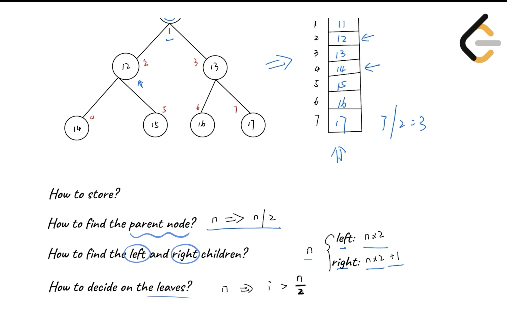
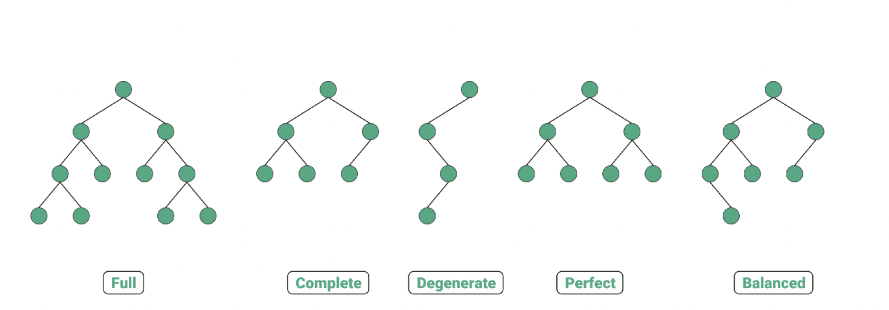
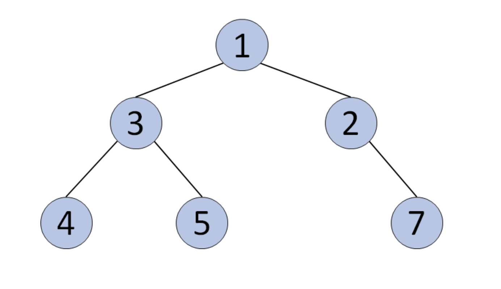

# Binary Tree

> **Scope** — Binary-tree-specific reasoning: **which direction DFS state flows** (down vs up), plus the 11 structural templates built on that.
> **See also**: [tree.md](./tree.md) — general tree concepts and traversal strategy; [tree2.md](./tree2.md) — ready-made per-pattern templates; [bst.md](./bst.md) — when the tree is ordered.

## LeetCode Problem Lists

- [Binary Tree](https://leetcode.com/problem-list/binary-tree/)
- [Tree](https://leetcode.com/problem-list/tree/)

## Time Complexity

| Data structure | Search   | Insert   | Delete   | Min/Max  |
| -------------- | -------- | -------- | -------- | -------- |
| Binary Tree    | O(n)     | O(n)     | O(n)     | O(n)     |

> General (unsorted) binary tree — no ordering, so every operation may visit all nodes. A *balanced* tree drops Search/Insert/Delete to **O(log n)**. Space is **O(n)** for storage plus **O(h)** for the recursion stack. For an ordered variant see [bst.md](./bst.md).

## Overview
**Binary Tree** is a hierarchical data structure where each node has at most two children (left and right). It forms the foundation for many advanced data structures like BST, Heap, and is crucial for understanding tree-based algorithms.

### Key Properties
- **Complexity**: see the [Time Complexity](#time-complexity) table above
- **Core Idea**: Hierarchical structure with recursive properties
- **When to Use**: Hierarchical data, searching, sorting, decision making, expression parsing

### References
- [Binary Tree Visualizer](https://www.cs.usfca.edu/~galles/visualization/BST.html)
- [Wikipedia - Binary Tree](https://en.wikipedia.org/wiki/Binary_tree)
- [Binary Tree - 演算法筆記](https://web.ntnu.edu.tw/~algo/BinaryTree.html)

## Recognition

Constraint cues come from the ruler in [complexity_cheatsheet.md](./complexity_cheatsheet.md).

| Signal in the statement | Constraint cue | Reach for | Not this if |
|---|---|---|---|
| "return the inorder / preorder / postorder traversal" | n ≤ 100 | [Template 1](#template-1-recursive-pre--in--post-order-traversal--lc-94) recursion, append position picks the order | "without recursion", deep tree → [Template 2](#template-2-iterative-traversal--stack-in-order-and-queue-level-order--lc-102) stack |
| "level by level", "right side view", "each depth" | n ≤ 2000 | [Template 2](#template-2-iterative-traversal--stack-in-order-and-queue-level-order--lc-102) queue snapshot | the gaps between nodes count → [Template 11](#template-11-bfs-with-positional-index--lc-662-) |
| "construct the tree from preorder and inorder" | n ≤ 3000, values unique | [Template 3](#template-3-build-from-preorder--inorder--lc-105) index map | one string with null markers → [tree_codec.md](./tree_codec.md) |
| "all root-to-leaf paths with sum = target" | n ≤ 5000 | [Template 4](#template-4-root-to-leaf-path-with-backtracking--lc-113) append / pop | the path may start anywhere → prefix sum on the tree, [tree_lca_distance.md](./tree_lca_distance.md) |
| "diameter", "longest path between any two nodes", "balanced" | n ≤ 10⁴ | [Template 5](#template-5-height-up-answer-in-a-global--lc-543) height up, bent path in a global | the value comes from above (depth, max so far) → pass it down, [§0-5](#0-5-depth-vs-height--the-two-numbers-a-tree-dfs-computes-) |
| "lowest common ancestor", root given, both nodes exist | n ≤ 10⁵ | [Template 6](#template-6-lca-by-returned-presence--lc-236) returned presence | a BST → walk down by value ([bst.md](./bst.md)); no root, `parent` pointers → [tree_lca_distance.md](./tree_lca_distance.md) |
| "count the nodes of a **complete** tree in less than O(n)" | n ≤ 5 · 10⁴ | [Template 7](#template-7-count-nodes-of-a-complete-tree--lc-222) compare left spines | not complete → O(n) traversal |
| "populate each `next` pointer", "constant extra space" | n ≤ 6000 | [Template 8](#template-8-level-linking-with-o1-space--lc-117-) dummy + tail | O(n) space allowed → [Template 2](#template-2-iterative-traversal--stack-in-order-and-queue-level-order--lc-102) |
| "cannot choose a parent and its child", "cover every node" | n ≤ 10⁴ | [Template 9](#template-9-tree-dp--return-multiple-states--lc-337-) a tuple of states | one number per subtree is enough → [Template 5](#template-5-height-up-answer-in-a-global--lc-543) |
| "delete the nodes and return the forest", "prune" | n ≤ 1000 | [Template 10](#template-10-post-order-structural-modification--lc-1110-) return the new subtree | an ordered tree trimmed by range → [bst.md](./bst.md) |
| "width of a level counting the nulls", "is it complete" | n ≤ 3000 | [Template 11](#template-11-bfs-with-positional-index--lc-662-) heap index | column order with ties sorted → [tree.md](./tree.md) |

## 0) Concept: Which Direction Does DFS State Flow? ⭐⭐⭐⭐⭐

> Before picking a template, answer one question: **where does the information a node needs come from — above it, or below it?** That single answer splits nearly every tree DFS problem into three shapes.

### 0-1) The Three DFS Shapes

| Shape | State flows | Signature | Answer is read | Classic LC |
|-------|-------------|-----------|----------------|------------|
| **A — Top-Down, Look-Back** | down, via a **parent** param | `dfs(node, parent, state)` | from a **global** | 112, 129, 1448, 298 |
| **B — Top-Down, Look-Forward** | down, decided **by the parent** | `dfs(node, state)` | from a **global** | 298, 687 |
| **C — Bottom-Up (post-order)** | **up**, via the **return value** | `dfs(node) -> state` | from the **return** (+ global) | 104, 543, 124, 337 |

**A and B are two spellings of the same top-down traversal.** C is a genuinely different algorithm. Choosing between A/B is style; choosing top-down vs bottom-up is *correctness*.

### 0-2) A vs B — Look-Back vs Look-Forward

Both solve LC 298 and both are O(n) time / O(h) space. The difference is **who owns the parent→child comparison**.

```python
# python
# LC 298 - Binary Tree Longest Consecutive Sequence
# STYLE A: LOOK-BACK — recurse first, compare against the parent I was handed
# time = O(n), space = O(h)
class Solution(object):
    def longestConsecutive(self, root):
        if not root:
            return 0
        self.max_len = 0
        self.dfs(root, None, 0)      # seed: no parent -> streak resets to 1
        return self.max_len

    def dfs(self, node, parent, curr_len):
        if not node:                 # <-- null handled HERE (base case)
            return
        # I decide MY OWN state from my parent's
        if parent and node.val == parent.val + 1:
            curr_len += 1
        else:
            curr_len = 1             # streak broke -> restart AT me
        self.max_len = max(self.max_len, curr_len)

        # ALWAYS recurse both sides - a broken streak can restart anywhere below
        self.dfs(node.left, node, curr_len)
        self.dfs(node.right, node, curr_len)
```

```python
# python
# LC 298 - Binary Tree Longest Consecutive Sequence
# STYLE B: LOOK-FORWARD — I compute each CHILD's state before calling it
# time = O(n), space = O(h)
class Solution(object):
    def longestConsecutive(self, root):
        if not root:
            return 0
        self.max_len = 0
        self.dfs(root, 1)            # seed: root is a streak of length 1
        return self.max_len

    def dfs(self, node, curr_len):
        self.max_len = max(self.max_len, curr_len)
        # I decide MY CHILDREN's state, and guard the null BEFORE recursing
        if node.left:                # <-- null handled HERE (call-site guard)
            self.dfs(node.left, curr_len + 1 if node.left.val == node.val + 1 else 1)
        if node.right:
            self.dfs(node.right, curr_len + 1 if node.right.val == node.val + 1 else 1)
```

#### Side-by-side

| | **A — Look-Back** | **B — Look-Forward** |
|---|---|---|
| Who does the compare | the **child**, about itself | the **parent**, about each child |
| Null handling | base case `if not node: return` | call-site guard `if node.left:` |
| Invocations on `n` nodes | **2n + 1** (nulls get called) | **n** (nulls never called) |
| Extra parameter | yes — `parent` (or `parent_val`) | none, reads `node.val` directly |
| Seed call | `dfs(root, None, 0)` | `dfs(root, 1)` |
| Compare logic written | **once** | **twice** (left + right) |
| N-ary tree (LC 589/1522) | `for c in node.children: dfs(c, node, s)` — unchanged | must re-nest the compare inside the loop |
| Graph / rebuilt-as-graph (LC 863) | natural — `parent` = "where I came from" | awkward — no fixed child set |

> **Measured**, not hand-waved: on a 15-node perfect tree Style A executes **31** calls, Style B executes **15**. The extra calls are the `None` children. Same O(n) — B just has a smaller constant.

#### Which to reach for

- **Default to A.** One copy of the transition logic, extends to n-ary and to graphs unchanged, and the `if not node` base case is the habit every other tree template already trains.
- **Reach for B** when the compare needs *both* endpoints of the edge and you want to avoid a null branch — or when you must **not** descend into a child at all (pruning), since B decides before recursing.
- **A leaks less state.** In B, `self.max_len` must be updated at the node (not at the child), or the root's own length is never counted.

#### The sentinel shortcut (and when it breaks)

Style A's `if parent and ...` disappears if you pass a **fake parent value** instead of a node:

```python
# python
# LC 298 - the `parent_val` sentinel variant of Style A
# IDEA: seed with (root.val - 1) so the root automatically satisfies "val == parent_val + 1" -> length 1
dfs(root, root.val - 1, 0)     # no `if parent` branch needed inside dfs
```

⚠️ **This only works when the state depends on the parent's *value*.** If you need the parent's **identity** — e.g. **LC 993 (Cousins in Binary Tree)**, where two nodes must have the same depth but a *different parent node* — you must pass the actual node. Passing `parent_val` there is silently wrong when two parents share a value.

### 0-3) Does the A/B choice apply to *every* tree DFS problem? — **No**

The A-vs-B question is only meaningful for **top-down** problems: ones where a node's answer is fully determined by the path **from the root down to it**. Ask:

```text
Can I answer for this node using ONLY what I learned on the way down?
├── YES -> Top-Down. Pick Style A or B freely (they are interchangeable).
│         Root-to-leaf sums, depth, path constraints, "ancestor so far".
└── NO, I need a fact about my SUBTREE (its height / best path / sum)
          -> Bottom-Up (Style C). A and B CANNOT express this.
             Depth, diameter, max path sum, balance, subtree aggregates.
```

**The tell for C**: the answer at a node **combines results from both children** (`left + right + node.val`), or the node returns something different from what the global tracks.

| LC | Problem | Shape | Why |
|----|---------|-------|-----|
| 112 / 113 | Path Sum I / II | **A or B** | running sum comes from above |
| 129 | Sum Root to Leaf Numbers | **A or B** | accumulate `num*10 + val` downward |
| 1448 | Count Good Nodes | **A or B** | carry `maxSoFar` down |
| 1026 | Max Diff Node vs Ancestor | **A or B** | carry `(min, max)` down |
| 298 | Longest Consecutive Sequence | **A or B** | streak length comes from above |
| 993 | Cousins in Binary Tree | **A only** | needs the parent **node**, not its value |
| 863 | All Nodes Distance K | **A only** | tree is walked as a graph; `parent` = came-from |
| 104 / 111 | Max / Min Depth | **C** | needs children's heights |
| 543 | Diameter | **C** | `left + right` at the node |
| 110 | Balanced Binary Tree | **C** | compares subtree heights |
| 124 | Max Path Sum | **C** | returns one arm, globals the two-arm sum |
| 687 | Longest Univalue Path | **B *and* C** | B for the downward arm, C to join arms → see Template 9 |
| 337 | House Robber III | **C** | returns a `(take, skip)` tuple → see Template 9 |
| 236 | LCA | **C** | needs "was p/q found below me" |

> **LC 298 is the rare problem solvable all three ways** — its path is strictly downward (so top-down works) *and* a subtree's best downward run is well-defined (so bottom-up works). Compare the C version in **Template 9 (Tree DP — Return Multiple States Bottom-Up)** below — it returns `cur_len` upward instead of threading it down. Most problems admit only one shape.

#### Converting A → C when you get stuck

If a top-down attempt needs subtree info, the mechanical fix is: **stop passing the accumulator down, start returning it up**, and keep the global for the answer.

```python
# python
# LC 298 - Style C (bottom-up): return "longest run STARTING at me, going down"
# IDEA: post-order; the global captures the best, the return value feeds my parent
# time = O(n), space = O(h)
def helper(node):
    if not node:
        return 0
    l, r = helper(node.left), helper(node.right)     # children FIRST
    cur = 1
    if node.left and node.left.val == node.val + 1:
        cur = max(cur, l + 1)
    if node.right and node.right.val == node.val + 1:
        cur = max(cur, r + 1)
    self.max_len = max(self.max_len, cur)            # global != return value
    return cur
```

### 0-4) Shared gotcha for all three — **reset, don't stop**

In LC 298 (and every "longest run of X" tree problem) a broken streak must **restart at 1**, never terminate the recursion:

```python
def dfs(node, parent, curr_len):
    if node is None:
        return
    if parent and node.val == parent.val + 1:
        curr_len += 1
    # ✅ correct - streak breaks: restart at 1, but keep exploring
    else:
        curr_len = 1
        # 🚫 wrong here: `return` - a longer streak may start deeper in this subtree

    self.max_len = max(self.max_len, curr_len)
    # recurse on BOTH children whether the streak continued or reset
    dfs(node.left, node, curr_len)
    dfs(node.right, node, curr_len)
```

Verified on 4000 random trees: Styles A, B and C agree with brute force on every case, including the zigzag tree below — the path `1→2→3→4` alternates left/right and is still valid, because **the only rule is parent → child**.

```text
    1
     \
      2        longest = 4  (1 -> 2 -> 3 -> 4)
     /
    3
     \
      4
```

### 0-5) Depth vs Height — the two numbers a tree DFS computes ⭐⭐⭐⭐

The same rule from §0-1, applied to the two quantities nearly every tree problem asks for. The question is whether the parent knows the value **before** it calls its children:

| Quantity | Measured | Who knows it first | Flows | Shape | Classic LC |
|----------|----------|--------------------|-------|-------|------------|
| **Depth** | edges from the **root** down to the node | the parent | **down**, as an **argument**: `dfs(child, depth + 1)` | A / B | 102, 111, 199, 1302 |
| **Height** | **nodes** on the longest path from the node down to a leaf (leaf = 1, empty = 0) | the children | **up**, as the **return value**: `return 1 + max(l, r)` | C | 104, 110, 543, 366 |
| **Distance** | edges between two nodes | neither alone | both: depth from the LCA, or a parent map | — | 1740, 863 → [tree_lca_distance.md](./tree_lca_distance.md#template-3-distance-between-nodes-via-lca--lc-1740) |

> **Mind the units: depth here counts edges (the root is 0), height counts nodes (a leaf is 1).** That is what the code below returns, and it makes LC 543's `left_height + right_height` come out directly in edges.
>
> **LC 104 is the one problem that reads both ways.** Its answer counts nodes, so it equals the root's height, or the deepest leaf's depth + 1. So it can be solved top-down, by carrying `depth` to every leaf, or bottom-up, by returning heights. That is why §0-3 lists depth under both branches.

#### Depth — passed down

```python
# python
# LC 102 - Binary Tree Level Order Traversal (the DFS version)
# IDEA: carry depth as an argument; the first visit to a depth opens its list
# time = O(n), space = O(h)
def nodes_by_depth(root):
    levels = []

    def dfs(node, depth):
        if node is None:
            return
        if depth == len(levels):          # first node seen at this depth
            levels.append([])
        levels[depth].append(node.val)
        dfs(node.left, depth + 1)         # the child's depth is decided HERE, by the parent
        dfs(node.right, depth + 1)

    dfs(root, 0)
    return levels


# python
# Depth of one target node (edges from the root), -1 if it is not in the tree
# IDEA: pre-order DFS carrying depth; the -1 sentinel means "not below me"
# time = O(n), space = O(h)
def depth_of(root, target):
    def dfs(node, depth):
        if node is None:
            return -1
        if node is target:
            return depth
        left = dfs(node.left, depth + 1)
        if left != -1:                    # found on the left: stop, skip the right
            return left
        return dfs(node.right, depth + 1)

    return dfs(root, 0)
```

The pre / in / post-order position of the `append` is the only difference between the three traversals. For those, see [Template 1](#template-1-recursive-pre--in--post-order-traversal--lc-94) and [Template 2](#template-2-iterative-traversal--stack-in-order-and-queue-level-order--lc-102).

#### Height — returned up

```python
# python
# LC 543 - Diameter of Binary Tree
# IDEA: return my height to my parent; record the path that bends at me in a global
# time = O(n), space = O(h)
def diameter_of_binary_tree(root):
    best = 0

    def height(node):
        nonlocal best
        if node is None:
            return 0                                   # empty subtree has height 0
        left_height = height(node.left)                # children FIRST: post-order
        right_height = height(node.right)
        best = max(best, left_height + right_height)   # the answer: both arms
        return 1 + max(left_height, right_height)      # the return: one arm

    height(root)
    return best


# python
# LC 110 - Balanced Binary Tree
# IDEA: return the height, or -1 as an "already unbalanced" signal that short-circuits upward
# time = O(n), space = O(h)
def is_balanced(root):
    def height(node):
        if node is None:
            return 0
        left_height = height(node.left)
        if left_height == -1:
            return -1
        right_height = height(node.right)
        if right_height == -1:
            return -1
        if abs(left_height - right_height) > 1:
            return -1
        return 1 + max(left_height, right_height)

    return height(root) != -1
```

**The global is not the return value.** LC 543 returns one arm (`1 + max`) and records two (`left + right`). Returning `left + right` is the usual bug: the parent would extend a path that already bends. LC 124 and LC 687 follow the same rule (see [Template 9](#template-9-tree-dp--return-multiple-states--lc-337-)).

#### Distance — both at once

Distance needs facts from above **and** below, so it lives in [tree_lca_distance.md](./tree_lca_distance.md):

- **Between two nodes p and q** (LC 1740): `d(p, q) = depth(p) + depth(q) − 2·depth(lca)`. Find the LCA, then run that section's `get_dist` from it twice. LC 1740 hands you **values**, so `get_dist` compares `root.val == target`. `depth_of` above compares node identity and would return `-1`. See [Template 3: Distance Between Nodes](./tree_lca_distance.md#template-3-distance-between-nodes-via-lca--lc-1740).
- **Every node k away from a target** (LC 863): record each node's parent in one DFS. The tree is then an undirected graph, so walk outward with a `visited` set. See [Template 2: Parent Map + BFS](./tree_lca_distance.md#template-2-parent-map--bfs--lc-863).

---

## Problem Categories

### **Pattern 1: Tree Traversal**
- **Description**: Visit all nodes in specific order (preorder, inorder, postorder, level-order)
- **Recognition**: "Visit all nodes", "print tree", "serialize tree"
- **Examples**: LC 94, LC 144, LC 145, LC 102
- **Template**: Use Traversal Templates

### **Pattern 2: Tree Construction**
- **Description**: Build tree from traversal sequences or other representations
- **Recognition**: "Construct from", "build tree", "deserialize"
- **Examples**: LC 105, LC 106, LC 108, LC 297
- **Template**: Use Construction Template

### **Pattern 3: Path Problems**
- **Description**: Find paths with specific properties (sum, length, pattern)
- **Recognition**: "Path sum", "root to leaf", "longest path"
- **Examples**: LC 112, LC 113, LC 257, LC 124
- **Template**: Use Path Template with backtracking

### **Pattern 4: Tree Properties**
- **Description**: Check or calculate tree properties (height, balance, symmetry)
- **Recognition**: "Height", "balanced", "symmetric", "diameter"
- **Examples**: LC 104, LC 110, LC 101, LC 543
- **Template**: Use Property Check Template

### **Pattern 5: LCA & Distance**
- **Description**: Find common ancestors or calculate distances between nodes
- **Recognition**: "Lowest common ancestor", "distance between nodes"
- **Examples**: LC 236, LC 235, LC 863
- **Template**: Use LCA Template

### **Pattern 6: Binary Search on Trees**
- **Description**: Apply binary search technique on tree properties (height, node count, structure)
- **Recognition**: "O(log n) time", "complete binary tree", "count nodes", "find kth element"
- **Examples**: LC 222 (Count Complete Tree Nodes), LC 230 (Kth Smallest in BST)
- **Template**: Use Binary Search + Tree Properties Template
- **Key Insight**:
  - For complete binary trees, can use binary search on tree structure
  - Check left/right subtree properties to decide search direction
  - Time complexity can be reduced from O(n) to O(log²n)

### Complete Tree to Array Representation

-  Note if we use an `array` to represent the `complete binary tree`,and `store the root node at index 1`
    - so, index of the `parent` node of any node is `[index of the node / 2]`
    - so, index of the `left child` node is `[index of the node * 2]`
    - so, index of the `right child` node is `[index of the node * 2 + 1]`
    - https://github.com/yennanliu/CS_basics/blob/master/data_structure/python/MinHeap.py#L36-L40
    - [video](https://leetcode.com/explore/learn/card/heap/643/heap/4017/) : very good explanation!!!
    - properties
        - how to store ? 
            - via Array and index
        - how to find the parent node ?
            - n / 2
            - NOTE : `n is an "index"` in array
        - how to find the left and right children ?
            - left children : n * 2
            - right children : n * 2 + 1
        - how to check if a node is leaf node ?
            - check if i > (# of nodes) / 2
        - <p align="center"></p>


#### Example:

Let's say you have a complete binary tree like this:

```text
        10
       /  \
     15    20
    / \    /
   30 40  50
```

This tree as an **array (1-based)** would be:

```text
# `n is an "index"` in array

Index:   1   2   3   4   5   6
Value: [10, 15, 20, 30, 40, 50]
```

Relationships:

* Node at index 2 (15)

  * Parent: 2 / 2 = 1 → 10
  * Left child: 2 * 2 = 4 → 30
  * Right child: 2 * 2 + 1 = 5 → 40

---


- Array to Complete Tree
    - dev

- `Complete binary tree`
    - A complete binary tree is a binary tree in which every level, `except possibly the last`, is completely filled, and all nodes in the last level are as far left as possible.
    - [wiki](https://en.wikipedia.org/wiki/Binary_tree#:~:text=A%20complete%20binary%20tree%20is,tree%20is%20not%20necessarily%20perfect.)
    - example :
        - complete binary tree
        <p align="center"></p>
        - NOT complete binary tree
        <p align="center"></p>

## Templates & Algorithms

### Template Comparison Table
| Template Type | Use Case | Approach | Time | Space | When to Use |
|---------------|----------|----------|------|-------|--------------|
| **Recursive Traversal** | Simple traversal | Recursion | O(n) | O(h) | Default choice, clean code |
| **Iterative Traversal** | Memory limited | Stack/Queue | O(n) | O(h) | Avoid recursion overhead |
| **Morris Traversal** | Space limited | Threading | O(n) | O(1) | Constant space required |
| **Level Order** | BFS problems | Queue | O(n) | O(w) | Level-by-level processing |
| **Binary Search on Trees** | Complete/Balanced tree | Binary Search | O(log²n) | O(log n) | Optimize with tree structure |

### Template 1: Recursive Pre / In / Post-order Traversal — LC 94

**Recognise** — "return the preorder / inorder / postorder traversal", "visit every node", or any
problem whose answer is a list of node values in one of those orders. n ≤ 100 here, but the same
code is the O(n) skeleton every larger tree problem starts from.

**Key point** — the recursion visits every node exactly once; the **position of the one
`append` line** (before, between or after the two recursive calls) is the only thing that decides
the order.

```python
# python
# LC 94 - Binary Tree Inorder Traversal
# IDEA: recurse left, record the node, recurse right; move the append to get pre- or post-order
# time = O(n), space = O(h)   h = height of the tree (recursion stack)
def inorderTraversal(root):
    result = []

    def dfs(node):
        if not node:
            return
        # result.append(node.val)   <- here: PRE-order  (root, left, right)
        dfs(node.left)
        result.append(node.val)     # here: IN-order   (left, root, right)
        dfs(node.right)
        # result.append(node.val)   <- here: POST-order (left, right, root)

    dfs(root)
    return result
```

```java
// java
// LC 94 - Binary Tree Inorder Traversal
// IDEA: recurse left, record the node, recurse right; move the add() for pre- or post-order
// time = O(n), space = O(h)
public List<Integer> inorderTraversal(TreeNode root) {
    List<Integer> result = new ArrayList<>();
    dfs(root, result);
    return result;
}

private void dfs(TreeNode node, List<Integer> result) {
    if (node == null) {
        return;
    }
    dfs(node.left, result);
    result.add(node.val);           // in-order position
    dfs(node.right, result);
}
```

**Complexity**
- **Time O(n)**: `dfs` is called once per node plus once per null child, and each call does O(1)
  work besides the two recursive calls.
- **Space O(h)**: the recursion stack holds one frame per level of the current root-to-node path;
  `h = n` for a skewed tree, `log n` for a balanced one. The output list is not counted.

**Traps**
- `return [root.val] + preorder(root.left) + preorder(root.right)` reads nicely but copies a list
  at every level: a skewed tree of n nodes (LC 94 `[1,null,2,null,3,…]`) costs O(n²). Append into
  one shared list.
- A skewed tree of 10⁵ nodes overflows Python's default recursion limit (1000) — switch to
  [Template 2](#template-2-iterative-traversal--stack-in-order-and-queue-level-order--lc-102)'s
  explicit stack.

**Not this if** — the tree is a BST and you want "the k-th smallest" or "is it valid": the
traversal is the same, but stopping early and the ordering invariant live in [bst.md](./bst.md).

**Drill** — LC 94 · LC 144 · LC 145 · LC 589 *(n-ary: loop over `children`)*

### Template 2: Iterative Traversal — Stack In-order and Queue Level-order — LC 102

**Recognise** — "level by level", "each depth", "right side view", "zigzag", "average of each
level" → the queue. "Without recursion", "the tree can be 10⁵ deep", or an iterator that yields one
node at a time (LC 173) → the stack.

**Key point** — the queue holds exactly one level at the moment `level_size = len(queue)` is read,
so the inner `for` loop drains that level and nothing else. (For the stack: it holds the left spine
still owed a visit, so the top is always the next node in sorted order.)

```python
# python
# LC 102 - Binary Tree Level Order Traversal
# IDEA: snapshot the queue length = the size of the current level, drain exactly that many
# time = O(n), space = O(w)   w = maximum width of a level
from collections import deque

def levelOrder(root):
    if not root:
        return []
    result = []
    queue = deque([root])
    while queue:
        level_size = len(queue)          # every node now in the queue is on this level
        level = []
        for _ in range(level_size):
            node = queue.popleft()
            level.append(node.val)
            if node.left:
                queue.append(node.left)
            if node.right:
                queue.append(node.right)
        result.append(level)
    return result


# LC 94 - Binary Tree Inorder Traversal (iterative)
# IDEA: push the whole left spine, pop = visit, then move to the right child
# time = O(n), space = O(h)
def inorder_iterative(root):
    result = []
    stack = []
    current = root
    while current or stack:
        while current:                   # go as far left as possible
            stack.append(current)
            current = current.left
        current = stack.pop()            # leftmost unvisited node
        result.append(current.val)
        current = current.right          # its right subtree comes next
    return result
```

```java
// java
// LC 102 - Binary Tree Level Order Traversal
// IDEA: snapshot the queue size = the current level, drain exactly that many
// time = O(n), space = O(w)
public List<List<Integer>> levelOrder(TreeNode root) {
    List<List<Integer>> result = new ArrayList<>();
    if (root == null) {
        return result;
    }
    Deque<TreeNode> queue = new ArrayDeque<>();
    queue.offer(root);
    while (!queue.isEmpty()) {
        int levelSize = queue.size();     // read ONCE, before the loop adds children
        List<Integer> level = new ArrayList<>();
        for (int i = 0; i < levelSize; i++) {
            TreeNode node = queue.poll();
            level.add(node.val);
            if (node.left != null) {
                queue.offer(node.left);
            }
            if (node.right != null) {
                queue.offer(node.right);
            }
        }
        result.add(level);
    }
    return result;
}
```

**Complexity**
- **Time O(n)**: every node is offered once and polled once; the inner `for` loop's iterations sum
  to n across all levels.
- **Space O(w)**: the queue never holds more than two adjacent levels; the widest level of a
  complete tree is about n / 2. The in-order stack holds one root-to-node spine, O(h).

**Traps**
- Java's `for (int i = 0; i < queue.size(); i++)` re-reads the size while the loop polls and offers,
  so levels are cut short or merged: LC 102 `[3,9,20,null,null,15,7]` no longer returns
  `[[3],[9,20],[15,7]]`. Read the size once, before the loop.
- `if not root: return []` first: an empty tree would otherwise put `None` in the queue and crash
  on `.val`.
- `list.pop(0)` instead of `deque.popleft()` makes each dequeue O(n) — O(n²) on a wide tree.

**Not this if** — the answer needs the horizontal gap inside a level (LC 662): carry a heap index
with the node, [Template 11](#template-11-bfs-with-positional-index--lc-662-). A **column** (LC 314,
LC 987) is a different coordinate: carry `col`, with `col - 1` for the left child and `col + 1` for
the right.

**Drill** — LC 102 ⭐ · LC 199 *(last node of each level)* · LC 103 *(reverse every other row)* ·
LC 173 *(the in-order stack as an iterator)* · LC 314

### Template 3: Build from Preorder + Inorder — LC 105

**Recognise** — "construct the binary tree from its preorder and inorder (or inorder and
postorder) traversal", values are **unique**. n ≤ 3000 → the O(n²) `index()` version passes, but
the expected answer is O(n).

**Key point** — `preorder[pre_index]` is always the root of the subtree being built, and its
position in `inorder` splits the remaining range into exactly the left subtree's values and the
right subtree's values. Build left before right, so `pre_index` walks preorder in order.

```python
# python
# LC 105 - Construct Binary Tree from Preorder and Inorder Traversal
# IDEA: next preorder value is the root; its inorder index splits [lo, hi] into left / right
# time = O(n), space = O(n)   the index map, plus O(h) recursion
def buildTree(preorder, inorder):
    index_of = {}
    for i, val in enumerate(inorder):
        index_of[val] = i                 # O(1) lookup instead of inorder.index()
    pre_index = 0                         # next root to take from preorder

    def build(lo, hi):                    # build the subtree whose values are inorder[lo..hi]
        nonlocal pre_index
        if lo > hi:
            return None
        root_val = preorder[pre_index]
        pre_index += 1
        root = TreeNode(root_val)
        mid = index_of[root_val]
        root.left = build(lo, mid - 1)    # left FIRST: preorder lists the left subtree next
        root.right = build(mid + 1, hi)
        return root

    return build(0, len(inorder) - 1)
```

```java
// java
// LC 105 - Construct Binary Tree from Preorder and Inorder Traversal
// IDEA: next preorder value is the root; its inorder index splits the range
// time = O(n), space = O(n)
private Map<Integer, Integer> indexOf = new HashMap<>();
private int preIndex = 0;

public TreeNode buildTree(int[] preorder, int[] inorder) {
    for (int i = 0; i < inorder.length; i++) {
        indexOf.put(inorder[i], i);
    }
    preIndex = 0;
    return build(preorder, 0, inorder.length - 1);
}

private TreeNode build(int[] preorder, int lo, int hi) {
    if (lo > hi) {
        return null;
    }
    int rootVal = preorder[preIndex];
    preIndex++;
    TreeNode root = new TreeNode(rootVal);
    int mid = indexOf.get(rootVal);
    root.left = build(preorder, lo, mid - 1);    // left before right
    root.right = build(preorder, mid + 1, hi);
    return root;
}
```

**Complexity**
- **Time O(n)**: each call consumes one preorder value and creates one node; `index_of[root_val]`
  is an O(1) map lookup, where `inorder.index()` would make the whole build O(n²).
- **Space O(n)**: the `index_of` map holds n entries; the recursion adds O(h).

**Dry run**

```text
preorder = [3,9,20,15,7]   inorder = [9,3,15,20,7]
build(0,4)  root 3  mid 1  -> left = build(0,0), right = build(2,4)
build(0,0)  root 9  mid 0  -> both children build(lo > hi) = None
build(2,4)  root 20 mid 3  -> left = build(2,2) root 15, right = build(4,4) root 7
result      [3,9,20,null,null,15,7]
```

**Traps**
- Building `root.right` before `root.left` consumes preorder in the wrong order: LC 105 example 1
  comes back as `[3,20,9,…]`-shaped garbage. (For **postorder + inorder**, LC 106, take roots from
  the **end** and build **right first**.)
- Slicing `preorder[1:mid+1]` at every call is O(n) per call → O(n²) on a skewed tree.
- Duplicate values break `index_of`; the problem guarantees uniqueness, so say that assumption out
  loud.

**Not this if** — you are given **one** sequence with null markers (`"1,2,#,#,3"`): that is a
serialization codec, a pre-order parser, in [tree_codec.md](./tree_codec.md).

**Drill** — LC 105 ⭐ · LC 106 *(postorder: roots from the end, right first)* · LC 889 *(pre +
post, the left root is `preorder[1]`)* · LC 1008 *(BST from preorder alone: bounds instead of a
map)*

### Template 4: Root-to-Leaf Path with Backtracking — LC 113

**Recognise** — "all **root-to-leaf** paths", "paths whose sum equals target", "return every path
as a list". n ≤ 5000 → O(n · h) with the path copies is fine.

**Key point** — `path` always equals the values on the way from the root to the current node: it
grows by one on entry and the `path.pop()` at the end of the call shrinks it by one on exit, so a
sibling never sees the other sibling's nodes.

```python
# python
# LC 113 - Path Sum II
# IDEA: pre-order DFS carrying the remaining sum; append on entry, pop on exit (backtrack)
# time = O(n * h), space = O(h)   each found path is copied in O(h)
def pathSum(root, targetSum):
    result = []
    path = []

    def dfs(node, remaining):
        if not node:
            return
        path.append(node.val)                     # enter: the path now ends at node
        remaining -= node.val
        if not node.left and not node.right:      # a leaf: the path is complete
            if remaining == 0:
                result.append(list(path))         # copy, the list keeps changing
        else:
            dfs(node.left, remaining)
            dfs(node.right, remaining)
        path.pop()                                # exit: undo the append

    dfs(root, targetSum)
    return result
```

```java
// java
// LC 113 - Path Sum II
// IDEA: pre-order DFS with the remaining sum; add on entry, remove on exit
// time = O(n * h), space = O(h)
public List<List<Integer>> pathSum(TreeNode root, int targetSum) {
    List<List<Integer>> result = new ArrayList<>();
    dfs(root, targetSum, new ArrayList<>(), result);
    return result;
}

private void dfs(TreeNode node, int remaining, List<Integer> path, List<List<Integer>> result) {
    if (node == null) {
        return;
    }
    path.add(node.val);
    remaining -= node.val;
    if (node.left == null && node.right == null) {
        if (remaining == 0) {
            result.add(new ArrayList<>(path));    // copy
        }
    } else {
        dfs(node.left, remaining, path, result);
        dfs(node.right, remaining, path, result);
    }
    path.remove(path.size() - 1);                  // backtrack
}
```

**Complexity**
- **Time O(n · h)**: the DFS itself is O(n); `list(path)` copies up to h values for each of the at
  most n/2 leaves that match.
- **Space O(h)**: `path` and the recursion stack both hold one root-to-node path. The output is not
  counted.

**Traps**
- Dropping `path.pop()`: on the tree `1 → (2, 3)` the path to 3 comes out as `[1, 2, 3]`, because 2
  was never removed when its call returned.
- `result.append(path)` without a copy stores the same list n times; after the DFS it is empty, so
  LC 113 example 1 returns `[[], []]`.
- Testing `remaining == 0` at a **null** child instead of at a leaf counts a node with one child as
  the end of a path: `[1,2]`, target 1 wrongly returns `[[1]]`.
- Negative values (allowed in LC 113) mean you cannot prune when `remaining < 0`.

**Not this if** — the path may start and end **anywhere** going down (LC 437) → a prefix-sum map
on the tree; the whole path family (LC 112 / 113 / 257 / 437) is owned by
[tree_lca_distance.md](./tree_lca_distance.md).

**Drill** — LC 112 · LC 257 *(strings are immutable: no pop needed)* · LC 113 · LC 129 · LC 437

### Template 5: Height Up, Answer in a Global — LC 543

**Recognise** — "diameter", "longest path between **any** two nodes", "maximum path sum", "is it
balanced", "tilt" — the answer at a node needs both children's results, and the best answer may bend
through a node that is not the root.

**Key point** — the function **returns** one arm (the height, which the parent can extend) and
**records** the bent path `left + right` into a global; the global is never the return value, because
a parent cannot extend a path that already bends.

```python
# python
# LC 543 - Diameter of Binary Tree
# IDEA: return my height (in nodes) to my parent; record the path that bends at me
# time = O(n), space = O(h)
def diameterOfBinaryTree(root):
    best = 0                               # longest path seen so far, in edges

    def height(node):
        nonlocal best
        if not node:
            return 0
        left = height(node.left)
        right = height(node.right)
        best = max(best, left + right)     # the path that bends at node
        return 1 + max(left, right)        # only ONE arm continues upward

    height(root)
    return best
```

```java
// java
// LC 543 - Diameter of Binary Tree
// IDEA: return the height, record left + right in a field
// time = O(n), space = O(h)
private int best = 0;

public int diameterOfBinaryTree(TreeNode root) {
    best = 0;
    height(root);
    return best;
}

private int height(TreeNode node) {
    if (node == null) {
        return 0;
    }
    int left = height(node.left);
    int right = height(node.right);
    best = Math.max(best, left + right);
    return 1 + Math.max(left, right);
}
```

**Complexity**
- **Time O(n)**: `height` runs once per node, post-order, with O(1) work after its two calls.
- **Space O(h)**: the recursion stack; the global is O(1).

**Traps**
- Returning `left + right` instead of `1 + max(left, right)`: the parent extends a bent path.
  `[1,2,3,4,5]` would score 4 at the root instead of 3.
- Units: `height(None) = 0` counts **nodes**, so `left + right` is already the **edge** count of the
  bent path. Adding 1 gives LC 543 example 2 (`[1,2]`) the answer 2 instead of 1.
- LC 124 (max path sum) has negative values: clamp each arm with `max(0, arm)` and start the global
  at `-inf`, or `[-3]` returns 0.
- Calling `height` again inside the loop (LC 110 written top-down) is O(n²) on a skewed tree;
  compute the height once and return `-1` as an "already unbalanced" flag.

**Not this if** — the value a node needs comes from **above** it (depth, the max so far on the path,
LC 1448): pass it down as an argument instead — see
[§0-5](#0-5-depth-vs-height--the-two-numbers-a-tree-dfs-computes-).

**Drill** — LC 104 ⭐ · LC 110 ⭐ · LC 543 ⭐ · LC 687 · LC 124 ⭐

### Template 6: LCA by Returned Presence — LC 236

**Recognise** — "lowest common ancestor of two nodes", both nodes **guaranteed to exist**, a root
is given, the tree is **not** a BST. n ≤ 10⁵ → one O(n) pass.

**Key point** — `dfs(node)` returns `p` or `q` if one of them is in `node`'s subtree (or the LCA if
both are), else `None`. The first node at which **both** children return non-null is the split
point, and nothing below it can contain both.

```python
# python
# LC 236 - Lowest Common Ancestor of a Binary Tree
# IDEA: return the target I found (or None); the node where both sides found one is the LCA
# time = O(n), space = O(h)
def lowestCommonAncestor(root, p, q):
    if not root or root is p or root is q:
        return root                        # a target is its own answer for this subtree
    left = lowestCommonAncestor(root.left, p, q)
    right = lowestCommonAncestor(root.right, p, q)
    if left and right:                     # p on one side, q on the other
        return root
    return left if left else right         # pass up whichever side found something
```

```java
// java
// LC 236 - Lowest Common Ancestor of a Binary Tree
// IDEA: return the found target or null; both sides non-null -> this node is the LCA
// time = O(n), space = O(h)
public TreeNode lowestCommonAncestor(TreeNode root, TreeNode p, TreeNode q) {
    if (root == null || root == p || root == q) {
        return root;
    }
    TreeNode left = lowestCommonAncestor(root.left, p, q);
    TreeNode right = lowestCommonAncestor(root.right, p, q);
    if (left != null && right != null) {
        return root;
    }
    return left != null ? left : right;
}
```

**Complexity**
- **Time O(n)**: each node is visited at most once; a returned target stops the descent below it.
- **Space O(h)**: the recursion stack.

**Variations** — the template assumes *a root to search from* and *both targets present*. Each
variant breaks one of those, and that decides the shape:

| LC | What changes | Shape | Complexity |
|----|--------------|-------|------------|
| 236 | — (baseline) | this template | O(N) / O(H) |
| 235 | tree is a **BST** | walk **down** while both targets sit on one side; first split point is the LCA | O(H) / O(1) |
| 1644 | `p`, `q` may **not exist** | same post-order, but never return early — count the targets seen, answer only if `count == 2` | O(N) / O(H) |
| 1650 | **no root**, every node has `parent` | walk **up** both parent chains → LC 160, intersection of two linked lists | O(H) / O(1) |
| 1676 | **N targets** instead of 2 | same post-order against a `set` of targets | O(N) / O(H) |

**Traps**
- The early `return root` when `root is p` means a `q` that does **not** exist is never noticed:
  LC 1644 with `q` absent returns `p` instead of `None`. That variant must recurse first and count.
- LC 1650's two-pointer walk must step **onto** `None` before switching: writing
  `a = a.parent or q` skips that step, so the two walks differ by one and can loop forever.
- Compare nodes by identity (`is`, `==` on references), not `.val`: values are not guaranteed to be
  unique in the follow-ups.

**Not this if** — the tree is a BST (LC 235): walk down by value in O(h) ([bst.md](./bst.md)); or
there is no root, only `parent` pointers (LC 1650). The whole LCA family, with 1650 traced step by
step and code for 1644 / 1676 / 235, lives in [tree_lca_distance.md](./tree_lca_distance.md).

**Drill** — LC 235 ⭐ · LC 236 · LC 1644 · LC 1650 · LC 1676 · LC 865

### Template 7: Count Nodes of a Complete Tree — LC 222

**Recognise** — "**complete** binary tree", "design an algorithm that runs in less than O(n)". n up
to 5 · 10⁴ — O(n) passes, so the follow-up is the question.

**Key point** — in a complete tree, if the left subtree's leftmost depth equals the right
subtree's, the **left** subtree is perfect (`2^h − 1` nodes); otherwise the **right** one is perfect,
one level shorter. Either way one half is counted by a formula and only the other is recursed into.

```python
# python
# LC 222 - Count Complete Tree Nodes
# IDEA: compare the left spines of the two subtrees; the perfect half is counted by 2^h,
#       recurse only into the other half
# time = O(log^2 n), space = O(log n)
def countNodes(root):
    if not root:
        return 0

    def left_depth(node):                  # nodes on the leftmost path
        depth = 0
        while node:
            depth += 1
            node = node.left
        return depth

    left_h = left_depth(root.left)
    right_h = left_depth(root.right)
    if left_h == right_h:
        # left subtree is perfect: 2^left_h - 1 nodes, plus the root = 2^left_h
        return (1 << left_h) + countNodes(root.right)
    # right subtree is perfect, one level shorter: 2^right_h - 1 nodes, plus the root
    return (1 << right_h) + countNodes(root.left)
```

```java
// java
// LC 222 - Count Complete Tree Nodes
// IDEA: equal left spines -> left half perfect, else right half perfect; recurse into the other
// time = O(log^2 n), space = O(log n)
public int countNodes(TreeNode root) {
    if (root == null) {
        return 0;
    }
    int leftH = leftDepth(root.left);
    int rightH = leftDepth(root.right);
    if (leftH == rightH) {
        return (1 << leftH) + countNodes(root.right);
    }
    return (1 << rightH) + countNodes(root.left);
}

private int leftDepth(TreeNode node) {
    int depth = 0;
    while (node != null) {
        depth++;
        node = node.left;
    }
    return depth;
}
```

**Complexity**
- **Time O(log² n)**: the recursion goes down one level per call (h = log n calls), and each call
  walks two left spines of length ≤ log n in `left_depth`.
- **Space O(log n)**: one stack frame per level.

**Traps**
- `1 << h` counts the subtree **plus** the current root; writing `(1 << h) - 1` and then adding 1
  for the root is the same, but forgetting the root returns 5 for LC 222 example 1 (`[1,2,3,4,5,6]`).
- Measuring the right subtree's **right** spine instead of its left spine breaks the test: the last
  level fills from the left, so only the left spine tells you its true depth.

**Not this if** — the tree is not guaranteed complete: only the O(n) traversal is correct.

**Drill** — LC 222 · LC 958 *(is it complete? BFS, [Template 11](#template-11-bfs-with-positional-index--lc-662-))* ·
LC 1261 · LC 1104 *(heap-index arithmetic on a zigzag-labelled tree)*

### Template 8: Level Linking with O(1) Space — LC 117 ⭐⭐⭐⭐⭐

**Recognise** — "populate each `next` pointer to its next right node", "you may only use constant
extra space", and the tree is **not** perfect (LC 117; LC 116 is the perfect case).

**Key point** — level `k`'s `next` chain is already built when you stand on it, so it **is** the
queue for level `k`; while walking it, a **dummy head + moving tail** stitches level `k + 1` together.

```python
# python
# LC 117 - Populating Next Right Pointers in Each Node II
# IDEA: walk level k through its own `next` chain; build level k+1's chain with dummy + tail
# time = O(n), space = O(1)   output pointers not counted
def connect(root):
    cur = root                       # head of the level being walked
    while cur:
        dummy = Node(0)              # dummy.next will be the head of the NEXT level
        tail = dummy
        while cur:                   # walk the current level through `next`
            if cur.left:
                tail.next = cur.left
                tail = tail.next
            if cur.right:
                tail.next = cur.right
                tail = tail.next
            cur = cur.next
        cur = dummy.next             # drop down one level
    return root
```

```java
// java
// LC 117 - Populating Next Right Pointers in Each Node II
// IDEA: traverse level k via its own `next` chain; build level k+1's chain with dummy + tail
// time = O(n), space = O(1)
public Node connect(Node root) {
    Node cur = root;
    while (cur != null) {
        Node dummy = new Node(0);
        Node tail = dummy;
        while (cur != null) {
            if (cur.left != null) {
                tail.next = cur.left;
                tail = tail.next;
            }
            if (cur.right != null) {
                tail.next = cur.right;
                tail = tail.next;
            }
            cur = cur.next;
        }
        cur = dummy.next;
    }
    return root;
}
```

**Complexity**
- **Time O(n)**: each node is reached once through `cur = cur.next` and linked once through
  `tail.next`.
- **Space O(1)**: only `cur`, `dummy` and `tail`; the BFS queue of Template 2 is gone.

**Traps**
- The perfect-tree shortcut `cur.left.next = cur.right; cur.right.next = cur.next.left` crashes on
  LC 117 example 1 (`[1,2,3,4,5,null,7]`): node 3 has no left child, so `cur.next.left` is `None`
  and 5 is never linked to 7.
- A fresh `dummy` per level is required; reusing one leaves `dummy.next` pointing at the old level
  when the next level is empty, and the outer loop never ends.

**Not this if** — the problem allows O(n) space or wants a list per level: plain
[Template 2](#template-2-iterative-traversal--stack-in-order-and-queue-level-order--lc-102).

**Drill** — LC 116 *(perfect tree: the same code works unchanged)* · LC 117 · LC 199

---

### Template 9: Tree DP — Return Multiple States — LC 337 ⭐⭐⭐⭐⭐

**Recognise** — "cannot pick two **adjacent** (parent–child) nodes", "cover every node", "each node
is in one of k modes" — any constraint that couples a parent's choice to what its child **chose**.

**Key point** — each call returns one best value **per state** of its own root (here
`(take, skip)`), so the parent can pick the child state its own choice allows. Recurrence (LC 337):
`take(n) = n.val + skip(L) + skip(R)`, `skip(n) = max(take(L), skip(L)) + max(take(R), skip(R))`.

```python
# python
# LC 337 - House Robber III
# IDEA: post-order DP returning (take, skip) per subtree
# time = O(n), space = O(h)
def rob(root):
    def helper(node):
        if not node:
            return (0, 0)                     # (take, skip)
        left = helper(node.left)
        right = helper(node.right)
        take = node.val + left[1] + right[1]  # robbing me forces both children to be skipped
        skip = max(left) + max(right)         # skipping me leaves each child free
        return (take, skip)

    return max(helper(root))
```

```java
// java
// LC 337 - House Robber III
// IDEA: post-order DP; each call returns {take, skip}
// time = O(n), space = O(h)
public int rob(TreeNode root) {
    int[] res = robHelper(root);
    return Math.max(res[0], res[1]);
}

private int[] robHelper(TreeNode node) {
    if (node == null) {
        return new int[]{0, 0};
    }
    int[] l = robHelper(node.left);
    int[] r = robHelper(node.right);
    int take = node.val + l[1] + r[1];
    int skip = Math.max(l[0], l[1]) + Math.max(r[0], r[1]);
    return new int[]{take, skip};
}
```

**Complexity**
- **Time O(n)**: one post-order call per node, O(1) work combining two pairs.
- **Space O(h)**: the recursion stack; each frame holds two small tuples.

**Dry run**

```text
LC 337 example 1: [3,2,3,null,3,null,1]
leaf 3 -> (3, 0)     leaf 1 -> (1, 0)
node 2 (right child 3) -> take = 2 + 0 + 0 = 2,  skip = 0 + max(3,0) = 3   -> (2, 3)
node 3 (right child 1) -> take = 3 + 0 + 0 = 3,  skip = 0 + max(1,0) = 1   -> (3, 1)
root 3 -> take = 3 + 3 + 1 = 7,  skip = max(2,3) + max(3,1) = 6            -> answer 7
```

**Traps**
- Returning one number "best of this subtree" loses the information the parent needs: greedy
  "rob every other level" gives 6 on `[2,1,3,null,4]`, whose answer is 7 (rob 3 and 4).
- Skipping a node does **not** force its children to be taken: `skip = take(L) + take(R)` returns 6
  on the chain `[4,1,null,2,null,3]`, whose answer is 7 (rob 4 and 3). Each child picks its own max.
- The grandchildren recursion `max(val + rob(grandchildren), rob(children))` without a memo calls
  each subtree again from two ancestors — exponential on a deep tree. The tuple return is the memo.

**Variations** — same post-order "return info about my subtree" skeleton, different payload:

| LC | Problem | What each call returns |
|----|---------|------------------------|
| 337 | House Robber III | `(take, skip)` — the template above |
| 968 | Binary Tree Cameras | node state: `needsCover / hasCamera / covered` (greedy on 3 states) |
| 508 | Most Frequent Subtree Sum | subtree **sum**, tallied into a `HashMap` on the way up |
| 652 | Find Duplicate Subtrees | a **canonical string** `val,left,right`, tallied into a `HashMap`; append node when count hits exactly 2 |
| 563 | Binary Tree Tilt | subtree sum, while accumulating `abs(leftSum - rightSum)` into a global |
| 687 | Longest Univalue Path | longest same-value arm going down; global max = left arm + right arm |
| 549 | Binary Tree Longest Consecutive Sequence II | `(inc, dec)` — longest ascending / descending run going **down** from me; global max = `inc + dec - 1` (worked below) |

```python
# python
# LC 652 - Find Duplicate Subtrees
# IDEA: canonical subtree id string + Counter; two subtrees are equal iff their ids are equal
# time = O(n^2) worst case (string building), space = O(n^2)
from collections import Counter

def findDuplicateSubtrees(root):
    count = Counter()
    result = []

    def subtree_id(node):
        if not node:
            return "#"                     # null marker keeps ids unambiguous
        key = "%s,%s,%s" % (node.val, subtree_id(node.left), subtree_id(node.right))
        count[key] += 1
        if count[key] == 2:                # report each duplicate exactly once
            result.append(node)
        return key

    subtree_id(root)
    return result
```

```java
// java
// LC 652 - Find Duplicate Subtrees
// IDEA: serialize every subtree into a canonical id string, count ids in a map.
//       Use a null marker ("#") - without it "1,2" is ambiguous.
// time = O(n^2) worst case (string building), space = O(n^2)
public List<TreeNode> findDuplicateSubtrees(TreeNode root) {
    Map<String, Integer> cnt = new HashMap<>();
    List<TreeNode> res = new ArrayList<>();
    subtreeId(root, cnt, res);
    return res;
}

private String subtreeId(TreeNode node, Map<String, Integer> cnt, List<TreeNode> res) {
    if (node == null) {
        return "#";
    }
    String key = node.val + ","
            + subtreeId(node.left, cnt, res) + ","
            + subtreeId(node.right, cnt, res);
    int c = cnt.merge(key, 1, Integer::sum);
    if (c == 2) {   // == 2 (not >= 2) so each duplicate is reported once
        res.add(node);
    }
    return key;
}
```

**Drill** — LC 337 · LC 563 · LC 652 · LC 549 *(worked below)* · LC 968

#### Worked variation: two runs per node — LC 549 Binary Tree Longest Consecutive Sequence II ⭐⭐⭐⭐

> Sequel to LC 298 (§2-4), with **two** rule changes: the run may be increasing **or** decreasing, and
> it may **bend** through a node (`child → parent → child`) instead of only going straight down.
> Source: [`binary-tree-longest-consecutive-sequence-ii.py`](../../leetcode_python/Recursion/binary-tree-longest-consecutive-sequence-ii.py)

**Why a tuple, not a scalar** — from a node with value `v`, a child holding `v + 1` can only extend an
**ascending** run and a child holding `v - 1` only a **descending** one. The parent has to ask both
questions, so each call returns `(inc, dec)`: the longest ascending / descending consecutive run that
**starts at this node and goes downward**.

```java
// java
// LC 549 - Binary Tree Longest Consecutive Sequence II
// IDEA: post-order DP. Each call returns {inc, dec} = longest ascending / descending
//       consecutive run STARTING at this node and going straight down.
//       The bent (child -> node -> child) path is scored into a global, not returned.
/**
 * time = O(N), space = O(H)   // H = tree height (recursion stack)
 */
private int res = 0;

public int longestConsecutive(TreeNode root) {
    helper(root);
    return res;
}

// returns int[]{ inc, dec }
private int[] helper(TreeNode node) {
    if (node == null) {
        return new int[]{0, 0};
    }
    int[] l = helper(node.left);
    int[] r = helper(node.right);

    int inc = 1, dec = 1;   // the node alone is already a run of length 1
    /** NOTE !!! null-check the child BEFORE reading child.val */
    if (node.left != null) {
        if (node.left.val == node.val + 1) {
            inc = Math.max(inc, l[0] + 1);
        } else if (node.left.val == node.val - 1) {
            dec = Math.max(dec, l[1] + 1);
        }
    }
    if (node.right != null) {
        if (node.right.val == node.val + 1) {
            inc = Math.max(inc, r[0] + 1);
        } else if (node.right.val == node.val - 1) {
            dec = Math.max(dec, r[1] + 1);
        }
    }

    // the path is allowed to BEND here: descending arm + this node + ascending arm
    res = Math.max(res, inc + dec - 1);

    // only the STRAIGHT runs are usable by the parent
    return new int[]{inc, dec};
}
```

```python
# python
# LC 549 - Binary Tree Longest Consecutive Sequence II
# IDEA: post-order DP returning (inc, dec) per subtree; bent path scored into a global
class Solution:
    def longestConsecutive(self, root):
        # time = O(N), space = O(H)
        self.res = 0

        def helper(node):
            if not node:
                return (0, 0)                   # (inc, dec)

            l_inc, l_dec = helper(node.left)
            r_inc, r_dec = helper(node.right)

            inc = dec = 1                       # the node alone is a run of length 1
            if node.left:
                if node.left.val == node.val + 1:
                    inc = max(inc, l_inc + 1)
                elif node.left.val == node.val - 1:
                    dec = max(dec, l_dec + 1)
            if node.right:
                if node.right.val == node.val + 1:
                    inc = max(inc, r_inc + 1)
                elif node.right.val == node.val - 1:
                    dec = max(dec, r_dec + 1)

            # bend at THIS node: descending arm + node + ascending arm
            self.res = max(self.res, inc + dec - 1)
            return (inc, dec)                   # straight runs only go up

        helper(root)
        return self.res
```

**Trace of the bend**

```text
      2         helper(1) -> (inc=1, dec=1)      leaf
     / \        helper(3) -> (inc=1, dec=1)      leaf
    1   3       at node 2:  left.val 1 == 2 - 1  -> dec = l_dec + 1 = 2
                            right.val 3 == 2 + 1 -> inc = r_inc + 1 = 2
                answer here = inc + dec - 1 = 2 + 2 - 1 = 3     (1 -> 2 -> 3)
                returns (2, 2) upward — NOT 3, a bent path cannot be extended
```

**Three things that make it correct**

1. **`- 1` because the node is counted twice** — it is the last cell of the descending arm *and* the
   first cell of the ascending arm. It holds even for a leaf: `1 + 1 - 1 = 1`.
2. **The two arms can never be the same child** — `inc` only grows through a child equal to `val + 1`,
   `dec` only through `val - 1`, and one child cannot be both. So `inc + dec - 1` is always a real
   path, never one branch double-counted. (LC 124 / 543 get the same guarantee for free by naming
   `left` and `right` separately; here it comes from the value test.)
3. **Score globally, return one-sidedly** — the bent length goes into `res`; only `(inc, dec)` goes
   up. Same split as LC 124 (max path sum), LC 543 (diameter), LC 687 (univalue path).

**LC 298 vs LC 549**

| | LC 298 | LC 549 |
|---|--------|--------|
| Direction | strictly increasing, parent → child | increasing **or** decreasing |
| Shape | straight down only | may bend: child → node → child |
| State | one scalar `cur_len` carried **down** (§0-2 Style A/B) | tuple `(inc, dec)` returned **up** (Style C / this template) |
| Answer | global max of `cur_len` | global max of `inc + dec - 1` |
| Restart rule | broken streak → `cur_len = 1` | broken streak → the arm just stays at `1` |

> **Trap**: initialising `res = 0` is safe (an empty tree must return `0`, and any real node scores at
> least `1 + 1 - 1 = 1`), but seeding the arms with `0` instead of `1` is not — a leaf would then
> report `-1`.

---

### Template 10: Post-order Structural Modification — LC 1110 ⭐⭐⭐⭐

**Recognise** — "delete the nodes … and return the forest", "prune every subtree that …", "remove
the leaves with value x" — the tree's **shape** changes, and the result is a node (or list of
nodes), not a number.

**Key point** — the recursion **returns the new subtree** (possibly `None`) and the parent
**reassigns** it: `node.left = walk(node.left, …)`. That one line detaches a deleted child without a
parent pointer. A surviving node whose parent was deleted is a new forest root, so that fact is passed
down as `is_root`.

```python
# python
# LC 1110 - Delete Nodes And Return Forest
# IDEA: return None to detach a deleted node; pass `is_root` (my parent was deleted) down
# time = O(n), space = O(n)   the set of values to delete, plus O(h) recursion
def delNodes(root, to_delete):
    to_del = set(to_delete)
    forest = []

    def walk(node, is_root):
        if not node:
            return None
        deleted = node.val in to_del
        if is_root and not deleted:
            forest.append(node)                    # I survive and nobody points at me
        node.left = walk(node.left, deleted)       # my children are roots iff I am deleted
        node.right = walk(node.right, deleted)
        return None if deleted else node           # None detaches me from my parent

    walk(root, True)
    return forest
```

```java
// java
// LC 1110 - Delete Nodes And Return Forest
// IDEA: DFS carrying `isRoot`; a deleted node returns null, which detaches it from its parent
// time = O(n), space = O(n)
public List<TreeNode> delNodes(TreeNode root, int[] to_delete) {
    Set<Integer> toDel = new HashSet<>();
    for (int v : to_delete) {
        toDel.add(v);
    }
    List<TreeNode> forest = new ArrayList<>();
    walk(root, true, toDel, forest);
    return forest;
}

private TreeNode walk(TreeNode node, boolean isRoot, Set<Integer> toDel, List<TreeNode> forest) {
    if (node == null) {
        return null;
    }
    boolean deleted = toDel.contains(node.val);
    if (isRoot && !deleted) {
        forest.add(node);
    }
    node.left = walk(node.left, deleted, toDel, forest);
    node.right = walk(node.right, deleted, toDel, forest);
    return deleted ? null : node;
}
```

**Complexity**
- **Time O(n)**: `walk` visits each node once; `node.val in to_del` is an O(1) set lookup.
- **Space O(n)**: `to_del` holds up to n values; the recursion stack adds O(h).

**Traps**
- Calling `walk(node.left, …)` without assigning the result back leaves deleted nodes attached:
  LC 1110 example 1 (`[1,2,3,4,5,6,7]`, delete `[3,5]`) returns a tree that still holds 3 and 5.
- A deleted node's children are roots even when they are themselves deleted — the `is_root and not
  deleted` test is what keeps a deleted root out of the forest (`[1,2]`, delete `[1,2]` → `[]`).
- Membership in a **list** `to_delete` instead of a set makes each test O(k): O(n · k) overall.

**Variations**
- **LC 814 (Binary Tree Pruning)** — no forest, one tree, and the delete test depends on the
  *already-pruned* children, so the check must come **after** both recursive calls.

```python
# python
# LC 814 - Binary Tree Pruning
# IDEA: prune both children first, THEN test whether I became a zero-valued leaf
# time = O(n), space = O(h)
def pruneTree(root):
    if not root:
        return None
    root.left = pruneTree(root.left)
    root.right = pruneTree(root.right)
    if root.val == 0 and not root.left and not root.right:
        return None
    return root
```

```java
// java
// LC 814 - Binary Tree Pruning
// IDEA: prune children first, THEN test if I became a valueless leaf
// time = O(n), space = O(h)
public TreeNode pruneTree(TreeNode root) {
    if (root == null) {
        return null;
    }
    root.left = pruneTree(root.left);
    root.right = pruneTree(root.right);
    if (root.val == 0 && root.left == null && root.right == null) {
        return null;
    }
    return root;
}
```

**Not this if** — the tree is a BST and nodes are removed by a **value range** (LC 669) or a
single key (LC 450): the ordering lets you discard a whole side at once, see [bst.md](./bst.md).

**Drill** — LC 226 ⭐ *(return the swapped subtree)* · LC 814 · LC 1325 · LC 1110 · LC 114

---

### Template 11: BFS with Positional Index — LC 662 ⭐⭐⭐⭐

**Recognise** — "the **width** of a level counts the null positions between the end nodes", "is the
tree **complete**" — a horizontal position that a plain level-order count cannot express.

**Key point** — each node carries its index in the complete-tree array layout (`left = 2i`,
`right = 2i + 1`), so the index encodes the position **including the gaps**; width of a level =
`last − first + 1`.

```python
# python
# LC 662 - Maximum Width of Binary Tree
# IDEA: BFS with (node, heap_index); re-base each level to 0; width = last - first + 1
# time = O(n), space = O(w)   w = maximum width of a level
from collections import deque

def widthOfBinaryTree(root):
    if not root:
        return 0
    best = 0
    queue = deque([(root, 0)])
    while queue:
        level_size = len(queue)
        first = queue[0][1]                   # index of the leftmost node on this level
        last = 0
        for _ in range(level_size):
            node, index = queue.popleft()
            index -= first                    # re-base to 0 so indices stay small
            last = index
            if node.left:
                queue.append((node.left, 2 * index))
            if node.right:
                queue.append((node.right, 2 * index + 1))
        best = max(best, last + 1)
    return best
```

```java
// java
// LC 662 - Maximum Width of Binary Tree
// IDEA: BFS carrying the heap-style index; re-base each level so the int never overflows
// time = O(n), space = O(w)
public int widthOfBinaryTree(TreeNode root) {
    if (root == null) {
        return 0;
    }
    int best = 0;
    Deque<TreeNode> nodes = new ArrayDeque<>();
    Deque<Integer> idx = new ArrayDeque<>();
    nodes.offer(root);
    idx.offer(0);
    while (!nodes.isEmpty()) {
        int size = nodes.size();
        int first = idx.peek();
        int last = 0;
        for (int i = 0; i < size; i++) {
            TreeNode n = nodes.poll();
            int j = idx.poll() - first;       // re-based index
            last = j;
            if (n.left != null) {
                nodes.offer(n.left);
                idx.offer(2 * j);
            }
            if (n.right != null) {
                nodes.offer(n.right);
                idx.offer(2 * j + 1);
            }
        }
        best = Math.max(best, last + 1);
    }
    return best;
}
```

**Complexity**
- **Time O(n)**: every node is enqueued and dequeued once, as in Template 2.
- **Space O(w)**: the queue holds at most one level (plus the children being added).

**Dry run**

```text
LC 662 example 1: [1,3,2,5,3,null,9]
level 0: (1,0)                     first 0  last 0   width 1
level 1: (3,0) (2,1)               first 0  last 1   width 2
level 2: (5,0) (3,1) (9,3)         first 0  last 3   width 4   <- the null at index 2 counts
```

**Traps**
- Without re-basing, indices double per level: a skewed tree 3000 deep needs `2^3000`, which
  overflows a Java `int` (and makes Python's big ints slow). Subtract the level's first index.
- `first` must be read before the loop pops anything; reading it inside the loop on `i == 0` works,
  reading `queue[0]` after the first pop takes the second node.

**Variations**
- **LC 958 (Check Completeness of a Binary Tree)** — the same "gaps matter" idea, but simpler to
  push `null` children too and require that **once a `null` is popped, no real node follows**.

```python
# python
# LC 958 - Check Completeness of a Binary Tree
# IDEA: BFS that enqueues null children too; in a complete tree every real node comes first
# time = O(n), space = O(w)
from collections import deque

def isCompleteTree(root):
    queue = deque([root])
    seen_null = False
    while queue:
        node = queue.popleft()
        if not node:
            seen_null = True
        else:
            if seen_null:
                return False          # a real node after a hole -> not complete
            queue.append(node.left)   # push nulls on purpose
            queue.append(node.right)
    return True
```

```java
// java
// LC 958 - Check Completeness of a Binary Tree
// IDEA: BFS enqueuing nulls too. In a complete tree all real nodes come first.
// time = O(n), space = O(w)
public boolean isCompleteTree(TreeNode root) {
    Queue<TreeNode> q = new LinkedList<>();   // LinkedList, because ArrayDeque rejects null
    q.add(root);
    boolean seenNull = false;
    while (!q.isEmpty()) {
        TreeNode n = q.poll();
        if (n == null) {
            seenNull = true;
        } else {
            if (seenNull) {
                return false;
            }
            q.add(n.left);
            q.add(n.right);
        }
    }
    return true;
}
```

**Not this if** — the question is about **columns** (LC 314, LC 987). A column is not the heap
index: on `[1,2,3]` the root and its left child both sit at offset 0 of their level, but in columns
0 and −1. Carry `col` (left `col - 1`, right `col + 1`); LC 987 also sorts each cell by
`(row, value)`, see [tree.md](./tree.md).

**Drill** — LC 662 · LC 958 · LC 919 *(complete-tree inserter)*

---

## Problems by Pattern

### Pattern-Based Problem Classification

#### **Pattern 1: Tree Traversal Problems**
| Problem | LC # | Difficulty | Key Technique | Template |
|---------|------|------------|---------------|----------|
| Binary Tree Inorder Traversal | 94 | Easy | Stack/Recursion | Template 1/2 |
| Binary Tree Preorder Traversal | 144 | Easy | Stack/Recursion | Template 1/2 |
| Binary Tree Postorder Traversal | 145 | Easy | Stack/Recursion | Template 1/2 |
| Binary Tree Level Order Traversal | 102 | Medium | BFS with Queue | Template 2 |
| Binary Tree Zigzag Level Order | 103 | Medium | BFS + Direction | Template 2 |
| Binary Tree Right Side View | 199 | Medium | Level Order/DFS | Template 2 |
| Binary Tree Vertical Order | 314 | Medium | BFS + HashMap | Template 2 |
| Find Bottom Left Tree Value | 513 | Medium | Level Order | Template 2 |

#### **Pattern 1b: Level-Order Variants (identical BFS skeleton, different per-level reducer)**

> All of these are Template 2's `while queue: for _ in range(level_size)` loop with one line changed. Learn the skeleton once.

| Problem | LC # | Difficulty | The one line that changes |
|---------|------|------------|---------------------------|
| Level Order Traversal II | 107 | Medium | reverse the result list at the end (or `insert(0, level)`) |
| Average of Levels | 637 | Easy | `res.append(sum(level) / len(level))` |
| Find Largest Value in Each Row | 515 | Medium | `res.append(max(level))` |
| Maximum Level Sum | 1161 | Medium | track `sum(level)` + return the **1-indexed** level number of the max |
| Cousins in Binary Tree | 993 | Easy | same depth (same level) but different parent → track parent while enqueuing |
| Maximum Width of Binary Tree | 662 | Medium | carry heap index with each node → **Template 11** |
| Check Completeness | 958 | Medium | enqueue `null` children too → **Template 11** variation |
| Vertical Order Traversal | 987 | Hard | BFS by column like LC 314, but ties broken by `(row, value)` → must **sort** each column |

#### **Pattern 2: Tree Construction Problems**  
| Problem | LC # | Difficulty | Key Technique | Template |
|---------|------|------------|---------------|----------|
| Construct from Preorder & Inorder | 105 | Medium | Index mapping | Template 3 |
| Construct from Inorder & Postorder | 106 | Medium | Index mapping | Template 3 |
| Construct from Preorder & Postorder | 889 | Medium | Recursion | Template 3 |
| Convert Sorted Array to BST | 108 | Easy | Binary Search | Template 3 |
| Serialize and Deserialize Tree | 297 | Hard | BFS/DFS | Template 3 |
| Construct from String | 536 | Medium | Stack/Recursion | Template 3 |

#### **Pattern 3: Path Problems**
| Problem | LC # | Difficulty | Key Technique | Template |
|---------|------|------------|---------------|----------|
| Path Sum | 112 | Easy | DFS | Template 4 |
| Path Sum II | 113 | Medium | DFS + Backtrack | Template 4 |
| Binary Tree Paths | 257 | Easy | DFS + Path Track | Template 4 |
| Sum Root to Leaf Numbers | 129 | Medium | DFS | Template 4 |
| Binary Tree Maximum Path Sum | 124 | Hard | DFS + Global Max | Template 4 |
| Longest Consecutive Sequence | 298 | Medium | DFS + Counter | Template 4 (see §0-2: solvable top-down **and** bottom-up) |
| Longest Consecutive Sequence II | 549 | Medium | DFS + Tuple State | Template 9 (bent path, `inc + dec - 1`) |
| Path Sum III | 437 | Medium | Prefix Sum | Template 4 + [prefix-sum-on-a-tree template](./prefix_sum_advanced.md#template-14-prefix-sum-on-a-tree-dfs--hashmap--backtrack---lc-437) |

#### **Pattern 4: Tree Properties Problems**
| Problem | LC # | Difficulty | Key Technique | Template |
|---------|------|------------|---------------|----------|
| Maximum Depth | 104 | Easy | DFS/BFS | Template 5 |
| Minimum Depth | 111 | Easy | DFS/BFS | Template 5 |
| Balanced Binary Tree | 110 | Easy | Height Check | Template 5 |
| Diameter of Binary Tree | 543 | Easy | DFS + Max | Template 5 |
| Symmetric Tree | 101 | Easy | Mirror Check | Template 5 |
| Same Tree | 100 | Easy | Simultaneous DFS | Template 5 |

#### **Pattern 4b: Twists on the Property/Dual-DFS skeleton**

| Problem | LC # | Difficulty | The twist |
|---------|------|------------|-----------|
| Flip Equivalent Binary Trees | 951 | Medium | LC 100's dual DFS, but accept **either** pairing: `(L,L)&(R,R)` **OR** `(L,R)&(R,L)` |
| Merge Two Binary Trees | 617 | Easy | dual DFS where a missing node is not a mismatch — just return the other side |
| Max Difference Between Node and Ancestor | 1026 | Medium | **top-down** instead of bottom-up: push `(minSoFar, maxSoFar)` down; answer at each leaf is `max - min` |
| Most Frequent Subtree Sum | 508 | Medium | bottom-up subtree sum + frequency map → **Template 9** |
| Binary Tree Tilt / Longest Univalue Path | 563 / 687 | Easy / Medium | return one value up, accumulate a different value into a global → **Template 9** |

#### **Pattern 5: LCA & Distance Problems**
| Problem | LC # | Difficulty | Key Technique | Template |
|---------|------|------------|---------------|----------|
| Lowest Common Ancestor | 236 | Medium | DFS | Template 6 |
| LCA of BST | 235 | Easy | BST Property | Template 6 |
| LCA II (targets may not exist) | 1644 | Medium | DFS + found-count | Template 6 variation |
| LCA III (parent pointers, no root) | 1650 | Medium | Walk **up** both parent chains (LC 160) | Template 6 variation |
| LCA IV (N targets) | 1676 | Medium | DFS against a target `set` | Template 6 variation |
| Distance K from Target | 863 | Medium | Graph Convert | Template 6 |
| LCA of Deepest Leaves | 1123 | Medium | DFS + Depth | Template 6 |

#### **Pattern 6: Binary Search on Trees Problems**
| Problem | LC # | Difficulty | Key Technique | Template |
|---------|------|------------|---------------|----------|
| Count Complete Tree Nodes | 222 | Medium | Binary Search on Height | Template 7 |
| Kth Smallest in BST | 230 | Medium | Inorder + Binary Search | Template 7 |
| Closest BST Value | 270 | Easy | Binary Search on BST | Template 7 |
| Closest BST Value II | 272 | Hard | Inorder + Two Pointers | Template 7 |

### Complete Problem List by Difficulty

#### Easy Problems (Foundation)
- LC 94: Binary Tree Inorder Traversal - Basic traversal
- LC 100: Same Tree - Tree comparison
- LC 101: Symmetric Tree - Mirror property check
- LC 104: Maximum Depth - Basic recursion
- LC 108: Convert Sorted Array to BST - Array to tree
- LC 110: Balanced Binary Tree - Height calculation
- LC 111: Minimum Depth - BFS for shortest path
- LC 112: Path Sum - Simple path tracking
- LC 144: Binary Tree Preorder Traversal - Stack usage
- LC 145: Binary Tree Postorder Traversal - Stack manipulation
- LC 226: Invert Binary Tree - Tree modification
- LC 235: LCA of BST - BST properties
- LC 257: Binary Tree Paths - Path collection
- LC 543: Diameter of Binary Tree - Global max pattern
- LC 572: Subtree of Another Tree - Tree matching

#### Medium Problems (Core)
- LC 102: Binary Tree Level Order Traversal - BFS foundation
- LC 103: Binary Tree Zigzag Level Order - Level with direction
- LC 105: Construct from Preorder & Inorder - Index mapping
- LC 106: Construct from Inorder & Postorder - Array slicing
- LC 113: Path Sum II - Backtracking paths
- LC 114: Flatten Binary Tree - In-place modification
- LC 116: Populating Next Right Pointers - Level connection
- LC 129: Sum Root to Leaf Numbers - Number construction
- LC 173: Binary Search Tree Iterator - Iterator design
- LC 199: Binary Tree Right Side View - Level last element
- LC 222: Count Complete Tree Nodes - Binary search on tree
- LC 230: Kth Smallest in BST - Inorder property
- LC 236: Lowest Common Ancestor - Classic LCA
- LC 298: Binary Tree Longest Consecutive - Path tracking
- LC 314: Binary Tree Vertical Order - Column indexing
- LC 437: Path Sum III - Prefix sum on tree ([template](./prefix_sum_advanced.md#template-14-prefix-sum-on-a-tree-dfs--hashmap--backtrack---lc-437))
- LC 513: Find Bottom Left Tree Value - Level order variant
- LC 536: Construct from String - Parsing to tree
- LC 549: Binary Tree Longest Consecutive II - Bent path, (inc, dec) state
- LC 654: Maximum Binary Tree - Monotonic stack
- LC 863: All Nodes Distance K - Graph conversion

#### Hard Problems (Advanced)
- LC 124: Binary Tree Maximum Path Sum - Global optimization
- LC 297: Serialize and Deserialize - String to tree
- LC 834: Sum of Distances in Tree - Rerooting technique
- LC 968: Binary Tree Cameras - Greedy on tree

## 2) LC Example

### 2-1) Construct Binary Tree from Preorder and Inorder Traversal — LC 105
```python
# python
# LC 105. Construct Binary Tree from Preorder and Inorder Traversal
# V0
# IDEA : BST property
class Solution(object):
    def buildTree(self, preorder, inorder):
        if len(preorder) == 0:
            return None
        if len(preorder) == 1:
            return TreeNode(preorder[0])
        ### NOTE : init root like below (via TreeNode and root value (preorder[0]))
        root = TreeNode(preorder[0])
        """
        NOTE !!!
        -> # we get index of root.val from "INORDER" to SPLIT TREE
        """
        index = inorder.index(root.val)  # the index of root at inorder, and we can also get the length of left-sub-tree, right-sub-tree ( preorder[1:index+1]) for following using
        # recursion for root.left
        #### NOTE : the idx is from "INORDER"
        #### NOTE : WE idx from inorder in preorder as well 
        #### NOTE : preorder[1 : index + 1] (for left sub tree)
        root.left = self.buildTree(preorder[1 : index + 1], inorder[ : index]) ### since the BST is symmery so the length of left-sub-tree is same in both Preorder and Inorder, so we can use the index to get the left-sub-tree of Preorder as well
        # recursion for root.right 
        root.right = self.buildTree(preorder[index + 1 : ], inorder[index + 1 :]) ### since the BST is symmery so the length of left-sub-tree is same in both Preorder and Inorder, so we can use the index to get the right-sub-tree of Preorder as well
        return root
```

### 2-2) Construct Binary Tree from Inorder and Postorder Traversal — LC 106
```python
# python
# LC 106 Construct Binary Tree from Inorder and Postorder Traversal
# V0
# IDEA : Binary Tree property, same as LC 105 
class Solution(object):
    def buildTree(self, inorder, postorder):
        if not inorder:
            return None
        if len(inorder) == 1:
            return TreeNode(inorder[0])
        ### NOTE : we get root from postorder
        root = TreeNode(postorder[-1])
        """
        ### NOTE : the index is from inorder
        ### NOTE : we get index of root in inorder
        #    -> and this idx CAN BE USED IN BOTH inorder, postorder (Binary Tree property)
        """
        idx = inorder.index(root.val)
        ### NOTE : inorder[:idx], postorder[:idx]
        root.left = self.buildTree(inorder[:idx], postorder[:idx])
        ### NOTE : postorder[idx:-1]
        root.right =  self.buildTree(inorder[idx+1:], postorder[idx:-1])
        return root
```


### 2-3) Binary Tree Paths — LC 257
```python
# LC 257 Binary Tree Paths

# V0
# IDEA : BFS
class Solution:
    def binaryTreePaths(self, root):
        res = []
        ### NOTE : we set q like this : [[root, cur]]
        cur = ""
        q = [[root, cur]]
        while q:
            for i in range(len(q)):
                node, cur = q.pop(0)
                ### NOTE : if node exist, but no sub tree (i.e. not root.left and not root.right)
                #         -> append cur to result
                if node:
                    if not node.left and not node.right:
                        res.append(cur + str(node.val))
                ### NOTE : we keep cur to left sub tree
                if node.left:
                    q.append((node.left, cur + str(node.val) + '->'))
                ### NOTE : we keep cur to left sub tree
                if node.right:
                    q.append((node.right, cur + str(node.val) + '->'))
        return res

# V0'
# IDEA : DFS 
class Solution:
    def binaryTreePaths(self, root):
        ans = []
        def dfs(r, tmp):
            if r.left:
                dfs(r.left, tmp + [str(r.left.val)])
            if r.right:
                dfs(r.right, tmp + [str(r.right.val)])
            if not r.left and not r.right:
                ans.append('->'.join(tmp))
        if not root:
            return []
        dfs(root, [str(root.val)])
        return ans
```

### 2-4) Binary Tree Longest Consecutive Sequence — LC 298

> See **§0-2 / §0-3** for the Look-Back vs Look-Forward vs Bottom-Up comparison — LC 298 is the rare problem that all three shapes solve.
> For the sequel **LC 549** (path may bend, and may descend) see **Template 9 — LC 549**, where the scalar `cur_len` has to become an `(inc, dec)` pair.

```python
# LC 298 Binary Tree Longest Consecutive Sequence
# V0
# IDEA : DFS
class Solution(object):
    def longestConsecutive(self, root):
        if not root:
            return 0

        self.result = 0
        self.helper(root, 1)

        return self.result

    def helper(self, root, curLen):
        self.result = curLen if curLen > self.result else self.result
        if root.left:
            if root.left.val == root.val + 1:
                self.helper(root.left, curLen + 1)
            else:
                self.helper(root.left, 1)
        if root.right:
            if root.right.val == root.val + 1:
                self.helper(root.right, curLen + 1)
            else:
                self.helper(root.right, 1)

# V0'
# IDEA : BFS
class Solution(object):
    def longestConsecutive(self, root):
        if root is None:
            return 0

        stack = list()
        stack.append((root, 1))
        maxLen = 1
        while len(stack) > 0:
            node, pathLen = stack.pop()
            if node.left is not None:
                if node.val + 1 == node.left.val:
                    stack.append((node.left, pathLen + 1))
                    maxLen = max(maxLen, pathLen + 1)
                else:
                    stack.append((node.left, 1))
            if node.right is not None:
                if node.val + 1 == node.right.val:
                    stack.append((node.right, pathLen + 1))
                    maxLen = max(maxLen, pathLen + 1)
                else:
                    stack.append((node.right, 1))

        return maxLen
```

### 2-5) Binary Search Tree Iterator — LC 173
```python
# LC 173. Binary Search Tree Iterator

# V0
# IDEA : STACK + tree
class BSTIterator(object):
    def __init__(self, root):
        """
        :type root: TreeNode
        """
        self.stack = []
        self.inOrder(root)

    def inOrder(self, root):
        if not root:
            return
        self.inOrder(root.right)
        self.stack.append(root.val)
        self.inOrder(root.left)

    def hasNext(self):
        """
        :rtype: bool
        """
        return len(self.stack) > 0

    def next(self):
        """
        :rtype: int
        """
        return self.stack.pop()
```

### 2-6) Count Complete Tree Nodes (Binary Search on Trees) — LC 222

**Key Idea**: walk the **leftmost** spine and the **rightmost** spine from the same node. If the two depths are equal, every level is full, so the subtree is **perfect**: it has `2^h - 1` nodes and is never visited. If they differ, count the root and recurse into both children.

**Why it is `O(log²n)`, not `O(n)`**: in a complete tree, at least one of the two children is perfect, so it returns at the first spine check. Only one recursion per level goes deeper, and there are `O(log n)` levels. Each level does an `O(log n)` spine walk. A plain DFS/BFS count is `O(n)`, which the problem rules out ("design an algorithm that runs in less than O(n) time").

```text
        1            left spine  1-2-4 -> h = 3
      /   \          right spine 1-3   -> h = 2   differ -> 1 + count(2) + count(3)
     2     3
    / \   /          count(2): spines 2-4 / 2-5 -> 2 == 2 -> perfect: 2^2 - 1 = 3
   4   5 6           count(3): spines 3-6 / 3   -> 2 != 1 -> 1 + count(6) + count(None)
                     count(6): 1 == 1 -> 2^1 - 1 = 1
                     total = 1 + 3 + (1 + 1 + 0) = 6
```

```python
# python
# LC 222 - Count Complete Tree Nodes
# IDEA: leftmost depth == rightmost depth -> perfect subtree -> 2^h - 1
# time = O(log^2 N), space = O(log N)
class Solution(object):
    def countNodes(self, root):
        if not root:
            return 0

        left_height = self.getLeftHeight(root)
        right_height = self.getRightHeight(root)

        # equal spines -> every level is full -> perfect tree, count without visiting
        if left_height == right_height:
            return 2 ** left_height - 1

        # otherwise count the root, then recurse; one child is perfect and returns at once
        return 1 + self.countNodes(root.left) + self.countNodes(root.right)

    def getLeftHeight(self, node):
        height = 0
        while node:
            height += 1
            node = node.left
        return height

    def getRightHeight(self, node):
        height = 0
        while node:
            height += 1
            node = node.right
        return height
```

```java
// java
// LC 222 - Count Complete Tree Nodes
// IDEA: leftmost depth == rightmost depth -> perfect subtree -> 2^h - 1
// time = O(log^2 N), space = O(log N)
public int countNodes(TreeNode root) {
    if (root == null) {
        return 0;
    }

    int leftHeight = getLeftHeight(root);
    int rightHeight = getRightHeight(root);

    // equal spines -> perfect tree, count without visiting
    if (leftHeight == rightHeight) {
        return (1 << leftHeight) - 1;
    }

    // otherwise count the root, then recurse; one child is perfect and returns at once
    return 1 + countNodes(root.left) + countNodes(root.right);
}

private int getLeftHeight(TreeNode node) {
    int height = 0;
    while (node != null) {
        height++;
        node = node.left;
    }
    return height;
}

private int getRightHeight(TreeNode node) {
    int height = 0;
    while (node != null) {
        height++;
        node = node.right;
    }
    return height;
}
```

**Variant: compare the children's left-spine heights.** Same bound, one recursion per level instead of two: if `getHeight(root.left) == getHeight(root.right)`, the left subtree is perfect (`2^h - 1` nodes, plus the root makes `2^h`), so recurse right. Otherwise the right subtree is perfect at the smaller height, so recurse left. The binary search on the last level's node index (bit path from the root) is the third `O(log²n)` route; see [binary_search.md](./binary_search.md#27-quick-reference--other-binary-search-flavoured-problems).

```java
// java
// LC 222 - Count Complete Tree Nodes (one recursion per level)
// IDEA: compare left-spine heights of the two children; the equal side is perfect
// time = O(log^2 N), space = O(log N)
public int countNodes(TreeNode root) {
    if (root == null) {
        return 0;
    }

    int leftHeight = getHeight(root.left);
    int rightHeight = getHeight(root.right);

    if (leftHeight == rightHeight) {
        // left subtree is perfect: 2^leftHeight - 1 nodes, plus the root
        return (1 << leftHeight) + countNodes(root.right);
    }
    // right subtree is perfect (one level shorter): 2^rightHeight - 1 nodes, plus the root
    return (1 << rightHeight) + countNodes(root.left);
}

// in a complete tree, the leftmost path gives the height
private int getHeight(TreeNode node) {
    int height = 0;
    while (node != null) {
        height++;
        node = node.left;
    }
    return height;
}
```

**Pitfalls**
- Comparing **both spines of the same node** is what proves the subtree is perfect. Two left spines (one per child) only tell you which child is perfect, which is the variant above.
- `2 ** h - 1`, not `2 ** h`: a perfect tree of height `h` has `2^h - 1` nodes.
- Counting every node with DFS/BFS is correct but `O(n)`, which misses the problem's stated requirement.

## Pattern Selection Strategy

```text
Problem Analysis Flowchart:

1. Does the problem require visiting nodes in specific order?
   ├── YES → Use Traversal Templates (1 or 2)
   │   ├── Need all nodes level by level? → Level Order (Template 2)
   │   ├── Need specific order (pre/in/post)? → Template 1
   │   └── Need iterative approach? → Template 2
   └── NO → Continue to 2

2. Does the problem involve building/modifying tree structure?
   ├── YES → Use Construction Template (3)
   │   ├── From traversal sequences? → Template 3
   │   ├── From array/string? → Template 3 variant
   │   └── Serialize/Deserialize? → Custom Template 3
   └── NO → Continue to 3

3. Does the problem involve paths from root to leaves?
   ├── YES → Use Path Template (4)
   │   ├── Need all paths? → Template 4 with result collection
   │   ├── Need path sum? → Template 4 with sum tracking
   │   └── Need max/min path? → Template 4 with optimization
   └── NO → Continue to 4

4. Does the problem ask for tree properties?
   ├── YES → Use Property Template (5)
   │   ├── Height/Depth? → Template 5 basic
   │   ├── Balance/Symmetry? → Template 5 with comparison
   │   └── Diameter/Width? → Template 5 with global max
   └── NO → Continue to 5

5. Does the problem involve finding ancestors or distances?
   ├── YES → Use LCA Template (6)
   │   ├── Common ancestor? → Template 6
   │   └── Distance between nodes? → Template 6 + path tracking
   └── NO → Continue to 6

6. Does the problem require O(log n) time or involve complete/balanced tree optimization?
   ├── YES → Use Binary Search on Trees Template (7)
   │   ├── Complete binary tree? → Template 7 with height optimization
   │   ├── BST with kth element? → Template 7 with inorder traversal
   │   └── Need log time complexity? → Template 7 with binary search
   └── NO → Use Template 1 (plain recursion) or reconsider problem type
```

### Decision Framework
1. **Identify pattern**: Look for keywords (traversal, path, construct, property, ancestor)
2. **Choose template**: Match problem requirements to template capabilities
3. **Adapt solution**: Modify template for specific constraints
4. **Optimize**: Consider iterative vs recursive, space vs time tradeoffs

## Drill Path

| Stage | Problems (easy → hard) | What it adds |
|---|---|---|
| **Core** ⭐ | LC 226 ⭐ · LC 104 ⭐ · LC 100 ⭐ · LC 572 ⭐ · LC 543 ⭐ · LC 110 ⭐ · LC 102 ⭐ · LC 1448 ⭐ · LC 105 ⭐ | swap and return, height up, two-tree recursion, the bent path, BFS levels, state passed down, building from traversals |
| **Practice** | LC 94 · LC 113 · LC 199 · LC 222 · LC 117 · LC 337 · LC 1110 | the stack, backtracking, complete-tree counting, O(1) level links, tuple DP, structural edits |
| **Stretch** | LC 662 · LC 652 · LC 549 · LC 968 | positional index, subtree ids, two runs per node, three-state greedy |

## Summary & Quick Reference

### Complexity Quick Reference
| Operation | Time | Space | Notes |
|-----------|------|-------|-------|
| Traversal (any order) | O(n) | O(h) | h = height, O(log n) balanced |
| Level Order | O(n) | O(w) | w = max width |
| Construction | O(n) | O(n) | Building entire tree |
| Path Finding | O(n) | O(h) | May need O(n) for all paths |
| Property Check | O(n) | O(h) | Single pass usually sufficient |
| LCA | O(n) | O(h) | Can optimize to O(log n) for BST |
| Binary Search on Trees | O(log²n) | O(log n) | For complete/balanced trees |
| Serialize/Deserialize | O(n) | O(n) | String representation |

### Template Quick Reference
| Template | Best For | Avoid When | Key Code Pattern |
|----------|----------|------------|------------------|
| Traversal Recursive | Clean code | Stack overflow risk | Order determines position |
| Traversal Iterative | Large trees | Simple recursion works | Stack/Queue manipulation |
| Construction | Building trees | Modifying existing | Index mapping crucial |
| Path | Root-to-leaf | Any path in tree | Backtracking pattern |
| Property | Tree metrics | Path problems | Bottom-up calculation |
| LCA | Common ancestors | Simple traversal | Return early pattern |
| Binary Search on Trees | Complete/Balanced trees | General trees | Height comparison + recursion |

### Common Patterns & Tricks

#### **Pattern: Global Variable for Optimization**
```python
class Solution:
    def maxPathSum(self, root):
        self.max_sum = float('-inf')
        
        def helper(node):
            if not node:
                return 0
            left = max(0, helper(node.left))
            right = max(0, helper(node.right))
            self.max_sum = max(self.max_sum, left + right + node.val)
            return max(left, right) + node.val
        
        helper(root)
        return self.max_sum
```

#### **Pattern: Level Processing with Delimiter**
```python
def rightSideView(root):
    if not root:
        return []
    result, queue = [], [root, None]
    
    while queue:
        node = queue.pop(0)
        if node:
            if queue[0] is None:  # Last node in level
                result.append(node.val)
            if node.left:
                queue.append(node.left)
            if node.right:
                queue.append(node.right)
        elif queue:  # Level delimiter
            queue.append(None)
    
    return result
```

### Problem-Solving Steps
1. **Analyze**: Identify tree structure and required output
2. **Choose**: Select appropriate template based on pattern
3. **Implement**: Adapt template to specific requirements
4. **Optimize**: Consider iterative alternatives, pruning
5. **Test**: Check null root, single node, skewed tree

### Common Mistakes & Tips

**🚫 Common Mistakes:**
- **Forgetting base case**: Always check `if not root`
- **Modifying during traversal**: Can break tree structure
- **Not handling null children**: Check before accessing `.left/.right`
- **Wrong traversal order**: Preorder ≠ Inorder ≠ Postorder
- **Reference vs value**: Python passes object references

**✅ Best Practices:**
- **Use meaningful variable names**: `left_height` not `l`
- **Handle edge cases first**: Empty tree, single node
- **Consider both recursive and iterative**: Know tradeoffs
- **Track state carefully**: Use helper functions for clarity
- **Test with skewed trees**: Worst case for recursion depth

### Interview Tips
1. **Clarify**: Ask about tree properties (balanced? BST? complete?)
2. **Draw**: Visualize small examples (3-5 nodes)
3. **Approach**: Start with recursive, mention iterative alternative
4. **Complexity**: Always state time and space complexity
5. **Edge cases**: null, single node, all left/right skewed

### Related Topics
- **Binary Search Tree (BST)**: When nodes follow left < root < right
- **Heap**: Complete binary tree with heap property
- **Graph**: Trees are special case of graphs (acyclic, connected)
- **Trie**: Tree for prefix matching
- **B-Tree**: Self-balancing tree for databases

### Java Implementation Notes
```java
// Java TreeNode definition
class TreeNode {
    int val;
    TreeNode left, right;
    TreeNode(int x) { val = x; }
}

// Use Queue interface with LinkedList
Queue<TreeNode> queue = new LinkedList<>();

// Stack for iterative traversal
Stack<TreeNode> stack = new Stack<>();
```

### Python Implementation Notes
```python
# TreeNode definition
class TreeNode:
    def __init__(self, val=0, left=None, right=None):
        self.val = val
        self.left = left
        self.right = right

# Use collections.deque for O(1) operations
from collections import deque
queue = deque([root])

# List as stack (append/pop)
stack = []
```

---
**Must-Know Problems for Interviews**: LC 94, 102, 104, 105, 110, 124, 222, 226, 236, 297, 543
**Advanced Problems**: LC 124, 222 (optimized), 297, 437, 863, 968
**Keywords**: binary tree, traversal, DFS, BFS, recursion, path, LCA, construction, binary search on trees, complete tree
