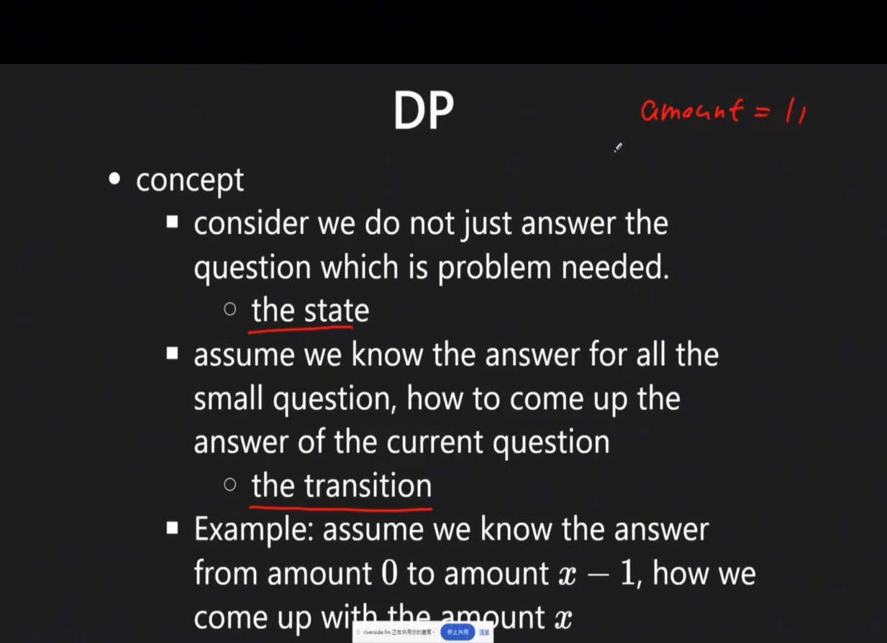

# Dynamic Programming (DP)

> **Scope** — The main DP sheet — state design, the pattern catalogue, and one canonical template per must-know DP family; the worked-solution archive, the rare techniques, and the five heaviest sub-topics live in their own sheets and are linked from here.
> **See also** — *split out of this file*: [dp_examples.md](./dp_examples.md) — the worked LC solution archive and the problems-by-pattern index; [dp_advanced.md](./dp_advanced.md) — game theory, tree DP, interval and string deep dives, probability DP; [knapsack.md](./knapsack.md) — 0/1 vs unbounded, subset sum, combinations vs permutations ([knapsack_01_zh.md](./knapsack_01_zh.md) — 0/1 背包的中文詳解版); [dp_string.md](./dp_string.md) — the two-sequence grid family; [dp_bitmask.md](./dp_bitmask.md) — state compression; [dp_digit.md](./dp_digit.md) — counting numbers by digit; [dp_monotonic_stack.md](./dp_monotonic_stack.md) — stack-carried DP values; [dp_loop_order.md](./dp_loop_order.md) — why a transition forces its loop nesting and direction, with LC 139 worked in five orders.
> *Neighbouring sheets*: [dp_pattern.md](./dp_pattern.md) — terse template index, one section per classic pattern; [recursion_to_dp.md](./recursion_to_dp.md) — converting a working recursion into DP step by step; [kadane_algorithm.md](./kadane_algorithm.md) — the maximum-subarray family in depth; [stock_trading.md](./stock_trading.md) — the LC 121/122/188/309/714 state machine.

## LeetCode Problem Lists

- [Dynamic Programming](https://leetcode.com/problem-list/dynamic-programming/)
- [Memoization](https://leetcode.com/problem-list/memoization/)

## Overview
**Dynamic Programming** is an algorithmic paradigm that solves complex problems by breaking them down into simpler subproblems and storing their solutions to avoid redundant computations.

### Key Properties
- **Time Complexity**: Problem-specific, typically O(n²) or O(n³)
- **Space Complexity**: O(n) to O(n²) for memoization table
- **Core Idea**: Trade space for time by memoizing overlapping subproblems
- **When to Use**: Problems with optimal substructure and overlapping subproblems
- **Key Techniques**: Memoization (top-down) and Tabulation (bottom-up)

### Core Characteristics
- **Optimal Substructure**: Optimal solution contains optimal solutions to subproblems
- **Overlapping Subproblems**: Same subproblems solved multiple times
- **Memoization**: Store results to avoid recomputation
- **State Transition**: Define relationship between states

- Core var: `state`, `transition`
- Anything the transition needs to know can go into `state`

<p align="center"></p>

### Step

Step 1. define `dp def`
Step 2. define `dp eq`
Step 3. check boundary condition, req, edge case
Step 4. get the result

### References
- [Dynamic Programming Patterns](https://leetcode.com/discuss/general-discussion/458695/dynamic-programming-patterns)
- [DP Tutorial](https://www.geeksforgeeks.org/dynamic-programming/) 

## Recognition

The constraint cues come from the ruler in [complexity_cheatsheet.md](./complexity_cheatsheet.md).

| Signal in the statement | Constraint cue | Reach for | Not this if |
|---|---|---|---|
| "maximum sum / product of a **contiguous** subarray", "cannot pick two adjacent" | n ≤ 10⁵ | [Template 1](#template-1-1-d-linear-dp--lc-53-) 1-D linear DP | the predecessor can be any earlier index → Template 7 |
| "number of ways to reach step n", "first `i` characters", a base case for *nothing* | n ≤ 10⁴ | [Template 1a](#template-1a-length-indexed-table-n--1-slots--lc-70) length-indexed table | |
| "segment / break / cut the string into valid pieces" | n ≤ 300 | [Template 1b](#template-1b-prefix-partition-dp--lc-139-) prefix partition | list **every** split → [backtrack.md](./backtrack.md) |
| "min path sum / unique paths", moves only right and down | m, n ≤ 200 | [Template 2](#template-2-2-d-grid-dp--lc-64-) grid DP | four-way moves → Dijkstra / BFS |
| a 2-D table the problem did not hand you (palindromic subsequence, two strings) | n ≤ 1000 | [Template 2a](#template-2a-2-d-table-shape-and-fill-order--lc-516-) shape and fill order | |
| "burst / merge / multiply everything in a range", cost depends on neighbours | n ≤ 500 | [Template 3](#template-3-interval-dp--lc-312) interval DP, last split point | only the two ends move → Template 2a, O(n²) |
| "use each element **at most once** to reach a sum / partition into two equal halves" | sum ≤ 2·10⁴ | [Template 4](#template-4-01-knapsack--lc-416-) 0/1 knapsack | items reusable → [knapsack.md](./knapsack.md) unbounded |
| "buy / sell with cooldown / fee / at most k transactions" | n ≤ 10⁵ | [Template 5](#template-5-state-machine-dp--lc-309) state machine | unlimited, no fee → greedy |
| "rob / climb / decode … in O(1) space" | n ≤ 10⁵ | [Template 6](#template-6-memoization--tabulation--rolling-variables--lc-198-) rolling variables | `dp[i]` reads every earlier cell → keep the table |
| "longest **increasing / divisible / nesting** subsequence" | n ≤ 2500 (n ≤ 10⁵ → `tails`) | [Template 7](#template-7-longest-increasing-subsequence--lc-300-) LIS | fixed difference → Template 7a |
| "longest subsequence where adjacent elements differ by a **given** `difference`" | n ≤ 10⁵ | [Template 7a](#template-7a-value-keyed-dp-dp--hash-map--lc-1218-) value-keyed DP | difference not given → `(index, diff)` map |
| "minimum insert / delete / replace to turn one string into another" | m, n ≤ 500 | [Template 8](#template-8-edit-distance--lc-72-) edit distance | delete only → Template 9 |
| "longest common subsequence", "min deletions to make two strings equal" | m, n ≤ 1000 | [Template 9](#template-9-longest-common-subsequence--lc-1143) LCS | contiguous → reset on mismatch (LC 718) |
| "longest / count palindromic **substrings**" | n ≤ 1000 | [Template 10](#template-10-palindrome-substring-dp--lc-5-) palindrome table | subsequence → LC 516 in Template 2a |
| "assign / pair / visit every item once" | n ≤ 20 | [Template 11](#template-11-bitmask-dp-over-subsets--lc-1879) bitmask DP | n ≥ 40 → greedy, flow or meet in the middle |
| "how many numbers ≤ n have digit property P" | n ≤ 10¹⁸ | [Template 12](#template-12-digit-dp--lc-233) digit DP | n ≤ 10⁶ → just loop |
| "list **all** combinations / partitions" | output is exponential | not DP → [backtrack.md](./backtrack.md) | |

## Problem Categories

### **Category 1: Linear DP**
- **Description**: Single sequence problems with linear dependencies
- **Examples**: LC 70 (Climbing Stairs), LC 198 (House Robber), LC 300 (LIS)
- **Pattern**: dp[i] depends on dp[i-1], dp[i-2], etc.
- **Sub-shape — prefix partition**: dp[i] instead scans *every* cut point j < i and tests the whole
  segment s[j:i] — LC 139 (Word Break), LC 132, LC 279. See [Template 1b](#template-1b-prefix-partition-dp--lc-139-).
- **Sub-shape — value-keyed (DP + hash map)**: the only legal predecessor of x is one known value
  (x - d), so dp lives in a map keyed by value and the inner loop disappears — LC 1218. See [Template 7a](#template-7a-value-keyed-dp-dp--hash-map--lc-1218-).

### **Category 2: Grid/2D DP**
- **Description**: Problems on 2D grids or matrices
- **Examples**: LC 62 (Unique Paths), LC 64 (Minimum Path Sum), LC 221 (Maximal Square)
- **Pattern**: dp[i][j] depends on neighbors

### **Category 3: Interval DP**
- **Description**: Problems on intervals or subarrays
- **Examples**: LC 312 (Burst Balloons), LC 1000 (Minimum Cost to Merge Stones)
- **Pattern**: dp[i][j] for interval [i, j]

### **Category 3-2: Game Theory / Minimax DP** → [dp_advanced.md](./dp_advanced.md)
- **Description**: Two-player optimal play on arrays; each player picks from either end
- **Examples**: LC 486 (Predict the Winner), LC 877 (Stone Game), LC 1140 (Stone Game II)
- **Pattern**: `dp[i][j]` = max relative score difference (current player minus opponent) on `nums[i..j]`
- **Recurrence**: `dp[i][j] = max(nums[i] - dp[i+1][j], nums[j] - dp[i][j-1])` — derivation and template in [dp_advanced.md](./dp_advanced.md)

### **Category 4: Tree DP**
- **Description**: DP on tree structures
- **Examples**: LC 337 (House Robber III), LC 968 (Binary Tree Cameras)
- **Pattern**: State at each node depends on children
- **📚 Implementation**: Tree DP problems use DFS traversal for implementation. See **dfs.md Template 6 (Bottom-up DFS)** for the DFS traversal patterns used in tree DP solutions

- **Sub-patterns**: bottom-up (post-order) tree DP and re-rooting DP (two-pass DFS) — both in [dp_advanced.md](./dp_advanced.md)

### **Category 5: State Machine DP**
- **Description**: Problems with multiple states and transitions
- **Examples**: LC 714 (Stock with Fee), LC 309 (Stock with Cooldown), LC 122 (Stock II)
- **Pattern**: Multiple DP arrays for different states
- **Key Characteristic**: State transitions depend on previous state + action constraints

- **Sub-patterns**: 2-state (LC 122), 3-state with cooldown (LC 309), 2k-state for k transactions (LC 123 / 188) — all in [stock_trading.md](./stock_trading.md)

### **Category 6: Knapsack DP**
- **Description**: Selection problems with constraints
- **Examples**: LC 416 (Partition Equal Subset), LC 494 (Target Sum)
- **Pattern**: dp[i][j] for items and capacity/target

### **Category 7: String DP**
- **Description**: String matching, transformation, and subsequence problems
- **Examples**: LC 72 (Edit Distance), LC 1143 (LCS), LC 5 (Longest Palindromic Substring)
- **Pattern**: dp[i][j] for positions in two strings

### **Category 8: State Compression DP**
- **Description**: Use bitmask to represent states, optimize space complexity
- **Examples**: LC 691 (Stickers to Spell Word), LC 847 (Shortest Path Visiting All Nodes)
- **Pattern**: dp[mask] where mask represents visited/selected items

### **Category 9: Monotonic Stack + DP** → [dp_monotonic_stack.md](./dp_monotonic_stack.md)

**Signal**: a brute-force that **removes elements round by round** (each element is deleted once a
bigger element reaches it), or an area/rectangle question over a histogram. Both are O(n^2) if
simulated and O(n) with a monotonic stack that carries a DP value.

| Problem | LC | What the stack carries |
|---------|----|------------------------|
| Steps to Make Array Non-decreasing | 2289 | `dp[i]` = rounds element `i` survives; a popped chain contributes `max(...)` |
| Largest Rectangle in Histogram | 84 | index of the previous smaller bar → width of the rectangle ending here |
| Maximal Rectangle | 85 | LC 84 applied row by row over a running histogram |
| Maximal Square / Count Square Submatrices | 221 / 1277 | `dp[i][j] = 1 + min(up, left, up-left)` (grid DP, not a stack) |
| Flip String to Monotone Increasing | 926 | one-pass counter DP |

[**dp_monotonic_stack.md**](./dp_monotonic_stack.md) covers, in full: the survival-round transition
with a worked trace, the LC 2289 template in Java and Python, the histogram area DP, the maximal
square recurrence, and the LC 926 one-pass DP.

## Templates & Algorithms

### Template Comparison Table
| Template Type | Use Case | State Definition | When to Use |
|---------------|----------|------------------|-------------|
| **1D Linear** | Single sequence | dp[i] = state at position i | Fibonacci-like problems |
| **2D Grid** | Matrix paths | dp[i][j] = state at (i,j) | Path counting, min/max |
| **Interval** | Subarray/substring | dp[i][j] = [i,j] interval | Palindrome, partition |
| **Knapsack** | Selection with limit | dp[i][w] = items & weight | 0/1, unbounded selection |
| **State Machine** | Multiple states | dp[i][state] = at i in state | Buy/sell stocks |
| **Value-Keyed (Hash Map)** | Chain with a fixed step | dp[value] = best chain ending with value | Predecessor is one known value |

### Template 1: 1-D Linear DP — LC 53 ⭐⭐⭐⭐⭐

**Recognise** — one array, and the answer at position `i` depends only on a **fixed number of
earlier positions**: "maximum sum of a contiguous subarray", "number of ways to reach step n",
"cannot take two adjacent". n ≤ 10⁵ → one O(n) pass is expected.

**Key point** — `dp[i]` is a claim about the subarray that **ends exactly at `i`**, so it has only
two choices: extend the best run ending at `i-1`, or restart at `i`. The answer can end anywhere,
so it is `max(dp)`, not `dp[n-1]`.

- **State**: `dp[i]` = best sum of a subarray ending exactly at index `i`
- **Recurrence**: `dp[i] = max(nums[i], dp[i-1] + nums[i])`
- **Base**: `dp[0] = nums[0]`
- **Order**: `i` ascending — `dp[i]` reads only `dp[i-1]`
- **Answer**: `max(dp)`

```python
# python
# LC 53 - Maximum Subarray
# IDEA: dp[i] = best sum of a subarray that ENDS at i: extend the previous run or restart at i
# time = O(n), space = O(n)
def maxSubArray(nums):
    n = len(nums)
    if n == 0:
        return 0

    # State: dp[i] = max sum of a subarray ending exactly at index i
    dp = [0] * n
    dp[0] = nums[0]

    for i in range(1, n):
        # Transition: extend the run ending at i-1, or start a new run at i
        dp[i] = max(nums[i], dp[i - 1] + nums[i])

    # The answer can end anywhere, so it is the best dp[i], not dp[n-1]
    return max(dp)
```

```java
// java
// LC 53 - Maximum Subarray
// IDEA: dp[i] = best sum of a subarray that ENDS at i: extend the previous run or restart at i
// time = O(n), space = O(n)
public int maxSubArray(int[] nums) {
    int n = nums.length;
    int[] dp = new int[n];
    dp[0] = nums[0];
    int best = dp[0];

    for (int i = 1; i < n; i++) {
        // extend the run ending at i-1, or start a new run at i
        dp[i] = Math.max(nums[i], dp[i - 1] + nums[i]);
        best = Math.max(best, dp[i]);   // the answer can end at any index
    }
    return best;
}
```

**Complexity**
- **Time O(n)**: the single `for i in range(1, n)` loop does O(1) work per index.
- **Space O(n)**: the `dp` array. `dp[i]` reads only `dp[i-1]`, so one running variable makes it
  O(1) — that is Kadane's algorithm.

**Dry run**

```text
nums = [-2, 1, -3, 4, -1, 2]
i=0  dp=-2                       best=-2
i=1  max(1, -2+1=-1)  -> 1       best=1
i=2  max(-3, 1-3=-2)  -> -2      best=1
i=3  max(4, -2+4=2)   -> 4       restart at 4
i=4  max(-1, 4-1=3)   -> 3
i=5  max(2, 3+2=5)    -> 5       best=5   ([4, -1, 2])
```

**Traps**
- `dp[i] = max(dp[i-1], nums[i])` drops the `+ nums[i]` and returns the **largest element**, not the
  largest sum: `[1, 2]` gives 2 instead of 3.
- Returning `dp[n-1]` assumes the best run ends at the last index: `[5, -9]` returns -4, not 5.
- Seeding `best = 0` (or `dp` with zeros) is wrong when every value is negative: `[-3, -1]` must
  return -1.

**Not this if** — the predecessor can be **any** earlier index, not just `i-1` → LIS
([Template 7](#template-7-longest-increasing-subsequence--lc-300-)). A product instead of a sum
needs both the max and the min ending at `i` → LC 152 in [kadane_algorithm.md](./kadane_algorithm.md).

**Drill** — LC 53 ⭐ · LC 746 *(min instead of max, two steps back)* · LC 152 ⭐ *(carry max and
min)* · LC 918 *(circular: total − min subarray)* · LC 1191 *(repeated array)*

#### Recurrence catalogue (1-D)

| Problem Type | Recurrence | Example | Time | Space |
|--------------|------------|---------|------|-------|
| **Fibonacci** | dp[i] = dp[i-1] + dp[i-2] | LC 70 Climbing Stairs | O(n) | O(1) |
| **House Robber** | dp[i] = max(dp[i-1], dp[i-2] + nums[i]) | LC 198 House Robber | O(n) | O(1) |
| **Decode Ways** | dp[i] = dp[i-1] + dp[i-2] (if valid) | LC 91 Decode Ways | O(n) | O(1) |
| **Word Break** → [Template 1b](#template-1b-prefix-partition-dp--lc-139-) | dp[i] = OR(dp[j] AND s[j:i] in dict) | LC 139 Word Break | O(n²) cuts, O(n³) with the slice | O(n) |

#### Maximum subarray (Kadane) → kadane_algorithm.md

`dp[i] = max(nums[i], dp[i-1] + nums[i])` is the same 1-D shape with a "restart or extend" choice, so
it needs no table at all. [**kadane_algorithm.md**](./kadane_algorithm.md) covers that family in full —
LC 53, LC 152 (max product), LC 918 (circular), LC 1191 (repeated array) — including index tracking
and the divide-and-conquer variant.

### Template 1a: Length-Indexed Table (n + 1 Slots) — LC 70

**Recognise** — the answer is about **the first `i` items** or **a target of size `i`**, and size 0
has a meaningful answer of its own: "number of ways to reach step `n`", "can the first `i`
characters be …", "fewest coins to make amount `a`". The tell is a base case for *nothing*.

**Key point** — `dp[i]` is a claim about a **length** (or amount), not about the element at index
`i`. Slot 0 holds the empty prefix, so the table has `n + 1` slots, the element decided at step `i`
is `nums[i-1]`, and the answer is `dp[n]`.

- **State**: `dp[i]` = number of distinct ways to stand on step `i`
- **Recurrence**: `dp[i] = dp[i-1] + dp[i-2]` — the last move was one step or two
- **Base**: `dp[0] = 1` (one way to stand still), `dp[1] = 1`
- **Order**: `i` ascending, `2 → n`
- **Answer**: `dp[n]`

```python
# python
# LC 70 - Climbing Stairs
# IDEA: dp[i] = ways to reach step i; i is a COUNT of steps, so the table has n + 1 slots
# time = O(n), space = O(n)
def climbStairs(n):
    dp = [0] * (n + 1)      # dp[0] .. dp[n]: step n is the goal, so it needs a slot
    dp[0] = 1               # one way to be at the bottom: take no step
    dp[1] = 1
    for i in range(2, n + 1):
        dp[i] = dp[i - 1] + dp[i - 2]   # last move was 1 step or 2 steps
    return dp[n]
```

```java
// java
// LC 70 - Climbing Stairs
// IDEA: dp[i] = ways to reach step i; i is a COUNT of steps, so the table has n + 1 slots
// time = O(n), space = O(n)
public int climbStairs(int n) {
    int[] dp = new int[n + 1];
    dp[0] = 1;              // one way to be at the bottom: take no step
    dp[1] = 1;
    for (int i = 2; i <= n; i++) {
        dp[i] = dp[i - 1] + dp[i - 2];
    }
    return dp[n];
}
```

**Complexity**
- **Time O(n)**: one pass of `for i in range(2, n + 1)`, O(1) per step.
- **Space O(n)**: the `n + 1` table. Two rolling variables make it O(1)
  ([Template 6](#template-6-memoization--tabulation--rolling-variables--lc-198-)).

**Traps**
- The three tells must agree — `[0] * (n + 1)`, `range(1, n + 1)`, `return dp[n]`. Mix the length
  view with the index view and you read `s[n]` off the end, or skip the last element.
- `s[i-1]` in a length-indexed loop is the **current** character, not the previous one (below).
- Seeding `dp[2]` without a guard: `n = 1` gives a table of 2 slots and `dp[2] = …` raises
  `IndexError`. Seeding `dp[0]` and `dp[1]` only needs `n ≥ 1`.

**Not this if** — `dp[i]` is about the element **at** index `i` ("subarray ending at `i`") → size `n`
and [Template 1](#template-1-1-d-linear-dp--lc-53-). A whole segment `s[j:i]` is tested at each
step → [Template 1b](#template-1b-prefix-partition-dp--lc-139-).

**Drill** — LC 70 ⭐ · LC 746 *(dp[n] is the "top", one past the last step)* · LC 198 ⭐ *(n + 1
form below)* · LC 91 ⭐ *(dp[0] = 1, read `s[i-1]` and `s[i-2:i]`)* · LC 926 *(the `s[i-1]` trap)*

**Why two sizes exist at all** — the difference comes down to **what a single index in your DP array
represents**. Two reasons cover almost every problem; the third — physical "steps" vs "goals",
LC 746 — is in [dp_advanced.md](./dp_advanced.md).

#### **1. "Indices" vs "Count" (The Offset)**

This is the most frequent reason for the difference.

- **Loop to `n` (Array size = `n`)**: You are treating the index as a **specific element** in the input array
  - `dp[i]` means "the best result using the i-th element"
  - Example: `dp[3]` represents "result at element index 3"

- **Loop to `n+1` (Array size = `n+1`)**: You are treating the index as a **quantity** or **length**
  - `dp[i]` means "the best result using the first i elements"
  - Example: `dp[3]` represents "result using first 3 elements"

**Example: LC 198 (House Robber)**
```python
# python
# LC 198 - House Robber, sized both ways
# IDEA: index view (dp[i] = best using house i) vs length view (dp[i] = best over the first i houses)
# time = O(n), space = O(n)
# Approach 1: Array size = n (index-based)
def rob_v1(nums):
    n = len(nums)
    if n == 0: return 0
    if n == 1: return nums[0]

    dp = [0] * n
    dp[0] = nums[0]
    dp[1] = max(nums[0], nums[1])

    for i in range(2, n):  # Loop to n
        dp[i] = max(dp[i-1], dp[i-2] + nums[i])

    return dp[n-1]  # Answer at last index

# Approach 2: Array size = n+1 (count-based)
def rob_v2(nums):
    n = len(nums)
    dp = [0] * (n + 1)  # Extra space for "0 houses"
    dp[0] = 0  # Robbing 0 houses = 0
    dp[1] = nums[0] if n > 0 else 0

    for i in range(2, n + 1):  # Loop to n+1
        dp[i] = max(dp[i-1], dp[i-2] + nums[i-1])  # Note: nums[i-1]

    return dp[n]  # Answer at position n
```

#### **The `s[i-1]` trap — it is the *current* character, not the previous one**

Once the table is `n+1` long, `i` stops being a position and becomes a **length**. That single
change is what makes `s[i-1]` read wrong at first glance: the `-1` looks like "step back one
character", but it is only the conversion from *a length* to *the index of that length's last
character*.

```text
dp[i]  = a claim about the FIRST i CHARACTERS  ->  i is a LENGTH (0 .. n)
s[j]   = the character sitting AT position j   ->  j is an INDEX  (0 .. n-1)

a prefix of length i ends at index i-1
        -> s[i-1] is the newest character inside dp[i]  ->  the CURRENT one
```

Line the two rows up once and the confusion goes away — they are off by one *by construction*,
because the length row carries an extra "empty prefix" slot at the front:

```text
s        =        0     1     0          (n = 3)
index    =        0     1     2          <- s is indexed 0..n-1
                  ^     ^     ^
dp slot  =  0     1     2     3          <- dp has n+1 slots
            |     |     |     |
           ""    "0"   "01"  "010"       <- the prefix dp[i] talks about
```

| loop step | `i` (length) | prefix `s[:i]` | its last char | `val = s[i-1]` |
|---|---|---|---|---|
| 1st | 1 | `"0"`   | `'0'` | `s[0]` = `'0'` ✅ current |
| 2nd | 2 | `"01"`  | `'1'` | `s[1]` = `'1'` ✅ current |
| 3rd | 3 | `"010"` | `'0'` | `s[2]` = `'0'` ✅ current |

`s[i-1]` is never the previous character — the previous character is `s[i-2]`, and you almost
never need it, because everything already decided about it is folded into `dp[i-1]`.

**LC 926 (Flip String to Monotone Increasing) written in this view** — `dp[i]` = min flips to make
the first `i` characters monotone increasing:

```python
# python
# LC 926 - Flip String to Monotone Increasing
# IDEA: dp[i] = min flips over the PREFIX OF LENGTH i, so the char decided at step i is s[i-1]
# time = O(n), space = O(n)
def minFlipsMonoIncr(s):
    n = len(s)
    dp = [0] * (n + 1)          # n+1 slots: dp[0] = empty prefix = 0 flips
    one_so_far = 0              # '1's seen so far in s[:i-1]

    for i in range(1, n + 1):   # i = prefix LENGTH, not a position
        val = s[i - 1]          # the character being decided right now

        if val == '0':
            # flip every earlier '1' -> one_so_far
            # flip this '0' to '1'   -> 1 more than dp[i-1]
            dp[i] = min(one_so_far, dp[i - 1] + 1)
        else:
            dp[i] = dp[i - 1]   # a '1' at the end is always safe, costs nothing
            one_so_far += 1

    return dp[n]                # dp[n], NOT dp[n-1]
```

Trace on `s = "010"`:

```text
i=1  val=s[0]='0'  dp[1]=min(one_so_far=0, dp[0]+1=1) = 0
i=2  val=s[1]='1'  dp[2]=dp[1]=0                 one_so_far -> 1
i=3  val=s[2]='0'  dp[3]=min(one_so_far=1, dp[2]+1=1) = 1
answer = dp[3] = 1     ("010" -> "011" or "000")
```

Three tells put you in the length view, and **all three must agree** — `dp = [0] * (n + 1)`,
`for i in range(1, n + 1)`, `return dp[n]`. Mix one of them with the index view and you either
read `s[n]` off the end of the string or silently skip its last character.

#### **2. Handling the "Empty" Base Case**

Many DP problems need a base case representing "nothing" (target sum = 0, empty string, etc.).

**Examples**:
- **Knapsack/Coin Change**: Need `dp[target + 1]` because `dp[0]` represents sum = 0
- **Longest Common Subsequence**: Use `(n+1) x (m+1)` matrix where first row/column = empty string
  — but a 2-D table indexed by **real positions** (LC 647's `dp[i][j]` = `s[i..j]`) is `n × n`; see
  [Sizing the table](#sizing-the-table--n--n-or-n1--n1-lc-647)

```python
# python
# LC 322 - Coin Change
# IDEA: dp[a] = fewest coins for amount a; dp[0] = 0 is the "empty" amount, so amount + 1 slots
# time = O(amount * len(coins)), space = O(amount)
def coinChange(coins, amount):
    dp = [float('inf')] * (amount + 1)  # Need amount+1
    dp[0] = 0  # Base case: 0 coins needed for amount 0

    for i in range(1, amount + 1):  # Loop to amount+1
        for coin in coins:
            if i >= coin:
                dp[i] = min(dp[i], dp[i - coin] + 1)

    return dp[amount] if dp[amount] != float('inf') else -1
```

#### **Comparison Summary**

| Feature | Loop `0` to `n` | Loop `0` to `n+1` |
|---------|-----------------|-------------------|
| **Array Size** | `new int[n]` | `new int[n + 1]` |
| **`dp[i]` meaning** | Result at element `i` | Result considering first `i` items |
| **Typical Base Case** | `dp[0]` and `dp[1]` | `dp[0]` is the "empty" state |
| **Access Pattern** | `dp[i]` ↔ `nums[i]` | `dp[i]` ↔ `nums[i-1]` |
| **Final Answer** | `dp[n - 1]` | `dp[n]` |
| **Use Case** | Direct element mapping | Count/quantity problems, "goal" beyond array |


### Template 1b: Prefix Partition DP — LC 139 ⭐⭐⭐⭐

Template 1a's `n+1` sizing exists for exactly this shape. `dp[i]` is a claim about a **prefix
length**, never about "the character at index `i`" — and this is the one 1-D family whose
transition inspects a **whole segment** `s[j:i]` instead of a fixed offset like `dp[i-1]` or
`dp[i-2]`. Everything else in the family swaps out one thing: the test applied to that segment.

**Recognise** — "can the string be **segmented / broken / cut** into pieces that each satisfy …",
"minimum number of cuts", "fewest pieces". n ≤ 300 (LC 139) → an O(n²) cut loop is fine; a
dictionary of short words (`L ≤ 20`) lets the inner loop stop after `L` steps.

**Key point** — **guess the last word.** If `s[:i]` splits at all, the split ends with one final
word `s[j:i]`, and everything before it is the smaller problem `s[:j]` that `dp[j]` has already
answered. So `dp[i]` is an OR over every cut point `j` of `dp[j] AND s[j:i] in words`.

| Aspect | Detail |
|--------|--------|
| **Pattern** | Prefix partition — outer loop over prefix *length*, inner loop over the cut point |
| **State** | `dp[i]` = can `s[:i]`, the first `i` characters, be segmented into dictionary words? |
| **Base** | `dp[0] = True` — the empty prefix is vacuously segmented |
| **Transition** | `dp[i] = OR over j < i of (dp[j] AND s[j:i] in dict)` |
| **Answer** | `dp[n]`, **not** `dp[n-1]` — the table has `n+1` slots |

```text
        j                 i
s:  [ ---- dp[j] ---- ][ s[j:i] ]
      already solved     one word?
```

`dp[i]` is true the moment **some** `j` answers yes to both — which is why the inner loop can
`break` on the first hit. **Read `i` as a boundary, not a character**: it is the frontier between
"already segmented" and "not yet looked at", so it legitimately reaches `n` — one past the last
character. That is the same frontier the BFS formulation queues up.

```python
# python
# IDEA: PREFIX PARTITION DP — dp[i] = can s[:i] be cut into dictionary words
# LC 139 - Word Break
# time = O(n^2) cuts * O(L) slice+hash, space = O(n + dictionary)
class Solution(object):
    def wordBreak(self, s, wordDict):
        n = len(s)
        words = set(wordDict)          # set, not list — see the trap below

        dp = [False] * (n + 1)         # n+1 slots, indexed by prefix LENGTH
        dp[0] = True                   # the empty prefix is always segmentable

        for i in range(1, n + 1):      # i = end boundary of the prefix
            for j in range(i):         # j = start of the candidate last word
                if dp[j] and s[j:i] in words:
                    dp[i] = True
                    break              # one valid cut is enough — it is an OR
        return dp[n]
```

```java
// java
// IDEA: PREFIX PARTITION DP — dp[i] = can s[:i] be cut into dictionary words
// LC 139 - Word Break
// time = O(n^2) cuts * O(L) substring+hash, space = O(n + dictionary)
public boolean wordBreak(String s, List<String> wordDict) {
    int n = s.length();
    Set<String> words = new HashSet<>(wordDict);

    boolean[] dp = new boolean[n + 1];   // n+1 slots, indexed by prefix LENGTH
    dp[0] = true;                        // the empty prefix is always segmentable

    for (int i = 1; i <= n; i++) {       // i = end boundary of the prefix
        for (int j = 0; j < i; j++) {    // j = start of the candidate last word
            if (dp[j] && words.contains(s.substring(j, i))) {
                dp[i] = true;
                break;                   // one valid cut is enough — it is an OR
            }
        }
    }
    return dp[n];
}
```

**Complexity** — stated honestly. The doubled `for i` / `for j` loop is O(n²) iterations, but each
one **builds and hashes a substring** of length up to `n`:

| Accounting | Bound | When it is the right one to quote |
|------------|-------|-----------------------------------|
| Treat slice + hash as O(1) | **O(n²)** | The usual interview shorthand |
| Charge the slice its real cost | **O(n³)** | Python `s[j:i]` / Java `substring` — the strict bound |
| Cap the inner loop at the longest word `L` | **O(n·L²)** | The optimisation below; `L ≤ 20` on LC 139 |

Space is O(n) for `dp` plus the word set. A last word longer than the longest dictionary entry can
never match, so the inner loop only needs to reach back `L` characters:

```python
# python
# IDEA: same DP, inner loop capped by the longest word — O(n * L^2), effectively linear in n
# time = O(n * L^2), space = O(n)
L = max(map(len, words))
for i in range(1, n + 1):
    for j in range(max(0, i - L), i):
        if dp[j] and s[j:i] in words:
            dp[i] = True
            break
```

**Dry run**

```text
s = "leetcode", dict = {"leet", "code"}

i=0                     dp[0] = True   (base: empty prefix)
i=1..3   no j works     dp[1..3] = False
i=4      j=0: dp[0] AND "leet" in dict  -> dp[4] = True
i=5..7   no j works     dp[5..7] = False
i=8      j=4: dp[4] AND "code" in dict  -> dp[8] = True
                                           ^ answer = dp[n] = dp[8]
```

**Traps**
- **`in wordDict` on the raw list.** `s[j:i] in wordDict` against a *list* is a linear scan with a
  string compare at each step — O(k·L) per lookup, so the whole solve degrades to O(n²·k·L) and
  TLEs. `set(wordDict)` makes it one hash. This is the single most common reason a correct-looking
  Word Break times out.
- **Looping over the dictionary instead of over the cut points.** The inner loop is `range(i)` —
  *positions* — not `for w in wordDict`. A word-driven **inner** loop is fine (it still reads only
  finished cells); a word-driven **outer** loop is not, and it silently fails the problem's own
  Example 2 — `"applepenapple"` needs `"apple"` on both sides of `"pen"`, and one pass per word can
  only place a word once. Why, and all five orders side by side:
  [dp_loop_order.md](./dp_loop_order.md#2-lc-139-word-break--one-recurrence-five-orders-).
- **Returning `dp[-1]` after mis-sizing.** With `n` slots instead of `n+1` there is nowhere to put
  the `dp[0] = True` base case, and every answer collapses to `False`.

**Not this if** — the problem wants **every** split, not whether one exists:
[LC 131 Palindrome Partitioning](./backtrack.md) is backtracking, because DP prunes to a yes/no or an
optimum and cannot enumerate exponentially many outputs any faster. LC 140 is the hybrid: DP to prove
a split exists, then backtracking to list them.

**Drill** — LC 139 ⭐ · LC 91 ⭐ *(segment capped at 2 digits, combine = sum)* · LC 279 *(segment
= a perfect square, combine = min + 1)* · LC 132 *(palindrome test, min cuts)* · LC 140 *(collect
sentences)* · LC 472 *(the dictionary is the input itself)*

#### Similar LeetCode Problems

Every one of these is the same `dp[i] = f(dp[j], segment(j, i))` skeleton. Only the **segment test**
and the **combining operator** change:

| Problem | Segment test on `s[j:i]` | Combine | Note |
|---------|--------------------------|---------|------|
| **LC 139** Word Break | is it a dictionary word? | OR | The template above |
| **LC 140** Word Break II | is it a dictionary word? | collect | Memoise *lists of sentences*, not booleans; backtrack from the same table |
| **LC 472** Concatenated Words | is it one of the *other* words? | OR | Sort by length so only strictly shorter words are in the dict |
| **LC 132** Palindrome Partitioning II | is it a palindrome? | `min(+1)` | Precompute the palindrome table first, then the identical cut loop |
| **LC 91** Decode Ways | is it a valid 1–2 digit code? | sum | Segment length is capped at 2, so the inner loop degenerates to `dp[i-1] + dp[i-2]` |
| **LC 279** Perfect Squares | is `i - j` a perfect square? | `min(+1)` | Same shape over integers rather than characters |
| **LC 1043** Partition Array for Max Sum | is the run ≤ `k` long? | `max` | Carries the running segment max alongside `j` |
| **LC 322** Coin Change | is `i - j` a coin? | `min(+1)` | The unbounded-knapsack spelling of the same recurrence |

### Template 2: 2-D Grid DP — LC 64 ⭐⭐⭐⭐⭐

**Recognise** — a grid is handed to you and movement is **only right / down** (or any one-way
direction): "minimum path sum from top-left to bottom-right", "number of unique paths", "largest
square of 1s". m, n ≤ 200 → O(m·n) is expected.

**Key point** — a one-way move makes the grid a DAG: the best path to `(i, j)` must have come from
**above or left**, and row-major order fills both before `(i, j)`. So each cell is computed once,
and no `visited` set is needed.

| Aspect | Detail |
|--------|--------|
| **State** | `dp[i][j]` = min cost to reach cell `(i, j)` from `(0, 0)` |
| **Transition** | `dp[i][j] = grid[i][j] + min(dp[i-1][j], dp[i][j-1])` |
| **Base Cases** | First row: prefix sum left→right; first column: prefix sum top→bottom |
| **Order** | Row-major, `i` then `j`, both ascending |
| **Answer** | `dp[m-1][n-1]` |

```python
# python
# LC 64 - Minimum Path Sum
# IDEA: a cell is reached from above or from the left, so take the cheaper and add the cell
# time = O(m * n), space = O(m * n)
def minPathSum(grid):
    m, n = len(grid), len(grid[0])
    dp = [[0] * n for _ in range(m)]
    dp[0][0] = grid[0][0]

    for i in range(1, m):                 # first column: only from above
        dp[i][0] = dp[i - 1][0] + grid[i][0]
    for j in range(1, n):                 # first row: only from the left
        dp[0][j] = dp[0][j - 1] + grid[0][j]

    for i in range(1, m):
        for j in range(1, n):
            dp[i][j] = grid[i][j] + min(dp[i - 1][j], dp[i][j - 1])

    return dp[m - 1][n - 1]
```

```java
// java
// LC 64 - Minimum Path Sum
// IDEA: a cell is reached from above or from the left, so take the cheaper and add the cell
// time = O(m * n), space = O(m * n)
public int minPathSum(int[][] grid) {
    int m = grid.length;
    int n = grid[0].length;
    int[][] dp = new int[m][n];

    dp[0][0] = grid[0][0];                       // base: starting cell
    for (int i = 1; i < m; i++) {                // first column — only from above
        dp[i][0] = dp[i - 1][0] + grid[i][0];
    }
    for (int j = 1; j < n; j++) {                // first row — only from the left
        dp[0][j] = dp[0][j - 1] + grid[0][j];
    }

    for (int i = 1; i < m; i++) {                // the rest: min of above vs left
        for (int j = 1; j < n; j++) {
            dp[i][j] = grid[i][j] + Math.min(dp[i - 1][j], dp[i][j - 1]);
        }
    }
    return dp[m - 1][n - 1];
}
```

**Complexity**
- **Time O(m·n)**: the nested `for i` / `for j` visits each cell once, O(1) per cell.
- **Space O(m·n)**: the `dp` table. Row `i` reads only row `i-1`, so one row of length `n` is
  enough — O(n).

**Dry run**

```text
grid          dp
1 3 1         1  4  5
1 5 1    ->   2  7  6
4 2 1         6  8  7     answer dp[2][2] = 7   (1 → 3 → 1 → 1 → 1)
```

**Traps**
- Filling the first row / column with the general formula reads `dp[-1][j]`, which in Python is the
  **last** row, not an error: the answer is silently wrong. Seed them separately.
- `grid = [[5]]` (1 × 1): both seeding loops are empty and the answer is `grid[0][0]`; a solution
  that starts with `dp[1][1]` indexes out of range.
- LC 63 (obstacles): an obstacle in the first row blocks **every** cell to its right, so the
  first-row seed is not `1` everywhere.

**Not this if** — movement in **all four directions** makes cycles, so "already filled" stops
being true → Dijkstra (LC 1631, table below). Two strings instead of one grid → the table is
invented, not handed to you → [Template 2a](#template-2a-2-d-table-shape-and-fill-order--lc-516-).

**Drill** — LC 62 ⭐ *(count instead of min)* · LC 64 · LC 63 *(obstacles in the seed row)* ·
LC 120 *(triangle, bottom-up)* · LC 221 *(`1 + min` of three neighbours)* · LC 174 *(fill from the
bottom-right)*

#### DP or Dijkstra — One-Way vs Four-Way Moves

| | LC 64 (Min Path Sum) | LC 1631 (Min Effort Path) |
|---|---|---|
| **Movement** | Right + Down only | All 4 directions |
| **Cost** | Accumulative sum | Max of step differences |
| **Revisit cells?** | No (one direction) | Yes (better path possible) |
| **Algorithm** | 2D DP | Dijkstra + min-heap |
| **`visited` needed?** | No | Yes |
| **Why DP works** | No cycles, DAG structure | DP fails: can revisit |

**Rule**: If movement is constrained to one direction (right/down) → use **2D DP**. If all 4 directions are allowed → use **Dijkstra** (or BFS with priority).

#### Recurrence catalogue (2-D)

| Problem Type | Recurrence | Example | Time | Space |
|--------------|------------|---------|------|-------|
| **Unique Paths** | dp[i][j] = dp[i-1][j] + dp[i][j-1] | LC 62 Unique Paths | O(m×n) | O(n) |
| **Min Path Sum** | dp[i][j] = min(dp[i-1][j], dp[i][j-1]) + grid[i][j] | LC 64 Min Path Sum | O(m×n) | O(n) |
| **LCS** | dp[i][j] = dp[i-1][j-1] + 1 if match else max(...) | LC 1143 LCS | O(m×n) | O(n) |
| **Edit Distance** | dp[i][j] = min(insert, delete, replace) | LC 72 Edit Distance | O(m×n) | O(n) |

> The Python transcription, the in-place variant, the O(m) rolling-row form, the top-down memoised
> form, the four-approach comparison table, the similar-problem map and the
> `[[1,3,1],[1,5,1],[4,2,1]]` trace are in [dp_advanced.md](./dp_advanced.md); the counting twin
> LC 62 (Unique Paths) is worked in [dp_examples.md](./dp_examples.md).

### Template 2a: 2-D Table Shape and Fill Order — LC 516 ⭐⭐⭐⭐⭐

Template 2 is the easy 2-D case: the table *is* the input grid, so `dp[i][j]` sits where the problem
already put it. The other two 2-D families — interval DP (Template 3, Template 10) and two-sequence
DP (Template 8, Template 9) — invent a table the problem never handed you, and there the recurrence
is rarely what sinks people. The table is: **what shape is it, which cells does the recurrence read,
and therefore which loop order is legal.** This section is the shared map; the templates below
assume it.

**Recognise** — a 2-D table the problem did not hand you: "longest palindromic **subsequence**",
"minimum insertions to make a palindrome", "edit distance / LCS between two strings", "burst /
merge everything in a range". n ≤ 1000 → O(n²) cells; n ≤ 500 with a split point → O(n³).

**Key point** — every `dp[...]` on the right-hand side of the transition is an arrow **into**
`dp[i][j]`; a loop order is legal exactly when every arrow lands on a cell that is already filled.
LC 516 reads row `i+1` and column `j-1`, so `i` descends and `j` ascends.

- **State**: `dp[i][j]` = longest palindromic subsequence inside `s[i..j]` (Shape A, `n × n`)
- **Recurrence**: `dp[i+1][j-1] + 2` if `s[i] == s[j]`, else `max(dp[i+1][j], dp[i][j-1])`
- **Base**: the diagonal, `dp[i][i] = 1`
- **Order**: `i` from `n-1` down to `0`, `j` from `i+1` up to `n-1`
- **Answer**: the top-right corner, `dp[0][n-1]`

```python
# python
# LC 516 - Longest Palindromic Subsequence
# IDEA: i descends so row i+1 is already done; j ascends so column j-1 is already done
# time = O(n^2), space = O(n^2)
def longestPalindromeSubseq(s):
    n = len(s)
    dp = [[0] * n for _ in range(n)]

    for i in range(n - 1, -1, -1):         # bottom row first
        dp[i][i] = 1                       # base: one character
        for j in range(i + 1, n):          # left to right, above the diagonal
            if s[i] == s[j]:
                dp[i][j] = dp[i + 1][j - 1] + 2
            else:
                dp[i][j] = max(dp[i + 1][j], dp[i][j - 1])

    return dp[0][n - 1]
```

```java
// java
// LC 516 - Longest Palindromic Subsequence
// IDEA: i descends so row i+1 is already done; j ascends so column j-1 is already done
// time = O(n^2), space = O(n^2)
public int longestPalindromeSubseq(String s) {
    int n = s.length();
    int[][] dp = new int[n][n];

    for (int i = n - 1; i >= 0; i--) {         // bottom row first
        dp[i][i] = 1;                          // base: one character
        for (int j = i + 1; j < n; j++) {      // left to right, above the diagonal
            if (s.charAt(i) == s.charAt(j)) {
                dp[i][j] = dp[i + 1][j - 1] + 2;
            } else {
                dp[i][j] = Math.max(dp[i + 1][j], dp[i][j - 1]);
            }
        }
    }
    return dp[0][n - 1];
}
```

**Complexity**
- **Time O(n²)**: the `for i` / `for j` pair visits each cell of the upper triangle once, O(1) per
  cell. A split point `k` nested inside (Template 3) makes it O(n³).
- **Space O(n²)**: the `n × n` table. Shape B tables compress to one row; Shape A does not (see
  *Space compression* below).

**Dry run** — LC 516 on `s = "bbbab"` is worked cell by cell in
[Shape A](#shape-a--one-sequence-ij-are-the-two-ends) below (*Worked table — LC 516*); the answer is the corner, 4.

**Traps**
- **Filling in the wrong direction.** Shape A's `i` must descend; `for i in range(n)` reads
  `dp[i+1][...]` while it is still `0` and the answer comes out silently too small — no crash, no
  wrong-index exception. Derive the direction from the arrow table below instead of recalling it.
- **Touching the dead triangle.** In Shape A with `j == i + 1`, `dp[i+1][j-1]` is `dp[i+1][i]`,
  below the diagonal. It is `0` / `False` by construction — which happens to be *correct* for
  LC 516 (`0 + 2 = 2`, a two-character palindrome) and *wrong* for LC 5, which is exactly why that
  one needs its explicit `j - i <= 2` guard.
- **Copying the base row from another problem.** `0`, `i` and `1` are all correct base rows for
  different Shape B problems — LCS, edit distance, LC 115 — see the callout under Shape B.
- **Compressing before knowing you only need the number.** The rolling row is free only when the
  answer is a value; the moment the follow-up is "and which operations?", you need the table back.

**Not this if** — the grid is handed to you and `i`, `j` are coordinates →
[Template 2](#template-2-2-d-grid-dp--lc-64-). The transition needs a **split point** `k` inside the
range → only the length-driven order (Order B) is safe → [Template 3](#template-3-interval-dp--lc-312).

**Drill** — LC 516 · LC 647 ⭐ *(n × n, count the `True`s)* · LC 5 ⭐ *(the `j - i <= 2` guard)* ·
LC 1143 ⭐ *(Shape B)* · LC 72 ⭐ *(Shape B, three moves)* · LC 1312 *(min insertions)*

#### The rule that decides the loop order

> Write the transition first. Every `dp[...]` on its **right-hand side** is an arrow pointing *into*
> `dp[i][j]`. A loop order is legal exactly when every arrow lands on a cell that is **already
> filled**. There is nothing else to it.

| The transition reads | Which neighbour | So the loop must go |
|---|---|---|
| `dp[i-1][j]` | row **above** | `i` ascending (`1 → m`) |
| `dp[i+1][j]` | row **below** | `i` **descending** (`n-1 → 0`) |
| `dp[i][j-1]` | column **left** | `j` ascending (`1 → n`) |
| `dp[i][j+1]` | column **right** | `j` **descending** |
| `dp[i+1][j-1]` | the **inner** range (both ends move in) | `i` descending **and** `j` ascending |
| `dp[i][k]`, `dp[k][j]` for `i < k < j` | **shorter** ranges | interval **length** ascending |

That table is the whole decision procedure, and it is why LC 516's loop runs `i` backwards while
LC 72's runs `i` forwards — not style, not taste, just which neighbours each recurrence reads.

> The 1-D sibling of this table — plus the *other* loop-order axis, whether an **item** loop may sit
> outside the state loop at all — is [dp_loop_order.md](./dp_loop_order.md).

#### Which shape am I building?

```text
What do i and j MEAN in dp[i][j]?

├── ONE sequence; i and j are the two ENDS of a sub-range s[i..j]
│      → Shape A — n × n, only the upper triangle is real,
│        base on the diagonal, answer at the TOP-RIGHT dp[0][n-1]
│        LC 516, 5, 647, 1312, 312, 877
│
├── TWO sequences; i and j are PREFIX LENGTHS (first i of s1, first j of s2)
│      → Shape B — (m+1) × (n+1), row 0 / column 0 are the empty prefixes,
│        answer at the BOTTOM-RIGHT dp[m][n]
│        LC 72, 1143, 115, 97, 10
│
└── a real grid handed to you; i and j are COORDINATES
       → Template 2 above — m × n, answer at dp[m-1][n-1]
         LC 62, 64, 221
```

#### Sizing the table — `n × n` or `(n+1) × (n+1)`? (LC 647)

This is [Template 1a](#template-1a-length-indexed-table-n--1-slots--lc-70)'s rule applied to two
axes. The size comes from **what an index means**, not from how many dimensions the table has:

| `dp[i][j]` uses… | `i` is a… | Size | Base case lives in | Reads a character as |
|---|---|---|---|---|
| **real string indexes** — the sub-range `s[i..j]` | position | `n × n` | the diagonal `dp[i][i]` | `s[i]`, `s[j]` |
| **prefix lengths** — the first `i` / first `j` characters | count | `(m+1) × (n+1)` | row 0 / column 0 = the empty prefix | `s1[i-1]`, `s2[j-1]` |

**Memory trick**: real index → `n × n`; "first `i` characters" → `n + 1`. The extra slot exists only
to hold *the empty prefix*. A sub-range `s[i..j]` with `i <= j` is never empty, so Shape A has
nothing to put there.

```python
# python
# LC 647 - Palindromic Substrings
# IDEA: dp[i][j] = s[i..j] is a palindrome. i and j are REAL indexes, so n x n, not n+1.
# time = O(n^2), space = O(n^2)
def countSubstrings(s):
    n = len(s)
    dp = [[False] * n for _ in range(n)]   # n slots: every index is a character of s
    count = 0

    for length in range(1, n + 1):         # short ranges first: dp[i+1][j-1] is shorter
        for i in range(n - length + 1):
            j = i + length - 1             # j is a position too, so it stays <= n-1
            if s[i] == s[j] and (length <= 2 or dp[i + 1][j - 1]):
                dp[i][j] = True
                count += 1

    return count
```

Compare LC 1143 (Shape B): `dp[i][j]` is "first `i` of `s1`, first `j` of `s2`", so `i` runs to `m`
— one past the last index — and the table needs `m + 1` rows to have somewhere to put it.

**The tell is consistency, as in 1-D.** Index view: `[[...] * n for _ in range(n)]`, loops stay
`<= n-1`, compare `s[i]`, return `dp[0][n-1]`. Length view: `(m+1) × (n+1)`, loops run `1 → m`,
compare `s1[i-1]`, return `dp[m][n]`. Size LC 647 at `n + 1` while still comparing `s[i]` and the
code may still pass — but row `n` is dead weight, and the next edit that loops to `n` reads `s[n]`
off the end.

---

#### Shape A — one sequence, `i`/`j` are the two ends

**State**: `dp[i][j]` = the answer for the sub-range `s[i..j]`.

```text
            j = 0      1        2      ...    n-1
  i = 0   [ base ] [   ?  ] [   ?  ]  ...  [ 🎯 dp[0][n-1] ]   ← the answer
      1   [ dead ] [ base ] [   ?  ]  ...  [      ?        ]
      2   [ dead ] [ dead ] [ base ]  ...  [      ?        ]
      :
    n-1   [ dead ] [ dead ] [ dead ]  ...  [    base       ]

  diagonal  i == j : the length-1 base case  (dp[i][i] = 1, or True)
  below it  i >  j : an empty range — never written, never read
  corner   (0, n-1): the whole sequence — this is what you return
```

**Dependency** — the three cells a boundary-shrinking transition reads:

```text
   the 2 x 2 window, drawn the same way up as the table above:

                        j-1              j
                  ┌──────────────┬──────────────┐
        row i     │  dp[i][j-1]  │   dp[i][j]   │  ← 🎯 being filled
                  ├──────────────┼──────────────┤
        row i+1   │ dp[i+1][j-1] │  dp[i+1][j]  │
                  └──────────────┴──────────────┘

   dp[i][j]  ⟵  dp[i][j-1]     →  from the LEFT      — drop the right end s[j]
   dp[i][j]  ⟵  dp[i+1][j]     ↑  from BELOW         — drop the left end  s[i]
   dp[i][j]  ⟵  dp[i+1][j-1]   ↗  from BELOW-LEFT    — drop BOTH ends

   Every arrow travels UP and to the RIGHT. Nothing arrives from above or from
   the right, so the table fills from the diagonal OUTWARD, toward the
   top-right corner.
```

##### Order A — `i` backward, `j` forward (write this one)

```python
# python
# LC 516 - Longest Palindromic Subsequence
# IDEA: i descends so row i+1 is already done; j ascends so column j-1 is already done
# time = O(n^2), space = O(n^2)
def longestPalindromeSubseq(s):
    n = len(s)
    dp = [[0] * n for _ in range(n)]

    for i in range(n):                 # base: one character is a palindrome of length 1
        dp[i][i] = 1

    for i in range(n - 1, -1, -1):     # ↑ bottom row first
        for j in range(i + 1, n):      # → left to right, staying above the diagonal
            if s[i] == s[j]:
                dp[i][j] = dp[i + 1][j - 1] + 2
            else:
                dp[i][j] = max(dp[i + 1][j], dp[i][j - 1])

    return dp[0][n - 1]
```

##### Order B — by interval length (diagonal sweep)

```python
# python
# IDEA: same table, one diagonal at a time. The only order that works when the transition
#       needs a split point k (dp[i][k] and dp[k][j]) instead of the two ends.
# time = O(n^2) for a two-end transition, O(n^3) once a k-loop is nested inside
n = len(s)
dp = [[0] * n for _ in range(n)]
for i in range(n):
    dp[i][i] = 1                        # base: the length-1 diagonal
for length in range(2, n + 1):          # sub-range length: short → long
    for i in range(n - length + 1):     # left end
        j = i + length - 1              # right end is derived, never looped
        if s[i] == s[j]:                # same transition as Order A (LC 516)
            dp[i][j] = dp[i + 1][j - 1] + 2
        else:
            dp[i][j] = max(dp[i + 1][j], dp[i][j - 1])
```

##### Both are legal — here is the order the cells actually get filled (`n = 5`)

```text
   Order A  (i: n-1→0, j: i+1→n-1)        Order B  (length: 2→n, i: 0→n-length)
          j0   j1   j2   j3   j4                  j0   j1   j2   j3   j4
    i0     ·    7    8    9   10            i0     ·    1    5    8   10
    i1          ·    4    5    6            i1          ·    2    6    9
    i2               ·    2    3            i2               ·    3    7
    i3                    ·    1            i3                    ·    4
    i4                         ·            i4                         ·

    row by row, bottom → top                diagonal by diagonal, ↗

  Check the corner cell dp[0][4] — step 10 in both orders.
  It reads dp[1][3], dp[1][4], dp[0][3]:
    Order A → steps 5, 6, 9   ✅ all filled before step 10
    Order B → steps 6, 9, 8   ✅ all filled before step 10
```

**How to pick**: Order A when the transition moves the two **ends** (`dp[i+1][j-1]`, `dp[i+1][j]`,
`dp[i][j-1]`) — palindromes, LCS against the reverse of the same string. Order B when the transition
needs a **split point `k`** strictly inside the range (`dp[i][k] + dp[k][j]`) — burst balloons, merge
stones, matrix chain — because there "already filled" means *strictly shorter*, and only a
length-driven loop guarantees that.

##### Worked table — LC 516 on `s = "bbbab"`

```text
   s =       b    b    b    a    b
             j0   j1   j2   j3   j4
   b   i0  [ 1 ][ 2 ][ 3 ][ 3 ][ 4 ]  ← 🎯 answer = 4
   b   i1    ·  [ 1 ][ 2 ][ 2 ][ 3 ]
   b   i2    ·    ·  [ 1 ][ 1 ][ 3 ]
   a   i3    ·    ·    ·  [ 1 ][ 1 ]
   b   i4    ·    ·    ·    ·  [ 1 ]

   dp[2][3] = 1 : 'b' != 'a'      → max(dp[3][3]=1, dp[2][2]=1) = 1
   dp[0][2] = 3 : s[0]=='b'==s[2] → dp[1][1] + 2 = 3          ("bbb")
   dp[1][3] = 2 : 'b' != 'a'      → max(dp[2][3]=1, dp[1][2]=2) = 2
   dp[0][4] = 4 : s[0]=='b'==s[4] → dp[1][3] + 2 = 4          ("bbbb")
```

##### Which way did it go? — walking the table backwards

The forward pass stores *values*. The **decisions** are recovered afterwards by re-asking, at each
cell, which neighbour produced that value — no parent pointers needed, just re-evaluate the
transition:

```text
   at (0,4)  s[0]=='b'==s[4]           → matched pair: take both, jump ↘ to (1,3)
   at (1,3)  'b' != 'a', and
             dp[1][2]=2 > dp[2][3]=1   → the max came from the LEFT: drop s[3], move to (1,2)
   at (1,2)  s[1]=='b'==s[2]           → matched pair: take both, jump ↘ to (2,1)
   at (2,1)  i > j                     → empty range: stop

   pairs collected, outer → inner:  (s0, s4) then (s1, s2)
   answer string:   b [ b  b ] b   =  "bbbb"   ✓ length 4 = dp[0][4]
```

##### Shape A problems

| Problem | On `s[i] == s[j]` | Otherwise |
|---|---|---|
| **LC 516** Longest Palindromic Subsequence | `dp[i+1][j-1] + 2` | `max(dp[i+1][j], dp[i][j-1])` |
| **LC 5** Longest Palindromic Substring | `True` if `j - i <= 2` or `dp[i+1][j-1]` | `False` |
| **LC 647** Palindromic Substrings | same test as LC 5, counting the `True`s | `False` |
| **LC 1312** Min Insertions to Make Palindrome | `dp[i+1][j-1]` | `1 + min(dp[i+1][j], dp[i][j-1])` |

Two Shape A problems have no character test at all, and they are the ones that pick the fill order
for you:

- **LC 312** (Burst Balloons) — a **split point**, so Order B only:
  `dp[i][j] = max over k in (i, j) of dp[i][k] + dp[k][j] + b[i]*b[k]*b[j]`. Worked in Template 3.
- **LC 877 / LC 486** (Stone Game / Predict the Winner) — same triangle, but `dp[i][j]` holds a
  **score difference**: `max(nums[i] - dp[i+1][j], nums[j] - dp[i][j-1])`. Two ends, so Order A. The
  minimax reasoning is in [dp_advanced.md](./dp_advanced.md).

---

#### Shape B — two sequences, `i`/`j` are prefix lengths

**State**: `dp[i][j]` = the answer for the **first `i` characters of `s1`** and the **first `j`
characters of `s2`**. So the characters this cell decides about are `s1[i-1]` and `s2[j-1]` — the
off-by-one everyone trips on is just a consequence of row/column 0 meaning *the empty prefix*.

```text
                  ""     s2[0]  s2[1]   ...   s2[n-1]
             j =   0       1      2     ...      n
   ""    i =  0  [base] [base] [base]  ...  [ base ]   ← s1 is empty
  s1[0]       1  [base] [  ?  ][  ?  ] ...  [  ?   ]
  s1[1]       2  [base] [  ?  ][  ?  ] ...  [  ?   ]
    :
  s1[m-1]     m  [base] [  ?  ][  ?  ] ...  [ 🎯 dp[m][n] ]  ← the answer

  row 0 / column 0 : one string is empty, so the answer is FORCED, not computed
  every other cell : three neighbours, one decision
```

**Dependency** — three arrows, all arriving from above / left / above-left:

```text
   the same 2 x 2 window, one row higher:

                        j-1              j
                  ┌──────────────┬──────────────┐
        row i-1   │ dp[i-1][j-1] │  dp[i-1][j]  │
                  ├──────────────┼──────────────┤
        row i     │  dp[i][j-1]  │   dp[i][j]   │  ← 🎯 being filled
                  └──────────────┴──────────────┘

   dp[i][j]  ⟵  dp[i-1][j-1]   ↘  from ABOVE-LEFT   — consume from BOTH strings
   dp[i][j]  ⟵  dp[i-1][j]     ↓  from ABOVE        — consume from s1 only
   dp[i][j]  ⟵  dp[i][j-1]     →  from the LEFT     — consume from s2 only

   Nothing arrives from below or from the right, so plain row-major
   (i: 1 → m, inner j: 1 → n) is legal — and it is the only order anyone writes.
```

**What each move means** — the recurrence changes per problem, the *geometry* never does:

| Move | Cell read | Meaning | LC 72 (Edit Distance) | LC 1143 (LCS) |
|---|---|---|---|---|
| ↘ diagonal | `dp[i-1][j-1]` | consume one char from **each** string | free if equal, else **replace** (`+1`) | `+1` if equal |
| ↓ vertical | `dp[i-1][j]` | consume from `s1` only | **delete** `s1[i-1]` (`+1`) | skip `s1[i-1]` |
| → horizontal | `dp[i][j-1]` | consume from `s2` only | **insert** `s2[j-1]` (`+1`) | skip `s2[j-1]` |

```python
# python
# LC 72 - Edit Distance
# IDEA: Shape B — base row/col are the forced answers, then row-major over three neighbours
# time = O(m * n), space = O(m * n)  → O(min(m, n)) once rolled
def minDistance(s1, s2):
    m, n = len(s1), len(s2)
    dp = [[0] * (n + 1) for _ in range(m + 1)]

    for i in range(m + 1):
        dp[i][0] = i          # s2 empty → delete every character of s1
    for j in range(n + 1):
        dp[0][j] = j          # s1 empty → insert every character of s2

    for i in range(1, m + 1):
        for j in range(1, n + 1):
            if s1[i - 1] == s2[j - 1]:
                dp[i][j] = dp[i - 1][j - 1]          # ↘ free
            else:
                dp[i][j] = 1 + min(
                    dp[i - 1][j],                    # ↓ delete
                    dp[i][j - 1],                    # → insert
                    dp[i - 1][j - 1],                # ↘ replace
                )

    return dp[m][n]
```

> **The base row is where the bug lives.** `dp[i][0] = i` for edit distance, `0` for LCS, `1` for
> LC 115 — the empty string is a subsequence of anything, exactly once. Derive it, never copy it:
> put `i = 0` into your own state sentence and read the answer off in English.

##### Worked table — LC 72 on `"horse"` → `"ros"`, with the path it chose

```text
              ""    r     o     s
        ""  [ 0*]   1     2     3
        h   [ 1 ] [ 1*]   2     3
        o   [ 2 ]   2   [ 1*]   2
        r   [ 3 ]   2   [ 2*]   2
        s   [ 4 ]   3     3   [ 2*]
        e   [ 5 ]   4     4   [ 3*]   ← 🎯 dp[5][3] = 3

   * = the cells on the chosen path, recovered by walking backwards from dp[5][3]:

   (5,3) 'e' vs 's' ✗   1 + min(↓ dp[4][3]=2, → dp[5][2]=4, ↘ dp[4][2]=3)
                        the min came from ↓   ⇒ DELETE 'e'
   (4,3) 's' == 's' ✓   free ↘                ⇒ KEEP 's'
   (3,2) 'r' vs 'o' ✗   1 + min(↓ dp[2][2]=1, → dp[3][1]=2, ↘ dp[2][1]=2)
                        the min came from ↓   ⇒ DELETE 'r'
   (2,2) 'o' == 'o' ✓   free ↘                ⇒ KEEP 'o'
   (1,1) 'h' vs 'r' ✗   1 + min(↓ dp[0][1]=1, → dp[1][0]=1, ↘ dp[0][0]=0)
                        the min came from ↘   ⇒ REPLACE 'h' → 'r'
   (0,0) both prefixes empty                  ⇒ stop

   replayed forwards:   replace h→r   "horse" → "rorse"
                        keep    o
                        delete  r     "rorse" → "rose"
                        keep    s
                        delete  e     "rose"  → "ros"    ✓ 3 ops = dp[5][3]
```

Read the path geometrically: **↘ means a character survives, ↓ means a character of `s1` is spent,
→ means a character of `s2` is spent.** The identical walk over the LC 1143 table spells out the
actual common subsequence instead of an operation list — same table, same backward walk, different
thing recorded on the way.

##### Space compression — and when it is not available

`dp[i][j]` reads only row `i` and row `i-1`, so Shape B collapses to **two rows**, then to one plus a
scalar for the diagonal that is about to be overwritten:

```python
# python
# IDEA: rolling row — prev is row i-1, cur is row i. s2 is the inner axis, so pass the
#       SHORTER string as s2.
# time = O(m * n), space = O(min(m, n))
def minDistance_rolled(s1, s2):
    m, n = len(s1), len(s2)
    prev = list(range(n + 1))
    for i in range(1, m + 1):
        cur = [i] + [0] * n
        for j in range(1, n + 1):
            cur[j] = prev[j - 1] if s1[i - 1] == s2[j - 1] else 1 + min(prev[j], cur[j - 1], prev[j - 1])
        prev = cur
    return prev[n]
```

**Shape A does not compress this way.** `dp[i][j]` reads row `i+1` at *two different columns*
(`j-1` and `j`), and the diagonal sweep keeps reaching back across every earlier diagonal — there is
no "last two rows" window to hold. Budget O(n²) for interval DP and move on.

And do not compress at all if you need the traceback: the rolling row throws away exactly the cells
the backward walk would have read. Whenever the answer is the *path* rather than the number, keep the
full table (or store the chosen move per cell).

##### Shape B problems

| Problem | On `s1[i-1] == s2[j-1]` | Otherwise |
|---|---|---|
| **LC 72** Edit Distance | `dp[i-1][j-1]` | `1 + min(dp[i-1][j], dp[i][j-1], dp[i-1][j-1])` |
| **LC 1143** Longest Common Subsequence | `dp[i-1][j-1] + 1` | `max(dp[i-1][j], dp[i][j-1])` |
| **LC 115** Distinct Subsequences | `dp[i-1][j-1] + dp[i-1][j]` | `dp[i-1][j]` |

Two more live on the same grid without a `s1` vs `s2` character test:

- **LC 97** (Interleaving String) — boolean, and the comparison is against a *third* string:
  `dp[i][j] = (dp[i-1][j] and s1[i-1] == s3[i+j-1]) or (dp[i][j-1] and s2[j-1] == s3[i+j-1])`.
  No diagonal at all — only ↓ and →, which is the shape of "every character comes from exactly one
  of the two sources".
- **LC 10** (Regular Expression Matching) — the `j` axis is the *pattern*. A plain character or `.`
  is the ordinary ↘; `'*'` splits into "zero copies" `dp[i][j-2]` and "one more copy" `dp[i-1][j]`,
  both of which still read only left and above, so row-major still holds.

---

#### The 2-D DP cheat sheet

| | **Shape A — one sequence** | **Shape B — two sequences** | **Template 2 — real grid** |
|---|---|---|---|
| `dp[i][j]` means | the range `s[i..j]` | first `i` of `s1` vs first `j` of `s2` | the cell `(i, j)` |
| Table size | `n × n`, upper triangle | `(m+1) × (n+1)` | `m × n` |
| Base case | the diagonal `dp[i][i]` | row 0 and column 0 | first row and first column |
| Answer cell | top-right `dp[0][n-1]` | bottom-right `dp[m][n]` | bottom-right `dp[m-1][n-1]` |
| Reads | `dp[i+1][j-1]`, `dp[i+1][j]`, `dp[i][j-1]` | `dp[i-1][j-1]`, `dp[i-1][j]`, `dp[i][j-1]` | `dp[i-1][j]`, `dp[i][j-1]` |
| Loop order | `i: n-1 → 0`, `j: i+1 → n-1` (or by length) | `i: 1 → m`, `j: 1 → n` | `i: 0 → m-1`, `j: 0 → n-1` |
| Time / space | O(n²) / O(n²) — O(n³) with a split point | O(m·n) / O(min(m,n)) rolled | O(m·n) / O(n) rolled |
| Canonical | LC 516, 5, 647, 1312, 312 | LC 72, 1143, 115, 97 | LC 62, 64, 221 |

### Template 3: Interval DP — LC 312

> The table is **Shape A** — `n × n`, upper triangle, answer in the top-right corner. Its
> skeleton, the two legal fill orders and why a split point forces the length-driven one are in
> [Template 2a](#template-2a-2-d-table-shape-and-fill-order--lc-516-).

**Recognise** — the cost of an operation depends on **neighbours that change as you go**: "burst
balloons, coins = left × this × right", "merge adjacent piles, cost = their sum", "multiply a chain
of matrices". n ≤ 300–500 → the O(n³) split-point loop is what the limit was set for.

**Key point** — think about which element is processed **last**, not first. When `k` is the last
balloon burst inside the open interval `(i, j)`, everything in `(i, k)` and `(k, j)` is already
gone, so the two sides are **independent** subproblems and `k`'s neighbours are exactly `i` and `j`.

- **State**: `dp[i][j]` = max coins from bursting every balloon strictly between `i` and `j`
- **Recurrence**: `dp[i][j] = max over i < k < j of dp[i][k] + dp[k][j] + b[i]·b[k]·b[j]`
- **Base**: `dp[i][i+1] = 0` — an open interval with nothing inside
- **Order**: interval **length** ascending (a split point reads strictly shorter ranges)
- **Answer**: `dp[0][n+1]`, after padding `b = [1] + nums + [1]`

```python
# python
# LC 312 - Burst Balloons
# IDEA: interval DP — pick k as the LAST balloon burst in (left, right); its neighbours are then fixed
# time = O(n^3), space = O(n^2)
def maxCoins(nums):
    n = len(nums)
    balloons = [1] + nums + [1]                 # boundary balloons with value 1
    dp = [[0] * (n + 2) for _ in range(n + 2)]  # dp[i][j]: open interval (i, j)

    for length in range(2, n + 2):              # short intervals first
        for left in range(n + 2 - length):
            right = left + length
            for k in range(left + 1, right):    # k = the LAST balloon burst in (left, right)
                coins = balloons[left] * balloons[k] * balloons[right]
                total = coins + dp[left][k] + dp[k][right]
                dp[left][right] = max(dp[left][right], total)

    return dp[0][n + 1]
```

```java
// java
// LC 312 - Burst Balloons
// IDEA: interval DP — pick k as the LAST balloon burst in (i, j); its neighbours are then fixed
// time = O(n^3), space = O(n^2)
public int maxCoins(int[] nums) {
    int n = nums.length;
    int[] balloons = new int[n + 2];          // boundaries: [1, ...nums..., 1]
    balloons[0] = 1;
    balloons[n + 1] = 1;
    for (int i = 0; i < n; i++) {
        balloons[i + 1] = nums[i];
    }

    int[][] dp = new int[n + 2][n + 2];       // dp[i][j]: open interval (i, j)
    for (int len = 2; len <= n + 1; len++) {  // short intervals first
        for (int i = 0; i <= n + 1 - len; i++) {
            int j = i + len;
            for (int k = i + 1; k < j; k++) { // k = the LAST balloon burst in (i, j)
                int total = balloons[i] * balloons[k] * balloons[j] + dp[i][k] + dp[k][j];
                dp[i][j] = Math.max(dp[i][j], total);
            }
        }
    }
    return dp[0][n + 1];
}
```

**Complexity**
- **Time O(n³)**: `length` × `left` is O(n²) intervals, and the `for k` split loop is O(n) inside
  each.
- **Space O(n²)**: the `(n+2) × (n+2)` table. Interval DP does not roll — a split point reaches back
  across every shorter length.

**Dry run**

```text
nums = [3, 1, 5]   ->  balloons = [1, 3, 1, 5, 1]   (indexes 0..4)

length 2: every (i, i+2) has one balloon inside
  dp[0][2] = 1*3*1 = 3     dp[1][3] = 3*1*5 = 15     dp[2][4] = 1*5*1 = 5
length 3:
  dp[0][3] = max(k=1: 1*3*5 + 0 + dp[1][3]=15 -> 30,  k=2: 1*1*5 + dp[0][2]=3 + 0 -> 8)  = 30
  dp[1][4] = max(k=2: 3*1*1 + 0 + dp[2][4]=5 -> 8,    k=3: 3*5*1 + dp[1][3]=15 + 0 -> 30) = 30
length 4:
  dp[0][4] = max(k=1: 3 + 0 + 30 = 33,  k=2: 1 + 3 + 5 = 9,  k=3: 5 + 30 + 0 = 35) = 35
```

**Traps**
- **Choosing the first balloon instead of the last.** Bursting `k` first leaves `(i, k)` and
  `(k, j)` as neighbours of each other, so the subproblems are not independent and no recurrence
  falls out.
- **Looping `left` before `length`.** `for left … for right …` reads `dp[k][right]` for a `k > left`
  that has not been filled yet; only an outer length loop guarantees "strictly shorter is done".
- **Forgetting the padding.** Without `[1] + nums + [1]`, the first and last balloons have no
  neighbour to multiply by: `nums = [5]` must return 5.

**Not this if** — the transition only moves the two **ends** (`dp[i+1][j-1]`, `dp[i+1][j]`,
`dp[i][j-1]`) with no split point → O(n²) Shape A, Order A
([Template 2a](#template-2a-2-d-table-shape-and-fill-order--lc-516-)). Two players taking from the
ends → minimax DP in [dp_advanced.md](./dp_advanced.md).

**Drill** — LC 312 · LC 1039 *(polygon triangulation, same split loop)* · LC 1547 *(cut a stick:
sort the cuts, pad the ends)* · LC 664 *(strange printer)* · LC 1000 *(merge k stones)* · LC 546
*(remove boxes, a third state)*

> The inclusive-boundary variant, the top-down memoised form, the worked `nums = [3,1,5,8]` trace,
> the recognition checklist, the common mistakes, the O(n³)/O(n²) derivation, the abstract
> split-point / matrix-chain skeletons and the backward-i + forward-j loop-order rule are in
> [dp_advanced.md](./dp_advanced.md).

### Template 4: 0/1 Knapsack — LC 416 ⭐⭐⭐⭐⭐

**Recognise** — each element is used **at most once**, and you are choosing a subset against a
budget or a target: "partition into two subsets with equal sum", "assign + or − to reach target",
"minimise the difference between two groups", "choose items within a capacity". The target is small
(sum ≤ 10⁴–2·10⁴) → an O(n · target) table is expected.

**Key point** — with one 1-D array, iterate the capacity **backward**: when `dp[s]` is updated for
item `num`, `dp[s - num]` has not been touched yet in this pass, so it still means "without `num`",
and each item is counted at most once.

- **State**: `dp[s]` = can some subset of the items seen so far sum to exactly `s`?
- **Recurrence**: `dp[s] = dp[s] or dp[s - num]`
- **Base**: `dp[0] = True` — the empty subset
- **Order**: items outer; capacity inner, **backward** from `target` to `num`
- **Answer**: `dp[target]`, with `target = total // 2` (an odd total is `False` at once)

```python
# python
# LC 416 - Partition Equal Subset Sum
# IDEA: 0/1 knapsack on sums — dp[s] = some subset reaches s; the backward loop uses each num once
# time = O(n * target), space = O(target)
def canPartition(nums):
    total = sum(nums)
    if total % 2:
        return False
    target = total // 2

    dp = [False] * (target + 1)
    dp[0] = True                              # empty subset sums to 0

    for num in nums:
        for s in range(target, num - 1, -1):  # backward: dp[s - num] is still "without num"
            dp[s] = dp[s] or dp[s - num]

    return dp[target]
```

```java
// java
// LC 416 - Partition Equal Subset Sum
// IDEA: 0/1 knapsack on sums — dp[s] = some subset reaches s; the backward loop uses each num once
// time = O(n * target), space = O(target)
public boolean canPartition(int[] nums) {
    int total = 0;
    for (int num : nums) {
        total += num;
    }
    if (total % 2 != 0) {
        return false;
    }
    int target = total / 2;

    boolean[] dp = new boolean[target + 1];
    dp[0] = true;                             // empty subset sums to 0

    for (int num : nums) {
        for (int s = target; s >= num; s--) { // backward: dp[s - num] is still "without num"
            dp[s] = dp[s] || dp[s - num];
        }
    }
    return dp[target];
}
```

**Complexity**
- **Time O(n · target)**: the outer `for num` runs n times and the backward `for s` at most
  `target` times inside it.
- **Space O(target)**: one boolean row. The 2-D form `dp[i][s]` is O(n · target); the backward loop
  is what lets row `i` overwrite row `i-1` in place.

**Dry run** — why the inner loop must go backward, on `nums = [3]`, `target = 6` (the answer is
`False`: one 3 cannot make 6):

```text
dp = [True, False, False, False, False, False, False]
        0      1      2      3      4      5      6

Forward (WRONG):   s=3: dp[3] = dp[0] = True
                   s=6: dp[6] = dp[3] = True    <- dp[3] was just set by the same 3: 3 + 3 ❌
Backward (RIGHT):  s=6: dp[6] = dp[3] = False   <- dp[3] still holds its old value
                   s=3: dp[3] = dp[0] = True
                   result dp[6] = False ✓
```

**Traps**
- **Forward inner loop.** It turns 0/1 into unbounded knapsack: `nums = [3]`, target 6 above
  returns `True`.
- **Skipping the odd-total check.** `[1, 2]` has total 3; `total // 2 = 1` is reachable, so
  without the check the answer is wrongly `True`.
- **Inner loop running below `num`.** `range(target, -1, -1)` reads `dp[s - num]` at a negative
  index, which in Python is the **end** of the array, not an error.

**Not this if** — an item may be **reused** (coins, unlimited supply) → unbounded knapsack, inner
loop forward, and the loop nesting depends on whether order matters → [knapsack.md](./knapsack.md).
Values are huge but n ≤ 20 → enumerate subsets / meet in the middle instead of a sum table.

**Drill** — LC 416 ⭐ · LC 494 *(count subsets: `(total + target) / 2`)* · LC 1049 *(largest
reachable sum ≤ total / 2)* · LC 474 *(two capacities, both backward)* · LC 879 *(count, 2-D
capacity)*

#### The max-value form (weights and values)

The same backward loop with `max` instead of `or` is the textbook 0/1 knapsack:

```python
# python
# IDEA: 0/1 knapsack, max value — dp[w] = best value within capacity w
# time = O(n * W), space = O(W)
def knapsack_01(weights, values, capacity):
    dp = [0] * (capacity + 1)
    for i in range(len(weights)):
        for w in range(capacity, weights[i] - 1, -1):   # backward
            dp[w] = max(dp[w], dp[w - weights[i]] + values[i])
    return dp[capacity]
```

```java
// java
// IDEA: 0/1 knapsack, max value — dp[w] = best value within capacity w
// time = O(n * W), space = O(W)
public int knapsack01(int[] weights, int[] values, int capacity) {
    int[] dp = new int[capacity + 1];
    for (int i = 0; i < weights.length; i++) {
        for (int w = capacity; w >= weights[i]; w--) {   // backward
            dp[w] = Math.max(dp[w], dp[w - weights[i]] + values[i]);
        }
    }
    return dp[capacity];
}
```

#### 0/1 Knapsack vs Unbounded Knapsack

| | **0/1 Knapsack** | **Unbounded Knapsack** |
|---|---|---|
| **Reuse** | Each item at most once | Each item unlimited times |
| **Inner loop direction** | **Backward** (`W → weight`) | Forward (`weight → W`) |
| **Example** | LC 416, 494, 1049 | LC 322, 518 |
| **Why direction differs** | Backward reads OLD dp[w-weight] | Forward reads NEW dp[w-weight] (allows reuse) |

---

#### Similar LeetCode Problems

| LC # | Problem | Variant | Key Transformation |
|------|---------|---------|-------------------|
| **416** | Partition Equal Subset Sum | Boolean | `dp[s]` = can we reach sum s? |
| **494** | Target Sum | Count ways | `sum1 = (total + target) / 2`; count subsets |
| **1049** | Last Stone Weight II | Integer | Maximize subset sum ≤ total/2 |
| **474** | Ones and Zeroes | 2-D capacity | dp[i][j] = max strings using ≤ i zeros, ≤ j ones |
| **879** | Profitable Schemes | 2-D capacity | dp[profit][members] counting |
| **2915** | Length of Longest Subsequence | Boolean | Same backward pattern |

---

#### Recurrence catalogue (knapsack)

| Variant | State Definition | Transition | Example |
|---------|------------------|------------|---------|
| **0/1 Knapsack** | dp[i][w] = max value with i items, weight w | dp[i][w] = max(dp[i-1][w], dp[i-1][w-weight[i]] + value[i]) | LC 416 Partition |
| **Unbounded** | dp[w] = max value with weight w | dp[w] = max(dp[w], dp[w-weight[i]] + value[i]) | LC 322 Coin Change |
| **Bounded** | dp[i][w] with a per-item count cap | Binary-split each item into 0/1 copies, then 0/1 knapsack | LC 2585 Ways to Earn Points |

#### Loop order cheat sheet → knapsack.md

Everything in the knapsack family is decided by two choices: **which loop is outer**, and **which
direction the inner loop runs**. Memorise this table; the reasoning behind every row is in
[knapsack.md](./knapsack.md).

| Goal | Outer loop | Inner loop | Recurrence | LC |
|------|-----------|------------|------------|----|
| **0/1** — each item at most once | items | capacity, **backward** | `dp[w] = max(dp[w], dp[w-wt] + val)` | 416, 494, 1049 |
| **Unbounded, count combinations** — `{1,2}` == `{2,1}` | items | amount, forward | `dp[a] += dp[a-coin]` | 518 |
| **Unbounded, count permutations** — `{1,2}` != `{2,1}` | amount | items | `dp[a] += dp[a-coin]` | 377 |
| **Unbounded, min/max** — order irrelevant | either | either | `dp[a] = min(dp[a], dp[a-coin] + 1)` | 322, 279 |

**Quick rule**: *cannot* reuse an item → 0/1, backward inner loop. *Can* reuse → unbounded, forward
inner loop; then ask whether order matters to pick the loop nesting.

---

> **Going deeper** — the subset-sum reduction (LC 416 / 494 / 1049), the unbounded and bounded
> variants, and the combinations-vs-permutations loop-order rule all live in
> [**knapsack.md**](./knapsack.md); a Traditional Chinese walkthrough of the 0/1 case is in
> [**knapsack_01_zh.md**](./knapsack_01_zh.md). This template plus the recognition table above is the
> part worth memorising; the rest is reference.

### Template 5: State Machine DP — LC 309

> The whole LC 121/122/123/188/309/714 family — every variant, every state count — is worked in
> [**stock_trading.md**](./stock_trading.md). What follows is the shape worth memorising.

**Recognise** — at each step you are in one of a **few named situations**, and a rule says which
moves are legal from each: "after you sell, you cannot buy the next day", "at most k
transactions", "pay a fee per sale". n ≤ 5000–10⁵ → O(n · states).

**Key point** — keep one variable per state, holding the best profit **ending today in that
state**. Every transition reads only *yesterday's* values, so save them before overwriting.

- **State**: `hold` (own a share), `sold` (sold today, so tomorrow is cooldown), `rest` (no share,
  free to buy)
- **Recurrence**: `hold = max(hold, rest - p)`, `sold = hold + p`, `rest = max(rest, sold)` — all
  from yesterday's values
- **Base**: day 0 — `hold = -prices[0]`, `sold = 0`, `rest = 0`
- **Order**: days ascending
- **Answer**: `max(sold, rest)` — never end holding a share

```python
# python
# LC 309 - Best Time to Buy and Sell Stock with Cooldown
# IDEA: three states per day; each reads yesterday's values, so snapshot before updating
# time = O(n), space = O(1)
def maxProfit(prices):
    if not prices:
        return 0
    hold = -prices[0]      # bought on day 0
    sold = 0               # cannot have sold on day 0; 0 is the neutral value
    rest = 0               # no share, not in cooldown

    for i in range(1, len(prices)):
        prev_hold, prev_sold, prev_rest = hold, sold, rest
        hold = max(prev_hold, prev_rest - prices[i])   # keep holding, or buy (only from rest)
        sold = prev_hold + prices[i]                   # sell what you held
        rest = max(prev_rest, prev_sold)               # stay idle, or finish the cooldown

    return max(sold, rest)
```

```java
// java
// LC 309 - Best Time to Buy and Sell Stock with Cooldown
// IDEA: three states per day; each reads yesterday's values, so snapshot before updating
// time = O(n), space = O(1)
public int maxProfit(int[] prices) {
    if (prices.length == 0) {
        return 0;
    }
    int hold = -prices[0];
    int sold = 0;
    int rest = 0;

    for (int i = 1; i < prices.length; i++) {
        int prevHold = hold, prevSold = sold, prevRest = rest;
        hold = Math.max(prevHold, prevRest - prices[i]);  // keep holding, or buy (only from rest)
        sold = prevHold + prices[i];                      // sell what you held
        rest = Math.max(prevRest, prevSold);              // stay idle, or finish the cooldown
    }
    return Math.max(sold, rest);
}
```

**Complexity**
- **Time O(n)**: one pass over `prices`; three O(1) updates per day.
- **Space O(1)**: three state variables (and their snapshots). With k transactions it is O(k).

**Dry run**

```text
prices = [1, 2, 3, 0, 2]
day 0  p=1  hold=-1  sold=0   rest=0
day 1  p=2  hold=-1  sold=1   rest=0
day 2  p=3  hold=-1  sold=2   rest=1
day 3  p=0  hold= 1  sold=-1  rest=2     buy at 0, from rest (the day-1 sale has cooled down)
day 4  p=2  hold= 1  sold=3   rest=2     answer max(3, 2) = 3
```

**Traps**
- **Updating in place without snapshots.** `hold = max(hold, rest - p)` followed by
  `sold = hold + p` sells the share bought *today*: on `[1, 2, 3, 0, 2]` the answer becomes wrong.
- **Buying from `sold`.** `hold = max(hold, sold - p)` skips the cooldown day; buy only from `rest`.
- **LC 121 (one transaction)** is not this code with `rest = 0`: there the buy must start from
  profit 0 every time, `hold = max(hold, -p)`, or a second transaction sneaks in.

**Not this if** — no cooldown, unlimited transactions, no fee (LC 122) → greedy: sum every positive
day-to-day difference. "At most k transactions" → `2k` states, in
[stock_trading.md](./stock_trading.md).

**Drill** — LC 121 ⭐ *(two states, buy from 0)* · LC 122 *(two states)* · LC 309 ⭐ · LC 714 *(fee
on sell)* · LC 123 *(four states)* · LC 188 *(2k states)*

### Template 6: Memoization → Tabulation → Rolling Variables — LC 198 ⭐⭐⭐⭐⭐

> The space-optimisation ladder: write the recursion, cache it, flip it to a table, then collapse the
> table to `k` variables. [recursion_to_dp.md](./recursion_to_dp.md) walks the first two rungs in detail.

**Recognise** — a 1-D recurrence that reads a **fixed window** of earlier answers (`dp[i-1]`,
`dp[i-2]`, …): "rob houses, no two adjacent", "climb 1 or 2 steps", "decode a digit string". The
follow-up "can you do it in O(1) space?" is the cue for the last rung.

**Key point** — if `dp[i]` reads only the last `k` cells, only `k` variables are alive. Keep the
invariant `p1 = dp[i-2]`, `p2 = dp[i-1]` true at the top of every iteration, and the answer is the
newest rolling variable — which is valid even when the loop runs zero times.

- **State**: `dp[i]` = most money robbed from houses `0..i`
- **Recurrence**: `dp[i] = max(dp[i-1], dp[i-2] + nums[i])` — skip house `i`, or rob it
- **Base**: `dp[0] = nums[0]`, `dp[1] = max(nums[0], nums[1])`
- **Order**: `i` ascending; two variables replace the table
- **Answer**: `p2` (= `dp[n-1]`), never the loop temporary

```python
# python
# LC 198 - House Robber
# IDEA: dp[i] = max(dp[i-1], dp[i-2] + nums[i]) -> only 2 vars needed
# time = O(n), space = O(1)
def rob(nums):
    if not nums:
        return 0
    n = len(nums)
    if n == 1:
        return nums[0]          # p2's seed reads nums[1], so n == 1 must leave early

    # invariant at the top of iteration i:  p1 = dp[i-2],  p2 = dp[i-1]
    p1 = nums[0]                        # dp[0]
    p2 = max(nums[0], nums[1])          # dp[1]

    for i in range(2, n):
        cur = max(p1 + nums[i], p2)     # dp[i]
        p1 = p2                         # oldest -> newest
        p2 = cur

    return p2                           # NOT `cur`
```

```java
// java
// LC 198 - House Robber
// IDEA: same 2-variable rolling window; return the rolling var, not the temp
// time = O(n), space = O(1)
public int rob(int[] nums) {
    if (nums == null || nums.length == 0) return 0;
    int n = nums.length;
    if (n == 1) return nums[0];

    int p1 = nums[0];                       // dp[0]
    int p2 = Math.max(nums[0], nums[1]);    // dp[1]

    for (int i = 2; i < n; i++) {
        int cur = Math.max(p1 + nums[i], p2);
        p1 = p2;
        p2 = cur;
    }
    return p2;   // hoisting `cur` out of the loop just to return it would need `int cur = 0;`
                 // -> returns 0 for n == 2 instead of the real answer
}
```

**Complexity**
- **Time O(n)**: one `for i in range(2, n)` pass, O(1) per house. Every rung of the ladder is O(n);
  the memoised recursion visits each `i` once.
- **Space O(1)**: `p1`, `p2`, `cur`. The table rung is O(n), and the memoised rung adds an O(n)
  recursion stack on top of its O(n) cache.

**Dry run** — the input that makes `return cur` wrong:

```text
n = 2, nums = [2, 7]

  p1 = 2                  <- dp[0]
  p2 = max(2, 7) = 7      <- dp[1]
  for i in range(2, 2):   <- zero iterations, `cur` never assigned

  return p2  -> 7         ✅
  return cur -> UnboundLocalError  ❌
```

**Traps**
- **`return cur`.** For `n == 2` the loop body never runs, so `cur` is unbound
  (`UnboundLocalError` in Python; in Java a hoisted `int cur = 0` silently returns 0). `p2` is
  seeded before the loop and equals `cur` whenever both exist, so it is correct in strictly more
  cases.
- **Updating newest → oldest.** `p2 = cur` then `p1 = p2` sets both to `cur`: `[2, 1, 1, 2]`
  returns the wrong total. Update oldest → newest, or use one tuple assignment.
- **Seeds that satisfy the statement but not the recurrence.** `p2 = nums[1]` instead of
  `max(nums[0], nums[1])` breaks `[2, 1, 1, 2]` (answer 4).
- **Deep recursion on the memoised rung.** Python's default limit is 1000 frames, so the cached
  recursion raises `RecursionError` on a 10⁴-element input that the table rung handles.

**Not this if** — `dp[i]` reads **every** earlier cell (`for j < i`) → nothing to roll; keep the
table (Template 7, Template 1b). A 2-D table rolls to one row only when row `i` reads just row `i-1`
(Shape B in [Template 2a](#template-2a-2-d-table-shape-and-fill-order--lc-516-)).

**Drill** — LC 70 ⭐ · LC 746 · LC 198 ⭐ · LC 213 ⭐ *(circle: run it twice, skipping each end)* ·
LC 1137 *(three variables)* · LC 740 *(reduce to House Robber over values)*

#### Step 1 — top-down memoization

```python
# python
# LC 198 - House Robber, top-down
# IDEA: dp(i) = best over houses 0..i; cache each i so the two-way recursion is linear
# time = O(n), space = O(n)
def top_down_dp(nums):
    """Top-down DP with memoization"""
    memo = {}

    def dp(i):
        # Base case
        if i < 0:
            return 0
        if i == 0:
            return nums[0]

        # Check memo
        if i in memo:
            return memo[i]

        # Recurrence relation
        result = max(dp(i-1), dp(i-2) + nums[i])
        memo[i] = result
        return result

    return dp(len(nums) - 1)
```

#### Step 2 — collapse the table into `k` rolling variables

```python
# python
# IDEA: a recurrence that reads two cells back needs two variables, prev2 and prev1
# time = O(n), space = O(1)
def fibonacci_variants():
    """Common Fibonacci-like patterns"""

    # 1. Classic Fibonacci
    def fibonacci(n):
        if n <= 1:
            return n
        prev2, prev1 = 0, 1
        for _ in range(2, n + 1):
            current = prev1 + prev2
            prev2, prev1 = prev1, current
        return prev1

    # 2. Climbing Stairs
    def climbStairs(n):
        if n <= 2:
            return n
        prev2, prev1 = 1, 2
        for _ in range(3, n + 1):
            current = prev1 + prev2
            prev2, prev1 = prev1, current
        return prev1
```

#### Rolling-variable checklist

| Step | Question to ask |
|------|-----------------|
| **1. Depth** | How many steps back does the recurrence read? That's how many variables. |
| **2. Invariant** | Write `p1 = dp[i-k] … pk = dp[i-1]` as a comment above the loop. |
| **3. Seed** | Do the seeds satisfy the recurrence (not just the problem statement)? |
| **4. Start index** | Loop from the first `i` whose whole window is seeded (`i = 2` for LC 198, `i = k` for a `k`-cell window). |
| **5. Update order** | Oldest → newest, or one tuple assignment. Never newest → oldest. |
| **6. Return** | Return the **newest rolling variable** (`p3` / `p2`), never the loop-body temp — the temp is unbound when the loop runs zero times. Make sure the `n < start` cases returned early. |


> The candy-bar / Tribonacci walkthrough, the visual window trace, the update-order bug, the seeding
> rule, the table of other problems with this update shape and the `k`-steps-back (deque / circular
> buffer) generalisation are in [dp_advanced.md](./dp_advanced.md).

### Template 7: Longest Increasing Subsequence — LC 300 ⭐⭐⭐⭐

> `dp[i]` = length of the LIS ending at index `i`, answer = `max(dp)`. The O(n log n) follow-up keeps a
> `tails` array and binary-searches the insert position instead.

**Recognise** — "longest **subsequence** (not contiguous) such that each element is bigger /
divisible / nests inside the previous one". n ≤ 2500 → the O(n²) table; n ≤ 10⁵ → the O(n log n)
`tails` follow-up.

**Key point** — `dp[i]` is the longest chain that **ends at** `nums[i]`, so any earlier `j` with
`nums[j] < nums[i]` can be extended by one. Unlike Template 1 the predecessor can be **any** earlier
index, which is the inner `for j < i` loop.

- **State**: `dp[i]` = length of the longest increasing subsequence ending exactly at `i`
- **Recurrence**: `dp[i] = max(dp[i], dp[j] + 1)` for every `j < i` with `nums[j] < nums[i]`
- **Base**: `dp[i] = 1` — every element alone is a subsequence
- **Order**: `i` ascending, `j` over `0..i-1`
- **Answer**: `max(dp)` — the chain can end anywhere

```python
# python
# LC 300 - Longest Increasing Subsequence
# IDEA: dp[i] = LIS ending at i; extend every earlier j whose value is strictly smaller
# time = O(n^2), space = O(n)
def lengthOfLIS(nums):
    if not nums:
        return 0
    n = len(nums)
    dp = [1] * n                         # each element alone has length 1

    for i in range(1, n):
        for j in range(i):
            if nums[j] < nums[i]:        # strictly smaller: only then can nums[i] extend it
                dp[i] = max(dp[i], dp[j] + 1)

    return max(dp)
```

```java
// java
// LC 300 - Longest Increasing Subsequence
// IDEA: dp[i] = LIS ending at i; extend every earlier j whose value is strictly smaller
// time = O(n^2), space = O(n)
public int lengthOfLIS(int[] nums) {
    if (nums == null || nums.length == 0) {
        return 0;
    }
    int n = nums.length;
    int[] dp = new int[n];
    Arrays.fill(dp, 1);                  // each element alone has length 1

    int best = 1;
    for (int i = 1; i < n; i++) {
        for (int j = 0; j < i; j++) {
            if (nums[j] < nums[i]) {     // strictly smaller: only then can nums[i] extend it
                dp[i] = Math.max(dp[i], dp[j] + 1);
            }
        }
        best = Math.max(best, dp[i]);    // the chain can end at any index
    }
    return best;
}
```

**Complexity**
- **Time O(n²)**: the inner `for j in range(i)` runs `i` times for each `i`, so ~n²/2 comparisons.
- **Space O(n)**: the `dp` array.

**Dry run**

```text
nums = [10, 9, 2, 5, 3, 7, 101, 18]
dp    = [1,  1, 1, 2, 2, 3,   4,  4]
         i=3: 2 < 5          -> dp[2]+1 = 2
         i=5: 2, 5, 3 < 7    -> max(dp[2], dp[3], dp[4]) + 1 = 3
         i=6, i=7: extend dp[5]  -> 4
answer = max(dp) = 4         ([2, 3, 7, 101] or [2, 5, 7, 18])
```

**Traps**
- **Returning `dp[n-1]`.** The LIS need not end at the last element: `[3, 4, 1]` has
  `dp[n-1] = 1`, but the answer is 2.
- **`<=` instead of `<`.** LC 300 wants **strictly** increasing: `[7, 7, 7]` must return 1.
- **Updating the global max only inside the `if`.** With `n == 1` (or a strictly decreasing input)
  the `if` never fires; start `best` at 1, or take `max(dp)` at the end.

**Not this if** — the predecessor is **one known value** (`x - d`) rather than "any smaller" → the
inner loop becomes a hash lookup ([Template 7a](#template-7a-value-keyed-dp-dp--hash-map--lc-1218-)).
n = 10⁵ → patience sorting / `tails` + binary search, O(n log n), in
[patience_sorting.md](./patience_sorting.md).

**Drill** — LC 300 ⭐ · LC 673 *(carry a count beside the length)* · LC 368 *(divisible chain:
sort first, rebuild the path)* · LC 1048 *(string chain, sort by length)* · LC 354 *(sort by width,
LIS on height)*

### Template 7a: Value-Keyed DP (DP + Hash Map) — LC 1218 ⭐⭐⭐⭐

> **Pattern**: an LIS-shaped "longest chain ending here" DP, except the element that may come
> **before** `x` is not "any smaller one" — it is **exactly one value**, `x - d`. So the inner
> `for j < i` loop of [Template 7](#template-7-longest-increasing-subsequence--lc-300-) collapses
> into a single hash-map lookup, and the DP is keyed by **value** instead of by index:
> `O(n^2)` → `O(n)`.

**Recognise** — "longest subsequence where adjacent elements differ by a **fixed** `difference`",
"a chain where each step is the previous one plus / minus one known thing". Values span
`-10⁴..10⁴` (or larger) and n ≤ 10⁵ → the O(n²) LIS loop is too slow and an array indexed by value
is sparse or negative.

**Key point** — the predecessor of `x` is fully determined (`x - difference`), and scanning left to
right means `dp` only holds values from **earlier** indices, so one lookup answers "how long is the
chain I can extend?" and the result is still a subsequence.

- **State**: `dp[x]` = length of the longest valid subsequence ending with value `x`, seen so far
- **Recurrence**: `dp[x] = dp.get(x - difference, 0) + 1`
- **Base**: an empty map — a value with no predecessor starts a chain of length 1
- **Order**: left to right over `arr`; a repeated value overwrites its entry
- **Answer**: the largest `dp[x]` written

```python
# python
# LC 1218 - Longest Arithmetic Subsequence of Given Difference
# IDEA: dp keyed by value — the only legal predecessor of x is x - difference
# time = O(n), space = O(n)
def longestSubsequence(arr, difference):
    dp = {}            # value -> longest chain ending with that value
    max_len = 0
    for x in arr:
        prev = x - difference
        # read the predecessor BEFORE writing dp[x] (matters when difference == 0)
        dp[x] = dp.get(prev, 0) + 1
        max_len = max(max_len, dp[x])
    return max_len
```

```java
// java
// LC 1218 - Longest Arithmetic Subsequence of Given Difference
// IDEA: dp keyed by value — the only legal predecessor of x is x - difference
// time = O(n), space = O(n)
public int longestSubsequence(int[] arr, int difference) {
    Map<Integer, Integer> dp = new HashMap<>();   // value -> longest chain ending with it
    int maxLen = 0;
    for (int x : arr) {
        int len = dp.getOrDefault(x - difference, 0) + 1;
        dp.put(x, len);
        maxLen = Math.max(maxLen, len);
    }
    return maxLen;
}
```

**Complexity**
- **Time O(n)**: one `for x in arr` pass with one O(1) average map lookup and write each.
- **Space O(n)**: the map holds at most one entry per distinct value.

**Dry run**

```text
arr = [1,5,7,8,5,3,4,2,1], difference = -2      (predecessor of x is x + 2)

x=1  dp[3]? no  -> dp[1]=1
x=5  dp[7]? no  -> dp[5]=1
x=7  dp[9]? no  -> dp[7]=1
x=8  dp[10]? no -> dp[8]=1
x=5  dp[7]=1    -> dp[5]=2        (overwrites the first 5's entry)
x=3  dp[5]=2    -> dp[3]=3
x=4  dp[6]? no  -> dp[4]=1
x=2  dp[4]=1    -> dp[2]=2
x=1  dp[3]=3    -> dp[1]=4        7 -> 5 -> 3 -> 1

answer = 4
```

**Traps**
- **Reaching for the `O(n^2)` LIS loop.** It is correct and times out at `n = 10^5`; the fixed
  difference is exactly what removes the inner loop.
- **Indexing an array by value.** `arr[i]` and `difference` are both negative-capable; a shifted
  array works only if you size it for `x - difference` too. The map has no such edge.
- **Writing `dp[x]` before reading `dp[x - difference]`.** With `difference = 0` the two keys are
  the same; read first, or every repeat of a value is counted twice.

**Not this if** — the difference is **not given** and is part of the answer → the key becomes
`(index, difference)` and the cost O(n²) (LC 1027, LC 446; table below).

**Drill** — LC 1218 · LC 1048 *(key = the word, predecessor = the word minus one letter)* ·
LC 1027 *(one map per index)* · LC 873 *(Fibonacci-like: key = the last two values)* · LC 446
*(count instead of length)*

#### The value-keyed family

| LC | Problem | Key | Cost |
|----|---------|-----|------|
| 1218 | Longest Arithmetic Subsequence of Given Difference | the value; `d` is fixed | one map, `O(n)` |
| 1027 | Longest Arithmetic Subsequence | `(index, difference)` — `d` is free, so one map **per index** | `O(n^2)` |
| 446 | Arithmetic Slices II - Subsequence | `(index, difference)`, storing a **count** | `O(n^2)` |
| 1048 | Longest String Chain | the word; predecessors are the word minus one letter (sort by length first) | `O(n · L^2)` |

LC 1027 and LC 446 — where the difference is part of the state rather than given — are worked in
[dp_advanced.md](./dp_advanced.md#a-hash-map-as-the-state-dimension--lc-446-).

### Template 8: Edit Distance — LC 72 ⭐⭐⭐⭐

**Pattern**: the minimum number of insert / delete / replace operations that turn `word1` into
`word2` (Levenshtein distance). The recognition checklist, the three-operation intuition, the
top-down and space-optimised variants and the visual table are in
[dp_advanced.md](./dp_advanced.md); the whole two-sequence family is in [dp_string.md](./dp_string.md).
The table is **Shape B** — see [Template 2a](#template-2a-2-d-table-shape-and-fill-order--lc-516-) for its shape, why
row-major is the only legal order, and the backward walk that recovers the operation list.

**Recognise** — **two strings**, and the question is the cheapest way to turn one into the other
with insert / delete / replace, or "minimum deletions to make them equal". m, n ≤ 500 → an
O(m·n) grid.

**Key point** — `dp[i][j]` answers the question for the **first `i`** characters of `word1` and the
**first `j`** of `word2`, so the last characters decide everything: equal → free diagonal; else one
operation plus the cheapest of the three neighbours it leads to.

- **State**: `dp[i][j]` = minimum operations to convert `word1[:i]` into `word2[:j]`
- **Recurrence**: `dp[i-1][j-1]` if `word1[i-1] == word2[j-1]`, else
  `1 + min(dp[i-1][j], dp[i][j-1], dp[i-1][j-1])` (delete, insert, replace)
- **Base**: `dp[i][0] = i` (delete everything), `dp[0][j] = j` (insert everything)
- **Order**: row-major, `i: 1 → m`, `j: 1 → n`
- **Answer**: `dp[m][n]`

```python
# python
# LC 72 - Edit Distance
# IDEA: Shape B grid over prefix lengths; equal last chars are free, else 1 + min of three moves
# time = O(m * n), space = O(m * n)
def minDistance(word1, word2):
    m, n = len(word1), len(word2)
    dp = [[0] * (n + 1) for _ in range(m + 1)]

    for i in range(m + 1):
        dp[i][0] = i                 # word2 empty: delete all i characters
    for j in range(n + 1):
        dp[0][j] = j                 # word1 empty: insert all j characters

    for i in range(1, m + 1):
        for j in range(1, n + 1):
            if word1[i - 1] == word2[j - 1]:
                dp[i][j] = dp[i - 1][j - 1]          # no operation
            else:
                dp[i][j] = 1 + min(
                    dp[i - 1][j],                    # delete word1[i-1]
                    dp[i][j - 1],                    # insert word2[j-1]
                    dp[i - 1][j - 1],                # replace
                )

    return dp[m][n]
```

```java
// java
// LC 72 - Edit Distance
// IDEA: Shape B grid over prefix lengths; equal last chars are free, else 1 + min of three moves
// time = O(m * n), space = O(m * n)
public int minDistance(String word1, String word2) {
    int m = word1.length();
    int n = word2.length();
    int[][] dp = new int[m + 1][n + 1];

    for (int i = 0; i <= m; i++) {
        dp[i][0] = i;                // delete all characters
    }
    for (int j = 0; j <= n; j++) {
        dp[0][j] = j;                // insert all characters
    }

    for (int i = 1; i <= m; i++) {
        for (int j = 1; j <= n; j++) {
            if (word1.charAt(i - 1) == word2.charAt(j - 1)) {
                dp[i][j] = dp[i - 1][j - 1];
            } else {
                int delete = dp[i - 1][j];
                int insert = dp[i][j - 1];
                int replace = dp[i - 1][j - 1];
                dp[i][j] = 1 + Math.min(delete, Math.min(insert, replace));
            }
        }
    }
    return dp[m][n];
}
```

**Complexity**
- **Time O(m·n)**: the nested `for i` / `for j` fills each of the `(m+1)(n+1)` cells once, O(1) each.
- **Space O(m·n)**: the table; row `i` reads only row `i-1`, so a rolling row makes it O(min(m, n))
  (see *Space compression* in Template 2a).

**Dry run** — `"horse"` → `"ros"` is worked cell by cell, with the path it chose, in
Template 2a's [Shape B](#shape-b--two-sequences-ij-are-prefix-lengths) (*Worked table — LC 72*); the answer
is `dp[5][3] = 3`.

**Traps**
- **Base row of zeros.** Copying LCS's `dp[0][j] = 0` makes `"" → "abc"` cost 0; edit distance's
  base row is `j`.
- **`word1[i]` instead of `word1[i-1]`.** The table is length-indexed, so the character decided at
  row `i` is `word1[i-1]`; `word1[i]` reads past the end on the last row.
- **Charging the match.** `1 + dp[i-1][j-1]` on equal characters makes `"a" → "a"` cost 1.

**Not this if** — only deletions are allowed (LC 583) or the goal is the longest shared part → LCS
([Template 9](#template-9-longest-common-subsequence--lc-1143)); `edit = m + n − 2·LCS` for
delete-only. One sequence and its two ends → Shape A.

**Drill** — LC 72 ⭐ · LC 583 *(delete only)* · LC 712 *(delete with ASCII cost)* · LC 161 *(one
edit away, O(n) without a table)* · LC 115 *(count, not cost)*

#### **Comparison: LC 72 vs LC 1143 (LCS)**

| Aspect | LC 72 (Edit Distance) | LC 1143 (LCS) |
|--------|----------------------|-------------|
| **Goal** | **Minimize** operations needed | **Maximize** matching characters |
| **Operations** | Insert, Delete, Replace | Only match or skip |
| **Match** | No cost (no operation) | +1 to length |
| **Mismatch** | 1 + min(3 options) | max(skip left, skip right) |
| **DP Transition** | `dp[i][j] = 1 + min(dp[i-1][j], dp[i][j-1], dp[i-1][j-1])` | `dp[i][j] = dp[i-1][j-1] + 1` or `max(dp[i-1][j], dp[i][j-1])` |

### Template 9: Longest Common Subsequence — LC 1143

**Recognise** — two sequences and "the longest part they **share in order**, not necessarily
contiguous": "longest common subsequence", "minimum deletions to make two strings equal", "max
uncrossed lines". m, n ≤ 1000 → an O(m·n) grid.

**Key point** — compare the **last** characters of the two prefixes: equal → they can both end the
common subsequence, so take the diagonal plus one; different → at least one of them is not in it, so
drop either and keep the better.

- **State**: `dp[i][j]` = LCS length of `text1[:i]` and `text2[:j]`
- **Recurrence**: `dp[i-1][j-1] + 1` if `text1[i-1] == text2[j-1]`, else `max(dp[i-1][j], dp[i][j-1])`
- **Base**: row 0 and column 0 are `0` — an empty prefix shares nothing
- **Order**: row-major, `i: 1 → m`, `j: 1 → n`
- **Answer**: `dp[m][n]`

```python
# python
# LC 1143 - Longest Common Subsequence
# IDEA: Shape B grid; matching last chars extend the diagonal, otherwise drop one side
# time = O(m * n), space = O(m * n)
def longestCommonSubsequence(text1, text2):
    m, n = len(text1), len(text2)
    dp = [[0] * (n + 1) for _ in range(m + 1)]   # row 0 / column 0 = empty prefix = 0

    for i in range(1, m + 1):
        for j in range(1, n + 1):
            if text1[i - 1] == text2[j - 1]:
                dp[i][j] = dp[i - 1][j - 1] + 1
            else:
                dp[i][j] = max(dp[i - 1][j], dp[i][j - 1])

    return dp[m][n]
```

```java
// java
// LC 1143 - Longest Common Subsequence
// IDEA: Shape B grid; matching last chars extend the diagonal, otherwise drop one side
// time = O(m * n), space = O(m * n)
public int longestCommonSubsequence(String text1, String text2) {
    int m = text1.length();
    int n = text2.length();
    int[][] dp = new int[m + 1][n + 1];          // row 0 / column 0 = empty prefix = 0

    for (int i = 1; i <= m; i++) {
        for (int j = 1; j <= n; j++) {
            if (text1.charAt(i - 1) == text2.charAt(j - 1)) {
                dp[i][j] = dp[i - 1][j - 1] + 1;
            } else {
                dp[i][j] = Math.max(dp[i - 1][j], dp[i][j - 1]);
            }
        }
    }
    return dp[m][n];
}
```

**Complexity**
- **Time O(m·n)**: the nested `for i` / `for j` visits every cell once.
- **Space O(m·n)**: the table; one rolling row (plus a saved diagonal) makes it O(min(m, n)).

**Dry run**

```text
text1 = "abcde", text2 = "ace"
          ""  a  c  e
      ""   0  0  0  0
      a    0  1  1  1
      b    0  1  1  1
      c    0  1  2  2
      d    0  1  2  2
      e    0  1  2  3     answer dp[5][3] = 3  ("ace")
```

**Traps**
- **Taking the diagonal on a mismatch.** `max(dp[i-1][j], dp[i][j-1], dp[i-1][j-1])` is correct
  but redundant; `dp[i-1][j-1] + 1` on a mismatch is wrong (`"ab"`, `"ba"` would return 2).
- **Contiguous vs not.** "Longest common **substring**" (LC 718) resets to 0 on a mismatch and takes
  the max over all cells; LCS carries the `max` forward.
- **Rolling one row without saving the diagonal.** `dp[i-1][j-1]` is overwritten by the time the
  row-major loop reaches `j`; keep it in a `prev_diag` variable.

**Not this if** — operations have costs and a replace exists → edit distance
([Template 8](#template-8-edit-distance--lc-72-)). The two sequences are one string and its reverse
→ LC 516 is cleaner as Shape A ([Template 2a](#template-2a-2-d-table-shape-and-fill-order--lc-516-)).

**Drill** — LC 1143 ⭐ · LC 583 *(m + n − 2·LCS)* · LC 1035 *(uncrossed lines = LCS)* · LC 718
*(substring: reset on mismatch)* · LC 1092 *(shortest common supersequence: walk the table back)*

#### The two-sequence grid → dp_string.md

Almost every two-string problem is the **same grid**: `dp[i][j]` = the answer for the first `i`
characters of `s1` and the first `j` characters of `s2`. Only the transition changes.

| Move | Meaning |
|------|---------|
| **Diagonal** `dp[i-1][j-1]` | consume a character from **both** strings (they matched) |
| **Vertical** `dp[i-1][j]` | skip / delete a character from `s1` |
| **Horizontal** `dp[i][j-1]` | skip / insert a character from `s2` |

| Problem | LC | On match | On mismatch |
|---------|----|----------|-------------|
| Longest Common Subsequence | 1143 | `1 + dp[i-1][j-1]` | `max(dp[i-1][j], dp[i][j-1])` |
| Edit Distance | 72 | `dp[i-1][j-1]` | `1 + min(replace, delete, insert)` |
| Distinct Subsequences | 115 | `dp[i-1][j-1] + dp[i-1][j]` | `dp[i-1][j]` |
| Interleaving String | 97 | `dp[i-1][j] && s1[i-1]==s3[i+j-1]` (or the `s2` side) | `False` |

The templates for LC 72 and LC 1143 stay above (Template 8 — Edit Distance, Template 9 — LCS).

### Template 10: Palindrome Substring DP — LC 5 ⭐⭐⭐⭐⭐

**Problem archetype**: LC 647 (Count Palindromic Substrings), LC 5 (Longest Palindromic Substring)

> The table is **Shape A** — the backward-`i` + forward-`j` order below is Order A in
> [Template 2a](#template-2a-2-d-table-shape-and-fill-order--lc-516-), and the `j - i <= 2` guard exists because `dp[i+1][j-1]` falls into the
> dead triangle.

**Recognise** — "longest / count of palindromic **substrings**" (contiguous), or a later DP that
needs "is `s[i..j]` a palindrome?" answered in O(1) (LC 131, LC 132). n ≤ 1000 → O(n²).

**Key point** — `s[i..j]` is a palindrome exactly when its ends match **and** its inside
`s[i+1..j-1]` is one; a length ≤ 3 range has no inside worth checking. So the table fills from short
ranges outward, with `i` descending.

- **State**: `dp[i][j] = True` if `s[i..j]` is a palindrome
- **Recurrence**: `dp[i][j] = s[i] == s[j] and (j - i <= 2 or dp[i+1][j-1])`
- **Base**: covered by the `j - i <= 2` guard (lengths 1, 2, 3)
- **Order**: `i` from `n-1` down to `0`, `j` from `i` up to `n-1`
- **Answer**: LC 5 — the `True` cell with the largest `j - i`; LC 647 — the number of `True` cells

```python
# python
# LC 5 - Longest Palindromic Substring
# IDEA: dp[i][j] = s[i..j] is a palindrome; i descends so dp[i+1][j-1] is already filled
# time = O(n^2), space = O(n^2)
def longestPalindrome(s):
    n = len(s)
    dp = [[False] * n for _ in range(n)]
    best_start, best_len = 0, 1 if n else 0

    for i in range(n - 1, -1, -1):          # i backward: row i+1 is ready
        for j in range(i, n):               # j forward:  column j-1 is ready
            if s[i] == s[j] and (j - i <= 2 or dp[i + 1][j - 1]):
                dp[i][j] = True
                if j - i + 1 > best_len:
                    best_start, best_len = i, j - i + 1

    return s[best_start:best_start + best_len]
```

```java
// java
// LC 5 - Longest Palindromic Substring
// IDEA: dp[i][j] = s[i..j] is a palindrome; i descends so dp[i+1][j-1] is already filled
// time = O(n^2), space = O(n^2)
public String longestPalindrome(String s) {
    int n = s.length();
    boolean[][] dp = new boolean[n][n];
    int bestStart = 0, bestLen = n == 0 ? 0 : 1;

    for (int i = n - 1; i >= 0; i--) {          // i backward: row i+1 is ready
        for (int j = i; j < n; j++) {           // j forward:  column j-1 is ready
            if (s.charAt(i) == s.charAt(j) && (j - i <= 2 || dp[i + 1][j - 1])) {
                dp[i][j] = true;
                if (j - i + 1 > bestLen) {
                    bestStart = i;
                    bestLen = j - i + 1;
                }
            }
        }
    }
    return s.substring(bestStart, bestStart + bestLen);
}
```

**Complexity**
- **Time O(n²)**: the `for i` / `for j` pair visits each of the ~n²/2 ranges once, O(1) each.
- **Space O(n²)**: the boolean table. Expand-around-center (Approach 2 below) is also O(n²) time
  but O(1) space, which is why it is the default when the table is not reused.

**Dry run**

```text
s = "cbbd"   (T = s[i..j] is a palindrome)
          j=0  j=1  j=2  j=3
   i=3                    T      "d"
   i=2               T    F      "b", "bd"
   i=1          T    T    F      "b", "bb" (s[1] == s[2], j - i = 1 <= 2), "bbd"
   i=0     T    F    F    F      "c", "cb", "cbb", "cbbd"
longest True range = dp[1][2]  ->  "bb"
```

**Traps**
- **Checking `dp[i+1][j-1]` without the `j - i <= 2` guard.** When `j - i == 1`, `dp[i+1][j-1]` is
  `dp[i+1][i]`, below the diagonal and still `False`: `"bb"` would not be found.
- **`i` ascending.** `for i in range(n)` reads row `i+1` before it is filled; `"aba"` loses its
  answer.
- **Expand-around-center with only odd centres.** Always call `expand(i, i)` **and**
  `expand(i, i + 1)`; `"abba"` has no odd centre.

**Not this if** — the palindrome may skip characters (**subsequence**) → LC 516, max instead of a
boolean ([Template 2a](#template-2a-2-d-table-shape-and-fill-order--lc-516-)). Only the answer is
needed, never the table → expand around center, O(1) space.

**Drill** — LC 5 ⭐ · LC 647 ⭐ *(count the `True`s)* · LC 131 ⭐ *(table as an O(1) gate for
backtracking)* · LC 132 *(table + prefix-partition min cuts)* · LC 1745 *(three palindromic parts)*

> The length-based table order, Manacher's O(n) algorithm and the similar-problem map are in
> [dp_advanced.md](./dp_advanced.md); [palindrome.md](./palindrome.md) covers the non-DP palindrome
> toolkit.

#### Approach Comparison

| Approach | Time | Space | When to Use |
|---|---|---|---|
| Brute Force | O(n³) | O(1) | Never in interviews |
| 2D DP (length-based) — [dp_advanced.md](./dp_advanced.md) | O(n²) | O(n²) | Need full dp table for other queries |
| 2D DP (backward-i) | O(n²) | O(n²) | Same as above, slightly cleaner |
| **Two Pointers (expand center)** ⭐ | O(n²) | **O(1)** | **Default — simpler, space-optimal** |
| Manacher's Algorithm — [dp_advanced.md](./dp_advanced.md) | O(n) | O(n) | Competitive programming / optimal |

---

#### Approach 1: 2D DP — Backward-i + Forward-j ⭐

```python
# IDEA: loop i backward so dp[i+1][...] is always ready when computing dp[i][...]
def countSubstrings_dp_backward(s):
    # time = O(n^2), space = O(n^2)
    n = len(s)
    dp = [[False] * n for _ in range(n)]
    count = 0

    for i in range(n - 1, -1, -1):   # i backward: ensures dp[i+1][j-1] is computed
        for j in range(i, n):         # j forward:  ensures dp[i][j-1] is computed
            if s[i] == s[j] and (j - i <= 2 or dp[i+1][j-1]):
                dp[i][j] = True
                count += 1

    return count
```

**Why backward-i?**
`dp[i][j]` depends on `dp[i+1][j-1]` (the inner substring). To read row `i+1` when filling row `i`, iterate `i` from `n-1` down to `0`.

---

#### Approach 2: Two Pointers — Expand Around Center ⭐⭐ (Recommended)

**Key insight**: every palindrome has a center. Expand outward from each possible center and count.
- **Odd-length** palindrome: center is one character — expand from `(i, i)`
- **Even-length** palindrome: center is between two characters — expand from `(i, i+1)`

```python
# IDEA: expand around center — O(1) space, no dp table needed
def countSubstrings_two_pointers(s):
    # time = O(n^2), space = O(1)
    count = 0
    n = len(s)

    def expand(l, r):
        cnt = 0
        while l >= 0 and r < n and s[l] == s[r]:
            cnt += 1
            l -= 1
            r += 1
        return cnt

    for i in range(n):
        count += expand(i, i)      # odd-length  (center at i)
        count += expand(i, i + 1)  # even-length (center between i and i+1)

    return count
```

**Visual trace for `s = "aaa"`:**
```text
Center i=0:
  odd  (0,0): "a"          → count +1
  even (0,1): "aa"         → count +1

Center i=1:
  odd  (1,1): "a"→(0,2)"aaa" → count +2  (expands to full string)
  even (1,2): "aa"         → count +1

Center i=2:
  odd  (2,2): "a"          → count +1
  even (2,3): out of bounds → count +0

Total = 6  ✓
```

---

#### Key Decision: DP vs Two Pointers

```text
Need the full dp[i][j] table? (e.g., for partitioning / further DP)
  YES → Use 2D DP (Approach 1)
  NO  → Use Two Pointers (Approach 2) — simpler + O(1) space
```

---

### Template 11: Bitmask DP over Subsets — LC 1879

**Recognise** — the state is "**which subset** of items have I used", and n is tiny: "assign each
of n workers to one of n jobs", "visit every node once", "pair up the elements". n ≤ 14–20 →
`2^n` masks is the budget (2²⁰ ≈ 10⁶).

**Key point** — the mask alone says how far along you are: with items assigned in a fixed order,
`popcount(mask)` is the index of the next one to place, so `dp[mask]` needs no second dimension and
every mask is reached only from smaller masks.

- **State**: `dp[mask]` = least XOR sum after pairing `nums1[0..k-1]` with the `nums2` elements in
  `mask`, where `k = popcount(mask)`
- **Recurrence**: for each `j` not in `mask`, `dp[mask | 1<<j] = min(…, dp[mask] + (nums1[k] ^ nums2[j]))`
- **Base**: `dp[0] = 0`
- **Order**: `mask` ascending — adding a bit always makes a bigger number
- **Answer**: `dp[(1 << n) - 1]`

```python
# python
# LC 1879 - Minimum XOR Sum of Two Arrays
# IDEA: dp[mask] = best cost having paired nums1[:popcount(mask)] with the nums2 items in mask
# time = O(2^n * n), space = O(2^n)
def minimumXORSum(nums1, nums2):
    n = len(nums1)
    full = (1 << n) - 1
    INF = float('inf')
    dp = [INF] * (1 << n)
    dp[0] = 0

    for mask in range(1 << n):
        if dp[mask] == INF:
            continue
        k = bin(mask).count('1')           # next nums1 index to pair
        if k == n:
            continue
        for j in range(n):
            if not mask & (1 << j):        # nums2[j] still free
                nxt = mask | (1 << j)
                dp[nxt] = min(dp[nxt], dp[mask] + (nums1[k] ^ nums2[j]))

    return dp[full]
```

```java
// java
// LC 1879 - Minimum XOR Sum of Two Arrays
// IDEA: dp[mask] = best cost having paired nums1[:popcount(mask)] with the nums2 items in mask
// time = O(2^n * n), space = O(2^n)
public int minimumXORSum(int[] nums1, int[] nums2) {
    int n = nums1.length;
    int[] dp = new int[1 << n];
    Arrays.fill(dp, Integer.MAX_VALUE);
    dp[0] = 0;

    for (int mask = 0; mask < (1 << n); mask++) {
        if (dp[mask] == Integer.MAX_VALUE) {
            continue;
        }
        int k = Integer.bitCount(mask);          // next nums1 index to pair
        if (k == n) {
            continue;
        }
        for (int j = 0; j < n; j++) {
            if ((mask & (1 << j)) == 0) {        // nums2[j] still free
                int nxt = mask | (1 << j);
                dp[nxt] = Math.min(dp[nxt], dp[mask] + (nums1[k] ^ nums2[j]));
            }
        }
    }
    return dp[(1 << n) - 1];
}
```

**Complexity**
- **Time O(2ⁿ · n)**: the outer `for mask` runs `2ⁿ` times and the inner `for j` n times.
- **Space O(2ⁿ)**: one cell per mask.

| Bit op | Meaning |
|--------|---------|
| `mask & (1 << i)` | is item `i` in the set? |
| `mask \| (1 << i)` | add item `i` |
| `mask ^ (1 << i)` | remove item `i` (only when it is present) |
| `sub = (sub - 1) & mask` | enumerate submasks of `mask` |
| `bin(mask).count('1')` | popcount = how many items used |

**Traps**
- **A second index dimension you do not need.** `dp[i][mask]` with `i = popcount(mask)` is the same
  table n times over; it multiplies memory by n and can exceed the limit at n = 20.
- **`1 << n` overflow in Java.** Masks past 31 items need `long` and `1L << n`; at n ≤ 20 `int` is
  fine, but the habit matters.
- **Forgetting the unreachable check.** Relaxing from a mask still at `INF` adds to infinity in
  Python (harmless) but to `Integer.MAX_VALUE` in Java, which overflows negative and wins every
  `min`.

**Not this if** — n is 40+ → `2^n` is out; look for a greedy, a matching / flow, or meet in the
middle. The items are interchangeable and only their count matters → the mask collapses to an
integer (plain knapsack).

**Drill** — LC 1879 · LC 526 *(count instead of min)* · LC 1986 *(sessions: carry the time used)* ·
LC 847 *(BFS over (node, mask))* · LC 1125 *(the mask is the goal: skills covered)*

[**dp_bitmask.md**](./dp_bitmask.md) covers, in full: the complete bit-operation reference, TSP and
assignment templates, submask-enumeration DP, complexity sizing, and the classic pitfalls
(`1L << n` for `n >= 31`, wrong submask loop, popcount-as-index).

### Template 12: Digit DP — LC 233

**Recognise** — "how many numbers in `[L, R]` (or `≤ n`) satisfy a **digit-level** property":
count a digit, digits strictly increasing, no repeated digit, digit sum divisible by k. n ≤ 10⁹ or
10¹⁸ → the range is far too large to iterate, but the number has only 10–19 digits.

**Key point** — build the number digit by digit from the left. While the prefix equals `n`'s prefix
(`tight`), the next digit is capped at `n`'s digit; once it is smaller, every later digit is free,
so all the non-tight states with the same `(pos, count)` have the same answer and can be cached.

| State | Meaning | Why it exists |
|-------|---------|---------------|
| `pos` | which digit position we are filling | the recursion index |
| `tight` | is the prefix still equal to the bound's prefix? | if yes, this digit is capped at `bound[pos]`; if no, `0..9` is free |
| `started` | have we placed a non-zero digit yet? | separates a real leading digit from padding zeros |

LC 233 counts the digit `1`, which a leading zero can never contribute, so it needs only `pos`,
`tight` and the running count — `started` is for properties a padding zero would break
("no repeated digit").

```python
# python
# LC 233 - Number of Digit One
# IDEA: digit DP over (pos, ones so far, tight); only tight states depend on n's digits
# time = O(D^2 * 10), space = O(D^2)   D = number of digits in n
from functools import lru_cache

def countDigitOne(n):
    digits = list(map(int, str(n)))
    D = len(digits)

    @lru_cache(maxsize=None)
    def count(pos, ones, tight):
        if pos == D:
            return ones                       # one finished number: its count of 1s
        limit = digits[pos] if tight else 9
        total = 0
        for d in range(limit + 1):
            total += count(pos + 1, ones + (d == 1), tight and d == limit)
        return total

    return count(0, 0, True)
```

```java
// java
// LC 233 - Number of Digit One
// IDEA: digit DP over (pos, ones so far, tight); only non-tight states are cached
// time = O(D^2 * 10), space = O(D^2)   D = number of digits in n
private int[] digits;
private Integer[][] memo;                         // memo[pos][ones], non-tight states only

public int countDigitOne(int n) {
    String s = Integer.toString(n);
    digits = new int[s.length()];
    for (int i = 0; i < s.length(); i++) {
        digits[i] = s.charAt(i) - '0';
    }
    memo = new Integer[digits.length][digits.length + 1];
    return count(0, 0, true);
}

private int count(int pos, int ones, boolean tight) {
    if (pos == digits.length) {
        return ones;                              // one finished number: its count of 1s
    }
    if (!tight && memo[pos][ones] != null) {
        return memo[pos][ones];
    }
    int limit = tight ? digits[pos] : 9;
    int total = 0;
    for (int d = 0; d <= limit; d++) {
        total += count(pos + 1, ones + (d == 1 ? 1 : 0), tight && d == limit);
    }
    if (!tight) {
        memo[pos][ones] = total;
    }
    return total;
}
```

**Complexity**
- **Time O(D² · 10)**: `pos` × `ones` gives O(D²) cached states, and the `for d` loop tries ≤ 10
  digits in each. The tight path is a single chain of D calls.
- **Space O(D²)**: the cache, plus O(D) recursion depth.

**Dry run**

```text
n = 13  ->  digits [1, 3]
pos 0, tight: d = 0 (free) or d = 1 (stays tight)
  d=0: numbers 00..09 -> pos 1 free, ones=0 -> d=1 adds one        -> 1
  d=1: numbers 10..13 -> pos 1 tight (limit 3), ones=1 -> 4 numbers carry 1 each,
       and d=1 at pos 1 (the 11) adds one more                     -> 5
answer = 1 + 5 = 6     (1, 10, 11, 11, 12, 13)
```

**Traps**
- **Caching tight states together with free ones.** `count(pos, ones, True)` and
  `count(pos, ones, False)` differ; a memo keyed on `(pos, ones)` alone returns the free answer on
  the tight path and over-counts.
- **`tight and d == limit`, not `d == digits[pos]`.** Once the prefix is below `n` it stays below;
  re-checking against `digits[pos]` on a free path wrongly caps later digits.
- **Range queries.** `answer(L, R) = count(R) - count(L - 1)`; `count(L)` drops `L` itself.

**Not this if** — the property depends on the **number's value** rather than its digits (a prime,
a perfect square) → no digit DP; enumerate or sieve. n ≤ 10⁶ → just loop.

**Drill** — LC 233 · LC 357 *(no repeated digit: needs `started` and a used-mask)* · LC 902 *(digits
from a set)* · LC 1012 *(complement of 357)* · LC 600 *(no consecutive 1s in binary)*

[**dp_digit.md**](./dp_digit.md) covers, in full: the universal template with commentary, LC 233
(count digit `1`), LC 902 (numbers built from a digit set), digit-sum and no-consecutive-digit variants, pruning, and the
memoisation-key pitfalls.

**Keywords**: DP, dynamic programming, memoization, tabulation, optimal substructure, overlapping subproblems, state transition, knapsack, LCS, LIS, interval DP, tree DP, state machine, bitmask, monotonic stack, mono stack, stack DP

---

## Drill Path

| Stage | Problems (easy → hard) | What it adds |
|---|---|---|
| **Core** ⭐ | LC 70 · LC 198 · LC 213 · LC 53 · LC 152 · LC 91 · LC 139 · LC 62 · LC 300 · LC 5 · LC 647 · LC 1143 · LC 72 · LC 416 · LC 322 · LC 309 | every core template once: 1-D, length-indexed, prefix partition, grid, LIS, palindrome table, two-sequence grid, knapsack, state machine |
| **Practice** | LC 746 · LC 64 · LC 516 · LC 1218 · LC 494 · LC 518 · LC 714 · LC 279 | the variant each template is usually asked as |
| **Stretch** | LC 312 · LC 1879 · LC 233 · LC 115 · LC 10 · LC 1000 | split-point interval DP, bitmask, digit DP, the hard two-sequence grids |

## Summary & Quick Reference

### Is It a DP Problem?

```text
DP Problem Identification Flowchart:

1. Can the problem be broken into subproblems?
   ├── NO → Not a DP problem
   └── YES → Continue to 2

2. Do subproblems overlap?
   ├── NO → Use Divide & Conquer
   └── YES → Continue to 3

3. Does it have optimal substructure?
   ├── NO → Not a DP problem
   └── YES → Use DP, continue to 4

4. What type of DP pattern?
   ├── Single sequence → Linear DP (Template 1)
   ├── 2D grid/matrix → Grid DP (Template 2)
   ├── Interval/substring → Interval DP (Template 3)
   ├── Selection with limit → Knapsack (Template 4)
   └── Multiple states → State Machine (Template 5)

5. Implementation approach?
   ├── Recursive structure clear → Top-down memoization
   └── Iterative structure clear → Bottom-up tabulation
```

#### DP vs other approaches

| Problem Type | Use DP | Use Alternative | Alternative |
|-------------|--------|-----------------|-------------|
| Optimization (min/max) | ✅ | Sometimes | Greedy if optimal |
| Count ways/paths | ✅ | - | - |
| Decision (yes/no) | ✅ | Sometimes | Greedy/DFS |
| All solutions needed | ❌ | ✅ | Backtracking |
| No overlapping subproblems | ❌ | ✅ | Divide & Conquer |
| Greedy choice property | ❌ | ✅ | Greedy |

### Which DP Pattern?

#### Quick Pattern Selection Table

| Problem Type | Recognition Keywords | DP Category | Example Problems |
|--------------|---------------------|-------------|------------------|
| **Fibonacci-like** | "nth number", "climbing stairs", "decode ways" | Linear DP | LC 70, 91, 746 |
| **House Robber** | "non-adjacent", "cannot pick consecutive" | Linear DP | LC 198, 213, 337 |
| **Prefix Partition** | "break/segment a string", "cut into valid pieces" | [Prefix Partition DP](#template-1b-prefix-partition-dp--lc-139-) | LC 139, 140, 132, 279 |
| **Longest Increasing** | "longest increasing", "LIS", "envelope" | Linear DP | LC 300, 354, 673 |
| **Fixed-Step Chain** | "subsequence with given difference", "each step is prev ± d" | [Value-keyed DP](#template-7a-value-keyed-dp-dp--hash-map--lc-1218-) | LC 1218, 1048 |
| **Path Counting** | "unique paths", "number of ways to reach" | Grid DP | LC 62, 63, 980 |
| **Path Sum (Min/Max)** | "minimum path sum", "maximum sum" | Grid DP | LC 64, 120, 174 |
| **Square/Rectangle** | "maximal square", "largest rectangle" | Grid DP | LC 221, 85 |
| **Interval Problems** | "burst balloons", "merge stones", "palindrome partition" | Interval DP | LC 312, 1000, 516 |
| **Tree Problems** | "house robber on tree", "tree cameras" | Tree DP | LC 337, 968 |
| **Tree Re-rooting** | "for every node compute", "sum of distances" | Re-rooting DP | LC 834, 2581 |
| **Stock Trading** | "buy and sell stock", "transaction", "cooldown" | State Machine | LC 122, 309, 714 |
| **Knapsack (0/1)** | "subset sum", "partition", "target sum" | Knapsack DP | LC 416, 494 |
| **Knapsack (Unbounded)** | "coin change", "unlimited supply" | Knapsack DP | LC 322, 518 |
| **Edit Distance** | "edit distance", "minimum operations" | String DP | LC 72, 583, 712 |
| **LCS/LPS** | "longest common subsequence", "palindrome" | String DP | LC 1143, 516, 647 |
| **Bitmask/Subset** | "visit all nodes", "assign tasks", "TSP" | State Compression | LC 847, 1723, 691 |


#### Signal → pattern

| Signal | Pattern |
|--------|---------|
| "max/min subarray with sliding constraint" | Monotonic queue DP |
| "answer for every node as root" | Re-rooting (2 DFS passes) |
| "largest rectangle / maximal square" | Stack DP or DP on prefix heights |
| "game: two players pick optimally" | Minimax DP: dp[i][j] = score diff |
| "count numbers with digit constraint" | Digit DP: (pos, tight, accumulator) |
| "break string into valid words" | [Prefix partition DP](#template-1b-prefix-partition-dp--lc-139-): dp[i] over prefix lengths + word set |
| "longest subsequence with a given difference" | [Value-keyed DP](#template-7a-value-keyed-dp-dp--hash-map--lc-1218-): dp[x] = dp[x - d] + 1 in a hash map |
| "stock buy/sell variants" | State machine (held/sold/rest) |
| "edit distance, LCS, interleaving" | 2D DP → 1D space optimization |

### Complexity Quick Reference
| Pattern | Time Complexity | Space Complexity | Space Optimization |
|---------|-----------------|------------------|-------------------|
| 1D Linear | O(n) | O(n) | O(1) with variables |
| 2D Grid | O(m×n) | O(m×n) | O(n) with rolling array |
| Interval | O(n³) typical | O(n²) | Usually not possible |
| 0/1 Knapsack | O(n×W) | O(n×W) | O(W) with 1D array |
| State Machine | O(n×k) | O(k) | Already optimized |

### State Definition Guidelines
```python
# 1D: Position/index based
dp[i] = "optimal value considering first i elements"

# 2D: Two dimensions
dp[i][j] = "optimal value for subproblem (i, j)"

# Interval: Range based  
dp[i][j] = "optimal value for interval [i, j]"

# Boolean: Decision problems
dp[i] = "whether target i is achievable"
```

### Problem-Solving Steps
1. **Identify if DP applicable**: Check for overlapping subproblems
2. **Define state**: What does dp[i] represent?
3. **Find recurrence**: How do states relate?
4. **Identify base cases**: Initial values
5. **Determine iteration order**: Bottom-up direction
6. **Optimize space**: Can we use rolling array?

### Common Mistakes & Tips

**🚫 Common Mistakes:**
- Wrong state definition
- Missing base cases
- Incorrect iteration order
- Not handling edge cases
- Integer overflow in large problems

**✅ Best Practices:**
- Start with recursive solution, then optimize
- Draw small examples to find patterns
- Check array bounds carefully
- Consider space optimization after correctness
- Use meaningful variable names for states

### Interview Tips
1. **Start simple**: Write recursive solution first
2. **Identify subproblems**: Draw recursion tree
3. **Add memoization**: Convert to top-down DP
4. **Consider bottom-up**: Often more efficient
5. **Optimize space**: Impress with rolling array
6. **Test with examples**: Trace through small inputs

### Related Topics
- **Greedy**: When local optimal leads to global
- **Backtracking**: When need all solutions
- **Divide & Conquer**: No overlapping subproblems
- **Graph Algorithms**: DP on graphs (shortest path)
- **Binary Search**: Optimization problems with monotonicity

---
