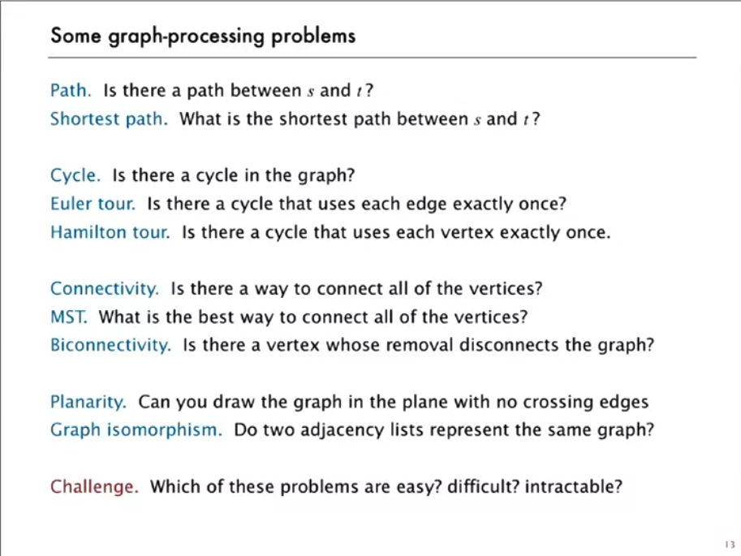
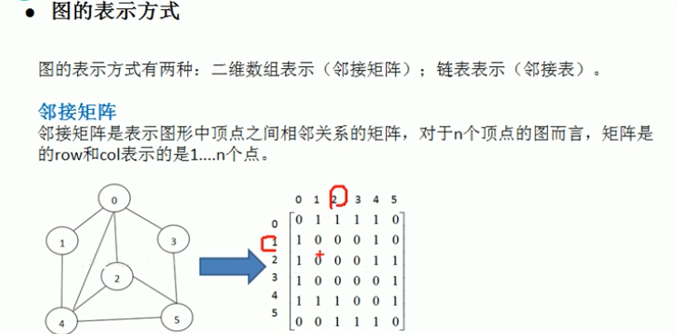
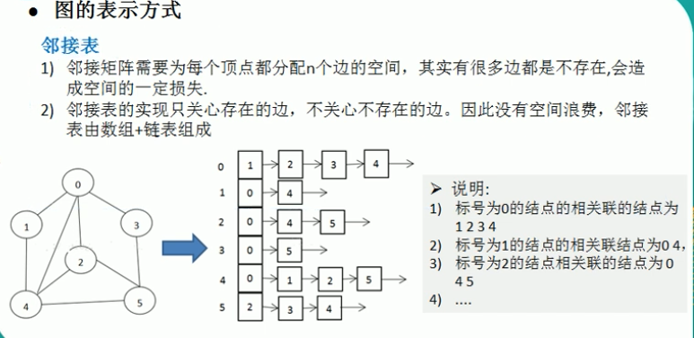

# Graph Algorithms

> **Scope** — Graph representation, traversal, connectivity, cycle detection and the general graph-problem catalogue.
> **See also** — *deep dives split out of this file*: [graph_advanced.md](./graph_advanced.md) — Tarjan (SCC, bridges, articulation points), Euler circuits, max flow / min cut, bipartite matching and k-colouring; [graph_examples.md](./graph_examples.md) — the worked-solution archive (LC 133 / 200 / 207 / 323 / 329 / 399 / 695 / 742 / 802 / 815 / 886 / 947 / 1319).
> *Neighbouring sheets*: [bfs.md](./bfs.md) — breadth-first traversal; [dfs.md](./dfs.md) — depth-first traversal; [topology_sorting.md](./topology_sorting.md) — DAG ordering; [union_find.md](./union_find.md) — undirected connectivity; [shortest_path_comparison.md](./shortest_path_comparison.md) — **choosing** a weighted shortest-path algorithm; [Dijkstra.md](./Dijkstra.md) — non-negative weights; [Bellman-Ford.md](./Bellman-Ford.md) — negative weights / bounded hops; [Floyd-Warshall.md](./Floyd-Warshall.md) — all-pairs.

## LeetCode Problem Lists

- [Graph Theory](https://leetcode.com/problem-list/graph/)

## Overview
**Graph algorithms** are techniques for solving problems on graph data structures consisting of vertices (nodes) and edges (connections between nodes).

### Key Properties
- **Complexity**: see the [Complexity Quick Reference](#complexity-quick-reference) table in the summary
- **Core Idea**: Model relationships and connections between entities
- **When to Use**: Network problems, dependencies, paths, connectivity
- **Key Algorithms**: BFS, DFS, Dijkstra, Union-Find, Topological Sort

### Core Characteristics
- **Directed vs Undirected**: One-way or two-way edges
- **Weighted vs Unweighted**: Edges with or without costs
- **Cyclic vs Acyclic**: Contains cycles or not
- **Connected vs Disconnected**: All nodes reachable or not

<p align="center"></p>

## Recognition

Read the statement for the wording in the first column, then the constraints against the
[constraint ruler](./complexity_cheatsheet.md#6-interview-decision-guide). Several rows route
out of this sheet: that is the right answer when the problem is weighted, ordered or advanced.

| Signal in the statement | Constraint cue | Reach for | Not this if |
|---|---|---|---|
| "how many provinces / groups / connected components" | V + E ≤ 10⁵ | [Template 1](#template-1-connected-components-by-traversal--lc-547-) — one traversal per component | the input is a grid → [dfs.md § Template 2](./dfs.md#template-2-graph--grid-dfs-flood-fill--lc-200-) |
| "can every room be visited", "is there a path from a to b" | V + E ≤ 10⁵ | [Template 2](#template-2-dfs-reachability--lc-841-) — DFS reachability | "minimum steps" → [bfs.md](./bfs.md) |
| "return every path from 0 to n − 1" | n ≤ 15 | [Template 2's LC 797 variation](#all-paths-from-source-to-target--lc-797) — backtracking, no shared `visited` | the graph has cycles → keep an on-path set |
| "redundant connection", "edges added one at a time", "connected because they share an email / row" | n ≤ 10⁵ | [Template 3](#template-3-union-find-with-path-compression--lc-684-) — union-find (LC 721, 947: the shared attribute is a node) | a path or its length is wanted → BFS / DFS |
| "prerequisites", "order of tasks", "alien dictionary" | directed, V + E ≤ 10⁵ | [Template 4](#template-4-topological-sort-kahns-bfs--lc-207-) — Kahn's BFS | undirected → there is no order to find |
| "cycle in a directed graph", "deadlock", "eventual safe nodes" | directed, V ≤ 10⁴ | [Template 5](#template-5-three-state-dfs-cycle-detection--lc-802-) — three-state DFS | undirected → union-find |
| "split into two groups", "is it bipartite", "dislike each other" | n ≤ 2,000 | [Template 6](#template-6-bipartite-check-2-coloring--lc-785-) — 2-colouring | three or more groups → backtracking colouring |
| "shortest path" with weights, "network delay", "cheapest flight" | E ≤ 10⁵ | [Dijkstra.md](./Dijkstra.md), [Bellman-Ford.md](./Bellman-Ford.md), [Floyd-Warshall.md](./Floyd-Warshall.md) | every edge costs 1 → BFS |
| "ratios", "exchange rates", "evaluate a / b" | V ≤ 40 | [dfs.md § Template 10](./dfs.md#template-10-weighted-graph-dfs-divisionratio-queries--lc-399) — weighted DFS | many queries on a fixed graph → weighted union-find |
| "longest path, moves strictly increasing" | grid ≤ 200 × 200 | implicit DAG, DFS + memo ([topology_sorting.md § Template 9](./topology_sorting.md#template-9-topological-sort--dp-on-an-implicit-dag-)) | moves may decrease → not a DAG, no memo |
| "connect every node at minimum total cost" | V ≤ 1,000 | [minimum_spanning_tree.md](./minimum_spanning_tree.md) | a path between two nodes, not a tree → shortest path |
| "removing this edge / node disconnects the graph", "critical connections" | V ≤ 10⁵ | Tarjan low-link ([graph_advanced.md](./graph_advanced.md#template-1-tarjans-low-link-dfs--scc-bridges-articulation-points--lc-1192-)) | only connectivity before / after → union-find |
| "use every edge / ticket exactly once" | E ≤ 300 | Euler path, Hierholzer ([graph_advanced.md](./graph_advanced.md#template-2-euler-path--circuit-hierholzer--lc-332-)) | visit every **node** once → Hamiltonian, bitmask DP |
| "max flow", "bipartite matching" | small V | Ford-Fulkerson / Edmonds-Karp ([graph_advanced.md](./graph_advanced.md)) | only a yes/no two-group split → Template 6 |

## Templates & Algorithms

### Which Sheet Owns Which Algorithm ⭐⭐⭐⭐⭐

This sheet owns **representation, traversal, connectivity and cycle detection**. Every
weighted or ordering algorithm has a dedicated sheet — go there for the implementation
rather than re-deriving it here.

| Need | Template here | Owning sheet |
|---|---|---|
| Build a graph from an LC input format | Graph Representations, below | this sheet |
| Count components, test reachability | Template 1 / Template 2 | this sheet; traversal itself in [bfs.md](./bfs.md), [dfs.md](./dfs.md) |
| Shortest path, **unweighted** | — | [bfs.md](./bfs.md) |
| Shortest path, **weighted** | — | see the table below |
| Order nodes with dependencies | Template 4 (Kahn) | [topology_sorting.md](./topology_sorting.md) |
| Dynamic connectivity, merge sets | Template 3 (DSU) | [union_find.md](./union_find.md) |
| Detect a cycle | Template 5 | this sheet |
| Two groups / conflict colouring | Template 6 | this sheet |
| SCC, bridges, articulation points, Euler circuit, max flow, k-colouring | — | [graph_advanced.md](./graph_advanced.md) |
| One worked solution per problem | — | [graph_examples.md](./graph_examples.md) |

#### Weighted shortest path — see the dedicated docs

These have full docs of their own; re-stating their implementations here is what let
`graph.md` drift out of sync with them.

| Need | Doc | Complexity | Anchor LC |
|---|---|---|---|
| Single source, **non-negative** weights | [Dijkstra.md](./Dijkstra.md) | O((V+E) log V) | LC 743 |
| Single source, **negative** weights / bounded hops / negative-cycle detection | [Bellman-Ford.md](./Bellman-Ford.md) | O(V·E) | LC 787 |
| **All pairs**, dense graph | [Floyd-Warshall.md](./Floyd-Warshall.md) | O(V³) | LC 1334 |
| Unweighted, or 0-1 weights | [bfs.md](./bfs.md) — plain BFS / 0-1 BFS with a deque | O(V+E) | LC 1091, LC 1368 |

Not sure which? → [shortest_path_comparison.md](./shortest_path_comparison.md).

### Graph Representations — How to Build Them ⭐⭐⭐⭐⭐

Almost every LC graph problem hands you one of a handful of input shapes. Recognising the
shape and converting it is the first thirty seconds of the solution.

| LC input shape | Build | Typical problems |
|---|---|---|
| `edges = [[u,v], ...]` | adjacency list, **both** directions if undirected | LC 323, 684, 1971 |
| `edges = [[u,v,w], ...]` | adjacency list of `(neighbor, weight)` pairs | LC 743, 787 |
| `isConnected[i][j]` / `graph[i][j]` | already an adjacency **matrix** | LC 547, 1334 |
| `graph[i] = [neighbors]` | already an adjacency **list** | LC 785, 797, 802 |
| a grid `char[][]` / `int[][]` | **implicit** — cell = node, 4 or 8 neighbours = edges | LC 200, 695, 1091 |
| a `Node` object with `neighbors` | pointer graph — traverse with a `{original: copy}` map | LC 133 |
| pairs of strings (`["a","b"]`) | implicit — discover nodes from the input into a `defaultdict` | LC 399, 721 |

**Which representation**

| | Space | `u→v` edge test | Iterate neighbours of `u` | Use when |
|---|---|---|---|---|
| Adjacency list | O(V + E) | O(deg u) | O(deg u) | sparse — the LC default |
| Adjacency matrix | O(V²) | O(1) | O(V) | dense, or `V` small (Floyd-Warshall) |
| Edge list | O(E) | O(E) | O(E) | Kruskal, Bellman-Ford — algorithms that sweep edges |

An **edge list** needs no build step at all: `edges` as handed to you *is* the
representation. Sort it for Kruskal, iterate it `V-1` times for Bellman-Ford.

#### **Adjacency List**
```python
# For edges list
graph = defaultdict(list)
for u, v in edges:
    graph[u].append(v)
    graph[v].append(u)  # Undirected

# For weighted edges
graph = defaultdict(list)
for u, v, w in edges:
    graph[u].append((v, w))
```

#### **Adjacency Matrix**
```python
# For unweighted
graph = [[0] * n for _ in range(n)]
for u, v in edges:
    graph[u][v] = 1
    graph[v][u] = 1  # Undirected

# For weighted
graph = [[float('inf')] * n for _ in range(n)]
for u, v, w in edges:
    graph[u][v] = w
```

#### **Grid as Graph**
```python
# 4-directional movement
directions = [(0, 1), (1, 0), (0, -1), (-1, 0)]

# 8-directional movement
directions = [(0, 1), (1, 0), (0, -1), (-1, 0),
              (1, 1), (1, -1), (-1, 1), (-1, -1)]

# Check bounds
def is_valid(r, c, rows, cols):
    return 0 <= r < rows and 0 <= c < cols
```

#### **Directed vs Undirected, and In/Out-Degree**
```python
# undirected: add BOTH directions -- forgetting this is the most common graph bug
for u, v in edges:
    graph[u].append(v)
    graph[v].append(u)

# directed: one direction only, and degree splits into two counts
out_deg = [0] * n
in_deg = [0] * n
for u, v in edges:
    graph[u].append(v)
    out_deg[u] += 1
    in_deg[v] += 1
```

- **Undirected**: `sum(degrees) == 2 * E`. A tree has exactly `V - 1` edges and no cycle.
- **Directed**: sources have `in_deg == 0` (Kahn's starting set, Template 4); sinks have
  `out_deg == 0` (LC 802 eventual safe states).
- Some problems are answered by the degrees alone, with no traversal — LC 997 Find the
  Town Judge (`in == n-1 and out == 0`), LC 2924 Find Champion II (`in == 0`, and unique),
  LC 1361 Validate Binary Tree Nodes. The pattern and its pitfalls live in
  [topology_sorting.md](./topology_sorting.md#template-10-in-degree-signature-answer-read-straight-off-the-degrees-).

<p align="center"></p>

<p align="center"></p>

### Visited-Set Discipline ⭐⭐⭐⭐

*Where* you mark a node decides whether the traversal terminates and whether it is correct.

- **Mark on enqueue, not on dequeue** (BFS). Marking on dequeue lets the same node enter
  the queue many times — still correct for plain reachability, but quadratic in the worst case,
  and wrong as soon as a counter or a distance is updated on visit (Template 1).
- **Count or reach a node** → one shared `visited` set; each node is processed once.
- **Enumerate paths** → no shared set; push on the way down and **pop on the way up**
  (Template 2's LC 797 variation).
- **Directed cycle detection** → three states, not a boolean (Template 5).
- On a grid you may mutate the input instead of allocating `visited` (`grid[r][c] = '0'`) —
  O(1) extra space, but it destroys the input; say so out loud in an interview.

#### **Three ways to record it**
```python
# Set for simple visited
visited = set()

# Array for state tracking
# 0: unvisited, 1: visiting, 2: visited
state = [0] * n

# Dictionary for path reconstruction
parent = {}
```

### Template 1: Connected Components by Traversal — LC 547 ⭐⭐⭐⭐

**Recognise** — "how many provinces / groups / connected components", "is every node connected",
an edge list or adjacency matrix with no weights. V + E ≤ 10⁵ → one O(V + E) sweep is expected.

**Key point** — every node is visited exactly once across **all** launches, so the number of
launches from a still-unvisited node is the number of components.

```python
# python
# LC 547 - Number of Provinces
# IDEA: launch a BFS from every node not yet visited; each launch covers exactly one component
# time = O(n^2), space = O(n)   n^2 because the input is an adjacency matrix
from collections import deque

def findCircleNum(isConnected):
    n = len(isConnected)
    visited = [False] * n
    components = 0
    for start in range(n):
        if visited[start]:
            continue
        components += 1                     # a new launch = a new component
        visited[start] = True
        queue = deque([start])
        while queue:
            node = queue.popleft()
            for nxt in range(n):            # one matrix row = node's neighbours
                if isConnected[node][nxt] == 1 and not visited[nxt]:
                    visited[nxt] = True     # mark when enqueued
                    queue.append(nxt)
    return components
```

```java
// java
// LC 547 - Number of Provinces
// IDEA: launch a BFS from every node not yet visited; each launch covers exactly one component
// time = O(n^2), space = O(n)
public int findCircleNum(int[][] isConnected) {
    int n = isConnected.length;
    boolean[] visited = new boolean[n];
    int components = 0;
    for (int start = 0; start < n; start++) {
        if (visited[start]) {
            continue;
        }
        components++;                        // a new launch = a new component
        visited[start] = true;
        Deque<Integer> queue = new ArrayDeque<>();
        queue.offer(start);
        while (!queue.isEmpty()) {
            int node = queue.poll();
            for (int nxt = 0; nxt < n; nxt++) {
                if (isConnected[node][nxt] == 1 && !visited[nxt]) {
                    visited[nxt] = true;     // mark when enqueued
                    queue.offer(nxt);
                }
            }
        }
    }
    return components;
}
```

**Complexity**
- **Time O(n²)**: the inner `for nxt in range(n)` scans a whole matrix row for each of the n
  nodes. Given an adjacency list instead, the same loop reads each edge once: O(V + E).
- **Space O(n)**: the `visited` array and the queue.

**Traps**
- Launching only from node 0 counts one component however many there are:
  `[[1,0],[0,1]]` returns 1 instead of 2. The outer `for start` loop *is* the template.
- An undirected edge list built in one direction only: LC 323 with `n = 2, edges = [[1,0]]`
  launches from 0, never reaches 1, then counts 1 as a second component. Add both directions.
- Isolated nodes are components too: `n = 3, edges = []` is 3. Looping over the keys of a
  `defaultdict` adjacency list skips every node that has no edge.

**Not this if** — edges arrive one at a time and you must answer "connected yet?" after each →
union-find ([Template 3](#template-3-union-find-with-path-compression--lc-684-)). A grid of
islands → [dfs.md § Template 2](./dfs.md#template-2-graph--grid-dfs-flood-fill--lc-200-), where
the cells are the nodes and there is no list to build.

**Drill** — LC 547 · LC 1971 *(are two nodes in the same component?)* · LC 323 ⭐ *(edge list)* ·
LC 261 ⭐ *(a tree = one component with exactly n − 1 edges)* · LC 1319 *(components − 1 cables)*

### Template 2: DFS Reachability — LC 841 ⭐⭐⭐⭐

**Recognise** — "can you visit every room", "is there a path from a to b", a graph handed as
`graph[i] = [neighbours]`, and no "shortest" or "minimum" anywhere in the statement: any path
will do. V + E ≤ 10⁵.

**Key point** — a node joins `visited` the first time it is reached and never leaves, so each
node is expanded once and each edge read once; when the stack empties, `visited` is exactly
the set reachable from the start.

```python
# python
# LC 841 - Keys and Rooms
# IDEA: DFS from room 0 with an explicit stack; visited = every room reached so far
# time = O(V + E), space = O(V)
def canVisitAllRooms(rooms):
    visited = {0}
    stack = [0]
    while stack:
        room = stack.pop()
        for key in rooms[room]:
            if key not in visited:
                visited.add(key)            # mark when pushed: each room is pushed once
                stack.append(key)
    return len(visited) == len(rooms)
```

```java
// java
// LC 841 - Keys and Rooms
// IDEA: DFS from room 0 with an explicit stack; visited = every room reached so far
// time = O(V + E), space = O(V)
public boolean canVisitAllRooms(List<List<Integer>> rooms) {
    boolean[] visited = new boolean[rooms.size()];
    visited[0] = true;
    int reached = 1;
    Deque<Integer> stack = new ArrayDeque<>();
    stack.push(0);
    while (!stack.isEmpty()) {
        int room = stack.pop();
        for (int key : rooms.get(room)) {
            if (!visited[key]) {
                visited[key] = true;         // mark when pushed: each room is pushed once
                reached++;
                stack.push(key);
            }
        }
    }
    return reached == rooms.size();
}
```

**Complexity**
- **Time O(V + E)**: the `visited` guard lets each room onto the stack once, and
  `for key in rooms[room]` reads each key once over the whole run.
- **Space O(V)**: `visited` plus the stack, each holding at most V rooms.

**Traps**
- Recursive DFS in Python on a 10⁵-node chain raises `RecursionError` (the default limit is
  1,000). The explicit stack has no depth limit; in Java the recursive form is fine to ~10⁴.
- Checking `visited` on pop instead of on push lets a room be pushed once per key that opens
  it: still correct, but the stack grows to O(E).

**Not this if** — "minimum number of moves / steps" → BFS
([bfs.md § Template 2](./bfs.md#template-2-graph-bfs-mark-on-enqueue--lc-1971-)): the first
time DFS reaches a node is not the shortest way there. "Return every path" → the LC 797
variation below, which drops the shared `visited` set.

**Drill** — LC 841 · LC 1971 *(edge list, both directions)* · LC 797 *(all paths: backtracking)*
· LC 133 ⭐ *(visited is the `{original: copy}` map)* · LC 417 ⭐ *(reachability backwards from
each ocean)*

#### All Paths From Source to Target — LC 797

> **Key point** — the graph is a **DAG**, so no walk can loop: drop the `visited` set and keep the
> current path instead, pushed on the way down and popped on the way up. Every arrival at
> `n - 1` is one path, copied out.

**Reduces to**: [Template 2](#template-2-dfs-reachability--lc-841-) — with backtracking in place of
the shared `visited` set ([dfs.md § Template 4](./dfs.md#template-4-backtracking--lc-46)).

```python
# python
# LC 797 - All Paths From Source to Target
# IDEA: DFS + backtracking on a DAG (no visited set needed)
# time = O(2^n * n), space = O(n) excluding output
class Solution(object):
    def allPathsSourceTarget(self, graph):
        n = len(graph)
        res, path = [], [0]

        def dfs(u):
            if u == n - 1:
                res.append(path[:])    # copy!
                return
            for v in graph[u]:
                path.append(v)
                dfs(v)
                path.pop()             # backtrack

        dfs(0)
        return res

# [[1,2],[3],[3],[]] -> [[0,1,3],[0,2,3]]
```

```java
// java
// LC 797 - All Paths From Source to Target
// IDEA: DFS + backtracking on a DAG. No visited set (DAG => no cycles),
//       and a node may legitimately appear in many different paths.
// time = O(2^n * n), space = O(n) excluding output
import java.util.*;

public class Solution {
    public List<List<Integer>> allPathsSourceTarget(int[][] graph) {
        List<List<Integer>> res = new ArrayList<>();
        List<Integer> path = new ArrayList<>();
        path.add(0);                       // start node is always in the path
        dfs(graph, 0, path, res);
        return res;
    }

    private void dfs(int[][] graph, int u, List<Integer> path, List<List<Integer>> res) {
        if (u == graph.length - 1) {
            res.add(new ArrayList<>(path));   // copy, not the live list
            return;
        }
        for (int v : graph[u]) {
            path.add(v);
            dfs(graph, v, path, res);
            path.remove(path.size() - 1);     // backtrack
        }
    }
}
```

**Traps**
- A shared `visited` set is **wrong** here: it blocks a node from appearing in a second path. *Count
  / reach* a node → `visited`; *enumerate paths* → backtracking, unmark on the way up.
- `res.append(path)` without the copy stores one list that the pops later empty.

### Template 3: Union-Find with Path Compression — LC 684 ⭐⭐⭐⭐

**Recognise** — "redundant connection", "edges are added one at a time", "are a and b in the same
group", "merge accounts that share an email". n ≤ 10⁵, and only connectivity is asked — never a
path or a distance.

**Key point** — every set is a tree whose root names it. `find(a) == find(b)` exactly when a and
b are in the same set, so a `union` that finds both ends already sharing a root has found an edge
that closes a cycle.

```python
# python
# LC 684 - Redundant Connection
# IDEA: union every edge; the first edge whose two ends already share a root closes the cycle
# time = O(E * α(n)), space = O(n)
class UnionFind:
    def __init__(self, n):
        self.parent = list(range(n))
        self.rank = [0] * n
        self.count = n                       # number of components

    def find(self, x):
        root = x
        while self.parent[root] != root:
            root = self.parent[root]
        while self.parent[x] != root:        # path compression: point each node at the root
            next_node = self.parent[x]
            self.parent[x] = root
            x = next_node
        return root

    def union(self, x, y):
        root_x, root_y = self.find(x), self.find(y)
        if root_x == root_y:
            return False                     # already connected: this edge is a cycle
        if self.rank[root_x] < self.rank[root_y]:
            root_x, root_y = root_y, root_x  # hang the shorter tree under the taller
        self.parent[root_y] = root_x
        if self.rank[root_x] == self.rank[root_y]:
            self.rank[root_x] += 1
        self.count -= 1
        return True

def findRedundantConnection(edges):
    uf = UnionFind(len(edges) + 1)           # nodes are 1..n and n == len(edges)
    for u, v in edges:
        if not uf.union(u, v):
            return [u, v]
    return []
```

```java
// java
// LC 684 - Redundant Connection
// IDEA: union every edge; the first edge whose two ends already share a root closes the cycle
// time = O(E * α(n)), space = O(n)
class UnionFind {
    private final int[] parent;
    private final int[] rank;

    UnionFind(int n) {
        parent = new int[n];
        rank = new int[n];
        for (int i = 0; i < n; i++) {
            parent[i] = i;
        }
    }

    int find(int x) {
        int root = x;
        while (parent[root] != root) {
            root = parent[root];
        }
        while (parent[x] != root) {          // path compression
            int next = parent[x];
            parent[x] = root;
            x = next;
        }
        return root;
    }

    boolean union(int x, int y) {
        int rootX = find(x);
        int rootY = find(y);
        if (rootX == rootY) {
            return false;                    // already connected: this edge is a cycle
        }
        if (rank[rootX] < rank[rootY]) {
            int tmp = rootX;
            rootX = rootY;
            rootY = tmp;
        }
        parent[rootY] = rootX;
        if (rank[rootX] == rank[rootY]) {
            rank[rootX]++;
        }
        return true;
    }
}

public int[] findRedundantConnection(int[][] edges) {
    UnionFind uf = new UnionFind(edges.length + 1);
    for (int[] edge : edges) {
        if (!uf.union(edge[0], edge[1])) {
            return edge;
        }
    }
    return new int[0];
}
```

**Complexity**
- **Time O(E · α(n))**: one `union` per edge; with path compression *and* union by rank each
  `find` is amortised α(n), the inverse Ackermann function — under 5 for any real n.
- **Space O(n)**: `parent` and `rank`.

**Traps**
- Nodes numbered 1..n: `UnionFind(n)` throws on LC 684's `[[1,2],[1,3],[2,3]]`, which touches
  index 3. Size it `n + 1`.
- `parent[a] == parent[b]` is not `find(a) == find(b)`: two nodes of one set can have different
  direct parents until a `find` compresses the path between them.
- Union-find answers nothing about **directed** cycles: LC 685 (directed redundant connection)
  needs the in-degree-2 case handled before the union pass.

**Not this if** — you need the path, its length, or the graph is directed → BFS / DFS. Edges are
deleted over time → a DSU cannot split a set; process the deletions offline, in reverse.

**Drill** — LC 684 ⭐ · LC 547 · LC 323 ⭐ · LC 261 ⭐ · LC 721 *(each email is a node)* ·
LC 947 *(each row and each column is a node)*. Weighted DSU, rollback and the rest:
[union_find.md](./union_find.md).

### Template 4: Topological Sort (Kahn's BFS) — LC 207 ⭐⭐⭐⭐⭐

> Ordering variants — lexicographic order, all orders, parallel scheduling, tree centroid, DP on the DAG — live in [topology_sorting.md](./topology_sorting.md).

**Recognise** — "prerequisites", "can you finish all courses", "an order of tasks in which each
comes after its dependencies", "alien dictionary". Directed edges, V + E ≤ 10⁵.

**Key point** — a node enters the queue only when its in-degree drops to 0, that is, once every
prerequisite has been output. Nodes on a cycle never get there, so `taken < n` exactly when the
graph has a cycle.

```python
# python
# LC 207 - Course Schedule
# IDEA: keep taking a course with no unmet prerequisite; a cycle leaves courses never taken
# time = O(V + E), space = O(V + E)
from collections import deque

def canFinish(numCourses, prerequisites):
    graph = [[] for _ in range(numCourses)]
    indegree = [0] * numCourses
    for course, pre in prerequisites:        # [a, b] means b must come before a
        graph[pre].append(course)
        indegree[course] += 1
    queue = deque()
    for course in range(numCourses):
        if indegree[course] == 0:            # every source, not only node 0
            queue.append(course)
    taken = 0
    while queue:
        node = queue.popleft()
        taken += 1
        for nxt in graph[node]:
            indegree[nxt] -= 1
            if indegree[nxt] == 0:
                queue.append(nxt)
    return taken == numCourses
```

```java
// java
// LC 207 - Course Schedule
// IDEA: keep taking a course with no unmet prerequisite; a cycle leaves courses never taken
// time = O(V + E), space = O(V + E)
public boolean canFinish(int numCourses, int[][] prerequisites) {
    List<List<Integer>> graph = new ArrayList<>();
    for (int i = 0; i < numCourses; i++) {
        graph.add(new ArrayList<>());
    }
    int[] indegree = new int[numCourses];
    for (int[] p : prerequisites) {          // [a, b] means b must come before a
        graph.get(p[1]).add(p[0]);
        indegree[p[0]]++;
    }
    Deque<Integer> queue = new ArrayDeque<>();
    for (int i = 0; i < numCourses; i++) {
        if (indegree[i] == 0) {
            queue.offer(i);
        }
    }
    int taken = 0;
    while (!queue.isEmpty()) {
        int node = queue.poll();
        taken++;
        for (int nxt : graph.get(node)) {
            indegree[nxt]--;
            if (indegree[nxt] == 0) {
                queue.offer(nxt);
            }
        }
    }
    return taken == numCourses;
}
```

**Complexity**
- **Time O(V + E)**: each node is dequeued once, and the inner `for nxt in graph[node]`
  decrements each edge's target once over the whole run.
- **Space O(V + E)**: the adjacency list; `indegree` and the queue are O(V).

**Dry run**

```text
numCourses = 2, prerequisites = [[1,0]]        edge 0 -> 1
indegree = [0, 1]   queue = [0]
pop 0  taken=1  indegree[1] -> 0, push 1
pop 1  taken=2                                  2 == 2 -> True

prerequisites = [[1,0],[0,1]]                  edges 0 -> 1, 1 -> 0
indegree = [1, 1]   queue = []                  taken=0 -> False (the cycle never empties)
```

**Traps**
- Edge direction: `[a, b]` means *b before a*. Building `a → b` still passes LC 207 (a reversed
  graph has the same cycles) and then returns the order backwards on LC 210.
- Seeding the queue with node 0 alone: a course with no edges at all, or a second source, is
  never taken. Every node of in-degree 0 goes in.

**Not this if** — the graph is undirected → there is no order to find; a cycle check is
union-find ([Template 3](#template-3-union-find-with-path-compression--lc-684-)). The
lexicographically smallest order is wanted → a min-heap replaces the queue
([topology_sorting.md](./topology_sorting.md)).

**Drill** — LC 207 ⭐ · LC 210 *(return the order)* · LC 1136 *(BFS levels = semesters)* ·
LC 269 ⭐ *(edges come from adjacent words)* · LC 329 ⭐ *(Kahn on the implicit DAG of
increasing cells)*

#### Second solution: three-state DFS

Kahn's peels courses with no unmet prerequisite; the DFS form instead finds the cycle as a **back
edge** — a node met while it is still on the current path. Same O(V + E), no in-degree array, but
recursion as deep as V. It is the [Template 5](#template-5-three-state-dfs-cycle-detection--lc-802-)
invariant applied to LC 207; give it when the interviewer asks for the DFS version.

```python
# python
# LC 207 - Course Schedule (three-state DFS)
# IDEA: a cycle exists iff the DFS meets a node that is still on the current path (state 1)
# time = O(V + E), space = O(V + E)
from collections import defaultdict

def canFinish(numCourses, prerequisites):
    graph = defaultdict(list)
    for course, pre in prerequisites:
        graph[course].append(pre)          # course -> what it needs
    state = [0] * numCourses               # 0 = unseen, 1 = on the current path, 2 = done
    def dfs(node):
        if state[node] == 1:
            return False                   # back edge: a cycle
        if state[node] == 2:
            return True
        state[node] = 1
        for nxt in graph[node]:
            if not dfs(nxt):
                return False
        state[node] = 2
        return True
    return all(dfs(c) for c in range(numCourses))
```

### Template 5: Three-State DFS Cycle Detection — LC 802 ⭐⭐⭐⭐

**Recognise** — "does this directed graph have a cycle", "deadlock", "eventual safe nodes",
"every path from this node ends at a terminal node". Directed edges, V ≤ 10⁴, E ≤ 4·10⁴.

**Key point** — a node is `ON_PATH` while its DFS is running and `SAFE` once it has finished
cycle-free. Reaching an `ON_PATH` node means following an edge back up the current path, which
is a cycle; a `SAFE` node is already proven and is never explored again.

```python
# python
# LC 802 - Find Eventual Safe States
# IDEA: 3-state DFS; a node is unsafe iff its DFS meets a node still on the current path
# time = O(V + E), space = O(V)
def eventualSafeNodes(graph):
    UNVISITED, ON_PATH, SAFE = 0, 1, 2
    state = [UNVISITED] * len(graph)

    def leads_to_cycle(node):
        if state[node] == ON_PATH:          # back edge: node is on the path we came down
            return True
        if state[node] == SAFE:             # finished earlier and proven cycle-free
            return False
        state[node] = ON_PATH
        for nxt in graph[node]:
            if leads_to_cycle(nxt):
                return True                 # leave node ON_PATH: it is unsafe for good
        state[node] = SAFE
        return False

    safe = []
    for node in range(len(graph)):
        if not leads_to_cycle(node):
            safe.append(node)
    return safe
```

```java
// java
// LC 802 - Find Eventual Safe States
// IDEA: 3-state DFS; a node is unsafe iff its DFS meets a node still on the current path
// time = O(V + E), space = O(V)
private static final int UNVISITED = 0, ON_PATH = 1, SAFE = 2;

public List<Integer> eventualSafeNodes(int[][] graph) {
    int[] state = new int[graph.length];
    List<Integer> safe = new ArrayList<>();
    for (int node = 0; node < graph.length; node++) {
        if (!leadsToCycle(graph, node, state)) {
            safe.add(node);
        }
    }
    return safe;
}

private boolean leadsToCycle(int[][] graph, int node, int[] state) {
    if (state[node] == ON_PATH) {
        return true;                         // back edge
    }
    if (state[node] == SAFE) {
        return false;
    }
    state[node] = ON_PATH;
    for (int nxt : graph[node]) {
        if (leadsToCycle(graph, nxt, state)) {
            return true;                     // node stays ON_PATH: unsafe for good
        }
    }
    state[node] = SAFE;
    return false;
}
```

**Complexity**
- **Time O(V + E)**: a node leaves `UNVISITED` once; after that every call on it returns at one
  of the first two `if`s, so each edge in `for nxt in graph[node]` is followed once.
- **Space O(V)**: `state` plus the recursion stack, which is at most V deep.

**Traps**
- A boolean `visited` instead of three states reports a cycle in a diamond:
  `[[1,2],[3],[3],[]]` reaches node 3 a second time through 2 and calls it a back edge.
- Resetting a finished node to `UNVISITED` (backtracking) stays correct but re-explores it from
  every path: exponential on a DAG with many paths. Mark it `SAFE`.
- Python's default recursion limit is 1,000; a 10⁴-node chain needs
  `sys.setrecursionlimit(20000)`, or Kahn's algorithm on the reversed graph, which has no
  recursion at all.

**Not this if** — the graph is **undirected**: the edge back to the parent looks like a back edge.
Use union-find ([Template 3](#template-3-union-find-with-path-compression--lc-684-) — a `union`
that returns False is the cycle) or pass the parent down. Only "is there a cycle" for a set of
prerequisites → Kahn ([Template 4](#template-4-topological-sort-kahns-bfs--lc-207-)).

**Drill** — LC 802 · LC 207 ⭐ *(a cycle means the courses cannot be finished)* · LC 1059 *(every
path ends at the destination)* · LC 2360 *(longest cycle when out-degree ≤ 1)*

#### Second solution: Kahn's on the reversed graph

No recursion: reverse every edge and peel backwards from the terminal nodes. A node becomes safe
once all of its out-edges lead to safe nodes (its out-degree reaches 0); nodes on or leading into a
cycle never get there. Same O(V + E), no recursion-depth risk on a long chain — the reason to
prefer it when V is large.

```python
# python
# LC 802 - Find Eventual Safe States (Kahn on the reversed graph)
# IDEA: terminals are safe; a node is safe once every out-edge leads to a safe node -> peel backwards
# time = O(V + E), space = O(V + E)
from collections import deque

def eventualSafeNodes(graph):
    n = len(graph)
    reverse = [[] for _ in range(n)]
    out_degree = [0] * n
    for node in range(n):
        out_degree[node] = len(graph[node])
        for nxt in graph[node]:
            reverse[nxt].append(node)      # edge flipped: nxt -> node
    queue = deque(node for node in range(n) if out_degree[node] == 0)  # terminals are safe
    safe = [False] * n
    while queue:
        node = queue.popleft()
        safe[node] = True
        for prev in reverse[node]:
            out_degree[prev] -= 1          # one more of prev's edges leads somewhere safe
            if out_degree[prev] == 0:
                queue.append(prev)
    return [node for node in range(n) if safe[node]]
```

### Template 6: Bipartite Check (2-Coloring) — LC 785 ⭐⭐⭐⭐

**Recognise** — "split the nodes into two groups so that every edge goes between the groups",
"is the graph bipartite", "people who dislike each other must be apart". n ≤ 100 (LC 785) to
2,000 (LC 886).

**Key point** — every coloured node has the opposite colour of the node that coloured it, so an
edge whose two ends share a colour closes an **odd** cycle — and an odd cycle is the one thing
that makes a graph non-bipartite.

```python
# python
# LC 785 - Is Graph Bipartite?
# IDEA: BFS paints each neighbour the opposite colour; a same-colour edge means an odd cycle
# time = O(V + E), space = O(V)
from collections import deque

def isBipartite(graph):
    n = len(graph)
    colors = [-1] * n                    # -1 = uncoloured, which also means unvisited
    for start in range(n):               # one BFS per component
        if colors[start] != -1:
            continue
        colors[start] = 0
        queue = deque([start])
        while queue:
            node = queue.popleft()
            for neighbor in graph[node]:
                if colors[neighbor] == -1:
                    colors[neighbor] = 1 - colors[node]
                    queue.append(neighbor)
                elif colors[neighbor] == colors[node]:
                    return False         # same colour on both ends of an edge
    return True
```

```java
// java
// LC 785 - Is Graph Bipartite?
// IDEA: BFS paints each neighbour the opposite colour; a same-colour edge means an odd cycle
// time = O(V + E), space = O(V)
public boolean isBipartite(int[][] graph) {
    int n = graph.length;
    int[] colors = new int[n];
    Arrays.fill(colors, -1);                 // -1 = uncoloured, which also means unvisited
    for (int start = 0; start < n; start++) {
        if (colors[start] != -1) {
            continue;
        }
        colors[start] = 0;
        Deque<Integer> queue = new ArrayDeque<>();
        queue.offer(start);
        while (!queue.isEmpty()) {
            int node = queue.poll();
            for (int neighbor : graph[node]) {
                if (colors[neighbor] == -1) {
                    colors[neighbor] = 1 - colors[node];
                    queue.offer(neighbor);
                } else if (colors[neighbor] == colors[node]) {
                    return false;
                }
            }
        }
    }
    return true;
}
```

**Complexity**
- **Time O(V + E)**: each node is coloured once, and each adjacency list is read once in
  `for neighbor in graph[node]`.
- **Space O(V)**: `colors` plus the queue.

**Traps**
- One BFS from node 0 checks node 0's component only: `[[],[2,3],[1,3],[1,2]]` has an isolated
  node 0 and a triangle, and returns True without the outer loop.
- A self-loop (`graph[0] = [0]`) is never bipartite. The same-colour check catches it, because the
  node and its neighbour are the same node.
- A separate `visited` array next to `colors` is two arrays that can disagree; `-1` already means
  unvisited.

**Not this if** — three or more groups → k-colouring is NP-hard in general; backtracking, or greedy
when the degree is small ([graph_advanced.md](./graph_advanced.md)). The two groups must be the same
size → a partition or matching problem, not a colouring.

**Drill** — LC 785 ⭐ · LC 886 *(build the graph from the dislike pairs)* · LC 1042 *(four colours,
degree ≤ 3: greedy)* · LC 2493 *(a bipartite check, then a BFS per component)*

#### **Approach 2: DFS with Coloring**
```python
# python
# LC 785 - Is Graph Bipartite? (recursive form, same invariant)
# IDEA: colour a node, recurse into neighbours with the opposite colour
# time = O(V + E), space = O(V)
def is_bipartite_dfs(graph):
    n = len(graph)
    colors = [-1] * n

    def dfs(node, color):
        colors[node] = color
        for neighbor in graph[node]:
            if colors[neighbor] == -1:
                if not dfs(neighbor, 1 - color):
                    return False
            elif colors[neighbor] == colors[node]:
                return False
        return True

    for i in range(n):
        if colors[i] == -1 and not dfs(i, 0):
            return False
    return True
```

> Union-Find bipartite detection, maximum bipartite matching and greedy k-colouring are in [graph_advanced.md](./graph_advanced.md); LC 886 Possible Bipartition is worked in [graph_examples.md](./graph_examples.md).

## Drill Path

| Stage | Problems (easy → hard) | What it adds |
|---|---|---|
| **Core** ⭐ | LC 323 · LC 261 · LC 684 · LC 133 · LC 207 · LC 269 | components, a tree check, union-find, cloning through a map, Kahn, building the graph before sorting it |
| **Practice** | LC 1971 · LC 997 · LC 547 · LC 841 · LC 797 · LC 785 · LC 802 · LC 210 | edge list vs matrix vs list input, degrees alone, all paths, 2-colouring, three-state DFS, returning the order |
| **Stretch** | LC 721 · LC 947 · LC 1192 · LC 332 | an attribute as a DSU node, bridges, an Euler path |

---

## Summary & Quick Reference

### Decision Table — Which Graph Pattern?

```text
Graph Algorithm Selection Flowchart:

1. What is the problem asking for?
   ├── Find shortest path → Continue to 2
   ├── Check connectivity → Use Union-Find or DFS/BFS
   ├── Order with dependencies → Use Topological Sort
   ├── Detect cycles → Use DFS with states or Union-Find
   └── Traverse all nodes → Use BFS or DFS

2. For shortest path problems:
   ├── Unweighted graph → Use BFS
   ├── Non-negative weights → Use Dijkstra
   ├── Negative weights → Use Bellman-Ford
   └── All pairs → Use Floyd-Warshall

3. For connectivity problems:
   ├── Static graph → Use DFS/BFS once
   ├── Dynamic connections → Use Union-Find
   └── Count components → Use either approach

4. For traversal problems:
   ├── Level-by-level → Use BFS
   ├── Path finding → Use DFS with backtracking
   └── State space search → Use BFS for optimal

5. Is the graph special?
   ├── Tree → Simpler DFS/BFS
   ├── DAG → Topological sort possible
   ├── Bipartite → Two-coloring
   └── Grid → Treat as implicit graph
```

### Complexity Quick Reference
| Algorithm | Time Complexity | Space Complexity | Notes |
|-----------|-----------------|------------------|-------|
| BFS/DFS | O(V + E) | O(V) | Standard traversal |
| Dijkstra | O((V+E)logV) | O(V) | With binary heap |
| Bellman-Ford | O(VE) | O(V) | Handles negative weights |
| Floyd-Warshall | O(V³) | O(V²) | All pairs |
| Union-Find | O(α(n)) | O(V) | Near constant |
| Topological Sort | O(V + E) | O(V) | Linear time |

### Problems by Pattern

#### **Graph Traversal Problems**
| Problem | LC # | Key Technique | Difficulty |
|---------|------|---------------|------------|
| Number of Islands | 200 | DFS/BFS on grid | Medium |
| Max Area of Island | 695 | DFS with counting | Medium |
| Clone Graph | 133 | BFS/DFS with map | Medium |
| Pacific Atlantic Water | 417 | Multi-source DFS | Medium |
| Word Ladder | 127 | BFS shortest path | Hard |
| Surrounded Regions | 130 | DFS from boundary | Medium |
| Evaluate Division | 399 | Weighted DFS (ratio graph) — [dfs.md § Template 10](./dfs.md#template-10-weighted-graph-dfs-divisionratio-queries--lc-399) | Medium |
| Longest Increasing Path in Matrix | 329 | DFS + memo on implicit DAG — [topology_sorting.md § Template 9](./topology_sorting.md#template-9-topological-sort--dp-on-an-implicit-dag-) | Hard |
| All Paths From Source to Target | 797 | DFS backtracking on a DAG | Medium |
| Keys and Rooms | 841 | Plain DFS/BFS reachability from node 0 | Medium |
| Find if Path Exists in Graph | 1971 | BFS/DFS or Union-Find connectivity | Easy |
| Find the Town Judge | 997 | In-degree/out-degree counting, no adjacency list needed — [topology_sorting.md](./topology_sorting.md#variation-a--degree-signature-lookup-lc-997-find-the-town-judge) | Easy |

#### **Shortest Path Problems**
| Problem | LC # | Key Technique | Difficulty |
|---------|------|---------------|------------|
| Network Delay Time | 743 | Dijkstra | Medium |
| Cheapest Flights K Stops | 787 | Modified Dijkstra | Medium |
| Path with Min Effort | 1631 | Dijkstra on grid | Medium |
| Bus Routes | 815 | BFS on routes | Hard |
| Shortest Path Binary Matrix | 1091 | BFS | Medium |

#### **Union-Find Problems**
| Problem | LC # | Key Technique | Difficulty |
|---------|------|---------------|------------|
| Number of Connected Components | 323 | Basic Union-Find | Medium |
| Redundant Connection | 684 | Detect cycle | Medium |
| Accounts Merge | 721 | Union-Find with map | Medium |
| Number of Provinces | 547 | Union-Find or DFS | Medium |
| Satisfiability of Equality | 990 | Union-Find | Medium |
| Most Stones Removed | 947 | DSU on shared row/col attribute — [graph_examples.md](./graph_examples.md#most-stones-removed-with-same-row-or-column--lc-947) | Medium |
| Make Network Connected | 1319 | DSU: components + spare edges | Medium |

#### **Topological Sort Problems**
| Problem | LC # | Key Technique | Difficulty |
|---------|------|---------------|------------|
| Course Schedule | 207 | Cycle detection | Medium |
| Course Schedule II | 210 | Topological order | Medium |
| Alien Dictionary | 269 | Build graph + sort | Hard |
| Minimum Height Trees | 310 | Leaf removal | Medium |
| Parallel Courses | 1136 | Level-wise BFS | Medium |

#### **Bipartite Problems**
| Problem | LC # | Key Technique | Difficulty |
|---------|------|---------------|------------|
| Is Graph Bipartite | 785 | BFS coloring | Medium |
| Possible Bipartition | 886 | DFS coloring | Medium |
| Flower Planting With No Adjacent | 1042 | Greedy k-coloring (degree < k) | Medium |

#### **Advanced Graph Problems**
| Problem | LC # | Key Technique | Difficulty |
|---------|------|---------------|------------|
| Critical Connections | 1192 | Tarjan bridges — [graph_advanced.md](./graph_advanced.md#template-1-tarjans-low-link-dfs--scc-bridges-articulation-points--lc-1192-) | Hard |
| Find Eventual Safe States | 802 | Cycle detection | Medium |
| Reconstruct Itinerary | 332 | Hierholzer's algorithm | Hard |
| Cracking the Safe | 753 | de Bruijn graph + Euler circuit — [graph_advanced.md](./graph_advanced.md#cracking-the-safe--lc-753) | Hard |
| Minimum Spanning Tree | 1135 | Kruskal / Prim — [minimum_spanning_tree.md](./minimum_spanning_tree.md) | Medium |

### Problem-Solving Steps
1. **Identify graph type**: Directed/undirected, weighted/unweighted
2. **Choose representation**: Adjacency list vs matrix
3. **Select algorithm**: Based on problem requirements
4. **Handle edge cases**: Empty graph, disconnected components
5. **Track state properly**: Visited nodes, paths, distances
6. **Optimize if needed**: Space or time improvements

### Common Mistakes & Tips

**🚫 Common Mistakes:**
- Not handling disconnected components
- Incorrect visited state management
- Missing cycle detection in recursive DFS
- Wrong graph representation choice
- Not considering edge cases (self-loops, multiple edges)

**✅ Best Practices:**
- Use adjacency list for sparse graphs
- Clear visited tracking strategy
- Handle both directed and undirected cases
- Consider using Union-Find for dynamic connectivity
- Test with disconnected components

### Interview Tips
1. **Clarify graph properties**: Directed? Weighted? Connected?
2. **Draw small examples**: Visualize the problem
3. **Choose right representation**: List vs matrix
4. **State complexities**: Time and space upfront
5. **Handle edge cases**: Empty, single node, cycles
6. **Optimize incrementally**: Start simple, then improve

### Related Topics
- **Trees**: Special case of graphs (connected, acyclic)
- **Dynamic Programming**: DP on graphs (paths, trees)
- **Greedy Algorithms**: MST algorithms
- **Heap/Priority Queue**: Used in Dijkstra, Prim's
- **Recursion/Backtracking**: DFS implementation
