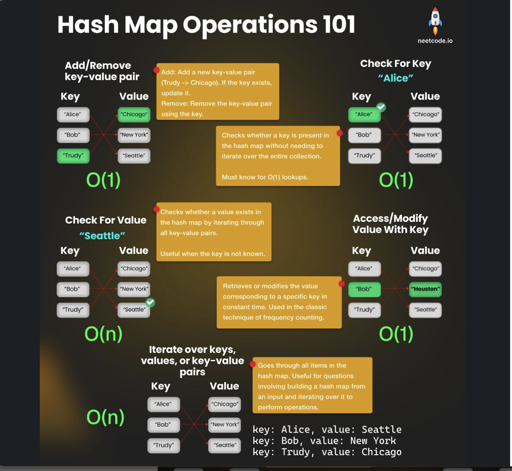
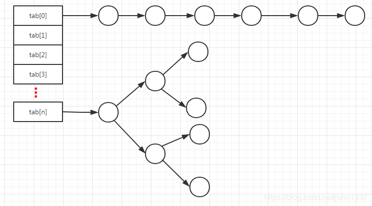
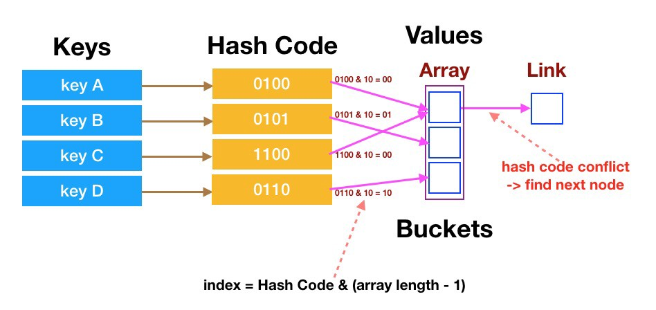

# Hash Map Cheatsheet

> **Scope** — Key→value problem patterns — lookup, grouping, index maps, prefix-sum maps, remapping.
> **See also** — *deep dives split out of this file*: [hash_map_examples.md](./hash_map_examples.md) — the worked-solution archive, the single-problem deep dives (bucket sort, rolling hash, split-and-probe, max-frequency arithmetic) and the ordered-map (Java `TreeMap` / Python `SortedDict`) reference.
> *Neighbouring sheets*: [hashing.md](./hashing.md) — how hashing works, plus counting and rolling-hash idioms; [set.md](./set.md) — membership only, no values; [Collection.md](./Collection.md) — picking a container in the first place.

## LeetCode Problem Lists

- [Hash Table](https://leetcode.com/problem-list/hash-table/)

## Time Complexity

| Data structure | Search   | Insert   | Delete   | Min/Max  |
| -------------- | -------- | -------- | -------- | -------- |
| Hash Map (avg) | O(1)     | O(1)     | O(1)     | O(n)     |

> Average case shown. **Worst case (all keys collide): O(n).** Min/Max requires a full scan since hashing imposes no ordering.

## Overview
Hash Map (Hash Table/Dictionary) is a fundamental data structure that provides efficient key-value storage and retrieval operations.

### Key Properties
- **Complexity**: see the [Time Complexity](#time-complexity) table above; space is **O(n)**
- **Implementation**: Array + Linked List/Red-Black Tree (Java HashMap)
- **Hash Collisions**: Handled via chaining or open addressing

### When Hash Collisions Occur
- **Load Factor > 0.75**: Performance degrades
- **Poor Hash Function**: Many keys map to same bucket
- **Java HashMap**: Converts linked list to red-black tree when length > 8
- **Resolution**: chaining (a list or tree per bucket) or open addressing — see [hash_map_collision.md](https://github.com/yennanliu/CS_basics/blob/master/doc/hash_map_collision.md)

<p align="center"></p>

- [NC - HashMap under the hood](https://www.linkedin.com/posts/neetcodeio_how-do-hashmaps-work-under-the-hood-activity-7298370869301526530-DsIi?utm_source=social_share_send&utm_medium=member_desktop_web&rcm=ACoAAA6fzw4BpOSBO1YeSrJwPZ-dNBhjC3jXTDE)

### Why Lookup Is O(1)

- FAQ
    - why hashmap search time complexity ~= O(1) ? explain ?
        - TL;DR : O(1) is avg and best case. worst case could be O(N) (hash collision)
        - hash func matters -> how to storage data & possible hash collision happens
        - OP
            - insert
                - get key, get hash val via hash func
                - find bucket in memory based on hash val
                - save key and value in the bucket
            - query
                - get index based on key
                - find bucket location based on index
                    - NOTE !!! use bit op (`int pos = (n - 1) & hash`), so this op can be O(1) time complexity. (find bucket address directly, NO need to loop over all items)
                - loop over all elements under that key (if there is one element, then do once)
                - return value
        <p align="center"></p>
        <p align="center"></p>
        - [ref 1](https://blog.csdn.net/junqing_wu/article/details/104606619)
        - [ref 2](https://blog.csdn.net/john1337/article/details/104727895)

### When to Use / When Not to Use

- When to use 
	- Use case that need data IO with ~ O(1) time complexity
    - optimization via cache (space - time tradeoff)
    - `sum, pair, continuous`
    - avoid double loop (O(N^2))

- When Not to use
	- When data is time sequence 
	- When data is in ordering 
	- https://www.reddit.com/r/learnprogramming/comments/29t4s4/when_is_it_bad_to_use_a_hash_table/

### Basic Operations

- `get` : get value from dict with default value if key not existed
```text
In [10]: d = {'a': 1, 'b': 2}
    ...: d['a']
Out[10]: 1

In [11]: d.get('a')
Out[11]: 1

In [12]: d.get('c', 0)
Out[12]: 0

In [13]: d.get('z')

In [14]:
```

- `setdefault()`
	- https://www.w3schools.com/python/ref_dictionary_setdefault.asp
```python
#-------------------------------------------------------------------------------
# setdefault : will creatte key if key NOT existed (with value as well if defined)
#-------------------------------------------------------------------------------

# syntax
d.setdefault(new_key)
d.setdefault(new_key, new_value)

# 662 Maximum Width of Binary Tree
car = {
  "brand": "Ford",
  "model": "Mustang",
  "year": 1964
}

# example 1) insert key "my_key", since my_key not existed, -> make it as new key and value as None (since not defined)
car.setdefault("my_key")
print (car)
# In [18]: car
# Out[18]: {'brand': 'Ford', 'model': 'Mustang', 'year': 1964, 'my_key': None}

# example 2) insert key "color", since my_key not existed, -> make it as new key and value as white
car.setdefault("color", "white")
print (car)
# Out[22]:
# {'brand': 'Ford',
#  'model': 'Mustang',
#  'year': 1964,
#  'my_key': None,
#  'color': 'white'}
```

- `Sort` on ***hashmap (dict)***
```python
# https://stackoverflow.com/questions/613183/how-do-i-sort-a-dictionary-by-value

x = {1: 2, 3: 4, 4: 3, 2: 1, 0: 0}
In [11]: x.items()
Out[11]: dict_items([(1, 2), (3, 4), (4, 3), (2, 1), (0, 0)])

#----------------------------------
# Sort hashMap by key/value !!!
#----------------------------------
x = {1: 2, 3: 4, 4: 3, 2: 1, 0: 0}
# note : have to use sorted(xxx, key=yyy), instead of xxx.sorted(....)
### NOTE this !!! : x.items()
sorted_x = sorted(x.items(), key=lambda kv: kv[1])
print (sorted_x)
# [(0, 0), (2, 1), (1, 2), (4, 3), (3, 4)]

x = {1: 2, 3: 4, 4: 3, 2: 1, 0: 0}
sorted_x = sorted(x.items(), key=lambda kv: kv[0])
print (sorted_x)
# [(0, 0), (1, 2), (2, 1), (3, 4), (4, 3)]

# 451  Sort Characters By Frequency
import collections
class Solution(object):
    def frequencySort(self, s):
        count = collections.Counter(s)
        count_dict = dict(count)
        """
        NOTE this !!!
            1. use sorted()
            2. count_dict.items()
        """
        count_tuple_sorted = sorted(count_dict.items(), key=lambda kv : -kv[1])
        res = ''
        for item in count_tuple_sorted:
            res += item[0] * item[1]
        return res
```

```text
# dict values -> array
In [6]:
   ...: mydict = {'a':['a1','a2','a3'], 'b':['b1','b2','b3']}
   ...:
   ...: res = [mydict[x] for x in mydict]
   ...:
   ...: print (res)
[['a1', 'a2', 'a3'], ['b1', 'b2', 'b3']]
```

### References

- [Java HashMap](https://bbs.huaweicloud.com/blogs/276884?utm_source=juejin&utm_medium=bbs-ex&utm_campaign=other&utm_content=content)
    - Low level : Array + Linked list / red-black tree
        - if Linked list length > 8 -> transform Linked list to red-black tree
        - if Linked list length < 6 -> transform red-black tree back to Linked list
- N sum:
    - [n_sum.md](https://github.com/yennanliu/CS_basics/blob/master/doc/cheatsheet/n_sum.md)
- LC Ref
    - [prefix_sum.md](https://github.com/yennanliu/CS_basics/blob/master/doc/cheatsheet/prefix_sum.md)
- Ref 
	- https://blog.techbridge.cc/2017/01/21/simple-hash-table-intro/
	- https://www.freecodecamp.org/news/hash-tables/

## Recognition

| Signal in the statement | Constraint cue | Reach for | Not this if |
|---|---|---|---|
| "return the indices of the two numbers that add up to `target`" | unsorted, n ≤ 10⁴–10⁵ → O(n) | [Template 1](#template-1-complement-lookup--lc-1) complement lookup | input already sorted → two pointers, O(1) space ([2_pointers.md](./2_pointers.md)) |
| "anagram", "most / least frequent", "first unique", "can `a` be built from `b`'s letters" | 26 lowercase letters → an `int[26]` is the map | [Template 2](#template-2-frequency-count--lc-242) frequency count | membership only, no multiplicity → [set.md](./set.md) |
| "group the strings / points that are the same up to …" | n words of length k → O(n·k log k) | [Template 3](#template-3-grouping-by-a-computed-key--lc-49) grouping by a computed key | the relation is not transitive ("differ by one letter") → graph / BFS |
| "number of subarrays whose sum equals / is divisible by k", values may be negative | n ≤ 2·10⁴–10⁵ → O(n), not all pairs | [Template 4](#template-4-prefix-sum-count-map--lc-560-) prefix-sum count map | all values positive and "longest / shortest" → [sliding_window.md](./sliding_window.md) |
| "all start indices of `p`'s anagrams in `s`", "a permutation of `s1` inside `s2`" | window length fixed at `len(p)` | [Template 5](#template-5-fixed-window-character-counts--lc-438) fixed-window counts | the window length varies ("longest with at most k distinct") → [sliding_window.md](./sliding_window.md) |
| "sorted in this alien language", "according to the order given in …" | alphabet ≤ 26 → O(1) rank lookups | [Template 6](#template-6-rank-map--value-to-position--lc-953-) rank map | |
| "isomorphic", "follows the same pattern", "no two characters map to the same one" | equal lengths, O(n) | [Template 7](#template-7-bijection-with-two-maps--lc-205) bijection | |
| "O(1) `get` and `put`", "evict the least recently used key" | up to 2·10⁵ calls → every op O(1) | [Template 8](#template-8-ordered-map-as-an-lru-cache--lc-146) ordered map as LRU | evict the least *frequently* used → LC 460, one list per frequency |
| "return a deep copy", "clone the graph / list" | V, E ≤ 10⁴ → O(V + E) | [Template 9](#template-9-old-to-new-node-map--lc-133) old-to-new node map | only reachability is asked → a visited set ([graph.md](./graph.md)) |
| "pick uniformly from `[0, n)` but never a blacklisted value" | n ≤ 10⁹, blacklist ≤ 10⁵ → cannot list the valid values | [Template 10](#template-10-virtual-map-remapping--lc-710) virtual remap | |
| "the k most frequent, ties broken alphabetically" | k ≪ n → a heap beats a full sort | [Template 11](#template-11-map-plus-heap--lc-692) map plus heap | no tie rule (LC 347) → bucket sort in O(n) |

> Constraint cues follow the ruler in [complexity_cheatsheet.md](./complexity_cheatsheet.md).

## Templates & Algorithms

### Template Comparison Table

| # | Template | Map shape | Recognise it by | Typical LC |
|---|----------|-----------|-----------------|------------|
| 1 | Complement lookup | `{value: index}` | "find a pair", "target sum", complement | 1, 15, 532, 1010 |
| 2 | Frequency count | `{item: count}`, or `{item: (first, last, count)}` | "count", "frequency", "anagram", "top-K", "all occurrences in one contiguous block" | 242, 49, 347, 451, 4038 |
| 3 | Grouping by a computed key | `{canonical_key: [items]}`, or `{(min, max): count}` | "group", "same line", "same signature", "`(x, y)` same as `(y, x)`" | 49, 149, 609, 987, 4066 |
| 4 | Prefix-sum count map | `{prefixSum: count}` / `{prefixSum: firstIndex}` / `{startValue: minPrefix}` | "subarray sum equals / divisible by K", "max sum where the ends satisfy ..." | 560, 974, 525, 325, 3026 |
| 5 | Fixed-window character counts | `{char: count in window}` | "anagram of `p` inside `s`", "permutation in string" | 438, 567, 30 |
| 6 | Rank map | `{value: rank}` | "according to the order given in ..." | 953, 791, 105 |
| 7 | Bijection (two maps) | `{x: y}` **and** `{y: x}` | "one-to-one", "isomorphic", "follows the pattern" | 205, 290 |
| 8 | Ordered map as an LRU cache | insertion-ordered `{key: value}` | "O(1) get and put", "evict the least recently used" | 146, 460, 432 |
| 9 | Old-to-new node map | `{original node: clone}`, `{child: parent}` | "clone", "deep copy", "parent pointer" | 133, 138, 652 |
| 10 | Virtual map (remapping) | `{badIndex: goodIndex}` | "pick at random, excluding ..." | 710 |
| 11 | Map plus heap | `{item: count}` + a heap ordered by count | "top-K", "ties broken by ..." | 692, 347, 451 |

> Patterns that are really a deep dive on one or two problems — bucket sort for O(n) top-K, rolling hash, split-and-probe pair lookup, max-frequency arithmetic, and the ordered map (`TreeMap` / `SortedDict`) — live in [hash_map_examples.md](./hash_map_examples.md#templates--algorithms).

### Template 1: Complement Lookup — LC 1

**Recognise** — "return the indices of the two numbers that add up to `target`", "a pair whose sum / difference / sum mod k is …", the input is **unsorted** and the indices must survive. n ≤ 10⁴–10⁵ → the O(n²) pair loop is the brute force to beat.

**Key point** — before index `i` is recorded, `seen` holds every value at an index `< i`, so the one lookup `target - x in seen` answers "does a partner exist to my left?" Every pair is found exactly once, by its right-hand element.

```python
# python
# LC 1 - Two Sum
# IDEA: one pass; look up the complement among the values already seen, THEN record this value
# time = O(n), space = O(n)
def twoSum(nums, target):
    seen = {}                          # {value: index}, only indices < i
    for i, x in enumerate(nums):
        need = target - x
        if need in seen:               # the partner sits strictly to the left
            return [seen[need], i]
        seen[x] = i                    # record after the lookup: x never pairs with itself
    return []
```

```java
// java
// LC 1 - Two Sum
// IDEA: one pass; look up the complement among the values already seen, then record this value
// time = O(n), space = O(n)
public int[] twoSum(int[] nums, int target) {
    Map<Integer, Integer> seen = new HashMap<>();   // {value: index}, only indices < i
    for (int i = 0; i < nums.length; i++) {
        int need = target - nums[i];
        if (seen.containsKey(need)) {
            return new int[]{seen.get(need), i};
        }
        seen.put(nums[i], i);
    }
    return new int[0];
}
```

**Complexity**
- **Time O(n)**: the `for` loop visits each index once, and `need in seen` / `seen[x] = i` are O(1) average hash operations.
- **Space O(n)**: `seen` holds every value when the matching pair is the last two elements.

**Dry run**

```text
nums = [3,2,4], target = 6
i=0  x=3  need=3  not in {}            seen={3:0}
i=1  x=2  need=4  not in seen          seen={3:0, 2:1}
i=2  x=4  need=2  seen[2]=1            -> [1, 2]
```

**Traps**
- Recording `x` before the lookup lets an element pair with itself: `[3,2,4]`, target 6 returns `[0, 0]`.
- Duplicates: `[3,3]`, target 6 — overwriting `seen[3]` is harmless only because the lookup runs first; the answer is `[0, 1]`.
- Returning `[i, seen[need]]` puts the later index first; the earlier index is `seen[need]`.

**Not this if** — the input is already **sorted** (LC 167) → two pointers in O(1) space ([2_pointers.md](./2_pointers.md)); the question **counts** pairs over distinct values (LC 532) → probe each distinct key once, so a pair is not counted from both ends.

**Drill** — LC 1 ⭐ · LC 1010 *(key = remainder mod 60, add counts instead of returning)* · LC 532 *(distinct values, probe only `x + k`; k = 0 needs counts)* · LC 15 ⭐ *(fix one value, two-sum the rest — [n_sum.md](./n_sum.md))*

### Template 2: Frequency Count — LC 242

**Recognise** — "anagram", "the same letters with the same multiplicities", "most / least frequent", "first unique character", "can `ransomNote` be built from `magazine`". Lowercase English letters only → a fixed `int[26]` is the map and space is O(1).

**Key point** — two strings are anagrams iff their count maps are equal. Counting `s` up and `t` down in **one** map keeps every entry at zero exactly when the multisets match, so the check is one pass plus one scan of the counts.

```python
# python
# LC 242 - Valid Anagram
# IDEA: count s up and t down in one map; every count back at 0 <=> same multiset
# time = O(n), space = O(k)   k = distinct characters (26 for lowercase)
def isAnagram(s, t):
    if len(s) != len(t):
        return False
    count = {}
    for a, b in zip(s, t):
        count[a] = count.get(a, 0) + 1
        count[b] = count.get(b, 0) - 1
    for c in count.values():
        if c != 0:
            return False
    return True
```

```java
// java
// LC 242 - Valid Anagram
// IDEA: lowercase only -> an int[26] is the count map; s counts up, t counts down
// time = O(n), space = O(1)   26 counters
public boolean isAnagram(String s, String t) {
    if (s.length() != t.length()) {
        return false;
    }
    int[] count = new int[26];
    for (int i = 0; i < s.length(); i++) {
        count[s.charAt(i) - 'a']++;
        count[t.charAt(i) - 'a']--;
    }
    for (int c : count) {
        if (c != 0) {
            return false;
        }
    }
    return true;
}
```

**Complexity**
- **Time O(n)**: the `zip` loop touches each of the n character pairs once; the final scan is over at most k distinct keys.
- **Space O(k)**: `count` has one entry per distinct character, which is O(1) for the fixed 26-letter alphabet.

**Traps**
- Skipping the length check: `"a"` vs `"ab"` — `zip` stops at the shorter string, every count is 0, and it returns `True`.
- Java `count[c - 'a']` throws on uppercase or Unicode input (`"Ä"`). The follow-up "what about Unicode?" wants a `HashMap<Character, Integer>`.
- `Counter` subtraction drops non-positive counts: `Counter("a") - Counter("ab")` is empty, so "the difference is empty" says `"a"` and `"ab"` match. Compare `Counter(s) == Counter(t)` instead.

**Not this if** — only membership matters, not multiplicity (LC 217) → a set ([set.md](./set.md)); *where* a value occurs matters rather than how often → the index-span variation below.

**Drill** — LC 242 ⭐ · LC 383 *(count the magazine, spend it on the note)* · LC 387 *(second pass in string order, first count of 1)* · LC 451 *(order keys by count)* · LC 347 ⭐ *(top k by count — [bucket sort](./hash_map_examples.md#bucket-sort-via-hash-map-top-k-frequency-on))*

#### Variation: index-span map — `span == count` proves contiguity ⭐⭐⭐

**Pattern**: sometimes the question is not *how many times* a value appears but *where* it appears. Record the positions instead of the count, and one arithmetic identity settles "are all occurrences of this value one contiguous block?":

```text
last_idx - first_idx + 1 == number_of_occurrences
```

**Key Idea**: the span is the number of slots the value's block would occupy if nothing else were inside it. Any foreign value sitting between two occurrences widens the span while leaving the count alone, so `span > count` ⇔ the block is broken. No sorting, no walking the index list — O(1) per distinct value.

```python
# python
# LC 4038 - Count Integers Appearing in a Single Block
# IDEA: {val: [idx, ...]}, then a value is special iff its indices are consecutive
# time = O(n), space = O(n)
from collections import defaultdict

def countSpecialIntegers(nums: list) -> int:
    my_map = defaultdict(list)
    for i, v in enumerate(nums):
        my_map[v].append(i)

    cnt = 0
    for k in my_map:
        idxs = my_map[k]
        # span == count  <=>  indices are consecutive
        if idxs[-1] - idxs[0] + 1 == len(idxs):
            cnt += 1
    return cnt

# [1,1,2,2,3] -> 1:[0,1] 2:[2,3] 3:[4]     -> every span == count -> 3
# [1,2,1]     -> 1:[0,2] -> 2-0+1 = 3 != 2 -> broken -> only 2 is special -> 1
```

**The one-pass refinement** — the check only ever reads three numbers, so the index list is never needed. Same O(n) time, but O(distinct) cells instead of O(n):

```python
# python
# LC 4038 - keep only (first_idx, last_idx, count) per value
# IDEA: the span check reads only the first index, the last index and the count
# time = O(n), space = O(k), k = number of distinct values
def countSpecialIntegers(nums: list) -> int:
    info = {}                                  # {val: [first, last, cnt]}
    for i, v in enumerate(nums):
        if v not in info:
            info[v] = [i, i, 1]
        else:
            info[v][1] = i
            info[v][2] += 1
    return sum(1 for first, last, cnt in info.values() if last - first + 1 == cnt)
```

**Four traps**:
1. **Special-casing a single occurrence** — no branch is needed: one index gives `span = last - first + 1 = 1` and `count = 1`, so it passes the same identity every block does.
2. **Walking (or sorting) the index list** to test consecutiveness — the indices arrive in increasing order already, and `span == count` reads only the ends.
3. **Counting occurrences instead of values** — the answer is the number of distinct *keys* that pass, so a value appearing 5 times in one block contributes 1.
4. **Confusing consecutive *indices* with consecutive *values*** — this identity is about positions in the array. Runs of consecutive values (LC 128) are a different sheet's trick (a set, plus "is `v-1` present?").

**Variations** (same "store position, not just count" move):

| Problem | LC# | The twist — what the map stores |
|---------|-----|---------------------------------|
| Partition Labels | 763 | `{char: last index}`; sweep left→right extending the block's end to the furthest `last` seen — a cut happens exactly where `i == end` |
| Contains Duplicate II | 219 | `{value: last index}`; a hit needs `i - last <= k`, so only the most recent position matters |
| Count Pairs of Equal Substrings With Minimum Difference | 1794 | Two maps over two strings: `{char: first index}` in one, `{char: last index}` in the other; minimise `first - last` and count the chars that reach it — [worked in string_examples.md](./string_examples.md#2-15-count-pairs-of-equal-substrings-with-minimum-difference--lc-1794) |
| Longest Consecutive Sequence | 128 | The contrast case: spans over **values**, not indices — a set plus "start only where `v-1` is absent" |

### Template 3: Grouping by a Computed Key — LC 49

**Recognise** — "group the strings / points / items that are the same up to …" (rearrangement, shift, rotation, slope), "return the groups in any order". n ≤ 10⁴ words of length k ≤ 100 → O(n·k log k) with a sorted key, O(n·k) with a count key.

**Key point** — hash the item's **canonical form**, not the item: the key function is equal exactly on one equivalence class (sorted letters for anagrams), so one pass of `groups[key(x)].append(x)` forms every group, and two items share a bucket iff they belong together.

```python
# python
# LC 49 - Group Anagrams
# IDEA: canonical key = the word's letters sorted; anagrams share it, nothing else does
# time = O(n * k log k), space = O(n * k)   n words of length <= k
def groupAnagrams(strs):
    groups = {}                          # {sorted letters: [words]}
    for word in strs:
        key = "".join(sorted(word))
        if key not in groups:
            groups[key] = []
        groups[key].append(word)
    return list(groups.values())
```

```java
// java
// LC 49 - Group Anagrams
// IDEA: canonical key = the word's letters sorted; anagrams share it, nothing else does
// time = O(n * k log k), space = O(n * k)
public List<List<String>> groupAnagrams(String[] strs) {
    Map<String, List<String>> groups = new HashMap<>();
    for (String word : strs) {
        char[] letters = word.toCharArray();
        Arrays.sort(letters);
        String key = new String(letters);     // a String, not the char[]: arrays hash by identity
        if (!groups.containsKey(key)) {
            groups.put(key, new ArrayList<>());
        }
        groups.get(key).add(word);
    }
    return new ArrayList<>(groups.values());
}
```

**Complexity**
- **Time O(n·k log k)**: `sorted(word)` runs once per word and dominates; a 26-count tuple as the key makes it O(n·k).
- **Space O(n·k)**: every word is stored once in its group, plus one key per group.

**Traps**
- A list as a dict key: `groups[sorted(word)]` raises `TypeError: unhashable type: 'list'`. Join it to a string or make it a tuple.
- A Java `char[]` as the key: arrays hash by identity, so `"eat"` and `"tea"` land in different buckets. Build a `String`.
- A count key joined without a delimiter: counts `[1, 11]` and `[11, 1]` both print `"111"`. Join with `#` (the [delimiter trap](./hashing.md#template-6-canonical-composite-key-lc-36)).

**Not this if** — the relation is not an equivalence, e.g. "differ by one letter" (LC 127): it is not transitive, so there is no canonical key → graph / BFS.

**Drill** — LC 49 ⭐ · LC 249 *(key = gaps between letters mod 26)* · LC 609 *(key = file content)* · LC 149 *(key = reduced slope, below)* · LC 4066 *(key = unordered pair, below)*

#### Generalized: the key is a normalized invariant ⭐⭐⭐⭐

**Pattern**: The map key is not a raw value — it is a **canonical form of a relationship** between values. Two items collide in the map exactly when they share the property you care about.

**Key Idea (geometry)**: "Same line through anchor P" ⇔ "same direction vector `(dx, dy)`". Raw `(dx, dy)` is not a valid key (`(1,2)` and `(2,4)` are the same line), and `dy/dx` as a float loses precision / divides by zero. **Normalize**: divide by `gcd`, then force a canonical sign.

```python
# python
# LC 149 - Max Points on a Line
# IDEA: anchor at each point, group the others by a gcd-normalized slope key
# time = O(n^2), space = O(n)
from collections import defaultdict
from math import gcd

def maxPoints(points: list) -> int:
    n = len(points)
    if n <= 2:
        return n
    best = 1
    for i in range(n):
        slope_count = defaultdict(int)
        x1, y1 = points[i]
        for j in range(i + 1, n):
            dx, dy = points[j][0] - x1, points[j][1] - y1
            g = gcd(abs(dx), abs(dy))
            if g:
                dx, dy = dx // g, dy // g
            if dx < 0 or (dx == 0 and dy < 0):     # canonical sign
                dx, dy = -dx, -dy
            slope_count[(dx, dy)] += 1
            best = max(best, slope_count[(dx, dy)] + 1)   # +1 = anchor point
    return best
```

```java
// java
// LC 149 - Max Points on a Line
// IDEA: anchor at each point, group the others by a gcd-normalized slope key
// time = O(n^2), space = O(n)
public int maxPoints(int[][] points) {
    int n = points.length;
    if (n <= 2) return n;
    int best = 1;
    for (int i = 0; i < n; i++) {
        Map<String, Integer> slopeCount = new HashMap<>();
        for (int j = i + 1; j < n; j++) {
            int dx = points[j][0] - points[i][0];
            int dy = points[j][1] - points[i][1];
            int g = gcd(Math.abs(dx), Math.abs(dy));
            if (g != 0) { dx /= g; dy /= g; }
            // canonical direction: force dx > 0, or dx == 0 && dy > 0
            if (dx < 0 || (dx == 0 && dy < 0)) { dx = -dx; dy = -dy; }
            String key = dx + "/" + dy;
            int cnt = slopeCount.merge(key, 1, Integer::sum);
            best = Math.max(best, cnt + 1);   // +1 for the anchor point itself
        }
    }
    return best;
}

private int gcd(int a, int b) { return b == 0 ? a : gcd(b, a % b); }
```

**Three traps** (all are the usual interview follow-ups):
1. **Float slope** `dy/dx` — precision loss + `ZeroDivisionError` on vertical lines. Use the reduced pair instead.
2. **Missing sign normalization** — `(1,2)` and `(-1,-2)` are the same line but two different keys. Force one canonical direction.
3. **Forgetting `+1`** — the map counts *partners* of the anchor; the anchor itself is not in the map.

**Variations** (same "invent a canonical key" move):

| Problem | LC# | The twist — what the key encodes |
|---------|-----|----------------------------------|
| Minimum Area Rectangle | 939 | Key = the point itself in a set; iterate **diagonal pairs** `(x1,y1),(x2,y2)` with `x1!=x2 && y1!=y2` and test whether the other two corners exist |
| Most Stones Removed with Same Row or Column | 947 | Key = `row` and `~col` (bitwise-not keeps rows and cols in disjoint id spaces) → union-find over a map |
| Vertical Order Traversal of a Binary Tree | 987 | Key = **column offset** `col` (root = 0, left = `col-1`, right = `col+1`); value = list of `(row, val)` to sort |

#### Pattern: unordered-pair key — `(min, max)` counts `{x, y}` in either order ⭐⭐⭐

**Pattern**: when the relationship you are counting is **symmetric** — `(x, y)` means the same thing as `(y, x)` — key the map by the pair in canonical order, `(min(x, y), max(x, y))`. Both orientations then land in one bucket, and the bucket's count is the number you actually want. It is the smallest normalized invariant there is: the canonical form of an unordered pair.

```python
pair = (min(x, y), max(x, y))      # (2, 5) and (5, 2) -> the same key (2, 5)
pair_count[pair] += 1
best = max(best, pair_count[pair]) # running max: counts only go up, so no second pass
```

**Key Idea (LC 4066)**: replace every `x` with `y`, at most once, to maximise equal adjacent pairs. Ask what one replacement `x -> y` does to each adjacent pair:

```text
(x, y) or (y, x)   -> (y, y)   unequal -> equal       +1
(x, x)             -> (y, y)   equal   -> equal        0   (never lost)
(x, a), a != y     -> (y, a)   unequal -> unequal      0
anything without x -> untouched                        0
```

So no equal pair is ever lost, and the gain is **exactly** the number of adjacent positions holding one `x` and one `y` — in either order. That is an unordered-pair count:

```text
answer = (adjacent pairs already equal) + max over x != y of (adjacent {x, y} pairs)
```

```python
# python
# LC 4066 - Maximum Equal Adjacent Pairs After at Most One Replacement
# IDEA: already-equal pairs survive any replacement; x -> y gains one per adjacent {x, y},
#       so count adjacent unequal pairs under an unordered (min, max) key and take the max
# time = O(n), space = O(n)
from collections import defaultdict

def maxEqualAdjacentPairs(nums: list) -> int:
    already_equal = 0
    unequal_pair_cnt = defaultdict(int)   # {(smaller, larger): adjacent occurrences}
    max_newly_equal = 0                   # 0 = do no operation (e.g. [1, 1, 1])

    for i in range(len(nums) - 1):
        x, y = nums[i], nums[i + 1]
        if x == y:
            already_equal += 1
        else:
            # (2, 5) and (5, 2) are fixed by the same replacement -> one key
            pair = (min(x, y), max(x, y))
            unequal_pair_cnt[pair] += 1
            max_newly_equal = max(max_newly_equal, unequal_pair_cnt[pair])

    return already_equal + max_newly_equal
```

```java
// java
// LC 4066 - Maximum Equal Adjacent Pairs After at Most One Replacement
// IDEA: same unordered (min, max) key, packed into one long (values <= 10^9 fit in 32 bits)
// time = O(n), space = O(n)
public int maxEqualAdjacentPairs(int[] nums) {
    int alreadyEqual = 0;
    int maxNewlyEqual = 0;
    Map<Long, Integer> unequalPairCnt = new HashMap<>();

    for (int i = 0; i + 1 < nums.length; i++) {
        int x = nums[i];
        int y = nums[i + 1];
        if (x == y) {
            alreadyEqual++;
        } else {
            long small = Math.min(x, y);
            long large = Math.max(x, y);
            long pairKey = (small << 32) | large;   // canonical order, one key per {x, y}
            int cnt = unequalPairCnt.merge(pairKey, 1, Integer::sum);
            maxNewlyEqual = Math.max(maxNewlyEqual, cnt);
        }
    }
    return alreadyEqual + maxNewlyEqual;
}
```

```text
nums = [1,2,1,2,1]
  i  pair    key     cnt   max_newly_equal
  0  (1,2)   (1,2)   1     1
  1  (2,1)   (1,2)   2     2      <- an ordered key would have started (2,1) at 1
  2  (1,2)   (1,2)   3     3
  3  (2,1)   (1,2)   4     4
  already_equal = 0  ->  answer = 0 + 4 = 4   (replace 1 -> 2: [2,2,2,2,2])

nums = [1,2,3,2]  -> {1,2}: 1, {2,3}: 2  -> 0 + 2 = 2
nums = [1,1,1]    -> already_equal = 2, map empty -> 2 + 0 = 2   (no operation)
```

**Four traps**:
1. **An ordered key** — `(x, y)` as-is splits `[1,2,1,2,1]` into `(1,2): 2` and `(2,1): 2` and answers 2 instead of 4. The replacement does not care which side `x` is on, so neither may the key.
2. **Fearing the replacement breaks equal pairs** — `(x, x)` becomes `(y, y)`, still equal. Nothing is subtracted, which is why the answer is a plain sum.
3. **Starting the best gain at 1, or requiring an operation** — "at most once" allows none; a map with no entries must contribute 0.
4. **A string key in Java** — `"1" + "23"` and `"12" + "3"` collide without a delimiter (the [delimiter trap](./hashing.md#template-6-canonical-composite-key-lc-36)). Pack into a `long` when the values fit in 32 bits, or use `x + "," + y`.

> **Why the running max is safe**: `max(best, cnt[pair])` after each increment equals the max over the final counts only because counts never decrease. In a sliding window, where counts drop, keep a separate pass or a structure that supports removal.

**Variations** (same unordered-pair key):

| Problem | LC# | The twist — what the `(min, max)` key counts |
|---------|-----|----------------------------------------------|
| Number of Equivalent Domino Pairs | 1128 | `[a, b]` ≡ `[b, a]`; count dominoes per key, then add `k*(k-1)/2` — or add the running count before each increment |
| Maximal Network Rank | 1615 | Undirected edges as a set of `(min, max)` keys, so "are `u` and `v` connected?" is one O(1) lookup regardless of order |
---

### Template 4: Prefix-Sum Count Map — LC 560 ⭐⭐⭐⭐⭐

**Recognise** — "the number of (contiguous) subarrays whose sum equals k / is divisible by k / has as many 0s as 1s", and the values **may be negative**, so a sliding window cannot shrink safely. n ≤ 2·10⁴–10⁵ → O(n), not the O(n²) scan over all `(i, j)`.

**Key point** — `sum(nums[i..j]) = pre[j+1] - pre[i]`, so the subarrays ending at `j` with sum k are exactly the earlier prefixes equal to `pre[j+1] - k`. The map counts how often each earlier prefix occurred, seeded with `{0: 1}` for the empty prefix, so one lookup adds every valid start at once.

```python
# python
# LC 560 - Subarray Sum Equals K
# IDEA: count the earlier prefix sums equal to (prefix - k); look up BEFORE recording the current prefix
# time = O(n), space = O(n)
def subarraySum(nums, k):
    count_of_prefix = {0: 1}             # the empty prefix: subarrays that start at index 0
    prefix = 0
    total = 0
    for x in nums:
        prefix += x
        total += count_of_prefix.get(prefix - k, 0)   # every earlier start that closes here
        count_of_prefix[prefix] = count_of_prefix.get(prefix, 0) + 1
    return total
```

```java
// java
// LC 560 - Subarray Sum Equals K
// IDEA: count the earlier prefix sums equal to (prefix - k); look up before recording the current prefix
// time = O(n), space = O(n)
public int subarraySum(int[] nums, int k) {
    Map<Integer, Integer> countOfPrefix = new HashMap<>();
    countOfPrefix.put(0, 1);             // the empty prefix
    int prefix = 0;
    int total = 0;
    for (int x : nums) {
        prefix += x;
        total += countOfPrefix.getOrDefault(prefix - k, 0);
        countOfPrefix.put(prefix, countOfPrefix.getOrDefault(prefix, 0) + 1);
    }
    return total;
}
```

**Complexity**
- **Time O(n)**: one pass over `nums`; each step is one `get` and one update on the map.
- **Space O(n)**: `count_of_prefix` holds up to n + 1 distinct prefix sums.

**Dry run**

```text
nums = [1,1,1], k = 2
x  prefix  look up prefix-k   total  map after
1  1       -1 -> 0            0      {0:1, 1:1}
1  2        0 -> 1            1      {0:1, 1:1, 2:1}
1  3        1 -> 1            2      {0:1, 1:1, 2:1, 3:1}
-> 2
```

**Traps**
- No `{0: 1}` seed misses every subarray that starts at index 0: `[1,1,1]`, k = 2 returns 1 instead of 2.
- Recording the prefix before the lookup counts the empty subarray when k = 0: `[1]`, k = 0 returns 1 instead of 0.
- `{prefix: index}` instead of a count loses repeated prefixes: `[1,-1,1,-1]`, k = 0 has 4 subarrays, but one index per prefix finds at most one start each.
- Modulo keys (LC 974) with negative values: Java `-7 % 5 == -2`; normalise with `((p % k) + k) % k`. Python's `%` is already non-negative.

**Not this if** — every value is positive and the question is the longest / shortest window with sum ≤ or ≥ k → a sliding window in O(1) space ([sliding_window.md](./sliding_window.md)); the **longest** subarray with sum k → keep the **first index** per prefix, seeded `{0: -1}` (LC 325, LC 525).

**Drill** — LC 560 · LC 930 *(binary values, same code)* · LC 974 *(key = prefix mod k)* · LC 525 *(0 → −1, first index per prefix)* · LC 325 *(longest: first index)* · LC 3026 *(below: key by the start's value, keep the min prefix)*

**What the map stores, by question**:

| Problem Type | Map Value | Example | Special Notes |
|-------------|-----------|---------|---------------|
| Count ALL subarrays | `count` | LC 560, 930, 974 | Check before update |
| Count (with modulo) | `count` | **LC 974** | **Use remainder as key; handle negatives!** |
| Find LONGEST subarray | `index` (first occurrence) | LC 325, 525 | Store only first occurrence |
| Find LONGEST (with transformation) | `index` (first occurrence) | **LC 525** | **Transform 0→-1, 1→+1; init {0:-1}** |
| Find if EXISTS | `boolean/index` | LC 523 | Any occurrence works |
| Find MAX SUM, condition on the endpoints | `min prefix`, keyed by the **start value** | **LC 3026** | **Key is `nums[i]`, not the prefix sum** — see [the variation below](#variation-key-by-the-starts-value-keep-the-min-prefix--lc-3026-) |

#### Variation: key by the start's value, keep the min prefix — LC 3026 ⭐⭐⭐

> **Key point** — this is Kadane's "subtract the smallest prefix so far" (LC 53), split into one bucket per start value. A count map answers "how many"; a min-prefix map answers "how much".

**Reduces to**: [Template 4](#template-4-prefix-sum-count-map--lc-560-) — the same one pass over prefix sums, with the start's value as the key and the minimum prefix as the value.

**Pattern**: the condition is on the subarray's **endpoints**, not on its sum, and the question asks for the **max sum**. So the key changes and so does the value:

- **key = the value at the start**, `nums[i]`, because "good" (`|nums[i] - nums[j]| == k`) pins the start's *value*, not its prefix sum;
- **value = the smallest `pre[i]` seen for that value**, because the sum ending at `j` is `pre[j+1] - pre[i]`, and a smaller `pre[i]` always gives a bigger sum.

```text
sum(nums[i..j]) = pre[j+1] - pre[i]
fixed j  ->  maximise  = minimise pre[i]   over every i with nums[i] in {nums[j]-k, nums[j]+k}
best[v]  = min pre[i] over every i seen so far with nums[i] == v
```

```python
# python
# LC 3026 - Maximum Good Subarray Sum
# IDEA: best[v] = min prefix sum just before an index holding v; close at x from v = x-k or x+k
# time = O(n), space = O(n)
def maximumSubarraySum(nums: list, k: int) -> int:
    best = {}                       # {start value: min prefix sum before it}
    res = float('-inf')
    pre = 0                         # pre = sum(nums[:j]), i.e. before x
    for x in nums:
        for v in (x - k, x + k):    # the two start values that make [i..j] good
            if v in best:
                res = max(res, pre + x - best[v])
        # record x as a future START with the prefix BEFORE it
        if x not in best or pre < best[x]:
            best[x] = pre
        pre += x
    return 0 if res == float('-inf') else res
```

```java
// java
// LC 3026 - Maximum Good Subarray Sum
// IDEA: same map; long, because n * |nums[i]| reaches 1e14
// time = O(n), space = O(n)
public long maximumSubarraySum(int[] nums, int k) {
    Map<Integer, Long> best = new HashMap<>();   // {start value: min prefix before it}
    long res = Long.MIN_VALUE, pre = 0;
    for (int x : nums) {
        for (int v : new int[]{x - k, x + k}) {      // |x ± k| <= 2e9 still fits an int
            Long p = best.get(v);
            if (p != null) res = Math.max(res, pre + x - p);
        }
        best.merge(x, pre, Math::min);
        pre += x;
    }
    return res == Long.MIN_VALUE ? 0 : res;
}
```

**Trace** — `nums = [-1,3,2,4,5], k = 3`:

```text
x    pre(before x)  look up x-k, x+k          candidate          best after
-1    0             -4, 2   -> none            -                  {-1:0}
 3   -1              0, 6   -> none            -                  {-1:0, 3:-1}
 2    2             -1, 5   -> -1: 2+2-0 = 4   4  ([-1,3,2])      {..., 2:2}
 4    4              1, 7   -> none            -                  {..., 4:4}
 5    8              2, 8   -> 2: 8+5-2 = 11   11 ([2,4,5])       {..., 5:8}
-> 11
```

**Four traps**:
1. **Starting `res` at 0** — a good subarray can have a negative sum (`[-1,-2,-3,-4], k = 2` → `-6`). Use `-inf`, and fall back to 0 only when **no** good subarray exists.
2. **Storing the prefix *including* the start** — the subarray contains `nums[i]`, so subtract `pre[i]`, the sum *before* it. Record `best[x]` before `pre += x`.
3. **Keeping the latest or first prefix for a value** — neither is the best start. Keep the **minimum**, the way LC 325 keeps the first index.
4. **`int` in Java** — 1e5 values of 1e9 overflow; the prefix and the answer are `long` (the keys `x ± k` stay within ±2e9 and fit an `int`).

**Variations** (same "best start per key" move):

| Problem | LC# | What the map keeps, and why |
|---------|-----|-----------------------------|
| Maximum Subarray | 53 | Every start qualifies, so the map collapses to **one** global min prefix — Kadane's algorithm |
| Maximum Good Subarray Sum | 3026 | `{start value: min prefix}`; look up `x - k` and `x + k` |
| Maximum Size Subarray Sum Equals k | 325 | `{prefix sum: first index}` — "best start" means *earliest*, because the goal is the longest |

---

### Template 5: Fixed-Window Character Counts — LC 438

**Recognise** — "find all the start indices of `p`'s anagrams in `s`", "does `s2` contain a permutation of `s1`": a window whose length is **fixed** at `len(p)`, compared by letter counts. n ≤ 3·10⁴ lowercase letters → O(26·n).

**Key point** — after step `right` the window is exactly `s[right-m+1..right]`: each step adds one character on the right and removes the one that fell off the left, so `window` is always the count map of the current m-length window, and `window == need` is the anagram test.

```python
# python
# LC 438 - Find All Anagrams in a String
# IDEA: fixed window of len(p); add the right char, drop the one that fell off the left, compare count maps
# time = O(26 * n), space = O(26)
def findAnagrams(s, p):
    m = len(p)
    if m > len(s):
        return []
    need = {}
    for ch in p:
        need[ch] = need.get(ch, 0) + 1
    window = {}
    starts = []
    for right in range(len(s)):
        ch = s[right]
        window[ch] = window.get(ch, 0) + 1
        if right >= m:                       # one too long: drop s[right - m]
            out = s[right - m]
            window[out] -= 1
            if window[out] == 0:
                del window[out]              # a zero entry would make window != need
        if right >= m - 1 and window == need:
            starts.append(right - m + 1)
    return starts
```

```java
// java
// LC 438 - Find All Anagrams in a String
// IDEA: two int[26] count arrays; slide by one, compare with Arrays.equals
// time = O(26 * n), space = O(1)
public List<Integer> findAnagrams(String s, String p) {
    List<Integer> starts = new ArrayList<>();
    int m = p.length();
    if (m > s.length()) {
        return starts;
    }
    int[] need = new int[26];
    int[] window = new int[26];
    for (int i = 0; i < m; i++) {
        need[p.charAt(i) - 'a']++;
    }
    for (int right = 0; right < s.length(); right++) {
        window[s.charAt(right) - 'a']++;
        if (right >= m) {
            window[s.charAt(right - m) - 'a']--;    // drop the char that left the window
        }
        if (right >= m - 1 && Arrays.equals(window, need)) {
            starts.add(right - m + 1);
        }
    }
    return starts;
}
```

**Complexity**
- **Time O(26·n)**: one pass over `s`; each `window == need` compares at most 26 keys.
- **Space O(26)**: both maps hold lowercase letters only.

**Traps**
- Leaving zero counts in the dict: `{'a': 0, 'b': 1} != {'b': 1}`, so `s = "ab", p = "b"` misses index 1. Delete the key when it reaches 0 (Java's `int[26]` has no such issue).
- Testing from `right >= m` instead of `right >= m - 1` skips the first full window: `s = "ab", p = "ab"` returns `[]`.
- No "matched" counter is needed for a fixed window: comparing the two maps is the whole check. LC 567 returns `True` on the first equality.

**Not this if** — the window length varies ("longest substring with at most k distinct", LC 3, LC 76) → grow-then-shrink in [sliding_window.md](./sliding_window.md); the count map is the same, the window rule is not.

**Drill** — LC 438 · LC 567 ⭐ *(return on the first match)* · LC 30 *(the "characters" are whole words)* · LC 76 ⭐ *(variable window plus a `matched` counter, in sliding_window)*

---

### Template 6: Rank Map — Value to Position — LC 953 ⭐⭐⭐⭐⭐

**Recognise** — "sorted lexicographically **in this alien language**", "sort `s` according to the order given in `order`", "build the tree from preorder and inorder": the problem defines its own ordering. An order string of ≤ 26 letters → each rank lookup is O(1).

**Key point** — precompute `rank[c]` = `c`'s position in the given order once; comparing ranks then compares letters in the alien order, and every comparison is an O(1) integer compare instead of an O(m) `order.index(c)` scan.

```python
# python
# LC 953 - Verifying an Alien Dictionary
# IDEA: char -> rank map, then compare adjacent words rank by rank
# time = O(total chars), space = O(1)   26 keys
def isAlienSorted(words, order):
    rank = {}
    for i, c in enumerate(order):
        rank[c] = i

    def in_order(a, b):
        for ca, cb in zip(a, b):
            if rank[ca] != rank[cb]:
                return rank[ca] < rank[cb]   # the first differing letter decides
        return len(a) <= len(b)              # common prefix: the shorter word must come first

    for i in range(len(words) - 1):
        if not in_order(words[i], words[i + 1]):
            return False
    return True

# python
# LC 791 - Custom Sort String
# IDEA: rank map as a sort key; unranked chars get rank len(order) (stable sort keeps them last)
# time = O(n log n + m), space = O(n)
def customSortString(order: str, s: str) -> str:
    rank = {c: i for i, c in enumerate(order)}
    return "".join(sorted(s, key=lambda c: rank.get(c, len(order))))
```

```java
// java
// LC 953 - Verifying an Alien Dictionary
// IDEA: char -> rank map turns an arbitrary alphabet into comparable ints
// time = O(total chars), space = O(1)  (26 keys)
public boolean isAlienSorted(String[] words, String order) {
    int[] rank = new int[26];                       // char -> position in `order`
    for (int i = 0; i < order.length(); i++) rank[order.charAt(i) - 'a'] = i;
    for (int i = 0; i + 1 < words.length; i++) {
        if (!inOrder(words[i], words[i + 1], rank)) return false;
    }
    return true;
}

private boolean inOrder(String a, String b, int[] rank) {
    int n = Math.min(a.length(), b.length());
    for (int i = 0; i < n; i++) {
        int ra = rank[a.charAt(i) - 'a'], rb = rank[b.charAt(i) - 'a'];
        if (ra != rb) return ra < rb;
    }
    return a.length() <= b.length();                // prefix must come first: "app" < "apple"
}

// LC 791 - Custom Sort String  (counting sort, no comparator needed)
// time = O(n + m), space = O(1)
public String customSortString(String order, String s) {
    int[] cnt = new int[26];
    for (char c : s.toCharArray()) cnt[c - 'a']++;
    StringBuilder sb = new StringBuilder();
    for (char c : order.toCharArray()) {            // ranked chars first, in rank order
        while (cnt[c - 'a'] > 0) { sb.append(c); cnt[c - 'a']--; }
    }
    for (char c = 'a'; c <= 'z'; c++) {             // unranked chars: any order
        while (cnt[c - 'a'] > 0) { sb.append(c); cnt[c - 'a']--; }
    }
    return sb.toString();
}
```

**Complexity**
- **Time O(total chars)**: building `rank` is O(26); each adjacent pair is compared up to the shorter length, so every character is read at most twice.
- **Space O(1)**: `rank` holds at most 26 entries.

**Traps**
- The prefix rule: `["apple", "app"]` is **not** sorted. After the common prefix the shorter word must come first; returning `True` when the letter loop ends misses it.
- `order.index(c)` inside the comparison is correct but O(26) per character; precompute the rank once.
- LC 791: a character missing from `order` raises `KeyError` on `rank[c]`; give it a rank past the end, `rank.get(c, len(order))`.

**Drill** — LC 953 · LC 791 *(rank as a sort key, or counting sort)* · LC 1122 *(relative sort array)* · LC 105 ⭐ *(rank = position in inorder, below)* · LC 106

**Variation — value → index map to split an array (LC 105 / LC 106)**: same map, but the "rank" is *position in inorder*, which turns the O(n²) "scan inorder for the root" into O(1) and the whole build into O(n).

```python
# python
# LC 105 - Construct Binary Tree from Preorder and Inorder Traversal
# IDEA: {value: index in inorder} → O(1) root split
# time = O(n), space = O(n)
def buildTree(preorder: list, inorder: list):
    idx = {v: i for i, v in enumerate(inorder)}   # values are unique (given)
    pre = [0]                                     # pointer into preorder

    def build(lo, hi):
        if lo > hi:
            return None
        node = TreeNode(preorder[pre[0]])
        pre[0] += 1
        mid = idx[node.val]                       # O(1) instead of inorder.index(...)
        node.left = build(lo, mid - 1)
        node.right = build(mid + 1, hi)
        return node

    return build(0, len(inorder) - 1)
```

---

### Template 7: Bijection with Two Maps — LC 205

**Recognise** — "isomorphic strings", "follows the same pattern", "no two characters may map to the same character". The two sequences have equal length, n ≤ 5·10⁴ → O(n).

**Key point** — a mapping is a bijection iff it is consistent in **both** directions: `s2t` rejects one `a` going to two different `b`s, `t2s` rejects two different `a`s going to one `b`. Checking both before recording keeps both maps a partial bijection at every step.

```python
# python
# LC 205 - Isomorphic Strings
# IDEA: two maps, s->t and t->s; any disagreement in either direction breaks the bijection
# time = O(n), space = O(k)   k = distinct characters
def isIsomorphic(s: str, t: str) -> bool:
    if len(s) != len(t):
        return False
    s2t, t2s = {}, {}
    for a, b in zip(s, t):
        if s2t.get(a, b) != b or t2s.get(b, a) != a:
            return False
        s2t[a] = b
        t2s[b] = a
    return True

# python
# LC 290 - Word Pattern
# IDEA: the same two maps, letter <-> word; check the lengths first
# time = O(n), space = O(n)
def wordPattern(pattern: str, s: str) -> bool:
    words = s.split()
    if len(pattern) != len(words):
        return False
    p2w, w2p = {}, {}
    for p, w in zip(pattern, words):
        if p2w.get(p, w) != w or w2p.get(w, p) != p:
            return False
        p2w[p] = w
        w2p[w] = p
    return True
```

```java
// java
// LC 205 - Isomorphic Strings
// IDEA: two maps, s->t and t->s; any disagreement in either direction breaks the bijection
// time = O(n), space = O(k)
public boolean isIsomorphic(String s, String t) {
    if (s.length() != t.length()) {
        return false;
    }
    Map<Character, Character> s2t = new HashMap<>();
    Map<Character, Character> t2s = new HashMap<>();
    for (int i = 0; i < s.length(); i++) {
        char a = s.charAt(i);
        char b = t.charAt(i);
        if (s2t.containsKey(a) && s2t.get(a) != b) {
            return false;
        }
        if (t2s.containsKey(b) && t2s.get(b) != a) {
            return false;
        }
        s2t.put(a, b);
        t2s.put(b, a);
    }
    return true;
}
```

**Complexity**
- **Time O(n)**: one pass over the pairs; each check and record is O(1).
- **Space O(k)**: each map holds one entry per distinct character (or word, in LC 290).

**Traps**
- One map only: `s = "badc", t = "baba"` passes every `s → t` check (`b→b, a→a, d→b, c→a`) and returns `True`; the `t → s` map catches `b` coming from both `b` and `d`.
- No length check in LC 290: `pattern = "aaa", s = "dog dog dog dog"` — `zip` stops after three words and returns `True`.
- Java `s2t.get(a) != b` compares a boxed `Character` with a `char`, which unboxes and is safe; comparing two boxed `Character`s with `!=` is not.

**Drill** — LC 205 · LC 290 *(letter ↔ word)* · LC 890 *(run the check against every word)* · LC 291 *(pattern ↔ substrings: backtracking over the same two maps)*

---

### Template 8: Ordered Map as an LRU Cache — LC 146

**Recognise** — "design a cache with O(1) `get` and `put`", "when the capacity is exceeded, evict the **least recently used** key". Up to 2·10⁵ calls → every operation must be O(1).

**Key point** — an insertion-ordered map stays in recency order if every access moves its key to the end; the least recently used key is then always the first one, so eviction is "remove the first entry", and both lookup and reordering are O(1).

```python
# python
# LC 146 - LRU Cache
# IDEA: OrderedDict keeps recency order: move_to_end on every use, popitem(last=False) evicts the oldest
# time = O(1) per get/put, space = O(capacity)
from collections import OrderedDict

class LRUCache:
    def __init__(self, capacity: int):
        self.capacity = capacity
        self.cache = OrderedDict()           # oldest key first, most recent last

    def get(self, key: int) -> int:
        if key not in self.cache:
            return -1
        self.cache.move_to_end(key)          # a read is a use
        return self.cache[key]

    def put(self, key: int, value: int) -> None:
        if key in self.cache:
            self.cache.move_to_end(key)      # an update is a use too
        self.cache[key] = value
        if len(self.cache) > self.capacity:
            self.cache.popitem(last=False)   # evict the least recently used
```

```java
// java
// LC 146 - LRU Cache
// IDEA: LinkedHashMap with accessOrder = true reorders on every get/put; removeEldestEntry evicts
// time = O(1) per get/put, space = O(capacity)
class LRUCache extends LinkedHashMap<Integer, Integer> {
    private final int capacity;

    public LRUCache(int capacity) {
        super(capacity, 0.75f, true);        // true = iterate in access order, not insertion order
        this.capacity = capacity;
    }

    public int get(int key) {
        return super.getOrDefault(key, -1);
    }

    public void put(int key, int value) {
        super.put(key, value);
    }

    @Override
    protected boolean removeEldestEntry(Map.Entry<Integer, Integer> eldest) {
        return size() > capacity;            // called after every put
    }
}
```

**Complexity**
- **Time O(1) per call**: `move_to_end` and `popitem(last=False)` relink nodes of the doubly linked list inside `OrderedDict`; `LinkedHashMap` does the same.
- **Space O(capacity)**: the `if len(self.cache) > self.capacity` eviction keeps at most `capacity` entries.

**Traps**
- A `get` that does not `move_to_end`: capacity 2, `put(1)`, `put(2)`, `get(1)`, `put(3)` must evict 2; without the move it evicts 1.
- A `put` on an existing key that only overwrites the value: the key stays where it was and can be evicted next, although it was just used.
- Evicting *before* inserting: capacity 1, `put(1,1)`, `put(1,2)` evicts key 1 and leaves the cache empty after the insert of a key that was already there. Insert first, then trim.
- A plain `dict` plus a list of keys: `keys.remove(key)` is O(n) per call, which is the bug the review found in [design_examples.md](./design_examples.md).

**Not this if** — the interviewer rules out `OrderedDict` / `LinkedHashMap` → hand-roll the map + doubly linked list ([linked_list.md](./linked_list.md)); evict the least **frequently** used (LC 460) → one list per frequency plus a `min_freq` pointer.

**Drill** — LC 146 ⭐ · LC 460 *(LFU: frequency lists)* · LC 432 *(all O(1): count buckets in a list)*

> Top-down DP with a dict keyed on the subproblem state (LC 139, 1048, 322) is the same template — worked out in [hash_map_examples.md → Hash Map + Memoization / DP](./hash_map_examples.md#hash-map--memoization--dp).

---

### Template 9: Old-to-New Node Map — LC 133

**Recognise** — "return a **deep copy** of the graph / the list", "clone", a node type with pointers that can form cycles or point anywhere (random pointers). V, E ≤ 10⁴ → O(V + E).

**Key point** — `copies[node]` is created the first time `node` is reached and **before** its neighbours are visited, so a cycle that comes back to `node` finds its clone in the map instead of recursing again. The map is both the visited set and the old → new translation.

```python
# python
# LC 133 - Clone Graph
# IDEA: copies = {original node: its clone}; register the clone BEFORE visiting neighbours, so cycles hit the map
# time = O(V + E), space = O(V)
class Node:
    def __init__(self, val=0, neighbors=None):
        self.val = val
        self.neighbors = neighbors if neighbors is not None else []

def cloneGraph(node):
    if node is None:
        return None
    copies = {}

    def clone(original):
        if original in copies:
            return copies[original]
        copy = Node(original.val)
        copies[original] = copy                  # register first: a cycle back here stops
        for neighbor in original.neighbors:
            copy.neighbors.append(clone(neighbor))
        return copy

    return clone(node)
```

```java
// java
// LC 133 - Clone Graph
// IDEA: copies = {original node: its clone}; register the clone before visiting neighbours
// time = O(V + E), space = O(V)
private Map<Node, Node> copies = new HashMap<>();

public Node cloneGraph(Node node) {
    if (node == null) {
        return null;
    }
    if (copies.containsKey(node)) {
        return copies.get(node);
    }
    Node copy = new Node(node.val, new ArrayList<>());
    copies.put(node, copy);                       // before the neighbours: cycles stop here
    for (Node neighbor : node.neighbors) {
        copy.neighbors.add(cloneGraph(neighbor));
    }
    return copy;
}
```

**Complexity**
- **Time O(V + E)**: `clone` runs its body once per node (the `if original in copies` return stops repeats) and walks each adjacency list once.
- **Space O(V)**: `copies` holds one entry per node, and the recursion stack can reach depth V on a path graph.

**Traps**
- Registering the copy after the neighbour loop: the two-node graph `1 — 2` recurses `1 → 2 → 1 → …` until the stack overflows.
- Keying by `val` works on LC 133 (values are unique) but breaks LC 138, where values repeat. Key by the node itself.
- `cloneGraph(None)` must return `None`, not a node with value 0 — the empty graph is one of LC 133's examples.

**Not this if** — only reachability or a count is asked (LC 200) → a visited set, no clone map ([graph.md](./graph.md)).

**Drill** — LC 133 ⭐ · LC 138 *(random pointers: the same map, two passes or interleaved)* · LC 1490 *(N-ary tree, no cycles)* · LC 652 *(the map is subtree signature → count)*

---

### Template 10: Virtual Map (Remapping) — LC 710

**Recognise** — "pick a random integer in `[0, n)` that is **not** in `blacklist`", "minimise calls to the random function". n ≤ 10⁹ with a blacklist ≤ 10⁵ → the valid values cannot be listed, and `pick()` must be O(1).

**Key point** — exactly `bound = n - B` values are valid, so draw only from `[0, bound)`. Each blacklisted slot inside that range is mapped to a distinct valid value from the tail `[bound, n)` — the tail has exactly as many valid values as there are bad slots in front — so the map is a bijection onto the valid set and every valid value is equally likely.

```python
# python
# LC 710 - Random Pick with Blacklist
# IDEA: draw from [0, bound); remap each blacklisted slot below bound to a valid tail value
# time = O(B) to build, O(1) per pick, space = O(B)
import random

class Solution:
    def __init__(self, n: int, blacklist: list):
        self.bound = n - len(blacklist)
        black_set = set(blacklist)
        self.mapping = {}

        last = n - 1
        for b in blacklist:
            if b < self.bound:
                while last in black_set:         # skip tail values that are blacklisted too
                    last -= 1
                self.mapping[b] = last
                last -= 1

    def pick(self) -> int:
        idx = random.randrange(self.bound)
        return self.mapping.get(idx, idx)
```

```java
// java
// LC 710 - Random Pick with Blacklist
// IDEA: draw from [0, bound); remap each blacklisted slot below bound to a valid tail value
// time = O(B) to build, O(1) per pick, space = O(B)
class Solution {
    private Map<Integer, Integer> mapping = new HashMap<>();
    private Random random = new Random();
    private int bound;

    public Solution(int n, int[] blacklist) {
        bound = n - blacklist.length;

        Set<Integer> blackSet = new HashSet<>();
        for (int b : blacklist) blackSet.add(b);

        int last = n - 1;
        for (int b : blacklist) {
            if (b < bound) {
                // Skip tail values that are also blacklisted
                while (blackSet.contains(last)) last--;
                mapping.put(b, last);
                last--;
            }
        }
    }

    public int pick() {
        int idx = random.nextInt(bound);
        return mapping.getOrDefault(idx, idx);  // remap if blacklisted, else return directly
    }
}
```

**Complexity**
- **Time O(B) to build, O(1) per pick**: the constructor's loop visits each blacklisted value once, and `last` only moves down across the B tail slots; `pick` is one draw and one map lookup.
- **Space O(B)**: `black_set` and `mapping` each hold at most B entries.

**Dry run**

```text
n=10, blacklist=[2,3,5,8]   →   bound = 10 - 4 = 6

RANDOM RANGE  [0, bound)
|----|----|----|----|----|----|
  0    1    2    3    4    5
             X    X         X
             ↑bad inside range — must remap

TAIL RANGE  [bound, n)
|----|----|----|----|
  6    7    8    9
             X            ← also blacklisted, skip it

Remapping (last starts at 9, walks left skipping blacklisted):
  b=2  →  last=9 (valid)  → map 2→9,  last=8
  b=3  →  last=8 (blacklisted, skip) → last=7 (valid) → map 3→7, last=6
  b=5  →  last=6 (valid)  → map 5→6,  last=5

Final mapping: { 2→9, 3→7, 5→6 }

pick() result for each index in [0,5]:
  0 → 0   (not mapped, return directly)
  1 → 1
  2 → 9   (remapped)
  3 → 7   (remapped)
  4 → 4
  5 → 6   (remapped)

Valid numbers returned: {0,1,4,6,7,9} ✓ uniformly distributed
```

**Traps**
- Drawing from `[0, n)` and re-rolling on a blacklisted hit: the expected number of draws is n / (n − B), unbounded as the blacklist approaches n.
- Mapping to `last` without skipping blacklisted tail values: `n = 3, blacklist = [0, 2]` maps 0 → 2, a blacklisted value.
- Remapping a blacklisted `b ≥ bound`: it is never drawn, and spending a tail value on it can run `last` below `bound`.

**Drill** — LC 710 · LC 398 *(reservoir sampling)* · LC 528 *(prefix sum + binary search)* · LC 384 *(Fisher–Yates shuffle)*

---

### Template 11: Map Plus Heap — LC 692

**Recognise** — "return the k most frequent words, sorted by frequency, ties broken alphabetically", "top k by count": the map counts, and a second structure orders what the map counted. k ≪ n → a heap beats sorting every key.

**Key point** — the map turns the input into `(item, count)` pairs in one pass; a heap ordered by `(-count, word)` then pops items in exactly the required order — highest count first, and the alphabetically smaller word first on a tie — so the first k pops are the answer.

```python
# python
# LC 692 - Top K Frequent Words
# IDEA: count with a map, heapify (-count, word) so ties pop alphabetically, pop k times
# time = O(n + k log n), space = O(n)
import heapq

def topKFrequent(words, k):
    count = {}
    for word in words:
        count[word] = count.get(word, 0) + 1
    heap = []
    for word, freq in count.items():
        heap.append((-freq, word))           # negate: heapq is a min-heap
    heapq.heapify(heap)                      # O(n), cheaper than n pushes
    result = []
    for _ in range(k):
        result.append(heapq.heappop(heap)[1])
    return result
```

```java
// java
// LC 692 - Top K Frequent Words
// IDEA: count with a map; a heap ordered by count desc, then word asc; poll k times
// time = O(n log n), space = O(n)
public List<String> topKFrequent(String[] words, int k) {
    Map<String, Integer> count = new HashMap<>();
    for (String word : words) {
        count.put(word, count.getOrDefault(word, 0) + 1);
    }
    PriorityQueue<String> heap = new PriorityQueue<>((a, b) -> {
        int byCount = Integer.compare(count.get(b), count.get(a));   // higher count first
        if (byCount != 0) {
            return byCount;
        }
        return a.compareTo(b);                                      // tie: alphabetical
    });
    heap.addAll(count.keySet());
    List<String> result = new ArrayList<>();
    for (int i = 0; i < k; i++) {
        result.add(heap.poll());
    }
    return result;
}
```

**Complexity**
- **Time O(n + k log n)** in Python: counting is one pass, `heapify` is O(n), and each of the k `heappop`s is O(log n). Java's `addAll` inserts one at a time, so it is O(n log n).
- **Space O(n)**: `count` and the heap each hold one entry per distinct word.

**Traps**
- A heap of `(freq, word)` without the minus sign pops the **least** frequent word first.
- A size-k min-heap (the O(n log k) follow-up) needs the **reverse** tie order, so the alphabetically larger word sits at the root and is evicted first; reusing the `(-count, word)` order evicts the wrong word.
- A Java comparator written `count.get(b) - count.get(a)` is the subtraction comparator; use `Integer.compare`.

**Not this if** — no tie rule and only the k most frequent values (LC 347) → bucket sort by frequency in O(n) ([hash_map_examples](./hash_map_examples.md#bucket-sort-via-hash-map-top-k-frequency-on)); the kth largest **value**, not count → [heap.md](./heap.md).

**Drill** — LC 692 · LC 347 ⭐ *(no ties: a heap, or buckets in O(n))* · LC 451 *(every key, ordered by count)* · LC 1636 *(count ascending, ties by value descending)*

> For the O(n) heap-free answer to top-K, see [Bucket Sort via Hash Map](./hash_map_examples.md#bucket-sort-via-hash-map-top-k-frequency-on); for `next greater` answers keyed by a monotonic stack, see [Monotonic Stack + Hash Map](./hash_map_examples.md#monotonic-stack--hash-map).

## Drill Path

| Stage | Problems (easy → hard) | What it adds |
|---|---|---|
| **Core** ⭐ | LC 1 · LC 242 · LC 49 · LC 347 · LC 146 | complement lookup, counting, grouping by a key, top-K by count, the ordered map as a cache |
| **Practice** | LC 205 · LC 290 · LC 383 · LC 953 · LC 438 · LC 560 · LC 133 | bijection, counting as a budget, rank map, fixed-window counts, prefix-sum counts, the clone map |
| **Stretch** | LC 692 · LC 3026 · LC 149 · LC 710 | tie-broken top-K, a min-prefix per key, a normalised slope key, a virtual remap |
## Summary & Quick Reference

### Problem → Pattern Decision Table

| Recognise it by | Pattern | Template | Time / Space | Problems |
|-----------------|---------|----------|--------------|----------|
| A pair, triplet or complement that hits a target; "two sum", "k-diff", "divisible by 60" | Complement lookup | [T1](#template-1-complement-lookup--lc-1) | O(n) / O(n) | 1, 15, 16, 18, 167, 532, 653, 1010, 1679, 1711, 2006 |
| Frequency of elements, characters or patterns; "most frequent", "anagram", duplicates, or *where* a value occurs ("one contiguous block") | Counting / frequency map, incl. the [index-span variation](#variation-index-span-map--span--count-proves-contiguity-) | [T2](#template-2-frequency-count--lc-242) | O(n) / O(n) | 242, 49, 451, 347, 692, 387, 819, 811, 1207, 383, 299, 349, 350, 4038, 763, 219, 1794 |
| Items that belong together under some *derived* form; "group", "same line", "same row or column"; a **symmetric** pair where `(x, y)` counts as `(y, x)` | Grouping by a computed key, incl. the [unordered-pair key](#pattern-unordered-pair-key--min-max-counts-x-y-in-either-order-) | [T3](#template-3-grouping-by-a-computed-key--lc-49) | O(n·k) / O(n) | 49, 149, 609, 939, 947, 987, 4066, 1128, 1615 |
| A subarray property: sum equals k, sum divisible by k, equal 0s and 1s, exactly k odds; or the max sum of a subarray whose **ends** satisfy a condition | Prefix sum → count map, incl. the [min-prefix-per-start variation](#variation-key-by-the-starts-value-keep-the-min-prefix--lc-3026-) | [T4](#template-4-prefix-sum-count-map--lc-560-) | O(n) / O(n) | 560, 325, 523, 525, 930, 974, 1248, 724, 3026 |
| A window over characters compared by letter counts (fixed length here; grow-and-shrink lives in [sliding_window.md](./sliding_window.md)) | Window + char counts | [T5](#template-5-fixed-window-character-counts--lc-438) | O(n) / O(k) | 3, 76, 424, 438, 567, 159, 340, 904, 1004, 1208, 1234 |
| "According to the order given in ...", a custom alphabet, a permutation, an index split | Rank map | [T6](#template-6-rank-map--value-to-position--lc-953-) | O(n) / O(n) | 953, 791, 105, 106 |
| A mapping that must be one-to-one in **both** directions | Bijection (two maps) | [T7](#template-7-bijection-with-two-maps--lc-205) | O(n) / O(n) | 205, 290 |
| "Design a cache", O(1) get + put, eviction, or a recursion worth memoizing | Caching / memoization | [T8](#template-8-ordered-map-as-an-lru-cache--lc-146) | O(1) amortised / O(n) | 146, 460, 705, 706, 380, 381, 432, 355, 981, 1244, 139, 322, 1048 |
| Node relationships: clone, parent pointers, subtree signatures, equations as edges | Graph / tree node map | [T9](#template-9-old-to-new-node-map--lc-133) | O(n) / O(n) | 133, 138, 652, 721, 734, 399, 947, 1257 |
| "Pick uniformly at random, but never these values" | Virtual map (remapping) | [T10](#template-10-virtual-map-remapping--lc-710) | O(1) per pick / O(B) | 710, 398, 528, 384 |
| The map alone is not enough — you also need order, a heap, or a stack | Map + another structure | [T11](#template-11-map-plus-heap--lc-692) | varies | 347, 496, 503, 739, 853, 729, 846, 352 |

> Worst case for every row above is **O(n) per operation** if all keys collide. Per-problem tables (difficulty and a one-line insight for each of ~90 problems) are in [hash_map_examples.md → Problems by Pattern](./hash_map_examples.md#problems-by-pattern).

### Key Insights and Recognition Cues

1. **Space-Time Tradeoff**: Hash maps trade extra O(n) space for O(1) average lookup time
2. **Prefix Sum Magic**: `subarray[i,j] = prefixSum[j] - prefixSum[i-1]`
3. **Sliding Window State**: Use hash map to maintain window properties efficiently
4. **Complement Thinking**: Instead of checking all pairs, store elements and check complements
5. **Index vs Value**: Decide whether to store indices, values, or both as hash map values
6. **Frequency Counting**: Most string/array problems can be solved with frequency analysis

**Interview signals to watch for:**
- "Find duplicate / repeated substring" → rolling hash or binary search + hash
- "Map one set of values to another consistently" → bijection (two maps)
- "Replace every `x` with `y`" / "`(a, b)` is the same as `(b, a)`" → unordered-pair key `(min, max)`
- "Optimize caching" → LRU with OrderedDict / doubly-linked list
- Follow-up "What if the array is very large?" → space-efficient hash (rolling hash, coordinate compression)

### Implementation Best Practices

#### Python Best Practices
```python
# 1. Use defaultdict for cleaner counting code
from collections import defaultdict
count = defaultdict(int)  # No need for get(key, 0)

# 2. Use Counter for frequency problems
from collections import Counter
freq = Counter(arr)  # Automatically counts frequencies

# 3. Handle edge cases with dict.get()
value = my_dict.get(key, default_value)

# 4. Clean up zero counts to save space
if count[key] == 0:
    del count[key]

# 5. Use enumerate when you need both index and value
for i, val in enumerate(arr):
    ...        # use both i and val
```

#### Java Best Practices
```java
// 1. Use getOrDefault to avoid null checks
map.put(key, map.getOrDefault(key, 0) + 1);

// 2. Use containsKey for existence checks
if (map.containsKey(key)) { /* ... */ }

// 3. Initialize with appropriate capacity
Map<String, Integer> map = new HashMap<>(expectedSize);

// 4. Use putIfAbsent for first occurrence
map.putIfAbsent(key, index);  // Only puts if key doesn't exist
```

**Performance**:

1. **Choose Right Hash Function**: Python's built-in hash is usually optimal
2. **Avoid Unnecessary Rehashing**: Pre-size maps when possible
3. **Memory Cleanup**: Remove zero-count entries in frequency maps
4. **Use Appropriate Load Factor**: Default 0.75 is usually optimal

### Common Mistakes to Avoid

1. **Hash Collision Assumption**: Remember that worst-case time complexity is O(n), not O(1)

2. **Index Out of Bounds**: 
   ```python
   # Wrong: Can cause index errors
   if target - nums[i] in seen:
       return [i, seen[target - nums[i]]]
   seen[nums[i]] = i
   
   # Right: Check existence first
   if target - nums[i] in seen:
       return [seen[target - nums[i]], i]
   seen[nums[i]] = i
   ```

3. **Modifying Dict During Iteration**:
   ```python
   # Wrong: Can cause runtime errors
   for key in my_dict:
       if condition:
           del my_dict[key]
   
   # Right: Collect keys first
   to_delete = [k for k, v in my_dict.items() if condition]
   for k in to_delete:
       del my_dict[k]
   ```

4. **Ignoring Edge Cases**:
   - Empty input arrays
   - Single element arrays
   - All elements the same
   - Target not achievable

5. **Wrong Data Structure Choice**:
   - Use `set()` for existence checks only
   - Use `dict()` when you need key-value mapping
   - Use `Counter()` for frequency counting

### Interview Preparation Checklist

- [ ] Master every template above and when to use each
- [ ] Practice 3-5 problems from each category
- [ ] Understand time/space complexity for each pattern
- [ ] Know common edge cases and how to handle them
- [ ] Practice explaining hash collision resolution
- [ ] Be comfortable with both Python dict and Java HashMap APIs
- [ ] Understand when NOT to use hash maps (sorted data, range queries, etc.)
