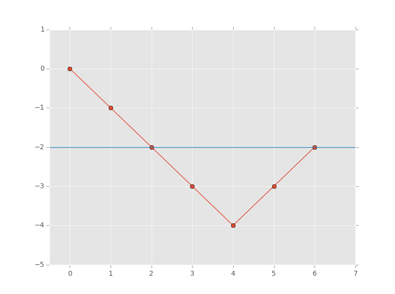

# Hash Map — Worked Examples

> **Scope** — The hash-map family's classic LC problems as problem cards, filed under the [hash_map.md](./hash_map.md) template each one reduces to; it has no templates of its own.
> **See also** — *core sheet*: [hash_map.md](./hash_map.md) — the ten templates these problems reduce to, the Recognition table, and the sorted-map (`TreeMap` / `SortedDict`) API reference.
> *Neighbouring sheets*: [prefix_sum.md](./prefix_sum.md) — the prefix-sum family in its own right; [hashing.md](./hashing.md) — how hashing works, plus counting and rolling-hash idioms; [set.md](./set.md) — membership only, no values.

## LeetCode Problem Lists

- [Hash Table](https://leetcode.com/problem-list/hash-table/)

## Overview

This sheet is the problem set for [hash_map.md](./hash_map.md): the templates live there, and every problem here is a card that names the template it reduces to and the one step it adds. The `##` sections follow the core sheet's ten templates in order. A problem whose best write-up lives on another sheet appears here as a one-row pointer, so the [Index](#index) still lists the whole set.

## Index

| LC | Problem | Reduces to | Difficulty | Worked in |
|---|---|---|---|---|
| 1 | Two Sum | [hash_map § Template 1](./hash_map.md#template-1-complement-lookup--lc-1) | Easy | hash_map.md (the anchor) |
| 1010 | Pairs of Songs With Total Durations Divisible by 60 | [hash_map § Template 1](./hash_map.md#template-1-complement-lookup--lc-1) | Medium | [below](#pairs-of-songs-with-total-durations-divisible-by-60--lc-1010) |
| 532 | K-diff Pairs in an Array | [hash_map § Template 1](./hash_map.md#template-1-complement-lookup--lc-1) | Medium | [set_examples.md](./set_examples.md#variation-b-probe-a-transformed-key-not-the-element-itself--lc-532) |
| 336 | Palindrome Pairs | [hash_map § Template 1](./hash_map.md#template-1-complement-lookup--lc-1) | Hard | [palindrome.md § Template 9](./palindrome.md#template-9-palindrome-pairs-via-hashmap-split--lc-336-) |
| 352 | Data Stream as Disjoint Intervals | [hash_map § Template 1](./hash_map.md#template-1-complement-lookup--lc-1) | Hard | [below](#data-stream-as-disjoint-intervals--lc-352) |
| 242 | Valid Anagram | [hash_map § Template 2](./hash_map.md#template-2-frequency-count--lc-242) | Easy | hash_map.md (the anchor) |
| 554 | Brick Wall | [hash_map § Template 2](./hash_map.md#template-2-frequency-count--lc-242) | Medium | [below](#brick-wall--lc-554) |
| 846 | Hand of Straights | [hash_map § Template 2](./hash_map.md#template-2-frequency-count--lc-242) | Medium | [below](#hand-of-straights--lc-846) |
| 1726 | Tuple with Same Product | [hash_map § Template 2](./hash_map.md#template-2-frequency-count--lc-242) | Medium | [below](#tuple-with-same-product--lc-1726) |
| 187 | Repeated DNA Sequences | [hash_map § Template 2](./hash_map.md#template-2-frequency-count--lc-242) | Medium | [hashing.md § 2-5](./hashing.md#2-5-repeated-dna-sequences-lc-187--sliding-window-hashset) |
| 763 | Partition Labels | [string § Template 8](./string.md#template-8-greedy-partition-by-last-occurrence--lc-763-) | Medium | string.md |
| 49 | Group Anagrams | [hash_map § Template 3](./hash_map.md#template-3-grouping-by-a-computed-key--lc-49) | Medium | hash_map.md (the anchor) |
| 734 | Sentence Similarity | [hash_map § Template 3](./hash_map.md#pattern-unordered-pair-key--min-max-counts-x-y-in-either-order-) | Easy | [below](#sentence-similarity--lc-734) |
| 560 | Subarray Sum Equals K | [hash_map § Template 4](./hash_map.md#template-4-prefix-sum-count-map--lc-560-) | Medium | hash_map.md (the anchor) |
| 525 | Contiguous Array | [hash_map § Template 4](./hash_map.md#template-4-prefix-sum-count-map--lc-560-) | Medium | [below](#contiguous-array--lc-525) |
| 325 | Maximum Size Subarray Sum Equals k | [hash_map § Template 4](./hash_map.md#template-4-prefix-sum-count-map--lc-560-) | Medium | [prefix_sum_examples.md § 1](./prefix_sum_examples.md#1-maximum-size-subarray-sum-equals-k--lc-325) |
| 523 | Continuous Subarray Sum | [hash_map § Template 4](./hash_map.md#template-4-prefix-sum-count-map--lc-560-) | Medium | [prefix_sum_examples.md § 2](./prefix_sum_examples.md#2-continuous-subarray-sum--lc-523) |
| 974 | Subarray Sums Divisible by K | [hash_map § Template 4](./hash_map.md#template-4-prefix-sum-count-map--lc-560-) | Medium | [prefix_sum.md § Template 3](./prefix_sum.md#template-3-modulo-prefix-sum-divisibility-problems--lc-974) |
| 1248 | Count Number of Nice Subarrays | [hash_map § Template 4](./hash_map.md#template-4-prefix-sum-count-map--lc-560-) | Medium | [prefix_sum.md § Template 6](./prefix_sum.md#template-6-transform-and-count--lc-1248) |
| 438 | Find All Anagrams in a String | [hash_map § Template 5](./hash_map.md#template-5-fixed-window-character-counts--lc-438) | Medium | hash_map.md (the anchor) |
| 3 | Longest Substring Without Repeating Characters | [sliding_window § Template 3](./sliding_window.md#template-3-longest-window-satisfying-p--lc-3-) | Medium | sliding_window.md |
| 424 | Longest Repeating Character Replacement | [sliding_window § Template 3](./sliding_window.md#template-3-longest-window-satisfying-p--lc-3-) | Medium | [sliding_window_examples.md § 5](./sliding_window_examples.md#5-longest-repeating-character-replacement--lc-424-) |
| 953 | Verifying an Alien Dictionary | [hash_map § Template 6](./hash_map.md#template-6-rank-map--value-to-position--lc-953-) | Easy | hash_map.md (the anchor) |
| 670 | Maximum Swap | [hash_map § Template 6](./hash_map.md#template-6-rank-map--value-to-position--lc-953-) | Medium | [below](#maximum-swap--lc-670) |
| 2471 | Minimum Number of Operations to Sort a Binary Tree by Level | [hash_map § Template 6](./hash_map.md#template-6-rank-map--value-to-position--lc-953-) | Medium | [below](#minimum-number-of-operations-to-sort-a-binary-tree-by-level--lc-2471) |
| 205 | Isomorphic Strings | [hash_map § Template 7](./hash_map.md#template-7-bijection-with-two-maps--lc-205) | Easy | hash_map.md (the anchor) |
| 290 | Word Pattern | [hash_map § Template 7](./hash_map.md#template-7-bijection-with-two-maps--lc-205) | Easy | hash_map.md |
| 133 | Clone Graph | [hash_map § Template 8](./hash_map.md#template-8-old-to-new-node-map--lc-133) | Medium | hash_map.md (the anchor) |
| 1257 | Smallest Common Region | [hash_map § Template 8](./hash_map.md#template-8-old-to-new-node-map--lc-133) | Medium | [below](#smallest-common-region--lc-1257) |
| 710 | Random Pick with Blacklist | [hash_map § Template 9](./hash_map.md#template-9-virtual-map-remapping--lc-710) | Hard | hash_map.md (the anchor) |
| 692 | Top K Frequent Words | [hash_map § Template 10](./hash_map.md#template-10-map-plus-heap--lc-692) | Medium | hash_map.md (the anchor, heap and bucket solutions) |
| 347 | Top K Frequent Elements | [heap § Template 2](./heap.md#template-2-count-then-a-size-k-heap-on-the-count--lc-347-) | Medium | heap.md (heap and bucket solutions) |
| 621 | Task Scheduler | [heap § Template 8](./heap.md#template-8-max-heap--cooldown-queue--lc-358) | Medium | [heap_examples.md](./heap_examples.md#task-scheduler--lc-621-) |
| 767 | Reorganize String | [heap § Template 7](./heap.md#template-7-greedy-build-with-a-run-length-cap--lc-1405) | Medium | [heap_examples.md](./heap_examples.md#reorganize-string--lc-767-) |
| 36 | Valid Sudoku | [hashing § Template 6](./hashing.md#template-6-canonical-composite-key-lc-36) | Medium | hashing.md |
| 146 | LRU Cache | [linked_list § Template 7](./linked_list.md#template-7-hash-map--doubly-linked-list-lru--lc-146-) | Medium | linked_list.md |
| 139 | Word Break | [dp § Template 1b](./dp.md#template-1b-prefix-partition-dp--lc-139-) | Medium | dp.md |
| 322 | Coin Change | [knapsack § Template 4](./knapsack.md#template-4-unbounded-min-count--lc-322-) | Medium | knapsack.md |
| 1048 | Longest String Chain | [dp_advanced § Longest String Chain](./dp_advanced.md#longest-string-chain--lc-1048) | Medium | dp_advanced.md |
| 1044 | Longest Duplicate Substring | [string_matching_kmp_rolling_hash § 2-3](./string_matching_kmp_rolling_hash.md#2-3-longest-duplicate-substring-lc-1044) | Hard | string_matching_kmp_rolling_hash.md |
| 204 | Count Primes | [combinatorics_math_patterns § Sieve](./combinatorics_math_patterns.md#sieve-of-eratosthenes--lc-204) | Medium | combinatorics_math_patterns.md |
| 496 | Next Greater Element I | [monotonic_stack § Template 1](./monotonic_stack.md#template-1-next-greater-element-decreasing-stack--lc-496) | Easy | monotonic_stack.md |
| 503 | Next Greater Element II | [monotonic_stack § Template 4](./monotonic_stack.md#template-4-circular-array-processing--lc-503) | Medium | monotonic_stack.md |
| 739 | Daily Temperatures | [stack § Template 3](./stack.md#template-3-monotonic-stack--next-greater--smaller--lc-739-) | Medium | stack.md |
| 853 | Car Fleet | [monotonic_stack § 2-10](./monotonic_stack.md#2-10-the-car-fleet-family-lc-853--4045--1776--when-a-stack-is-really-a-greedy-) | Medium | monotonic_stack.md |
| 729 | My Calendar I | [hash_map § Language APIs](./hash_map.md#language-apis--sorted-map-treemap--sorteddict) | Medium | [design_examples.md](./design_examples.md#my-calendar-i--lc-729) |
| 731 | My Calendar II | [hash_map § Language APIs](./hash_map.md#language-apis--sorted-map-treemap--sorteddict) | Medium | [design_examples.md](./design_examples.md#my-calendar-ii--lc-731) |
| 732 | My Calendar III | [hash_map § Language APIs](./hash_map.md#language-apis--sorted-map-treemap--sorteddict) | Hard | [design_examples.md](./design_examples.md#my-calendar-iii--lc-732) |

A row whose **Reduces to** names another sheet is worked on that sheet; it is listed here so a search of this sheet still finds it.

## Complement Lookup Examples

### Pairs of Songs With Total Durations Divisible by 60 — LC 1010

> **Key point** — the complement of a duration is a **remainder**, not a value: `t` pairs with every earlier song whose `t % 60` is `(60 - t % 60) % 60`, so the map counts songs per remainder and the answer adds a count instead of returning an index.

**Reduces to**: [hash_map § Template 1](./hash_map.md#template-1-complement-lookup--lc-1) — the key is `t % 60` and the value is how many earlier songs have it, because the question counts pairs rather than finding one.

```python
# python
# LC 1010 - Pairs of Songs With Total Durations Divisible by 60
# IDEA: count songs per remainder; each song pairs with every earlier song whose remainder completes it to 0 mod 60
# time = O(n), space = O(1)   at most 60 remainders
def numPairsDivisibleBy60(time):
    count_of_rem = {}                       # {remainder: songs seen so far}
    pairs = 0
    for t in time:
        rem = t % 60
        need = (60 - rem) % 60              # remainder 0 pairs with 0, not with 60
        pairs += count_of_rem.get(need, 0)  # look up BEFORE recording: a song never pairs with itself
        count_of_rem[rem] = count_of_rem.get(rem, 0) + 1
    return pairs
```

**Traps**
- `need = 60 - rem` without the outer `% 60` looks up key 60 for a multiple of 60: `[60, 60, 60]` returns 0 instead of 3.
- Recording before the lookup lets a song pair with itself when its remainder is 0 or 30: `[60]` returns 1 instead of 0.

### Data Stream as Disjoint Intervals — LC 352

> **Key point** — a new value `v` can only touch the interval that **ends** at `v - 1` and the one that **starts** at `v + 1`, so two boundary maps, `{start: end}` and `{end: start}`, turn every merge into two O(1) lookups. The maps always hold exactly the current disjoint intervals.

**Reduces to**: [hash_map § Template 1](./hash_map.md#template-1-complement-lookup--lc-1) — the "partners" probed are the neighbours `v - 1` and `v + 1`, one in each boundary map; only `getIntervals` sorts.

```python
# python
# LC 352 - Data Stream as Disjoint Intervals
# IDEA: {start: end} and {end: start}; a new value probes v-1 (an end) and v+1 (a start) and merges with each
# time = O(1) per addNum, O(k log k) per getIntervals, space = O(n)   k = disjoint intervals
class SummaryRanges:
    def __init__(self):
        self.seen = set()              # every value added; a repeat changes nothing
        self.start_to_end = {}
        self.end_to_start = {}

    def addNum(self, value):
        if value in self.seen:
            return
        self.seen.add(value)
        start, end = value, value
        if value - 1 in self.end_to_start:          # an interval ends right before value
            start = self.end_to_start.pop(value - 1)
        if value + 1 in self.start_to_end:          # an interval starts right after value
            end = self.start_to_end.pop(value + 1)
        self.start_to_end[start] = end              # overwrites the left interval's old end
        self.end_to_start[end] = start              # overwrites the right interval's old start

    def getIntervals(self):
        result = []
        for start in sorted(self.start_to_end):
            result.append([start, self.start_to_end[start]])
        return result
```

**Dry run**

```text
add  start_to_end            end_to_start             getIntervals
1    {1:1}                   {1:1}                    [[1,1]]
3    {1:1, 3:3}              {1:1, 3:3}               [[1,1],[3,3]]
7    {1:1, 3:3, 7:7}         {1:1, 3:3, 7:7}          [[1,1],[3,3],[7,7]]
2    {1:3, 7:7}              {3:1, 7:7}               [[1,3],[7,7]]     2 joins [1,1] and [3,3]
6    {1:3, 6:7}              {3:1, 7:6}               [[1,3],[6,7]]
```

**Traps**
- No `seen` set: adding `2` twice after `1, 3, 2` finds no neighbour boundary the second time and creates `[2, 2]` inside `[1, 3]`.
- Popping only one side of a merge leaves a stale boundary: after joining `[1,1]` and `[3,3]`, a leftover `end_to_start[1]` would let a later `2` merge again.

**Not this if** — `getIntervals` is called far more often than `addNum`: keep the intervals in a sorted map so a read is O(k) without re-sorting ([hash_map § Language APIs](./hash_map.md#language-apis--sorted-map-treemap--sorteddict)).

| Also reduces to Template 1 | Problem | Worked in | Difficulty |
|---|---|---|---|
| LC 1 | Two Sum | [hash_map § Template 1](./hash_map.md#template-1-complement-lookup--lc-1) | Easy |
| LC 532 | K-diff Pairs in an Array | [set_examples.md](./set_examples.md#variation-b-probe-a-transformed-key-not-the-element-itself--lc-532) | Medium |
| LC 336 | Palindrome Pairs | [palindrome.md § Template 9](./palindrome.md#template-9-palindrome-pairs-via-hashmap-split--lc-336-) | Hard |

## Frequency Count Examples

### Brick Wall — LC 554

> **Key point** — a vertical line crosses the fewest bricks where the most rows have an **edge**, so count edge positions (each row's running width, excluding the wall's right side) and the answer is `rows - the largest count`.

**Reduces to**: [hash_map § Template 2](./hash_map.md#template-2-frequency-count--lc-242) — the counted item is a prefix width, not an element of the input.

```python
# python
# LC 554 - Brick Wall
# IDEA: count every inner edge position across rows; cross where the most edges line up
# time = O(total bricks), space = O(distinct edge positions)
def leastBricks(wall):
    edges_at = {}                          # {distance from the left: rows with an edge there}
    for row in wall:
        position = 0
        for i in range(len(row) - 1):      # the last brick ends at the wall's edge: never a gap
            position += row[i]
            edges_at[position] = edges_at.get(position, 0) + 1
    most_edges = 0
    for count in edges_at.values():
        most_edges = max(most_edges, count)
    return len(wall) - most_edges
```

**Traps**
- Counting the last brick of each row: the wall's right edge is shared by every row, so `most_edges` becomes `len(wall)` and every input returns 0.
- Every row a single brick (`[[1],[1],[1]]`): no inner edge exists, the map is empty, and `max()` over it raises — start `most_edges` at 0 and the answer is 3.

### Hand of Straights — LC 846

> **Key point** — the smallest card left can only **start** a group, so walking the distinct cards in sorted order and spending `count[card]` copies of each of the next `groupSize` cards never makes a choice that could have been better.

**Reduces to**: [hash_map § Template 2](./hash_map.md#template-2-frequency-count--lc-242) — the count map is read in **sorted key order**; a Java `TreeMap` keeps that order for free ([hash_map § Language APIs](./hash_map.md#language-apis--sorted-map-treemap--sorteddict)).

```python
# python
# LC 846 - Hand of Straights
# IDEA: count the cards; from the smallest card up, every copy of it starts a run of groupSize consecutive cards
# time = O(n log n), space = O(n)
def isNStraightHand(hand, groupSize):
    if len(hand) % groupSize != 0:
        return False
    count = {}
    for card in hand:
        count[card] = count.get(card, 0) + 1
    for card in sorted(count):             # the smallest remaining card must start a group
        starts = count[card]               # groups that start at this card
        if starts == 0:
            continue
        for nxt in range(card, card + groupSize):
            if count.get(nxt, 0) < starts:
                return False               # a run would have a gap
            count[nxt] -= starts
    return True
```

**Complexity** — sorting the distinct cards is O(n log n); the inner loop runs only for a card that starts groups and each run consumes at least `groupSize` cards, so it is O(n) in total.

**Traps**
- Walking the keys in insertion order: `hand = [2, 1], groupSize = 2` starts at 2, finds no 3, and returns `False`; sorted order starts at 1 and returns `True`.
- Subtracting one group at a time instead of `starts`: correct, but `[1]*k + [2]*k` with `groupSize = 2` re-walks the run k times.

### Tuple with Same Product — LC 1726

> **Key point** — count how many index pairs share each product; `c` pairs with one product give `C(c, 2)` pairs of pairs, and each pair of pairs `(a, b), (c, d)` gives 8 ordered tuples, so the answer is `sum(8 * C(c, 2))`.

**Reduces to**: [hash_map § Template 2](./hash_map.md#template-2-frequency-count--lc-242) — the counted item is the product of a pair, and the answer combines the counts instead of comparing them.

```python
# python
# LC 1726 - Tuple with Same Product
# IDEA: count index pairs per product; c pairs give C(c, 2) choices, each yielding 8 orderings
# time = O(n^2), space = O(n^2)
def tupleSameProduct(nums):
    pairs_with = {}                        # {product: index pairs i < j with that product}
    for i in range(len(nums)):
        for j in range(i + 1, len(nums)):
            product = nums[i] * nums[j]
            pairs_with[product] = pairs_with.get(product, 0) + 1
    total = 0
    for c in pairs_with.values():
        total += 8 * (c * (c - 1) // 2)    # choose 2 pairs, then 2 * 2 * 2 orderings
    return total
```

```java
// java
// LC 1726 - Tuple with Same Product
// IDEA: count index pairs per product; c pairs give C(c, 2) choices, each yielding 8 orderings
// time = O(n^2), space = O(n^2)
public int tupleSameProduct(int[] nums) {
    Map<Integer, Integer> pairsWith = new HashMap<>();   // values <= 10^4, so a product fits an int
    for (int i = 0; i < nums.length; i++) {
        for (int j = i + 1; j < nums.length; j++) {
            pairsWith.merge(nums[i] * nums[j], 1, Integer::sum);
        }
    }
    int total = 0;
    for (int c : pairsWith.values()) {
        total += 4 * c * (c - 1);          // 8 * c * (c - 1) / 2, without the division
    }
    return total;
}
```

**Traps**
- Forgetting the 8: `[2, 3, 4, 6]` has one pair of pairs (`2·6 = 3·4`) and the answer is 8, not 1. The orderings are 2 within the first pair × 2 within the second × 2 for which pair comes first.
- The 8 assumes the two pairs share no element. It holds only because the values are **distinct**: `a·b = a·c` forces `b = c`.

| Also reduces to Template 2 | Problem | Worked in | Difficulty |
|---|---|---|---|
| LC 242 | Valid Anagram | [hash_map § Template 2](./hash_map.md#template-2-frequency-count--lc-242) | Easy |
| LC 187 | Repeated DNA Sequences | [hashing.md § 2-5](./hashing.md#2-5-repeated-dna-sequences-lc-187--sliding-window-hashset) | Medium |
| LC 763 | Partition Labels | [string § Template 8](./string.md#template-8-greedy-partition-by-last-occurrence--lc-763-) | Medium |

## Grouping by a Computed Key Examples

### Sentence Similarity — LC 734

> **Key point** — similarity is **symmetric but not transitive**, so each pair is stored once under the unordered key `(min, max)` and every word position is one O(1) membership test; no graph is needed.

**Reduces to**: [hash_map § Template 3 — unordered-pair key](./hash_map.md#pattern-unordered-pair-key--min-max-counts-x-y-in-either-order-) — the canonical key makes `["great", "fine"]` and `["fine", "great"]` one entry; a set is enough because there is nothing to count.

```python
# python
# LC 734 - Sentence Similarity
# IDEA: store each similar pair under the key (min, max); compare the sentences word by word
# time = O(n + p), space = O(p)   n words, p pairs
def areSentencesSimilar(sentence1, sentence2, similarPairs):
    if len(sentence1) != len(sentence2):
        return False
    similar = set()
    for a, b in similarPairs:
        similar.add((min(a, b), max(a, b)))       # {a, b} in either order -> one key
    for a, b in zip(sentence1, sentence2):
        if a != b and (min(a, b), max(a, b)) not in similar:
            return False
    return True
```

**Traps**
- Looking up `[a, b]` in the raw pair list: correct, but O(p) per word, and it still has to try `[b, a]` as well.
- A word is similar to itself with no pair listed: `["great"]` vs `["great"]` with no pairs is `True`, which the `a != b` test gives.
- No transitivity: `great ~ fine` and `fine ~ good` do **not** make `great ~ good` here. LC 737 adds transitivity, and that needs union-find ([dfs_examples.md](./dfs_examples.md)).

| Also reduces to Template 3 | Problem | Worked in | Difficulty |
|---|---|---|---|
| LC 49 | Group Anagrams | [hash_map § Template 3](./hash_map.md#template-3-grouping-by-a-computed-key--lc-49) | Medium |

## Prefix-Sum Count Map Examples

### Contiguous Array — LC 525

> **Key point** — read each `0` as `-1`, so a subarray has equally many 0s and 1s iff its sum is 0, i.e. iff the running sum at its two ends is equal. The map keeps the **first** index of each running sum, seeded `{0: -1}`, so `i - first[sum]` is the longest balanced subarray ending at `i`.

**Reduces to**: [hash_map § Template 4](./hash_map.md#template-4-prefix-sum-count-map--lc-560-) — the target is the same prefix sum (k = 0), and the map stores the first index instead of a count because the question asks for the longest.

```python
# python
# LC 525 - Contiguous Array
# IDEA: 0 -> -1, then the longest subarray with sum 0 = the widest gap between two equal running sums
# time = O(n), space = O(n)
def findMaxLength(nums):
    first_index = {0: -1}          # running sum 0 before index 0: subarrays that start at 0
    running = 0
    longest = 0
    for i, x in enumerate(nums):
        running += 1 if x == 1 else -1
        if running in first_index:
            longest = max(longest, i - first_index[running])
        else:
            first_index[running] = i      # keep the FIRST index only: it gives the longest span
    return longest
```

```java
// java
// LC 525 - Contiguous Array
// IDEA: 0 -> -1, then the longest subarray with sum 0 = the widest gap between two equal running sums
// time = O(n), space = O(n)
public int findMaxLength(int[] nums) {
    Map<Integer, Integer> firstIndex = new HashMap<>();
    firstIndex.put(0, -1);                 // subarrays that start at index 0
    int running = 0;
    int longest = 0;
    for (int i = 0; i < nums.length; i++) {
        running += (nums[i] == 1) ? 1 : -1;
        if (firstIndex.containsKey(running)) {
            longest = Math.max(longest, i - firstIndex.get(running));
        } else {
            firstIndex.put(running, i);    // first occurrence only
        }
    }
    return longest;
}
```

**Dry run**

```text
nums = [0,0,0,0,1,1]
i  x  running  first_index (after)              longest
0  0  -1       {0:-1, -1:0}                     0
1  0  -2       {..., -2:1}                      0
2  0  -3       {..., -3:2}                      0
3  0  -4       {..., -4:3}                      0
4  1  -3       -3 seen at 2  -> 4 - 2 = 2       2
5  1  -2       -2 seen at 1  -> 5 - 1 = 4       4   nums[2..5] = [0,0,1,1]
```

<p align="center"></p>

**Traps**
- No `{0: -1}` seed: `[0, 1]` returns 0 instead of 2, because the balanced subarray starts at index 0.
- Updating the index on every repeat keeps the **last** occurrence: `[0, 1, 0, 1]` returns 2 instead of 4.
- A count map (LC 560's `{sum: count}`) answers "how many", not "how long"; the value has to be an index here.

| Also reduces to Template 4 | Problem | Worked in | Difficulty |
|---|---|---|---|
| LC 560 | Subarray Sum Equals K | [hash_map § Template 4](./hash_map.md#template-4-prefix-sum-count-map--lc-560-) | Medium |
| LC 325 | Maximum Size Subarray Sum Equals k | [prefix_sum_examples.md § 1](./prefix_sum_examples.md#1-maximum-size-subarray-sum-equals-k--lc-325) | Medium |
| LC 523 | Continuous Subarray Sum | [prefix_sum_examples.md § 2](./prefix_sum_examples.md#2-continuous-subarray-sum--lc-523) | Medium |
| LC 974 | Subarray Sums Divisible by K | [prefix_sum.md § Template 3](./prefix_sum.md#template-3-modulo-prefix-sum-divisibility-problems--lc-974) | Medium |
| LC 1248 | Count Number of Nice Subarrays | [prefix_sum.md § Template 6](./prefix_sum.md#template-6-transform-and-count--lc-1248) | Medium |

## Fixed-Window Character Counts Examples

The anchor is worked in the core sheet; the variable-length windows that keep a count map are worked on the sliding-window sheets.

| Reduces to Template 5, or to a sliding window | Problem | Worked in | Difficulty |
|---|---|---|---|
| LC 438 | Find All Anagrams in a String | [hash_map § Template 5](./hash_map.md#template-5-fixed-window-character-counts--lc-438) | Medium |
| LC 3 | Longest Substring Without Repeating Characters | [sliding_window § Template 3](./sliding_window.md#template-3-longest-window-satisfying-p--lc-3-) | Medium |
| LC 424 | Longest Repeating Character Replacement | [sliding_window_examples.md § 5](./sliding_window_examples.md#5-longest-repeating-character-replacement--lc-424-) | Medium |

## Rank Map Examples

### Maximum Swap — LC 670

> **Key point** — `last[d]` is the rightmost index of digit `d`. The first position `i` that has a larger digit somewhere after it is the only place one swap can raise the most significant digit, and the best partner is the **largest** such digit at its **last** index.

**Reduces to**: [hash_map § Template 6](./hash_map.md#template-6-rank-map--value-to-position--lc-953-) — a value → position map built once, so "is there a larger digit to my right, and where?" is at most 9 lookups. The three-pointer scan without a map is in [array_examples.md § 4](./array_examples.md#4-maximum-swap--lc-670).

```python
# python
# LC 670 - Maximum Swap
# IDEA: {digit: last index}; at the first position beaten by a larger digit later, swap with that digit's last copy
# time = O(n), space = O(1)   n digits, at most 10 keys
def maximumSwap(num):
    digits = list(str(num))
    last = {}
    for i, ch in enumerate(digits):
        last[int(ch)] = i                       # a later copy overwrites: the LAST index wins
    for i, ch in enumerate(digits):
        current = int(ch)
        for d in range(9, current, -1):         # the largest digit first
            if last.get(d, -1) > i:
                j = last[d]
                digits[i], digits[j] = digits[j], digits[i]
                return int("".join(digits))     # only one swap is allowed
    return num                                  # already the largest arrangement
```

```java
// java
// LC 670 - Maximum Swap
// IDEA: {digit: last index}; at the first position beaten by a larger digit later, swap with that digit's last copy
// time = O(n), space = O(1)   10 digits
public int maximumSwap(int num) {
    char[] digits = String.valueOf(num).toCharArray();
    int[] last = new int[10];
    for (int i = 0; i < digits.length; i++) {
        last[digits[i] - '0'] = i;
    }
    for (int i = 0; i < digits.length; i++) {
        int current = digits[i] - '0';
        for (int d = 9; d > current; d--) {
            if (last[d] > i) {
                char tmp = digits[i];
                digits[i] = digits[last[d]];
                digits[last[d]] = tmp;
                return Integer.parseInt(new String(digits));
            }
        }
    }
    return num;
}
```

**Dry run**

```text
num = 2736   last = {2:0, 7:1, 3:2, 6:3}
i=0  digit 2: try 9, 8 (absent), 7 -> last[7] = 1 > 0  -> swap 0 and 1 -> 7236, stop
```

**Traps**
- Swapping with the **first** copy of the larger digit: `1993` gives `9193`; the last copy gives `9913`.
- Taking the first larger digit found instead of the largest: `2736` would swap the 2 with the 3 and return `3726`.
- No improvable position (`9973`): return `num` unchanged.

### Minimum Number of Operations to Sort a Binary Tree by Level — LC 2471

> **Key point** — levels are independent, so the answer is the sum of the minimum swaps that sort each level. A `{value: current index}` map makes each swap O(1): at index `i`, fetch where the value that belongs there sits, update both map entries, then swap. Every swap puts one value in its final place, so the count is minimal.

**Reduces to**: [hash_map § Template 6](./hash_map.md#template-6-rank-map--value-to-position--lc-953-) — a value → position map, kept current as the array changes; BFS supplies each level.

```python
# python
# LC 2471 - Minimum Number of Operations to Sort a Binary Tree by Level
# IDEA: BFS per level; min swaps to sort a level = place sorted[i] at i via a {value: current index} map
# time = O(n log n), space = O(w)   w = the widest level
from collections import deque

def minimumOperations(root):
    queue = deque([root])
    operations = 0
    while queue:
        level = []
        for _ in range(len(queue)):
            node = queue.popleft()
            level.append(node.val)
            if node.left:
                queue.append(node.left)
            if node.right:
                queue.append(node.right)
        operations += min_swaps(level)
    return operations

def min_swaps(arr):
    target = sorted(arr)
    position = {}                               # {value: current index}; values are unique
    for i, v in enumerate(arr):
        position[v] = i
    swaps = 0
    for i in range(len(arr)):
        want = target[i]
        if arr[i] != want:
            j = position[want]                  # where the value that belongs at i sits now
            position[arr[i]] = j                # update the map BEFORE the swap overwrites arr[i]
            position[want] = i
            arr[i], arr[j] = arr[j], arr[i]
            swaps += 1
    return swaps
```

```java
// java
// LC 2471 - Minimum Number of Operations to Sort a Binary Tree by Level
// IDEA: BFS per level; min swaps to sort a level = place sorted[i] at i via a {value: current index} map
// time = O(n log n), space = O(w)
public int minimumOperations(TreeNode root) {
    Queue<TreeNode> queue = new LinkedList<>();
    queue.offer(root);
    int operations = 0;
    while (!queue.isEmpty()) {
        int size = queue.size();
        int[] level = new int[size];
        for (int i = 0; i < size; i++) {
            TreeNode node = queue.poll();
            level[i] = node.val;
            if (node.left != null) queue.offer(node.left);
            if (node.right != null) queue.offer(node.right);
        }
        operations += minSwaps(level);
    }
    return operations;
}

private int minSwaps(int[] arr) {
    int[] target = arr.clone();
    Arrays.sort(target);
    Map<Integer, Integer> position = new HashMap<>();   // {value: current index}
    for (int i = 0; i < arr.length; i++) {
        position.put(arr[i], i);
    }
    int swaps = 0;
    for (int i = 0; i < arr.length; i++) {
        int want = target[i];
        if (arr[i] != want) {
            int j = position.get(want);
            position.put(arr[i], j);       // update the map before the swap
            position.put(want, i);
            arr[j] = arr[i];
            arr[i] = want;
            swaps++;
        }
    }
    return swaps;
}
```

**Dry run**

```text
min_swaps([3, 1, 2])   target = [1, 2, 3]   position = {3:0, 1:1, 2:2}
i=0  want 1 at j=1   position -> {3:1, 1:0}   arr = [1, 3, 2]   swaps = 1
i=1  want 2 at j=2   position -> {3:2, 2:1}   arr = [1, 2, 3]   swaps = 2
i=2  3 already in place                                          -> 2
```

**Traps**
- Swapping first and updating the map after: `arr[i]` already holds `want`, so the displaced value's new index is written under the wrong key.
- Scanning for `want` with `arr.index(want)` instead of the map: correct, but O(w) per swap and O(w²) per level.

| Also reduces to Template 6 | Problem | Worked in | Difficulty |
|---|---|---|---|
| LC 953 | Verifying an Alien Dictionary | [hash_map § Template 6](./hash_map.md#template-6-rank-map--value-to-position--lc-953-) | Easy |

## Bijection Examples

Both problems of this card are worked in the core sheet.

| Reduces to Template 7 | Problem | Worked in | Difficulty |
|---|---|---|---|
| LC 205 | Isomorphic Strings | [hash_map § Template 7](./hash_map.md#template-7-bijection-with-two-maps--lc-205) | Easy |
| LC 290 | Word Pattern | [hash_map § Template 7](./hash_map.md#template-7-bijection-with-two-maps--lc-205) | Easy |

## Old-to-New Node Map Examples

### Smallest Common Region — LC 1257

> **Key point** — each list names a parent and its children, so a `{child: parent}` map turns the region lists into a tree with parent pointers, and the answer is the lowest common ancestor: collect `region1`'s ancestors in a set, then walk `region2` up until it reaches one.

**Reduces to**: [hash_map § Template 8](./hash_map.md#template-8-old-to-new-node-map--lc-133) — the map is `{child: parent}` instead of `{original: clone}`; the walk is the parent-pointer LCA of [tree_lca_distance.md](./tree_lca_distance.md#lca-variant--parent-pointers-no-root-lc-1650-).

```python
# python
# LC 1257 - Smallest Common Region
# IDEA: {child: parent} from the lists; region1's ancestors in a set; walk region2 up until it hits one
# time = O(total names), space = O(total names)
def findSmallestRegion(regions, region1, region2):
    parent = {}
    for group in regions:
        for child in group[1:]:            # group[0] contains every other name in the list
            parent[child] = group[0]
    ancestors = set()
    node = region1
    while node is not None:
        ancestors.add(node)                # region1 counts as its own ancestor
        node = parent.get(node)            # the root has no parent -> None
    node = region2
    while node not in ancestors:           # the root is in the set, so this stops
        node = parent[node]
    return node
```

```java
// java
// LC 1257 - Smallest Common Region
// IDEA: {child: parent} from the lists; region1's ancestors in a set; walk region2 up until it hits one
// time = O(total names), space = O(total names)
public String findSmallestRegion(List<List<String>> regions, String region1, String region2) {
    Map<String, String> parent = new HashMap<>();
    for (List<String> group : regions) {
        for (int i = 1; i < group.size(); i++) {
            parent.put(group.get(i), group.get(0));
        }
    }
    Set<String> ancestors = new HashSet<>();
    for (String node = region1; node != null; node = parent.get(node)) {
        ancestors.add(node);
    }
    String node = region2;
    while (!ancestors.contains(node)) {
        node = parent.get(node);
    }
    return node;
}
```

**Traps**
- Leaving `region1` out of its own ancestor set: when `region1` contains `region2` (`"North America"`, `"New York"`), the walk passes `"North America"` and answers `"Earth"`.
- Recording `{parent: [children]}` instead: it is the right shape for a top-down DFS, but finding an ancestor then needs a search from the root.

| Also reduces to Template 8 | Problem | Worked in | Difficulty |
|---|---|---|---|
| LC 133 | Clone Graph | [hash_map § Template 8](./hash_map.md#template-8-old-to-new-node-map--lc-133) | Medium |

## Virtual Map Examples

| Reduces to Template 9 | Problem | Worked in | Difficulty |
|---|---|---|---|
| LC 710 | Random Pick with Blacklist | [hash_map § Template 9](./hash_map.md#template-9-virtual-map-remapping--lc-710) | Hard |

## Map Plus Heap Examples

LC 692 is worked in the core sheet, with a heap and with buckets by count. The other top-K and scheduling problems that start from a count map are worked on the heap sheets.

| Reduces to Template 10, or to a heap card | Problem | Worked in | Difficulty |
|---|---|---|---|
| LC 692 | Top K Frequent Words | [hash_map § Template 10](./hash_map.md#template-10-map-plus-heap--lc-692) | Medium |
| LC 347 | Top K Frequent Elements | [heap § Template 2](./heap.md#template-2-count-then-a-size-k-heap-on-the-count--lc-347-) | Medium |
| LC 621 | Task Scheduler | [heap_examples.md](./heap_examples.md#task-scheduler--lc-621-), reducing to [heap § Template 8](./heap.md#template-8-max-heap--cooldown-queue--lc-358) | Medium |
| LC 767 | Reorganize String | [heap_examples.md](./heap_examples.md#reorganize-string--lc-767-), reducing to [heap § Template 7](./heap.md#template-7-greedy-build-with-a-run-length-cap--lc-1405) | Medium |
