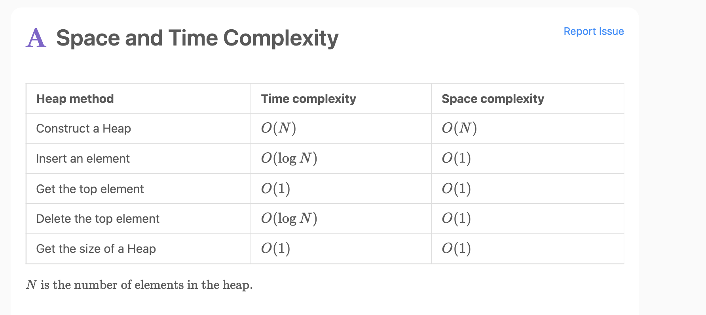
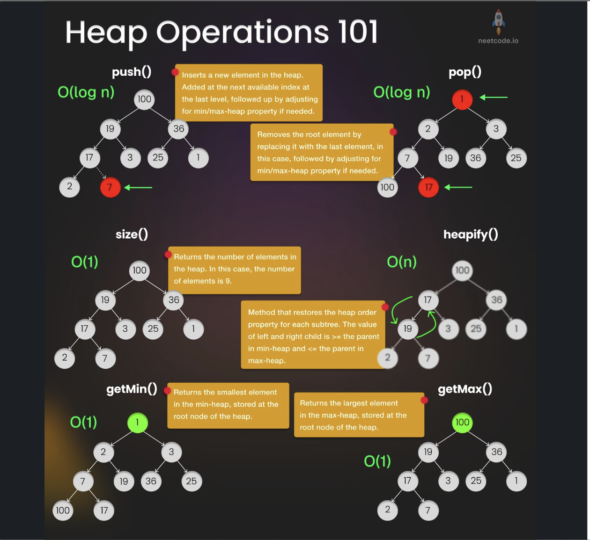
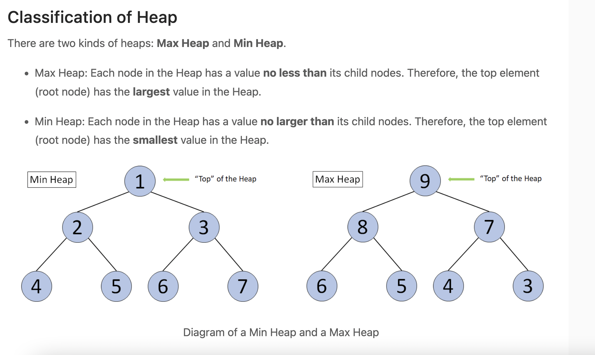

# Heap & Priority Queue

> **Scope** — Both the heap (the structure) and the priority queue (the ADT it implements), in Python and Java. Formerly split across `heap.md` + `priority_queue.md`, which solved the same problems twice.
> **See also** — *deep dives split out of this file*: [heap_advanced.md](./heap_advanced.md) — lazy deletion, sweep-line "alive" heaps, regret greedy, resource-pool allocators, grid best-first search; [heap_examples.md](./heap_examples.md) — the problem set, each problem filed under the template below it reduces to; [heap_language_apis.md](./heap_language_apis.md) — the full `heapq` / `PriorityQueue` API reference and the peek-without-popping rules.
> *Neighbouring sheets*: [priority_queue.md](./priority_queue.md) — redirect stub; [monotonic_queue.md](./monotonic_queue.md) — when a deque beats a heap for sliding-window extrema; [Dijkstra.md](./Dijkstra.md) — the canonical PQ algorithm; [streaming_algorithms.md](./streaming_algorithms.md) — top-k over a stream; [sort.md](./sort.md) — heap sort in context.

## LeetCode Problem Lists

- [Heap (Priority Queue)](https://leetcode.com/problem-list/heap-priority-queue/)

## Time Complexity

| Data structure | Search   | Insert   | Delete   | Min/Max  |
| -------------- | -------- | -------- | -------- | -------- |
| Heap           | O(n)     | O(log n) | O(log n) | O(1)     |

> Peek of the top element (min for a min-heap / max for a max-heap) is **O(1)**; finding the *opposite* extreme is **O(n)**. Building a heap from `n` existing items is **O(N)** via heapify — *not* `O(N log N)`. Space is **O(N)**.

## Overview
**Heap** is a complete binary tree that satisfies the heap property, making it ideal for efficient access to the largest or smallest element in a dataset. It's the foundation for priority queues and heap sort algorithms.

<p align="center"></p>

<p align="center"></p>

### Key Properties
- **Complexity**: see the [Time Complexity](#time-complexity) table above
- **Core Idea**: Complete binary tree where parent-child relationship follows heap property
- **When to Use**: Need frequent access to min/max element, priority scheduling, sorting

### Heap Types
- **Min Heap**: Parent ≤ Children (root contains minimum)
- **Max Heap**: Parent ≥ Children (root contains maximum)

<p align="center"></p>

### Priority Queue Relationship
- **Priority Queue**: Abstract data type with priority-based access
- **Heap**: Common implementation of priority queue
- **Key Difference**: Priority Queue is concept, Heap is implementation


### Implementation
- Usually implemented using **Binary Heap** (min-heap or max-heap)
- Can also use balanced BST or Fibonacci heap for advanced operations
- Python: `heapq` module (min-heap by default)
- Java: `PriorityQueue` class (min-heap by default)


### Problem Categories

#### **Pattern 1: Kth Element Problems**
- **Description**: Find the kth largest/smallest element in a dataset
- **Examples**: LC 215, 703, 1492 - Kth Largest Element, Kth Largest in Stream, Kth Factor
- **Pattern**: Use min/max heap of size k, maintain heap property

#### **Pattern 2: Top K Problems**
- **Description**: Find top k elements with highest/lowest frequency or value, or make frequencies unique
- **Examples**:
  - Top K: LC 347, 692, 973 - Top K Frequent Elements, Top K Words, K Closest Points
  - Frequency Uniqueness: LC 1647, 1481 - Make Frequencies Unique, Least Unique After K Removals
- **Pattern**: Count frequency, use heap to maintain top k results or ensure unique frequencies

#### **Pattern 3: Merge Problems**
- **Description**: Merge multiple sorted arrays/lists efficiently
- **Examples**: LC 23, 373, 378 - Merge k Lists, K Smallest Pairs, Kth Smallest in Matrix
- **Pattern**: Use min heap to track current minimum from each source

#### **Pattern 4: Sliding Window Extrema**
- **Description**: Find min/max in sliding windows efficiently
- **Examples**: LC 239, 480, 1438 - Sliding Window Maximum, Sliding Median, Longest Subarray
- **Pattern**: Use heap with lazy deletion or deque for extrema tracking

#### **Pattern 5: Scheduling Problems**
- **Description**: Schedule tasks or events based on priority/timing
- **Examples**: LC 1353, 502, 630, 621, 1834 - Max Events, IPO, Course Schedule III, Task Scheduler, Single-Threaded CPU
- **Pattern**: Use heap to maintain events by start/end time or priority
- **Key Insight (time sweep + deadline heap)**: sort by window **start** so items enter the heap in time order; heap by window **end** so each time slot serves the **most urgent (earliest deadline)** item; lazy-delete expired tops
- **Signature**: *"one item per unit of time"* + *"each item has a validity window / deadline"* → see [scanning_line_examples.md § LC 1353](./scanning_line_examples.md#5-maximum-number-of-events-that-can-be-attended--lc-1353-)
- **Trap**: do **not** reuse the LC 253 counting sweep. There `[1,3]` *occupies* days 1–3; here it costs **one** day chosen from `{1,2,3}`, capped at one event per day — so max-overlap over-counts (`[[1,1],[1,1],[1,1]]` → sweep 3, answer 1). See [scanning_line_examples.md § LC 1353](./scanning_line_examples.md#5-maximum-number-of-events-that-can-be-attended--lc-1353-)

#### **Pattern 6: Data Stream Problems**
- **Description**: Handle continuous data stream with min/max queries
- **Examples**: LC 295, 480, 1825 - Find Median, Sliding Median, Finding MK Average
- **Pattern**: Use two heaps (min + max) to maintain balanced structure

#### **Pattern 7: Grid Shortest Path with Range Jumps**
- **Description**: Find shortest path in grid where each cell can jump to a range of cells
- **Examples**: LC 2617 - Minimum Number of Visited Cells in a Grid
- **Pattern**: DP + Per-row/column PQs with lazy deletion
- **Key Insight**: Standard BFS is O(N²) per cell; PQ reduces to O(log N) per cell
- **Similar**: LC 778 (Swim in Rising Water), LC 1631 (Path With Minimum Effort)

#### **Pattern 8: Lazy Deletion (Stale Heap Entries)** ⭐⭐⭐⭐⭐
- **Description**: Values in the heap get **updated/invalidated**, but a binary heap has no
  "decrease-key" / "remove arbitrary element" op — so we push the new value and leave the old one behind
- **Examples**: LC 3092, 2349, 1834, 480, 1825, 2336, 621, 1353, 2406
- **Pattern**: **Heap = candidates (may be stale)** + **HashMap = source of truth** →
  clean the top only *at read time*, only *until the top is valid*
- **Key Insight**: You never search the heap for the stale entry. You only ever check `heap[0]`,
  and a stale entry costs at most one pop over the whole run → amortized O(log n)
- **See**: [heap_advanced.md § Lazy Deletion](./heap_advanced.md#1-lazy-deletion--heap--hashmap-of-truth-), with LC 3092 worked through
- **Two extremes at once** (LC 2034): mirror the heap — one truth map, a max-heap and a min-heap of
  the same `(price, ts)` pairs, cleaned with the same test →
  [heap_advanced.md § the LC 2034 variant](./heap_advanced.md#variant--two-mirrored-lazy-heaps-over-one-map-lc-2034-)
- **Same idea elsewhere**: hash-table tombstones, LSM-tree deletes, MVCC dead tuples, Dijkstra's
  `d > dist[u]` skip →
  [heap_advanced.md § outside the heap](./heap_advanced.md#lazy-deletion-outside-the-heap--the-same-idea-in-other-structures-)

#### **Pattern 9: Sweep Line + Heap of "Alive" Intervals** ⭐⭐⭐⭐⭐
- **Description**: Sweep a coordinate; the heap holds every interval **currently covering** it
- **Examples**: LC 218 The Skyline Problem, LC 1851 Minimum Interval to Include Each Query
- **Pattern**: heap of `(value, endCoordinate)` → insert on start, **lazy-evict** at the top when `end <= pos`, read `heap[0]`
- **Signature**: *"at every x, what is the max/min over all intervals covering x?"*
- **See**: [heap_advanced.md § Sweep Line](./heap_advanced.md#2-sweep-line--max-heap-of-alive-intervals-)

#### **Pattern 10: Bounded "Regret" Heap (k free passes)** ⭐⭐⭐⭐
- **Description**: k free resources + a budget for everything else, decided **online**
- **Examples**: LC 1642 Furthest Building You Can Reach, LC 1792 Maximum Average Pass Ratio
- **Pattern**: optimistically give every item a free pass; min-heap capped at k; the evicted (smallest) item is paid from the budget
- **Contrast**: LC 630 evicts the **largest** (max-heap replace) — same "commit then regret" idea, opposite comparator
- **See**: [heap_advanced.md § Bounded Regret Heap](./heap_advanced.md#3-bounded-regret-heap--keep-the-k-best-pay-for-the-rest-)

#### **Pattern 11: Two Heaps as Resource Pools** ⭐⭐⭐⭐
- **Description**: Allocator simulation — not every "two heaps" problem is a median problem
- **Examples**: LC 1942 Smallest Unoccupied Chair, LC 1606 Find Servers, LC 1801 Orders in Backlog, LC 2073 Process Tasks Using Servers
- **Pattern**: `free` = min-heap by **resource id**, `busy` = min-heap by **release time** → RELEASE → ASSIGN → OCCUPY
- **See**: [heap_advanced.md § Resource Pools](./heap_advanced.md#5-two-heaps-as-resource-pools-free-pool--busy-pool-)


#### **Pattern 12: Greedy String/Sequence Building with Constraint** ⭐⭐⭐⭐
- **Description**: Build a string/sequence greedily using the most frequent element, but skip it when adding it would violate a constraint (e.g., 3 consecutive same chars). Use a max-heap to always have the current most frequent element ready.
- **Examples**: LC 1405 (Longest Happy String), LC 767 (Reorganize String), LC 621 (Task Scheduler), LC 358 (Rearrange String k Distance Apart)
- **Pattern**: Max-heap ordered by count; on each step try the top element — if it violates the constraint, temporarily use the 2nd element, then put the 1st back
- **Key Trick**: Two-case loop
  1. **Case 1 — constraint violated**: poll `second`, append it, decrement, re-add if > 0; then re-add `first` (it was NOT consumed)
  2. **Case 2 — safe**: append `first`, decrement, re-add if > 0
- **See**: [Template 7](#template-7-greedy-build-with-a-run-length-cap--lc-1405) — the run-length cap (1 vs 2) is what makes LC 767 and LC 1405 differ

#### **Pattern 13: PQ + Cooldown Queue (k-Distance Scheduling)** ⭐⭐⭐⭐
- **Description**: Greedily pick the most frequent element from a max-heap, then lock it in a cooldown queue for k steps before it can be reused. This is the canonical pattern for "same element must be at least k distance apart" problems.
- **Examples**: LC 358 (Rearrange String k Distance Apart), LC 621 (Task Scheduler), LC 767 (Reorganize String — k=2 special case)
- **Pattern**: Max-heap picks next element; after use, element enters a cooldown queue with `releaseTime = time + k`; when `time == releaseTime`, element is moved back to the heap
- **Key Insight**: PQ alone cannot track "last used position" — the cooldown queue acts as a k-slot delay line that automatically re-enables elements after k steps
- **When to Use**:
  1. Problem says "same element at least k apart" or "cooldown of k"
  2. Need to greedily pick most frequent available element
  3. Elements cycle through available → used → cooling → available
- **Difference from Pattern 7**: Pattern 7 checks a look-back window and swaps elements; Pattern 8 uses an explicit cooldown queue to enforce the distance, which is cleaner for variable k


### References
- [LeetCode Heap Learn Card](https://leetcode.com/explore/learn/card/heap/)
- [GeeksforGeeks Heap Guide](https://www.geeksforgeeks.org/heap-data-structure/)


- [Python heapq documentation](https://docs.python.org/3/library/heapq.html)
- [Java PriorityQueue](https://docs.oracle.com/javase/8/docs/api/java/util/PriorityQueue.html)
- [Priority Queue Implementation Notes](https://docs.python.org/3/library/heapq.html#priority-queue-implementation-notes)


## Recognition

Constraint cues come from the ruler in [complexity_cheatsheet.md](./complexity_cheatsheet.md). A heap is the answer when you need the current extreme **repeatedly** while the set changes; a one-off answer over static data usually has something cheaper.

| Signal in the statement | Constraint cue | Reach for | Not this if |
|---|---|---|---|
| "kth largest / kth smallest", "k closest" | n ≤ 10⁵, k ≪ n → O(n log k) | [Template 1](#template-1-size-k-min-heap-for-the-kth-largest--lc-215-) size-k heap | one query over a static array → quickselect, O(n) average ([quickselect.md](./quickselect.md)) |
| "top k most frequent", "k most common words" | distinct values ≤ n | [Template 2](#template-2-count-then-a-size-k-heap-on-the-count--lc-347-) count, then size-k heap | counts bounded by n and k close to n → bucket sort, O(n) |
| "merge k sorted lists / arrays", "kth smallest in a sorted matrix" | k lists, N total → O(N log k) | [Template 3](#template-3-k-way-merge--lc-23-) k-way merge | only two sources → a plain two-pointer merge |
| "median of a data stream", "balance two halves" | many `add` + `query` calls | [Template 4](#template-4-two-heaps-for-a-running-median--lc-295-) two heaps | the window also *removes* values → lazy deletion ([heap_advanced.md](./heap_advanced.md#1-lazy-deletion--heap--hashmap-of-truth-)) |
| "longest subarray where max − min ≤ limit", variable window needing max **and** min | n ≤ 10⁵ | [Template 5](#template-5-two-heaps-with-index-expiry--lc-1438-) two heaps + index expiry | fixed-size window, one extreme → monotonic deque, O(n) ([monotonic_queue.md](./monotonic_queue.md)) |
| "minimum number of meeting rooms / groups", "max overlapping intervals" | n ≤ 10⁴–10⁵ intervals | [Template 6](#template-6-min-heap-of-end-times--lc-253-) min-heap of end times | each interval costs **one day** of its span (LC 1353) → day sweep, see Template 6's variation |
| "no three identical letters in a row", "no two adjacent equal" | alphabet ≤ 26 | [Template 7](#template-7-greedy-build-with-a-run-length-cap--lc-1405) greedy + run-length cap | the gap is a general k → Template 8 |
| "same task / letter at least k apart", "cooldown n" | alphabet ≤ 26 | [Template 8](#template-8-max-heap--cooldown-queue--lc-358) heap + cooldown queue | only the **length** is asked (LC 621) → the counting formula is O(n) |
| weighted shortest path, non-negative edges | V, E ≤ 10⁵ | [Dijkstra.md](./Dijkstra.md) — the PQ algorithm lives there | unit weights → BFS ([bfs.md](./bfs.md)) |
| a pushed value later changes or expires | | [heap_advanced.md § Lazy Deletion](./heap_advanced.md#1-lazy-deletion--heap--hashmap-of-truth-) | |

## Templates & Algorithms

### Template Comparison Table

The canonical templates live here, each as a card in **both languages**, Python first. The tier-4
specialisations were split out into [heap_advanced.md](./heap_advanced.md) — the right-hand column
says where each one went.

| Template | Use case | Complexity | Where |
|---|---|---|---|
| **Size-k heap** | kth largest / smallest | O(N log k) | [Template 1](#template-1-size-k-min-heap-for-the-kth-largest--lc-215-) |
| **Count + size-k heap** | most / least frequent, k closest | O(N log k) | [Template 2](#template-2-count-then-a-size-k-heap-on-the-count--lc-347-) |
| **K-way merge** | merge sorted lists / arrays | O(N log k) | [Template 3](#template-3-k-way-merge--lc-23-) |
| **Two heaps (median)** | median of a stream | O(log N) per add | [Template 4](#template-4-two-heaps-for-a-running-median--lc-295-) |
| **Two heaps + index expiry** | variable window needing max **and** min | O(N log N) | [Template 5](#template-5-two-heaps-with-index-expiry--lc-1438-) |
| **Min-heap of end times** | meeting rooms, overlap count | O(N log N) | [Template 6](#template-6-min-heap-of-end-times--lc-253-) |
| **Greedy + run-length cap** | build a string with no k-in-a-row | O(N log Σ) | [Template 7](#template-7-greedy-build-with-a-run-length-cap--lc-1405) |
| **Heap + cooldown queue** | k-distance / task scheduling | O(N log Σ) | [Template 8](#template-8-max-heap--cooldown-queue--lc-358) |
| **Graph shortest path** | Dijkstra with a PQ | O(E log V) | [Dijkstra.md](./Dijkstra.md) |
| **Lazy Deletion** | pushed values change or expire | O(log N) amortised | [heap_advanced.md](./heap_advanced.md#1-lazy-deletion--heap--hashmap-of-truth-) |
| **Sweep + Alive Heap** | max/min over intervals covering x | O(N log N) | [heap_advanced.md](./heap_advanced.md#2-sweep-line--max-heap-of-alive-intervals-) |
| **Bounded Regret Heap** | k free passes + a budget | O(N log k) | [heap_advanced.md](./heap_advanced.md#3-bounded-regret-heap--keep-the-k-best-pay-for-the-rest-) |
| **Greedy with Regret** | undo the worst past decision | O(N log N) | [heap_advanced.md](./heap_advanced.md#4-greedy-with-regret--undo-the-worst-past-decision-) |
| **Resource Pools (2 heaps)** | free-by-id + busy-by-release-time | O(N log N) | [heap_advanced.md](./heap_advanced.md#5-two-heaps-as-resource-pools-free-pool--busy-pool-) |
| **Sort + Fixed-Size Heap** | objective = `sum(A) × max/min(B)` | O(N log N) | [heap_advanced.md](./heap_advanced.md#6-sort-by-one-criterion--fixed-size-heap-on-the-other) |
| **Grid Best-First** | expand the cheapest cell | O(MN log MN) | [heap_advanced.md](./heap_advanced.md#7-min-heap-best-first-search-on-a-grid) |
| **Grid Range Jumps** | each cell jumps to a range | O(MN log(M+N)) | [heap_advanced.md](./heap_advanced.md#8-grid-shortest-path-with-range-jumps) |
| **Frequency Uniqueness** | make all frequencies distinct | O(N + K log K) | [heap_advanced.md](./heap_advanced.md#9-frequency-uniqueness--greedy--heap--hashset) |
| **Heap + Dedup Set** | uniqueness constraint | O(log N) | [heap_advanced.md](./heap_advanced.md#10-heap-with-deduplication) |

The basic `heapq` / `PriorityQueue` calls every card uses (min-heap, max-heap by negation or
`reverseOrder()`, `heapify`, peek) are in [Language APIs](#language-apis) below.

### Template 1: Size-k Min-Heap for the Kth Largest — LC 215 ⭐⭐⭐⭐⭐

**Recognise** — "kth largest", "kth smallest", "k closest", "the k strongest". n ≤ 10⁵ with
k much smaller than n → O(n log k) is the expected bound.

**Key point** — the heap holds the k largest values seen so far, so its **top (the smallest of
those k) is the kth largest**. Mirror it for the kth smallest: a size-k **max**-heap of the k
smallest, whose top is the answer.

```python
# python
# LC 215 - Kth Largest Element in an Array
# IDEA: keep a min-heap of the k largest seen so far; its root is the kth largest
# time = O(n log k), space = O(k)
import heapq

def findKthLargest(nums, k):
    min_heap = []
    for num in nums:
        heapq.heappush(min_heap, num)
        if len(min_heap) > k:
            heapq.heappop(min_heap)   # drop the smallest; the k largest stay
    return min_heap[0]                # the smallest of the k largest = the kth largest
```

```java
// java
// LC 215 - Kth Largest Element in an Array
// IDEA: keep a min-heap of the k largest seen so far; its root is the kth largest
// time = O(n log k), space = O(k)
public int findKthLargest(int[] nums, int k) {
    PriorityQueue<Integer> minHeap = new PriorityQueue<>();
    for (int num : nums) {
        minHeap.add(num);
        if (minHeap.size() > k) {
            minHeap.poll();           // drop the smallest; the k largest stay
        }
    }
    return minHeap.peek();
}
```

**Complexity**
- **Time O(n log k)**: the loop runs n times, and each `heappush` / `heappop` works on a heap
  that never holds more than k + 1 items.
- **Space O(k)**: the `len(min_heap) > k` pop caps the heap at k.

**Traps**
- Wrong direction: a **max**-heap for "kth largest" keeps the k *smallest*. `[3,2,1,5,6,4]`,
  k = 2 then returns 2 instead of 5. Say the invariant out loud before coding.
- Duplicates count: LC 215 `[3,2,3,1,2,4,5,5,6]`, k = 4 is **4** — do not dedupe.
- Numeric strings (LC 1985) compare lexicographically: `"10" < "6"`. Key the heap by
  `(len(s), s)` in Python, and compare length first, then `compareTo`, in Java.
- Letting the heap grow to n and popping k times at the end is O(n log n) — the cap is the point.

**Not this if** — a single query over a static array: quickselect is O(n) average
([quickselect.md](./quickselect.md)). The heap wins when values arrive as a
stream (LC 703) or the kth element is asked repeatedly.

**Drill** — LC 215 ⭐ · LC 703 *(the same heap, kept across calls)* · LC 1985 *(key = `(len, s)`)* ·
LC 1337 *(key = `(soldiers, row)`)* · LC 378 *(kth smallest in a sorted matrix — or Template 3)*

### Template 2: Count, Then a Size-k Heap on the Count — LC 347 ⭐⭐⭐⭐

**Recognise** — "the k most frequent", "top k words", "k closest points": the ranking key is
**derived** (a count, a distance), not the value itself. Distinct values ≤ n.

**Key point** — a hash map turns the input into `(key, item)` pairs once; from there it is
Template 1 on the **key**. The size-k min-heap holds the k best pairs, and its top is the weakest
one still in.

```python
# python
# LC 347 - Top K Frequent Elements
# IDEA: count with a hash map, then keep a min-heap of the k highest (freq, num) pairs
# time = O(n log k), space = O(n)
import heapq
from collections import Counter

def topKFrequent(nums, k):
    count = Counter(nums)                   # num -> frequency
    heap = []                               # (freq, num), at most k of them
    for num, freq in count.items():
        heapq.heappush(heap, (freq, num))
        if len(heap) > k:
            heapq.heappop(heap)             # evict the least frequent
    return [num for freq, num in heap]
```

```java
// java
// LC 347 - Top K Frequent Elements
// IDEA: count with a hash map, then a min-heap of keys ordered by count, capped at k
// time = O(n log k), space = O(n)
public int[] topKFrequent(int[] nums, int k) {
    Map<Integer, Integer> count = new HashMap<>();
    for (int n : nums) {
        count.put(n, count.getOrDefault(n, 0) + 1);
    }
    PriorityQueue<Integer> minHeap = new PriorityQueue<>(
        (a, b) -> Integer.compare(count.get(a), count.get(b)));   // least frequent on top
    for (int key : count.keySet()) {
        minHeap.offer(key);
        if (minHeap.size() > k) {
            minHeap.poll();
        }
    }
    int[] result = new int[k];
    for (int i = k - 1; i >= 0; i--) {
        result[i] = minHeap.poll();          // most frequent ends up first
    }
    return result;
}
```

**Complexity**
- **Time O(n log k)**: counting is one O(n) pass; the heap loop runs once per distinct value
  (≤ n) on a heap capped at k.
- **Space O(n)**: the `count` map holds every distinct value; the heap adds O(k).

**Traps**
- **Ties need an order the heap can compare.** Python compares the next tuple field when keys tie,
  so `(freq, obj)` with an unorderable payload raises `TypeError` — push `(freq, counter, obj)`
  (see [Tie-Breaking](#tie-breaking)). Java needs the tie-break written into the comparator.
- LC 692 wants ties broken **alphabetically** while the heap evicts the *least* frequent — so the
  eviction comparator is `(freq asc, word desc)`, the reverse of the output order.
- A custom-object heap: Python needs `__lt__` on the class (or a tuple key); Java needs a
  comparator built from `Integer.compare`, never `a - b`.

**Second solution — bucket sort by count, O(n).** A count is at most n, so index buckets by
count and read them from the top down: no comparison sort, no heap. This is the answer to LC 347's
follow-up ("better than O(n log n)"); the heap stays V0 because it also works when the key is not
a small integer (LC 973's distances) and when the input streams.

```python
# python
# LC 347 - Top K Frequent Elements (bucket sort)
# IDEA: buckets[f] holds the values seen exactly f times; scan f from n down until k are taken
# time = O(n), space = O(n)
from collections import Counter

def topKFrequent_bucket(nums, k):
    count = Counter(nums)
    buckets = [[] for _ in range(len(nums) + 1)]   # buckets[f] = values seen exactly f times
    for num, freq in count.items():
        buckets[freq].append(num)
    res = []
    for freq in range(len(nums), 0, -1):           # highest count first
        for num in buckets[freq]:
            res.append(num)
            if len(res) == k:
                return res
    return res
```

**Not this if** — k is close to n and counts are bounded by n: bucket sort by frequency is O(n)
(the second solution above). A static "sort everything by key" with no k is just `sorted`.

**Drill** — LC 347 ⭐ · LC 973 *(key = squared distance)* · LC 692 *(reverse tie-break)* ·
LC 451 *(emit `char * freq`)* · LC 1338 *(pop the most frequent until half is gone)*

### Template 3: K-Way Merge — LC 23 ⭐⭐⭐⭐⭐

**Recognise** — "merge k sorted lists / arrays", "smallest range covering k lists", "kth smallest
pair / in a sorted matrix". k sources, N items in total → O(N log k).

**Key point** — the heap holds **exactly one candidate per non-empty source**, its current head.
The global minimum is always one of those heads, so popping it and pushing that source's next
item keeps the invariant.

```python
# python
# LC 23 - Merge k Sorted Lists
# IDEA: min-heap of (head value, list index, node); pop the smallest, push its successor
# time = O(N log k), space = O(k)
import heapq

def mergeKLists(lists):
    heap = []
    for i, node in enumerate(lists):
        if node:
            heapq.heappush(heap, (node.val, i, node))   # i breaks ties before node is compared
    dummy = ListNode()
    tail = dummy
    while heap:
        val, i, node = heapq.heappop(heap)
        tail.next = node
        tail = node
        if node.next:
            heapq.heappush(heap, (node.next.val, i, node.next))
    return dummy.next
```

```java
// java
// LC 23 - Merge k Sorted Lists
// IDEA: min-heap of current list heads ordered by value; pop the smallest, offer its next
// time = O(N log k), space = O(k)
public ListNode mergeKLists(ListNode[] lists) {
    PriorityQueue<ListNode> minHeap = new PriorityQueue<>((a, b) -> Integer.compare(a.val, b.val));
    for (ListNode head : lists) {
        if (head != null) {
            minHeap.offer(head);
        }
    }
    ListNode dummy = new ListNode(0);
    ListNode tail = dummy;
    while (!minHeap.isEmpty()) {
        ListNode node = minHeap.poll();
        tail.next = node;
        tail = node;
        if (node.next != null) {
            minHeap.offer(node.next);
        }
    }
    return dummy.next;
}
```

**Complexity**
- **Time O(N log k)**: every one of the N nodes is pushed once and popped once, on a heap that
  never holds more than k entries (one per source).
- **Space O(k)**: the heap; the output reuses the input nodes.

**Traps**
- `(node.val, node)` without the index: two equal values make Python compare `ListNode`s →
  `TypeError` on LC 23 `[[1,4,5],[1,3,4],[2,6]]`. The source index is unique among the heap's
  entries, so it always settles the tie.
- `[]` and `[None]` are both valid LC 23 inputs: skip empty sources when seeding, and return
  `dummy.next` (which is `None`).
- For arrays, push `(value, source, index)` and advance `index + 1` — the same shape with an index
  where the `next` pointer was.

**Second solution — pairwise divide-and-conquer merge, no heap.** Merge the lists in pairs, then
the results in pairs, like the bottom-up levels of merge sort. There are log k rounds and each
round touches all N nodes, so it is also O(N log k), with O(1) extra space instead of the heap's
O(k). Merging the lists one after another into a running result is the trap version: the first
list is re-walked k times, O(kN).

```python
# python
# LC 23 - Merge k Sorted Lists (pairwise divide and conquer)
# IDEA: merge lists i and i + step for step = 1, 2, 4, ...; each round halves the number of lists
# time = O(N log k), space = O(1) extra
def mergeTwo(a, b):
    dummy = ListNode()
    tail = dummy
    while a and b:
        if a.val <= b.val:
            tail.next = a
            a = a.next
        else:
            tail.next = b
            b = b.next
        tail = tail.next
    tail.next = a if a else b                # one list is exhausted; append the rest
    return dummy.next

def mergeKLists_dc(lists):
    if not lists:
        return None
    step = 1
    while step < len(lists):                 # log k rounds
        for i in range(0, len(lists) - step, step * 2):
            lists[i] = mergeTwo(lists[i], lists[i + step])
        step *= 2
    return lists[0]
```

**Not this if** — only two sources: a plain two-pointer merge is O(N) with no heap. When the
answer is a single kth element and the sources are rows of a matrix, binary search on the value
range can beat the heap (LC 378).

**Drill** — LC 23 ⭐ · LC 373 *(a virtual grid of pairs)* · LC 378 *(rows as sources)* ·
LC 632 *(track the max of the k heads too)* · LC 1439 *(merge row by row)* — variants in
[heap_advanced.md § K-Way Merge Variants](./heap_advanced.md#11-k-way-merge-variants)

### Template 4: Two Heaps for a Running Median — LC 295 ⭐⭐⭐⭐⭐

**Recognise** — "median of a data stream", "after each insertion, report the middle", "balance
two halves". Many interleaved `add` / `query` calls, so re-sorting each time (O(n log n)) is out.

**Key point** — `small` (a max-heap) holds the lower half and `large` (a min-heap) the upper half;
**every value in `small` ≤ every value in `large`**, and the sizes differ by at most one. The
median is then read off the two tops in O(1).

```python
# python
# LC 295 - Find Median from Data Stream
# IDEA: max-heap `small` (negated) for the lower half, min-heap `large` for the upper half;
#       route every number through the other heap so the halves stay ordered and balanced
# time = O(log n) per addNum, O(1) per findMedian, space = O(n)
import heapq

class MedianFinder:
    def __init__(self):
        self.small = []   # max-heap via negation: the lower half
        self.large = []   # min-heap: the upper half; len(large) == len(small) or one more

    def addNum(self, num):
        if len(self.small) == len(self.large):
            # pass num through small so only the lower half's max moves up
            heapq.heappush(self.large, -heapq.heappushpop(self.small, -num))
        else:
            heapq.heappush(self.small, -heapq.heappushpop(self.large, num))

    def findMedian(self):
        if len(self.small) == len(self.large):
            return (self.large[0] - self.small[0]) / 2.0
        return float(self.large[0])
```

```java
// java
// LC 295 - Find Median from Data Stream
// IDEA: max-heap `small` for the lower half, min-heap `large` for the upper half;
//       push through small, move its max to large, then rebalance so small is never shorter
// time = O(log n) per addNum, O(1) per findMedian, space = O(n)
class MedianFinder {
    private PriorityQueue<Integer> small = new PriorityQueue<>(Collections.reverseOrder());
    private PriorityQueue<Integer> large = new PriorityQueue<>();

    public void addNum(int num) {
        small.offer(num);
        large.offer(small.poll());          // the lower half's max crosses over: halves stay ordered
        if (large.size() > small.size()) {
            small.offer(large.poll());      // sizes: small == large or small == large + 1
        }
    }

    public double findMedian() {
        if (small.size() > large.size()) {
            return small.peek();
        }
        return (small.peek() + (double) large.peek()) / 2.0;   // widen before adding
    }
}
```

**Complexity**
- **Time O(log n) per `addNum`**: a constant number of heap pushes and pops (`heappushpop` is one
  sift). `findMedian` reads two tops, O(1).
- **Space O(n)**: every number ever added sits in one of the two heaps.

**Dry run**

```text
add  sizes equal?  routed through        small (lower)  large (upper)  median
1    yes           small -> out 1 -> large   []             [1]            1.0
2    no            large -> out 1 -> small   [1]            [2]            (1+2)/2 = 1.5
3    yes           small -> out 3 -> large   [1]            [2,3]          large[0] = 2.0
```

**Traps**
- Pushing straight into one heap and only fixing the **sizes** breaks the ordering: add 5 then 1
  to `large` directly and `small`'s top can exceed `large`'s. Route every number through the other
  heap (or compare with a top) first.
- Integer overflow in Java: `(small.peek() + large.peek()) / 2.0` adds two `int`s before widening;
  two values near `Integer.MAX_VALUE` wrap. Cast one side to `double` first.
- Python's `small` stores **negatives**: read `-small[0]`, push `-num`.

**Not this if** — the window also *removes* old values (LC 480 sliding-window median): the two
heaps need lazy deletion ([heap_advanced.md](./heap_advanced.md#1-lazy-deletion--heap--hashmap-of-truth-)),
or use a sorted container.

**Drill** — LC 295 ⭐ · LC 703 *(one heap is enough for one rank)* · LC 480 *(+ lazy deletion)* ·
LC 502 *(two heaps as available / locked pools)* · LC 1825 *(three-way split)*

### Template 5: Two Heaps with Index Expiry — LC 1438 ⭐⭐⭐⭐

**Recognise** — a **variable-size** window that needs the max **and** the min at the same time:
"longest subarray where max − min ≤ limit". n ≤ 10⁵ → O(n log n) is fine.

**Key point** — every entry is `(value, index)`, and an entry is **stale iff `index < left`**.
Nothing is removed when `left` advances; a stale entry is popped only when it reaches the top, so
both tops are always inside the window when they are compared. To fix an invalid window, jump
`left` past the **older** of the two offending extremes — the only move that breaks the pair.

```text
maxHeap = (-value, index)     minHeap = (value, index)
stale  <=>  index < left      (the element has fallen out of the window)
```

```python
# python
# LC 1438 - Longest Continuous Subarray With Absolute Diff Less Than or Equal to Limit
# IDEA: two heaps hold window max/min; shrink past the older extreme; purge stale indices lazily
# time = O(N log N), space = O(N)
import heapq

class Solution(object):
    def longestSubarray(self, nums, limit):
        max_h = []   # max-heap: (-val, idx)
        min_h = []   # min-heap: ( val, idx)
        left = 0
        res = 0

        for i, v in enumerate(nums):
            heapq.heappush(max_h, (-v, i))
            heapq.heappush(min_h, (v, i))

            # window invalid -> must drop at least one of the two extremes
            while -max_h[0][0] - min_h[0][0] > limit:
                # move left PAST the earlier of the two extreme indices
                left = min(max_h[0][1], min_h[0][1]) + 1
                # lazy delete: anything left of the window is stale
                while max_h[0][1] < left:
                    heapq.heappop(max_h)
                while min_h[0][1] < left:
                    heapq.heappop(min_h)

            res = max(res, i - left + 1)

        return res
```

```java
// java
// LC 1438 - Longest Continuous Subarray With Absolute Diff Less Than or Equal to Limit
// IDEA: max-heap + min-heap of {val, idx}; shrink past older extreme; lazy-purge stale indices
// time = O(N log N), space = O(N)
public int longestSubarray(int[] nums, int limit) {
    PriorityQueue<int[]> maxH = new PriorityQueue<>((a, b) -> Integer.compare(b[0], a[0]));  // {val, idx}
    PriorityQueue<int[]> minH = new PriorityQueue<>((a, b) -> Integer.compare(a[0], b[0]));

    int left = 0, res = 0;

    for (int i = 0; i < nums.length; i++) {
        maxH.offer(new int[]{nums[i], i});
        minH.offer(new int[]{nums[i], i});

        while (maxH.peek()[0] - minH.peek()[0] > limit) {
            left = Math.min(maxH.peek()[1], minH.peek()[1]) + 1;
            while (maxH.peek()[1] < left) maxH.poll();
            while (minH.peek()[1] < left) minH.poll();
        }

        res = Math.max(res, i - left + 1);
    }
    return res;
}
```

**Shrinking one step at a time** — the form most people write first, and also correct: advance
`left` by 1 and purge after each step, instead of jumping. Same O(N log N) bound — `left` moves at
most N times in total — it just loops more.

```python
# python
# LC 1438 - shrink form, the inner loop only
# IDEA: left += 1 per step, purge stale tops after each step
# time = O(N log N), space = O(N)
            while -max_h[0][0] - min_h[0][0] > limit:
                left += 1
                while max_h[0][1] < left:
                    heapq.heappop(max_h)
                while min_h[0][1] < left:
                    heapq.heappop(min_h)
```

**Complexity**
- **Time O(N log N)**: each index is pushed once into each heap and popped at most once, and the
  purge `while`s pop — never scan — so all their iterations together are bounded by the pushes.
- **Space O(N)**: stale entries stay in the heaps until they surface, so a heap can hold all N.

**Dry run** — shrink form on `nums = [8, 2, 4, 7]`, `limit = 4`. The `.1` rows are the lazy
deletions: an entry is popped only once it is **on top** *and* its index is `< left`.

```text
step  r  v  left  window     min_h[0]  max_h[0]  max-min  action                          res
1     0  8  0     [8]        (8,0)     (-8,0)    0        valid                           1
2     1  2  0     [8,2]      (2,1)     (-8,0)    6        6 > 4 -> left = 1               1
2.1   1  -  1     [2]        (2,1)     (-2,1)    0        pop (-8,0) from max_h: 0 < 1    1
3     2  4  1     [2,4]      (2,1)     (-4,2)    2        valid                           2
4     3  7  1     [2,4,7]    (2,1)     (-7,3)    5        5 > 4 -> left = 2               2
4.1   3  -  2     [4,7]      (4,2)     (-7,3)    3        pop (2,1) from min_h: 1 < 2     2
```

**Traps**
- **The top is `h[0]`, never `h[-1]`.** A `heapq` list is only partially ordered, so `h[-1]` is
  an arbitrary leaf, not the max (Common Mistake #7 below). Every read here is `max_h[0]` /
  `min_h[0]`.
- **Purge both heaps, not only the one whose top moved.** After the jump on `[8,2,4,7]`, the
  *other* heap's top can also sit left of the new `left`; comparing it gives a wrong `max − min`.
- **The purge loops need no `heap and` guard.** The entry just pushed has index `i >= left`,
  so neither heap can empty while purging. A second purge right after the two pushes does nothing.

**Not this if** — the window is **fixed-size**, or eviction is always "oldest first": two monotonic
deques solve LC 1438 in O(N) —
[monotonic_queue.md → Template 7](./monotonic_queue.md#template-7-two-deques--window-max-and-min-under-a-limit-lc-1438-).
Use the heaps when the eviction rule is by value or an arbitrary predicate, which a deque cannot
express.

**Drill** — LC 1438 ⭐ · LC 1696 *(the heap holds `dp[j]`; pop while `j < i − k`)* ·
LC 1499 *(key `y − x`; expire by **coordinate** `x_j − x_top > k`)* · LC 480 *(median, two heaps + lazy deletion)*

### Template 6: Min-Heap of End Times — LC 253 ⭐⭐⭐⭐

**Recognise** — "minimum number of meeting rooms / platforms / groups", "maximum number of
intervals overlapping at once". n ≤ 10⁴–10⁵ intervals → sort + heap, O(n log n).

**Key point** — after sorting by start, the heap holds the **end times of the rooms in use**; its
top is the room that frees up first. A meeting that starts at or after that end reuses the room
(pop then push); otherwise it opens a new one. The heap's size is the number of rooms ever needed.

```python
# python
# LC 253 - Meeting Rooms II
# IDEA: sort by start; min-heap of end times = rooms in use; reuse the earliest-ending room
# time = O(n log n), space = O(n)
import heapq

def minMeetingRooms(intervals):
    if not intervals:
        return 0
    intervals.sort(key=lambda x: x[0])
    heap = [intervals[0][1]]               # end time of each room in use
    for start, end in intervals[1:]:
        if start >= heap[0]:               # the earliest-ending room is free by now
            heapq.heappop(heap)
        heapq.heappush(heap, end)
    return len(heap)
```

```java
// java
// LC 253 - Meeting Rooms II
// IDEA: sort by start; min-heap of end times = rooms in use; reuse the earliest-ending room
// time = O(n log n), space = O(n)
public int minMeetingRooms(int[][] intervals) {
    if (intervals.length == 0) return 0;

    Arrays.sort(intervals, (a, b) -> Integer.compare(a[0], b[0]));

    PriorityQueue<Integer> pq = new PriorityQueue<>();   // end times of rooms in use
    pq.offer(intervals[0][1]);

    for (int i = 1; i < intervals.length; i++) {
        if (intervals[i][0] >= pq.peek()) {   // room frees up in time
            pq.poll();
        }
        pq.offer(intervals[i][1]);
    }

    return pq.size();
}
```

**Complexity**
- **Time O(n log n)**: the sort, plus one push and at most one pop per interval.
- **Space O(n)**: in the worst case (all meetings overlap) every end time is in the heap.

**Traps**
- `>=` vs `>`: `[[1,5],[5,10]]` needs **one** room because a meeting ending at 5 frees the room for
  one starting at 5. Writing `>` returns 2.
- Sorting by **end** instead of start breaks the sweep: the heap must see meetings in the order
  they begin.
- Java comparators: `Integer.compare(a[0], b[0])`, never `a[0] - b[0]` (overflow on large times).

**Not this if** — each interval costs **one unit of time chosen from its span** rather than
occupying all of it (LC 1353 Maximum Number of Events That Can Be Attended). Counting overlaps
over-counts there (`[[1,1],[1,1],[1,1]]` → 3, answer 1). Sweep **day by day**, heap the **end days
of open events**, and attend the one that ends soonest:

```java
// java
// LC 1353 - Maximum Number of Events That Can Be Attended
// IDEA: sort by start day; each day push all events that opened, drop expired ones,
//       then attend the one with the earliest end day (min-heap)
// time = O(n log n), space = O(n)
public int maxEvents(int[][] events) {
    Arrays.sort(events, (a, b) -> Integer.compare(a[0], b[0]));
    PriorityQueue<Integer> pq = new PriorityQueue<>();   // end days of open events
    int i = 0, n = events.length, res = 0, day = 0;

    while (i < n || !pq.isEmpty()) {
        // idle -> jump to the next start day, otherwise advance one day
        day = pq.isEmpty() ? events[i][0] : day + 1;

        while (i < n && events[i][0] <= day) pq.offer(events[i++][1]);   // now open
        while (!pq.isEmpty() && pq.peek() < day) pq.poll();              // expired

        if (!pq.isEmpty()) { pq.poll(); res++; }   // attend earliest-ending event
    }
    return res;
}
```

Python side of LC 1353, with the day-jumping vs scan-every-day trade-off written out:
[scanning_line_examples.md § LC 1353](./scanning_line_examples.md#5-maximum-number-of-events-that-can-be-attended--lc-1353-).

**Drill** — LC 252 *(one room: any overlap at all?)* · LC 253 ⭐ · LC 1094 *(capacity, not
rooms)* · LC 2406 *(groups = rooms)* · LC 1353 *(one day per event)* · LC 1834 *(single-threaded
CPU: two orderings)*

### Template 7: Greedy Build with a Run-Length Cap — LC 1405

**Recognise** — "build the longest string with no three identical letters in a row", "rearrange so
no two adjacent are equal". A tiny alphabet (≤ 26, often 3) with large counts.

**Key point** — always place the letter with the **most remaining**, because it is the one that
runs out of room last; when placing it would break the run-length cap, place the **second** most
and put the first back **unconsumed**. The heap only ever answers "most remaining", so it holds
at most the alphabet.

```python
# python
# LC 1405 - Longest Happy String
# IDEA: max-heap by remaining count; if the top would make 3 in a row, use the 2nd and
#       push the top back untouched; stop when only the blocked letter is left
# time = O(n log 3) = O(n), space = O(1)   n = a + b + c
import heapq

def longestDiverseString(a, b, c):
    heap = [(-cnt, ch) for cnt, ch in ((a, 'a'), (b, 'b'), (c, 'c')) if cnt > 0]
    heapq.heapify(heap)                    # negated counts: most remaining on top
    res = []
    while heap:
        cnt1, ch1 = heapq.heappop(heap)
        if len(res) >= 2 and res[-1] == ch1 and res[-2] == ch1:
            if not heap:                   # only the blocked letter is left
                break
            cnt2, ch2 = heapq.heappop(heap)
            res.append(ch2)
            if cnt2 + 1 < 0:               # counts are negative: + 1 uses one up
                heapq.heappush(heap, (cnt2 + 1, ch2))
            heapq.heappush(heap, (cnt1, ch1))   # first was NOT used
        else:
            res.append(ch1)
            if cnt1 + 1 < 0:
                heapq.heappush(heap, (cnt1 + 1, ch1))
    return "".join(res)
```

```java
// java
// LC 1405 - Longest Happy String
// IDEA: max-heap by count; two-case loop:
//   Case 1: top char would create 3 consecutive -> use 2nd, put 1st back
//   Case 2: safe -> use top char directly
// time = O((a+b+c) * log 3) = O(n), space = O(1) heap size bounded by alphabet
class ValCnt {
    char val;
    int cnt;
    ValCnt(char val, int cnt) { this.val = val; this.cnt = cnt; }
}

public String longestDiverseString(int a, int b, int c) {
    PriorityQueue<ValCnt> pq = new PriorityQueue<>((x, y) -> Integer.compare(y.cnt, x.cnt));
    if (a > 0) pq.add(new ValCnt('a', a));
    if (b > 0) pq.add(new ValCnt('b', b));
    if (c > 0) pq.add(new ValCnt('c', c));

    StringBuilder sb = new StringBuilder();

    while (!pq.isEmpty()) {
        ValCnt first = pq.poll();
        int len = sb.length();

        // Case 1: adding `first` would create 3 consecutive -> use second instead
        if (len >= 2
                && sb.charAt(len - 1) == first.val
                && sb.charAt(len - 2) == first.val) {

            if (pq.isEmpty()) break;          // no alternative -> stop

            ValCnt second = pq.poll();        // use 2nd most frequent
            sb.append(second.val);
            second.cnt--;

            if (second.cnt > 0) pq.add(second);
            pq.add(first);                    // first was NOT used, put it back

        // Case 2: safe to use the most frequent character
        } else {
            sb.append(first.val);
            first.cnt--;
            if (first.cnt > 0) pq.add(first);
        }
    }

    return sb.toString();
}
```

**Complexity**
- **Time O(n)**: one letter is appended per loop iteration (n = a + b + c iterations at most), and
  each heap operation is on at most 3 entries, so O(log 3) = O(1).
- **Space O(1)**: the heap holds at most the alphabet; the output itself is O(n).

**Traps**
- Consuming `first` in Case 1: `(a, b, c) = (7, 1, 0)` must give a length-5 string (`"aabaa"`).
  Decrementing `first` when it was skipped loses an `a` and returns a shorter string.
- Breaking out of the loop **only** when the blocked letter is the last one left — `continue` there
  spins forever.
- The cap is the look-back check: `res[-1] == res[-2] == ch` allows two in a row (LC 1405); LC 767
  allows one, so the check is just `res[-1] == ch`.

**Not this if** — the gap between equal letters is a general **k**: the look-back check grows with
k, and Template 8's cooldown queue is cleaner.

**Drill** — LC 1405 · LC 767 *(cap of 1)* · LC 1054 *(LC 767 on numbers)* · LC 984 *(two letters,
no heap needed)*

### Template 8: Max-Heap + Cooldown Queue — LC 358

**Recognise** — "the same letter / task must be at least k apart", "cooldown of n between equal
tasks". Alphabet ≤ 26, so the heap is O(1)-sized.

**Key point** — a used letter goes into a FIFO **cooldown queue**, not back into the heap. When the
queue reaches length k, its front has waited exactly k − 1 positions, so it may be placed at the
next one: move it back to the heap. The heap therefore only ever offers letters that are legal
**right now**.

```python
# python
# LC 358 - Rearrange String k Distance Apart
# IDEA: max-heap picks the most frequent available letter; a k-long FIFO delays its return
# time = O(n log 26) = O(n), space = O(26) = O(1)
import heapq
from collections import Counter, deque

def rearrangeString(s, k):
    if k <= 1:
        return s
    heap = [(-cnt, ch) for ch, cnt in Counter(s).items()]   # negated: most remaining on top
    heapq.heapify(heap)
    cooldown = deque()                                      # (negated remaining, letter)
    res = []
    while heap:
        cnt, ch = heapq.heappop(heap)
        res.append(ch)
        cooldown.append((cnt + 1, ch))                      # one used up
        if len(cooldown) == k:                              # front has cooled for k steps
            ready_cnt, ready_ch = cooldown.popleft()
            if ready_cnt < 0:                               # still has copies left
                heapq.heappush(heap, (ready_cnt, ready_ch))
    return "".join(res) if len(res) == len(s) else ""
```

```java
// java
// LC 358 - Rearrange String k Distance Apart
// IDEA: max-heap picks most frequent available char; cooldown queue locks used chars for k steps
// time = O(n log 26) = O(n), space = O(26) = O(1)
public String rearrangeString(String s, int k) {
    if (k <= 1) return s;

    int[] freq = new int[26];
    for (char c : s.toCharArray()) {
        freq[c - 'a']++;
    }

    // Max-heap ordered by remaining frequency
    PriorityQueue<Integer> pq = new PriorityQueue<>((a, b) -> Integer.compare(freq[b], freq[a]));
    for (int i = 0; i < 26; i++) {
        if (freq[i] > 0) pq.offer(i);
    }

    // Cooldown queue: [charIndex, remainingCount]
    Queue<int[]> cooldown = new LinkedList<>();
    StringBuilder res = new StringBuilder();

    while (!pq.isEmpty()) {
        int idx = pq.poll();
        res.append((char) ('a' + idx));
        freq[idx]--;

        cooldown.offer(new int[]{idx, freq[idx]});   // enter cooldown with its remaining count

        if (cooldown.size() == k) {                  // front has cooled for k steps
            int[] ready = cooldown.poll();
            if (ready[1] > 0) {
                pq.offer(ready[0]);
            }
        }
    }

    return res.length() == s.length() ? res.toString() : "";
}
```

**Complexity**
- **Time O(n)**: one letter is placed per iteration, and every heap operation is on at most 26
  entries.
- **Space O(1)**: the heap and the cooldown queue each hold at most 26 letters; the output is O(n).

**Traps**
- Pushing the used letter straight back into the heap: `"aabbcc"`, k = 3 can produce `"abab…"`.
  The cooldown queue is what enforces the gap.
- Impossible inputs end with the heap empty while letters still wait in the queue: `"aaabc"`, k = 3
  must return `""` — check `len(res) == len(s)`, not just "the loop ended".
- k = 0 or 1 means no constraint: return `s` before building anything (a k = 0 queue never
  releases).
- In the Java version the comparator reads `freq[]`, so update `freq[idx]` **after** the letter
  leaves the heap, never while it is inside it.

**Not this if** — only the **length** of the schedule is asked (LC 621 Task Scheduler): the
answer is `max(n_tasks, (maxCount − 1) × (cooldown + 1) + numberOfTasksWithMaxCount)`, O(n) with no
heap ([heap_examples.md § LC 621](./heap_examples.md#task-scheduler--lc-621-)). Simulate with this template only when the order itself is needed.

**Drill** — LC 767 *(k = 2)* · LC 621 ⭐ *(count idle slots; or the formula)* · LC 358 ·
LC 1953 *(only "can it be done?")*

## Language APIs

Full reference — every `heapq` call with its output, the peek rules, the partial-order traps:
[heap_language_apis.md](./heap_language_apis.md).

| What you need | Python `heapq` | Java `PriorityQueue` |
|---|---|---|
| Min-heap | `h = []` | `new PriorityQueue<>()` |
| Max-heap | push negated keys: `heappush(h, -v)` | `new PriorityQueue<>(Collections.reverseOrder())` |
| Build from a list — **O(N)**, not O(N log N) | `heapq.heapify(lst)` | `new PriorityQueue<>(collection)` |
| Push | `heapq.heappush(h, v)` | `pq.offer(v)` |
| Pop top | `heapq.heappop(h)` | `pq.poll()` |
| **Peek** top — O(1) | `h[0]` — there is **no `peek()`** | `pq.peek()` |
| Pop then push (one sift) | `heapq.heapreplace(h, v)` | `pq.poll(); pq.offer(v);` |
| Push then pop (one sift) | `heapq.heappushpop(h, v)` | `pq.offer(v); pq.poll();` |
| Top k largest / smallest | `heapq.nlargest(k, it)` / `nsmallest` | size-k min-/max-heap, then drain |
| Empty check | `if h:` | `pq.isEmpty()` |
| Custom order | tuple keys, or `__lt__` on the class | comparator lambda |

**Three rules that prevent most heap bugs**

1. **Only index `0` is meaningful.** `h[1]`, `h[-1]`, and iterating a Java `PriorityQueue` all give
   *partial* order, not sorted order.
2. **Comparators use `Integer.compare(a, b)` / `Long.compare(a, b)`, never `a - b`** — subtraction
   overflows on large or negative values.
3. **Guard the empty case.** `h[0]` raises `IndexError`; Java's `peek()` returns `null` while
   `element()` throws. In a `while` condition put the emptiness test **first** so it short-circuits.

```python
# python
# the size-k idiom, written once
import heapq

def k_largest(nums, k):                 # time = O(N log k), space = O(k)
    h = []
    for v in nums:
        if len(h) < k:
            heapq.heappush(h, v)
        elif v > h[0]:                  # peek, then replace in one sift
            heapq.heapreplace(h, v)
    return h                            # h[0] == the kth largest

def k_smallest(nums, k):                # max-heap = negate on the way in and out
    h = []
    for v in nums:
        heapq.heappush(h, -v)
        if len(h) > k:
            heapq.heappop(h)
    return [-x for x in h]              # -h[0] == the kth smallest
```

## Drill Path

| Stage | Problems (easy → hard) | What it adds |
|---|---|---|
| **Core** ⭐ | LC 215 · LC 347 · LC 253 · LC 621 · LC 23 · LC 295 | Templates 1, 2, 6, 8, 3 and 4, once each |
| **Practice** | LC 703 · LC 1046 · LC 973 · LC 692 · LC 767 · LC 1438 · LC 378 | a heap kept across calls, simulation, a derived key, a reverse tie-break, the run-length cap, index expiry, a matrix as k sources |
| **Stretch** | LC 1353 · LC 502 · LC 480 · LC 632 · LC 358 | one day per event, two pools, a median that also deletes, k heads plus their max, the cooldown queue |

## Summary & Quick Reference

### Decision Table — Which Heap Pattern?

Read top to bottom; the first row that matches is the pattern. `T1`–`T8` link to the cards above; the rest route out to the sheet named in the row.

| If the problem says… | Reach for | Heap shape | Classic LC |
|---|---|---|---|
| "kth largest" / "kth smallest" | [T1](#template-1-size-k-min-heap-for-the-kth-largest--lc-215-) Kth Element | size-k **min**-heap for kth largest; size-k **max**-heap for kth smallest | 215, 703, 378, 1492, 1985, 1337 |
| "top k frequent" / "k closest" | [T2](#template-2-count-then-a-size-k-heap-on-the-count--lc-347-) Top K Frequency | `Counter` → size-k heap on the count / distance | 347, 692, 973, 658, 451, 1338, 1054 |
| "merge k sorted …" / a sorted grid | [T3](#template-3-k-way-merge--lc-23-) Merge K Sources | min-heap of `(value, sourceIdx, elemIdx)` | 23, 373, 378, 632, 786, 1439 |
| "median" / "balanced halves" of a stream | [T4](#template-4-two-heaps-for-a-running-median--lc-295-) Two Heap System | max-heap of the small half + min-heap of the large half, sizes within 1 | 295, 480, 1825 |
| variable-size window needing **max and min** | [T5](#template-5-two-heaps-with-index-expiry--lc-1438-) Window Extrema (2 heaps) | two heaps of `(value, index)`, stale iff `index < left` | 1438, 1696, 1499 |
| "minimum rooms / groups" — count overlaps | [T6](#template-6-min-heap-of-end-times--lc-253-) Interval Scheduling | sort by start, min-heap of end times, heap size = answer | 253, 2406, 1094 |
| "one item per unit of time" + a deadline | [T6](#template-6-min-heap-of-end-times--lc-253-) Interval Scheduling (day sweep) | sort by start, min-heap of **end** days, attend the earliest deadline | 1353, 1834, 1705 |
| "no k identical in a row" / "k apart" | [T7](#template-7-greedy-build-with-a-run-length-cap--lc-1405) Greedy + Constraint, or [T8](#template-8-max-heap--cooldown-queue--lc-358) PQ + Cooldown Queue | max-heap on remaining count (+ a k-slot delay line) | 1405, 767, 621, 358, 1054 |
| weighted shortest path on a graph | Dijkstra — [Dijkstra.md](./Dijkstra.md) | min-heap of `(distance, node)` | 743, 787, 1514, 1631 |
| a pushed value later **changes or expires** | Lazy Deletion — [heap_advanced.md](./heap_advanced.md#1-lazy-deletion--heap--hashmap-of-truth-) | heap of candidates + hashmap of truth; clean the **top** at read time | 3092, 2349, 2034, 480, 1825, 239 |
| "at every x, the max over all intervals covering x" | Sweep + Alive Heap — [heap_advanced.md](./heap_advanced.md#2-sweep-line--max-heap-of-alive-intervals-) | max-heap of `(value, end)`, evict when `end <= x` | 218, 1851 |
| "k ladders / k free upgrades" + a budget | Bounded Regret Heap — [heap_advanced.md](./heap_advanced.md#3-bounded-regret-heap--keep-the-k-best-pay-for-the-rest-) | min-heap capped at k; the evicted smallest is paid for | 1642, 1792 |
| you only discover you overcommitted **later** | Greedy with Regret — [heap_advanced.md](./heap_advanced.md#4-greedy-with-regret--undo-the-worst-past-decision-) | take everything, then `poll()` the worst decision | 871, 630, 502 |
| "smallest free chair / server / seat" | Resource Pools — [heap_advanced.md](./heap_advanced.md#5-two-heaps-as-resource-pools-free-pool--busy-pool-) | free-by-id heap + busy-by-release-time heap | 1942, 1606, 1801, 2073, 2102 |
| objective is `sum(A) × max/min(B)` | Sort + Fixed-Size Heap — [heap_advanced.md](./heap_advanced.md#6-sort-by-one-criterion--fixed-size-heap-on-the-other) | sort by B, size-k heap over A | 857, 1383 |
| a grid where cost is minimax or accumulated | Grid Best-First — [heap_advanced.md](./heap_advanced.md#7-min-heap-best-first-search-on-a-grid) | min-heap seeded from a boundary, expand the cheapest | 407, 778, 1631, 1368, 675 |
| each grid cell jumps to a **range** of cells | Grid Range Jumps — [heap_advanced.md](./heap_advanced.md#8-grid-shortest-path-with-range-jumps) | one PQ per row + one per column, lazy pop | 2617 |
| "make all frequencies unique" | Frequency Uniqueness — [heap_advanced.md](./heap_advanced.md#9-frequency-uniqueness--greedy--heap--hashset) | max-heap decrement, or a used-frequency set | 1647, 1481 |
| **fixed**-size window, only the max needed | *not a heap* — [monotonic_queue.md](./monotonic_queue.md) | monotonic deque, O(1) amortised | 239, 1425 |
| a one-off kth element, no updates | *not a heap* — quickselect, O(N) average | — | 215 |

### Complexity Quick Reference

| Operation | Binary heap | Sorted array | Balanced BST |
|---|---|---|---|
| Build from n items | **O(n)** (heapify) | O(n log n) | O(n log n) |
| Insert | O(log n) | O(n) | O(log n) |
| Delete min/max | O(log n) | O(1) | O(log n) |
| Peek min/max | O(1) | O(1) | O(log n) |
| Search / delete arbitrary | O(n) | O(log n) / O(n) | O(log n) |
| Merge two structures | O(n + m) | O(n + m) | O(n + m) |
| Space | O(n) | O(n) | O(n) |

Consequences worth stating out loud in an interview:

- **No decrease-key, no remove-arbitrary.** Everything in
  [heap_advanced.md](./heap_advanced.md) exists to work around that.
- A **size-k** heap turns `O(N log N)` into `O(N log k)` and `O(N)` space into `O(k)`.
- The *opposite* extreme is O(n): a min-heap tells you nothing cheap about its maximum.

### Common Patterns & Tricks

#### **Max Heap in Python (Using Negation)**
```python
import heapq

# Create max heap by negating values
max_heap = [-x for x in nums]
heapq.heapify(max_heap)

# Insert into max heap
heapq.heappush(max_heap, -val)

# Get max value (remember to negate back)
max_val = -max_heap[0]  # peek
max_val = -heapq.heappop(max_heap)  # pop
```

#### **Heap with Custom Objects**
```python
# Method 1: Using tuples (automatic comparison)
heap = []
heapq.heappush(heap, (priority, data))

# Method 2: Using custom class with __lt__
class Task:
    def __init__(self, priority, data):
        self.priority = priority
        self.data = data

    def __lt__(self, other):
        return self.priority < other.priority

heap = []
heapq.heappush(heap, Task(1, "high priority"))
```

#### **Tie-Breaking**
```python
# python
# a heap of (key, payload) compares the payload when keys tie -> unorderable types crash.
# push a monotone counter as the second element so the comparison never reaches the payload.
import heapq, itertools

counter = itertools.count()
heapq.heappush(pq, (priority, next(counter), payload))   # FIFO among equal priorities
```

### Common Mistakes & Tips

**🚫 Common Mistakes**

1. **Wrong heap direction.** Min-heap of size k for "kth **largest**"; max-heap of size k for
   "kth **smallest**". Say the invariant out loud before coding: *"the heap holds the k largest
   seen so far, so its top is the answer."*
2. **Forgetting to negate back** when faking a max-heap in Python — negate on push *and* on read.
3. **Letting the heap grow unbounded** in a kth-element problem: pop as soon as `len(h) > k`, or
   you have paid `O(N log N)` for nothing.
4. **Unbalanced two-heap system.** Re-establish `|len(small) - len(large)| <= 1` after *every*
   insertion, not just when the median is read.
5. **`a - b` comparators in Java** — overflows. Use `Integer.compare` / `Long.compare`.
6. **Cleaning stale entries at write time.** Lazy deletion cleans the **top**, at **read** time,
   with a `while` (several stale entries can stack up) and an emptiness guard.
7. **Reading `h[1]` / `h[-1]`** expecting the 2nd smallest or the largest. A heap is only
   partially ordered.

**✅ Best Practices**

1. `heapify` an existing list — O(N) beats N × O(log N).
2. Use `heapreplace` / `heappushpop` when you were going to replace the top anyway (one sift).
3. Push a tuple whose **first** element is the ordering key; add a counter to break ties.
4. Consider the alternative first: sorting for static data, quickselect for a one-off kth,
   a monotonic deque for a fixed-size window, a `TreeMap` / `SortedList` when you truly need
   arbitrary deletion.
5. Test `k == 1`, `k == n`, an empty input, and all-equal elements.

### Interview Tips

1. **Ask first**: duplicates allowed? can `k > n`? stream or static? do values get updated?
2. **Name the pattern** from the decision table above, then state the heap's invariant — that one
   sentence is what the interviewer is listening for.
3. **State complexity in terms of k**, not just n: `O(N log k)` time, `O(k)` space is the whole
   reason a heap beats sorting.
4. **Expect the follow-ups**: "what if the values change?" (lazy deletion), "what if the window is
   fixed?" (monotonic deque), "what if you need the kth element repeatedly?" (keep the heap).

### Related Topics

- [Dijkstra.md](./Dijkstra.md) — the canonical PQ algorithm; its `if d > dist[u]: continue` is a
  lazy delete
- [monotonic_queue.md](./monotonic_queue.md) — the O(1) alternative for fixed-size window extrema
- [sort.md](./sort.md) — heap sort, and when sorting beats a heap
- [streaming_algorithms.md](./streaming_algorithms.md) — top-k over an unbounded stream
- [greedy.md](./greedy.md) — the exchange arguments that make the regret patterns correct
- [intervals.md](./intervals.md) / [scanning_line.md](./scanning_line.md) — the non-heap half of
  the interval-scheduling family

### Language-Specific Notes

- **Python `heapq`** — min-heap only; negate for a max-heap; `heappush`, `heappop`, `heapify`,
  `heapreplace`, `heappushpop`, `nlargest`, `nsmallest`, `merge`.
- **Java `PriorityQueue`** — min-heap by default; `new PriorityQueue<>(Collections.reverseOrder())`
  or a comparator built from `Integer.compare` for a max-heap; `offer`, `poll`, `peek`, `size`.
- **C++ `priority_queue`** — **max**-heap by default; use
  `priority_queue<int, vector<int>, greater<int>>` for a min-heap.