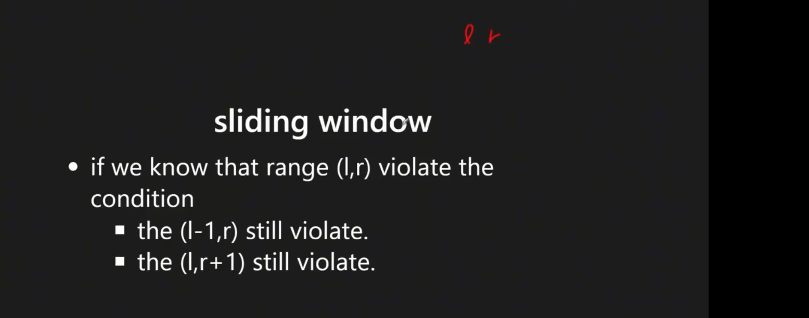
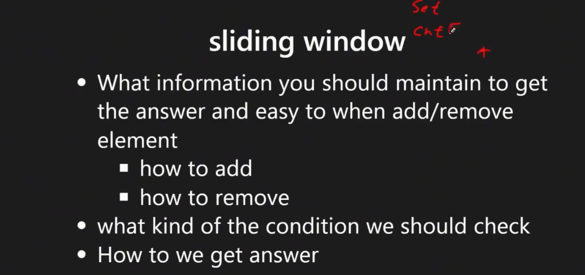
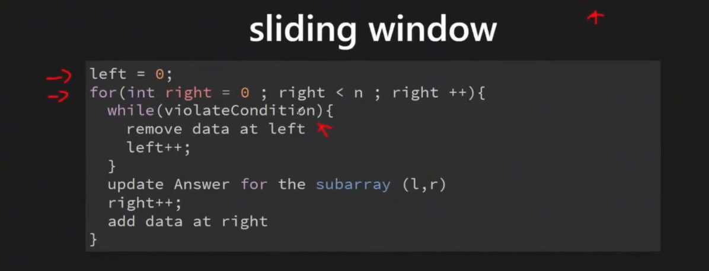

# Sliding Window

> **Scope** — Windows that grow and shrink on a condition — fixed-size, variable-size, at-most-k, and exactly-k by subtraction; owns the expand/contract loop and the seven canonical window templates.
> **See also** — *split out of this file*: [sliding_window_examples.md](./sliding_window_examples.md) — the worked LC solution archive, one canonical solution per problem per language; [sliding_window_advanced.md](./sliding_window_advanced.md) — deque extrema, at-most-K generalisations, exactly-K beyond one instance, complement / word-level / bucketed windows.
> *Neighbouring sheets*: [2_pointers.md](./2_pointers.md) — pointers that converge instead of trailing; [hash_map.md](./hash_map.md) — the counting map most windows carry; [monotonic_queue.md](./monotonic_queue.md) — window extrema in O(n); [prefix_sum.md](./prefix_sum.md) — when the window can be negative-valued.

## LeetCode Problem Lists

- [Sliding Window](https://leetcode.com/problem-list/sliding-window/)
- [Two Pointers](https://leetcode.com/problem-list/two-pointers/)

## Overview

**Sliding Window** is a technique that uses two pointers to maintain a "window" over arrays or strings, expanding and contracting to find optimal solutions efficiently.

### Key Properties
- **Time Complexity**: O(n) - each element is visited at most twice
- **Space Complexity**: O(1) for pointers, O(k) for window state
- **Core Idea**: Maintain a window [left, right] that slides over the data structure
- **Two-Phase Process**: 
  - **Expand**: Move right pointer to grow window
  - **Contract**: Move left pointer to shrink window when invalid

### When to Use Sliding Window
- **Subarray/Substring Problems**: Finding optimal subarrays with specific properties
- **Window-based Constraints**: Problems involving fixed or variable window sizes  
- **Optimization**: Min/max length, count, or sum within constraints
- **Character/Element Tracking**: Problems requiring frequency counting

### References
- [labuladong Sliding Window Guide](https://labuladong.online/algo/essential-technique/sliding-window-framework/)
- [Sliding Window Template Collection](https://leetcode.com/discuss/general-discussion/657507/sliding-window-for-beginners-problems-template-sample-solutions/)

## Recognition

| Signal in the statement | Constraint cue | Reach for | Not this if |
|---|---|---|---|
| "every subarray / substring **of length k**", "maximum average of k consecutive" | n ≤ 10⁵, k given | [Template 1](#template-1-fixed-size-window--lc-643-) fixed-size window | k is not given and the length is what you are asked for → Template 3 / 4 |
| "longest subarray where at most k …", "you may flip / replace k" | n ≤ 10⁵ → O(n) | [Template 2](#template-2-grow-then-shrink-the-while-invariant--lc-1004-) grow-then-shrink | an exact sum `== k` with negatives → [prefix_sum.md](./prefix_sum.md) (LC 560) |
| "longest substring **without repeating** / with at most k distinct" | n ≤ 5·10⁴ | [Template 3](#template-3-longest-window-satisfying-p--lc-3-) longest window | the window must contain something → Template 4 / 5 |
| "**minimal length** subarray whose sum ≥ target", all values positive | n ≤ 10⁵ | [Template 4](#template-4-shortest-window-satisfying-p--lc-209-) shortest window | values can be negative → monotonic deque on prefix sums, LC 862 ([monotonic_queue.md](./monotonic_queue.md)) |
| "minimum window **containing all** characters of t", "permutation / anagram of p in s" | \|s\|, \|t\| ≤ 10⁵ | [Template 5](#template-5-char-count-window-with-the-haveneed-counter--lc-76-) have/need counter | the order of t's characters matters → subsequence two pointers ([2_pointers.md](./2_pointers.md)) |
| "**number of** subarrays with **exactly** k distinct / odd / sum k" | n ≤ 2·10⁴ | [Template 6](#template-6-exactly-k-via-at-most-subtraction--lc-992-) atMost(k) − atMost(k−1) | values can be negative (LC 560) → prefix sum + hash map |
| "longest subarray with **no two / three elements** such that …" | values ≤ 500 | [Template 7](#template-7-hereditary-constraint--test-only-the-newcomer--lc-4067-) test only the newcomer | the rule is not hereditary (dropping an element can break it) → not a window |
| "maximum / minimum of every window of size k" | n ≤ 10⁵ | monotonic deque → [monotonic_queue.md](./monotonic_queue.md) (LC 239) | |

The constraint cues come from the ruler in [complexity_cheatsheet.md](./complexity_cheatsheet.md).

## Problem Categories

### Core Components
1. **Two Pointers**: `left` and `right` to define window boundaries
2. **Loop Structure**:
    - `while-while`: Outer loop expands, inner loop contracts
    - `for-while`: For loop expands, while loop contracts
    - **Key Insight**: 1st loop finds acceptable solution, 2nd loop optimizes to find the best
3. **Window State**: Track elements, counts, or sums within current window
4. **Validity Condition**: Define when window is valid/invalid


<p align="center"></p>

<p align="center"></p>

<p align="center"></p>


### The Five Window Shapes

#### **Fixed Size Window**
- **Description**: Window size is predetermined and constant
- **Examples**: LC 438 (Find All Anagrams), LC 567 (Permutation in String)
- **Pattern**: Maintain exact window size, slide one position at a time

#### **Variable Size Window - Maximum**
- **Description**: Find maximum window size satisfying constraints
- **Examples**: LC 3 (Longest Substring), LC 424 (Character Replacement)
- **Pattern**: Expand until invalid, record max, then contract

#### **Variable Size Window - Minimum**  
- **Description**: Find minimum window size satisfying constraints
- **Examples**: LC 209 (Minimum Subarray Sum), LC 76 (Minimum Window Substring)
- **Pattern**: Contract until invalid, record min, then expand

#### **Subarray Counting**
- **Description**: Count subarrays/substrings meeting criteria
- **Examples**: LC 713 (Subarray Product), LC 992 (Subarrays with K Different)
- **Pattern**: For each right position, count valid left positions

#### **String Matching (Hash-based)**
- **Description**: Track character frequencies in window
- **Examples**: LC 567 (Permutation), LC 438 (Anagrams), LC 76 (Window Substring)
- **Pattern**: Use HashMap/Counter to track character counts

### Window State & Helper Tools
- **Techniques**: Two pointers, sliding window, frequency counting
- **Data Structures**: HashMap, Counter, Set, Array
- **Helper Tools**: Collections.Counter (Python), HashMap.getOrDefault (Java)

### Fixed-Size Window vs Variable-Size Window
| Type | When to Use | Shrink Condition | Example |
|------|------------|-----------------|---------|
| Fixed size k | Window size is given | `right - left + 1 > k` | LC 567 (Permutation in String) |
| Variable (minimize) | Find smallest valid window | Shrink while window is valid | LC 76 (Min Window Substring) |
| Variable (maximize) | Find largest valid window | Shrink while window is invalid | LC 3 (Longest No-Repeat) |
| Exactly K → AtMost | Count windows with exact constraint | N/A — use subtraction trick | LC 992, LC 1248 |
| Variable (maximize), rule over pairs / triples | "no `i, j, k` in the window with …" | Shrink while the **newcomer** would break the rule | LC 4067 (Restricted Pair Sums) |

## Templates & Algorithms

Six templates cover every must-know sliding-window shape, and a seventh covers the case where
the validity test, not the loop, is the hard part. Template 2 is the one to write from memory
first — every variable-size window in the family is that loop with a different validity test and
a different result update.

### Template Comparison Table

| # | Template | Shape | Result update | Time / Space | Anchor problems |
|---|----------|-------|---------------|--------------|-----------------|
| 1 | Fixed-Size Window | `for i` + evict `i - k` | test when `i >= k - 1` | O(n) / O(k) | LC 643, 438, 567 |
| 2 | Grow-Then-Shrink (the `while` invariant) | `for right` + `while invalid: shrink` | any valid window | O(n) / O(k) | LC 1004, 904 — the base of 3–7 |
| 3 | Longest Window Satisfying P | shrink **while invalid** | `max(res, r - l + 1)` | O(n) / O(k) | LC 3, 424, 1004 |
| 4 | Shortest Window Satisfying P | shrink **while valid** | `min(res, r - l + 1)` | O(n) / O(k) | LC 209, 76 |
| 5 | Char-Count Window (`have`/`need`) | freq map + match counter | on `have == need` | O(n) / O(charset) | LC 76, 438, 567 |
| 6 | Exactly K via At-Most Subtraction | two at-most passes | `count += r - l + 1` | O(n) / O(k) | LC 992, 1248, 930 |
| 7 | Hereditary Constraint — test only the newcomer | `while joins(a[r]): shrink`, then add | `max(res, r - l + 1)` | O(n · V) / O(V) | LC 4067 |

> Rows 3 and 4 differ by **one word**: longest shrinks while the window is *invalid*, shortest
> shrinks while it is *valid*. Get that word wrong and the answer is silently off.

### Template 1: Fixed-Size Window — LC 643 ⭐⭐⭐⭐⭐

**Recognise** — "every subarray / substring **of length k**", "maximum average of k
consecutive elements", "an anagram of p" (the window is `len(p)` wide). k is given, n ≤ 10⁵ →
O(n) expected, so recomputing each window from scratch (O(n·k)) is the answer being ruled out.

**Key point** — after index `i` is added and `i - k` is evicted, the state holds exactly
`nums[i-k+1 .. i]`; each step changes the window by one element in and one out, so the state is
updated in O(1) instead of rebuilt.

```python
# python
# LC 643 - Maximum Average Subarray I
# IDEA: add nums[i], evict nums[i - k] once the window is over-full, measure once it is k wide
# time = O(n), space = O(1)   (a counting map instead of a sum makes it O(k))
def findMaxAverage(nums, k):
    window_sum = 0
    best = float("-inf")
    for i in range(len(nums)):
        window_sum += nums[i]                 # add the newcomer
        if i >= k:
            window_sum -= nums[i - k]         # evict the element that fell out
        if i >= k - 1:                        # window is exactly k wide from here on
            best = max(best, window_sum)
    return best / k
```

```java
// java
// LC 643 - Maximum Average Subarray I
// IDEA: add nums[i], evict nums[i - k] once the window is over-full, measure once it is k wide
// time = O(n), space = O(1)
public double findMaxAverage(int[] nums, int k) {
    int windowSum = 0;
    int best = Integer.MIN_VALUE;
    for (int i = 0; i < nums.length; i++) {
        windowSum += nums[i];                // add the newcomer
        if (i >= k) {
            windowSum -= nums[i - k];        // evict the element that fell out
        }
        if (i >= k - 1) {                    // exactly k wide from here on
            best = Math.max(best, windowSum);
        }
    }
    return (double) best / k;
}
```

**Complexity**
- **Time O(n)**: the single `for i` loop; each step does one add and at most one evict.
- **Space O(1)**: one running sum. When the state is a counting map (LC 438 / 567) it holds at
  most k keys, so O(k), and O(1) again with a fixed `int[26]`.

**Traps**
- Measuring before the window is full: without `if i >= k - 1`, `[5, -10, 1]`, k = 2 compares
  the one-element window `[5]` and returns 2.5 instead of −2.5.
- Starting `best` at 0: an all-negative input such as `[-1]`, k = 1 returns 0 instead of −1.
- A counting map must delete keys that fall to 0, or comparing plain dicts (`window == need`)
  fails on `{'a': 0}` vs `{}` (LC 438).

**Not this if** — k is not given and the length is what is asked for ("longest", "shortest")
→ [Template 3](#template-3-longest-window-satisfying-p--lc-3-) /
[Template 4](#template-4-shortest-window-satisfying-p--lc-209-).

**Drill** — LC 643 · LC 219 *(window as a set)* · LC 1456 · LC 567 ⭐ *(counting map, compare
to `need`)* · LC 438 *(record every start)*

### Template 2: Grow-Then-Shrink, the `while` Invariant — LC 1004 ⭐⭐⭐⭐⭐

**Recognise** — "longest subarray where at most k …", "you may flip / replace / remove at most
k", any contiguous-range question whose validity only gets *worse* as the window grows. n ≤ 10⁵
→ O(n) expected.

**Key point** — at the bottom of every iteration `[left, right]` is valid, and `left` never
moves backwards, so every element is added once and removed at most once: O(n) however the
validity test is written.

**The single most important idiom on this sheet.** One `for` advances `right` and adds an
element; one `while` advances `left` until the window is valid again:

```text
for right in range(n):         # 1. expand: the window may now be invalid
    add(a[right])
    while not valid(window):   # 2. restore the invariant (may run 0 times)
        remove(a[left]); left += 1
    update_result(left, right)  # 3. the window is valid HERE, and only here
```

Those three slots are the whole design space: what `add`/`remove` maintain, what `valid` tests,
and what `update_result` records. Templates 3–6 are this loop with the slots filled in. In LC 1004
the state is one integer, the number of zeros in the window, and `valid` is `zeros <= k`:

```python
# python
# LC 1004 - Max Consecutive Ones III
# IDEA: grow right; while the window holds more than k zeros, shrink left; measure when valid
# time = O(n), space = O(1)
def longestOnes(nums, k):
    left = 0
    zeros = 0                                 # window state: zeros inside [left, right]
    best = 0
    for right in range(len(nums)):
        if nums[right] == 0:                  # 1. add
            zeros += 1
        while zeros > k:                      # 2. restore the invariant
            if nums[left] == 0:
                zeros -= 1
            left += 1
        best = max(best, right - left + 1)    # 3. valid here, so measure here
    return best
```

```java
// java
// LC 1004 - Max Consecutive Ones III
// IDEA: grow right; while the window holds more than k zeros, shrink left; measure when valid
// time = O(n), space = O(1)
public int longestOnes(int[] nums, int k) {
    int left = 0;
    int zeros = 0;                           // window state: zeros inside [left, right]
    int best = 0;
    for (int right = 0; right < nums.length; right++) {
        if (nums[right] == 0) {
            zeros++;                         // 1. add
        }
        while (zeros > k) {                  // 2. restore the invariant
            if (nums[left] == 0) {
                zeros--;
            }
            left++;
        }
        best = Math.max(best, right - left + 1);  // 3. valid here
    }
    return best;
}
```

**Complexity**
- **Time O(n)**: the `while` is nested, but `left` only moves forward and never past `right`,
  so across the whole run it advances at most n times.
- **Space O(1)** here (one counter); O(k) in general, for whatever the window state holds.

**Traps**
- Updating the result *inside* the `while`, or before it, measures an invalid window:
  `[0, 0]`, k = 0, returns 1 instead of 0.
- `if` instead of `while`: one newcomer can need several shrinks once the state is a map
  (`"abcb"` at at-most-2-distinct needs two). The one-integer state of LC 1004 hides this.
- The loop is only sound when validity is **monotone**: shrinking a valid window keeps it valid.
  A sum over negative values is not: longest subarray with `sum <= 0` on `[2, -2]` is 2, but the
  window drops the `2` before `-2` arrives and returns 1.

**Not this if** — values can be negative and the condition is on a sum → prefix sum + hash map
([prefix_sum.md](./prefix_sum.md), LC 560).

**Drill** — LC 1004 · LC 904 *(at most 2 distinct)* · LC 424 ⭐ *(validity = `len − maxFreq ≤ k`)*
· LC 1838 *(sort first, then the window)*

### Template 3: Longest Window Satisfying P — LC 3 ⭐⭐⭐⭐⭐

**Recognise** — "**longest** substring / subarray such that …": without repeating characters,
with at most k distinct, with at most k replacements. n ≤ 5·10⁴ → O(n) expected.

**Key point** — shrink **while the window is invalid**, so at the bottom of each iteration the
window is the longest valid one ending at `right`; record `right - left + 1` *after* the `while`,
never inside it.

```python
# python
# LC 3 - Longest Substring Without Repeating Characters
# IDEA: a set holds the window's characters; shrink from the left until s[right] is not in it
# time = O(n), space = O(min(n, charset))
def lengthOfLongestSubstring(s):
    in_window = set()
    left = 0
    best = 0
    for right in range(len(s)):
        while s[right] in in_window:          # invalid -> shrink until the duplicate is gone
            in_window.remove(s[left])
            left += 1
        in_window.add(s[right])
        best = max(best, right - left + 1)    # valid here, so measure here
    return best
```

A second spelling, kept because it is a distinct trick: store each character's **last index**
and jump `left` past the duplicate in one step instead of shrinking one by one.

```python
# python
# LC 3 - jump variant
# IDEA: last_seen[ch] = latest index of ch; on a repeat, jump left to last_seen[ch] + 1
# time = O(n), space = O(min(n, charset))
def lengthOfLongestSubstring_jump(s):
    last_seen = {}
    left = 0
    best = 0
    for right, ch in enumerate(s):
        if ch in last_seen:
            left = max(left, last_seen[ch] + 1)   # max: a stale index must never pull left back
        last_seen[ch] = right
        best = max(best, right - left + 1)
    return best
```

```java
// java
// LC 3 - Longest Substring Without Repeating Characters
// IDEA: a set holds the window's characters; shrink from the left until s[right] is not in it
// time = O(n), space = O(min(n, charset))
public int lengthOfLongestSubstring(String s) {
    Set<Character> inWindow = new HashSet<>();
    int left = 0;
    int best = 0;
    for (int right = 0; right < s.length(); right++) {
        char ch = s.charAt(right);
        while (inWindow.contains(ch)) {      // invalid -> shrink until ch is gone
            inWindow.remove(s.charAt(left));
            left++;
        }
        inWindow.add(ch);
        best = Math.max(best, right - left + 1);
    }
    return best;
}
```

**Complexity**
- **Time O(n)**: `left` only moves forward, so the inner `while` runs at most n times in total;
  the jump variant has no inner loop at all.
- **Space O(min(n, charset))**: `in_window` / `last_seen` hold at most one entry per distinct
  character.

**Dry run**

```text
s = "abba"            (jump variant)
right=0 'a'  left=0  window "a"   best=1
right=1 'b'  left=0  window "ab"  best=2
right=2 'b'  seen at 1 -> left=2  window "b"   best=2
right=3 'a'  seen at 0 -> left=max(2, 1)=2   window "ba"  best=2
```

**Traps**
- The jump without `max`: on `"abba"` the last `'a'` was seen at 0, so `left` would move back to
  1 and the answer becomes 3 (`"bba"`).
- Recording `best` before the shrink loop counts the duplicate: `"bb"` returns 2.
- `""` must return 0; both versions do, because the loop never runs.

**Not this if** — the window must *contain* something (all of t, a target sum) → that is a
shortest-window problem, [Template 4](#template-4-shortest-window-satisfying-p--lc-209-) /
[Template 5](#template-5-char-count-window-with-the-haveneed-counter--lc-76-).

**Drill** — LC 3 ⭐ · LC 159 · LC 340 *(at most k distinct: a count map, shrink while
`len(map) > k`)* · LC 424 ⭐

### Template 4: Shortest Window Satisfying P — LC 209 ⭐⭐⭐⭐⭐

**Recognise** — "**minimal length** subarray whose sum ≥ target", "smallest window that
covers …", with **non-negative** values so a bigger window is never worse. n ≤ 10⁵ → O(n).

**Key point** — shrink **while the window is valid**, recording the length *before* each
shrink. This is [Template 3](#template-3-longest-window-satisfying-p--lc-3-) with the `while`
condition negated and the result update moved inside; nothing else changes.

```python
# python
# LC 209 - Minimum Size Subarray Sum
# IDEA: grow right; while the sum still reaches target, record the length and shrink left
# time = O(n), space = O(1)
def minSubArrayLen(target, nums):
    left = 0
    window_sum = 0
    best = len(nums) + 1                      # sentinel: longer than any real window
    for right in range(len(nums)):
        window_sum += nums[right]
        while window_sum >= target:           # valid -> record, then try a shorter one
            best = min(best, right - left + 1)
            window_sum -= nums[left]
            left += 1
    return 0 if best == len(nums) + 1 else best
```

```java
// java
// LC 209 - Minimum Size Subarray Sum
// IDEA: grow right; while the sum still reaches target, record the length and shrink left
// time = O(n), space = O(1)
public int minSubArrayLen(int target, int[] nums) {
    int left = 0;
    int windowSum = 0;
    int best = Integer.MAX_VALUE;
    for (int right = 0; right < nums.length; right++) {
        windowSum += nums[right];
        while (windowSum >= target) {        // valid -> record, then try a shorter one
            best = Math.min(best, right - left + 1);
            windowSum -= nums[left];
            left++;
        }
    }
    return best == Integer.MAX_VALUE ? 0 : best;
}
```

**Complexity**
- **Time O(n)**: as in Template 2, `left` advances at most n times over the whole run.
- **Space O(1)**: one running sum.

**Traps**
- No valid window: `target = 11, nums = [1,1,1,1,1,1,1,1]` must return 0, not the sentinel.
- Recording *after* the shrink measures a window that is no longer valid:
  `target = 4, nums = [1, 4, 4]` would report 0 instead of 1.
- Negative values break it: `target = 3, nums = [1, -1, 3]` returns 3, because the shrink stops
  as soon as the sum drops below target and never reaches `[3]` (length 1).

**Not this if** — values can be negative → monotonic deque over prefix sums, LC 862
([monotonic_queue.md](./monotonic_queue.md)).

**Drill** — LC 209 · LC 1658 *(shortest removed = longest kept with sum `total − x`)* ·
LC 76 ⭐ *(validity is coverage, [Template 5](#template-5-char-count-window-with-the-haveneed-counter--lc-76-))*
· LC 862 *(negatives: deque)*

### Template 5: Char-Count Window with the have/need Counter — LC 76 ⭐⭐⭐⭐⭐

**Recognise** — "minimum window of s that **contains all** characters of t (with
multiplicity)", "is a **permutation / anagram** of p a substring of s". |s|, |t| ≤ 10⁵ → O(n + m).

**Key point** — `need` holds what the window still owes for each character, and one integer
(`missing`) counts the total still owed; the window covers t exactly when `missing == 0`, so
validity is an O(1) check instead of an O(charset) map comparison on every step.

```python
# python
# LC 76 - Minimum Window Substring
# IDEA: need[c] = copies of c still owed (negative = surplus); missing = total owed;
#       when missing hits 0, drop surplus from the left, record, then break the window
# time = O(n + m), space = O(charset)
from collections import Counter

def minWindow(s, t):
    need = Counter(t)
    missing = len(t)
    best = ""
    left = 0
    for right, c in enumerate(s):
        if need[c] > 0:                       # c was owed -> one less missing
            missing -= 1
        need[c] -= 1
        if missing == 0:                      # window covers t
            while need[s[left]] < 0:          # drop surplus characters from the left
                need[s[left]] += 1
                left += 1
            if not best or right - left + 1 < len(best):
                best = s[left:right + 1]
            need[s[left]] += 1                # give up s[left]: the window owes it again
            missing += 1
            left += 1
    return best
```

```java
// java
// LC 76 - Minimum Window Substring
// IDEA: count map of the window vs need; valid = distinct chars whose need is fully met;
//       while valid == need.size(), record and shrink
// time = O(n + m), space = O(charset)
public String minWindow(String s, String t) {
    Map<Character, Integer> need = new HashMap<>();
    Map<Character, Integer> window = new HashMap<>();
    for (char c : t.toCharArray()) {
        need.put(c, need.getOrDefault(c, 0) + 1);
    }
    int left = 0;
    int valid = 0;                           // distinct chars whose need is fully met
    int start = 0;
    int minLen = Integer.MAX_VALUE;
    for (int right = 0; right < s.length(); right++) {
        char c = s.charAt(right);
        window.put(c, window.getOrDefault(c, 0) + 1);
        if (need.containsKey(c) && window.get(c).equals(need.get(c))) {
            valid++;
        }
        while (valid == need.size()) {       // valid -> record, then shrink
            if (right - left + 1 < minLen) {
                minLen = right - left + 1;
                start = left;
            }
            char out = s.charAt(left);
            left++;
            if (need.containsKey(out) && window.get(out).equals(need.get(out))) {
                valid--;                     // about to drop below what t needs
            }
            window.put(out, window.get(out) - 1);
        }
    }
    return minLen == Integer.MAX_VALUE ? "" : s.substring(start, start + minLen);
}
```

**Complexity**
- **Time O(n + m)**: O(m) to build `need`, then each index of s enters and leaves the window once.
- **Space O(charset)**: `need` and `window` hold at most one key per distinct character.

**Traps**
- Comparing `Integer` objects with `==` in Java: counts above 127 are not cached, so
  `window.get(c) == need.get(c)` fails on long inputs. Use `.equals`, or an `int[128]`.
- Multiplicity: `s = "a", t = "aa"` must return `""`; counting distinct characters instead of
  copies returns `"a"`.
- `valid` (Java) counts **distinct** characters satisfied and is compared to `need.size()`;
  `missing` (Python) counts **copies** owed and is compared to 0. Mixing the two never reaches
  the target.

**Not this if** — the window size is fixed (`len(p)`, LC 438 / 567) → compare the two count
maps directly in a [Template 1](#template-1-fixed-size-window--lc-643-) loop; the counter only
pays off when the window can be any length. If t's order matters, it is a subsequence problem
([2_pointers.md](./2_pointers.md)).

**Drill** — LC 567 ⭐ *(fixed size, same counts)* · LC 438 · LC 76 ⭐ · LC 30 *(words instead
of characters, [sliding_window_advanced.md](./sliding_window_advanced.md))*

### Template 6: Exactly K via At-Most Subtraction — LC 992 ⭐⭐⭐⭐⭐

**Recognise** — "**number of** subarrays with **exactly** k distinct integers / k odd numbers /
sum equal to k" on non-negative values. n ≤ 2·10⁴ → O(n); an O(n²) enumeration is what it rules out.

**Key point** — once `[left, right]` is the longest valid window ending at `right`, every one of
its suffixes is valid too, so `count += right - left + 1` counts the at-most-k subarrays ending
at `right`; and exactly k = atMost(k) − atMost(k − 1), because the second set is contained in
the first.

```text
Exactly K = At Most K - At Most (K-1)
```

"Exactly k" is not monotone (shrinking an exactly-2 window can make it exactly-1), so it cannot
drive the `while` directly; "at most k" is, which is why the subtraction exists.

```python
# python
# LC 992 - Subarrays with K Different Integers
# IDEA: at_most(k) counts subarrays with <= k distinct, adding right - left + 1 per right;
#       exactly k = at_most(k) - at_most(k - 1)
# time = O(n), space = O(k)
def subarraysWithKDistinct(nums, k):
    def at_most(k):
        if k == 0:
            return 0
        freq = {}
        left = 0
        count = 0
        for right in range(len(nums)):
            freq[nums[right]] = freq.get(nums[right], 0) + 1
            while len(freq) > k:              # shrink while more than k distinct
                freq[nums[left]] -= 1
                if freq[nums[left]] == 0:
                    del freq[nums[left]]
                left += 1
            count += right - left + 1         # every suffix of [left, right] is valid
        return count

    return at_most(k) - at_most(k - 1)
```

```java
// java
// LC 992 - Subarrays with K Different Integers
// IDEA: atMostK counts subarrays with <= k distinct, adding right - left + 1 per right;
//       exactly k = atMostK(k) - atMostK(k - 1)
// time = O(n), space = O(k)
public int subarraysWithKDistinct(int[] nums, int k) {
    return atMostK(nums, k) - atMostK(nums, k - 1);
}

private int atMostK(int[] nums, int k) {
    if (k == 0) {
        return 0;
    }
    Map<Integer, Integer> freq = new HashMap<>();
    int left = 0;
    int count = 0;
    for (int right = 0; right < nums.length; right++) {
        freq.put(nums[right], freq.getOrDefault(nums[right], 0) + 1);
        while (freq.size() > k) {            // shrink while more than k distinct
            freq.put(nums[left], freq.get(nums[left]) - 1);
            if (freq.get(nums[left]) == 0) {
                freq.remove(nums[left]);
            }
            left++;
        }
        count += right - left + 1;           // every suffix of [left, right] is valid
    }
    return count;
}
```

**Complexity**
- **Time O(n)**: two passes of the Template 2 loop, each O(n) because `left` only moves forward.
- **Space O(k)**: `freq` is shrunk back to at most k keys before every count.

**Dry run**

```text
nums = [1, 2, 1, 2, 3], k = 2
at_most(2): ends at r=0..4 add 1, 2, 3, 4, 2   -> 12
at_most(1): ends at r=0..4 add 1, 1, 1, 1, 1   -> 5
exactly 2  = 12 - 5 = 7
  [1,2] [1,2,1] [1,2,1,2] [2,1] [2,1,2] [1,2] [2,3]
```

**Traps**
- Leaving a key in `freq` when its count reaches 0: `len(freq)` then counts stale keys, the
  `while` never stops, and on `[1, 2, 1, 2, 3], k = 2` `left` runs past the end (IndexError).
- Using `count += 1` instead of `right - left + 1` counts windows, not subarrays:
  `[1, 2, 1, 2, 3], k = 2` returns far fewer than 7.
- Driving the `while` with "exactly k" directly undercounts: the shrink throws away left
  endpoints that a later `right` would have needed.

**Not this if** — values can be negative (LC 560 "subarray sum equals k") → at-most is no longer
monotone; use prefix sum + hash map ([prefix_sum.md](./prefix_sum.md)). For a binary array the
same count also falls out of prefix-sum counting (LC 930, LC 1248).

**Drill** — LC 713 *(counting slot alone, product < k)* · LC 930 · LC 1248 *(odd → 1, even → 0)*
· LC 992 · LC 2062 *(a consonant resets the window)*

| Problem | LC# | Difficulty | Transformation | Key Insight |
|---------|-----|------------|----------------|-------------|
| **Subarrays with K Different Integers** | **992** | **Hard** | Exactly K distinct = atMost(K) - atMost(K-1) | Core example |
| Count Vowel Substrings of a String | 2062 | Medium | Exactly 5 vowels = atMost(5) - atMost(4) | Consonant resets window (vowels-only) |
| Count Nice Subarrays | 1248 | Medium | Exactly K odds = atMost(K) - atMost(K-1) | Transform odd→1, even→0 |
| Binary Subarrays With Sum | 930 | Medium | Exactly sum K = atMost(K) - atMost(K-1) | Subarray sum |
| Longest Substring with At Most K Distinct | 340 | Medium | Direct atMost(K) for max length | No subtraction needed |
| Fruits Into Baskets | 904 | Medium | atMost(2) distinct for max length | Simplified K=2 |
| Max Consecutive Ones III | 1004 | Medium | atMost(K) zeros for max length | Count zeros ≤ K |

> The reset twist for restricted alphabets (LC 2062), the one-pass prefix alternative (LC 1248),
> the visual proof and the "why is direct exactly-K hard" argument all live in
> [sliding_window_advanced.md](./sliding_window_advanced.md).

### Template 7: Hereditary Constraint — Test Only the Newcomer — LC 4067 ⭐⭐⭐

**Recognise** — "longest subarray with **no two / no three elements** such that …": a validity
rule stated over **every pair or triple** in the window, not over a count or a sum. A small value
range (values ≤ 500) next to n ≤ 1000 is the cue that the test may scan values, not the window.

**Key point** — the window *before* `nums[right]` joins is valid (the loop invariant), so the only
violation that can appear is one that uses `nums[right]`; `valid()` asks one question about the
newcomer, never one about the whole window.

Templates 3–6 lean on two facts they never have to state. Both must be checked before this loop
is sound, and the second is what makes it fast:

1. **Validity is hereditary** — every sub-window of a valid window is valid. That is what lets
   `left` only move right: once `[left, right]` is invalid, so is every window containing it.
   Dropping elements can never *create* a forbidden pair or triple, so "no `i, j, k` with
   `nums[i] + nums[j] == nums[k]`" is hereditary. "Sum equals k" over negatives is **not**, which
   is why LC 560 is a prefix sum and not a window.
2. **The window before the newcomer joins is valid** — the loop invariant at the top of every
   iteration. So the only violations that can appear are the ones that *use* `nums[right]`, and
   `valid()` shrinks from "is there any triple in the window" (O(w²) per step, O(n³) overall)
   to "does `nums[right]` complete a triple with what is already here".

For LC 4067 the newcomer `v` can play two roles, and each question is one scan of the value
range `1..V` rather than of the window:

```text
v is the sum    :  a + b == v   with a and b both in the window   (a == b needs two copies)
v is an addend  :  a and a + v  both in the window
```

Values are ≥ 1, so a pair's sum is strictly bigger than both of its members: the `k` matching a
pair is never one of the pair's own indices, and "three **distinct** indices" comes for free
(`3 + 3 = 6` from two different 3s still counts, and the two-copies check sees it).

```python
# python
# LC 4067 Longest Subarray With Restricted Pair Sums
# IDEA : SLIDING WINDOW OVER VALUE COUNTS — test only the newcomer
# time = O(n * V), space = O(V)   (V = max(nums) <= 500)
class Solution(object):
    def maxSubarray(self, nums):
        n = len(nums)
        if n <= 2:                       # fewer than 3 elements can not form a triple
            return n
        max_val = max(nums)
        cnt = [0] * (max_val + 1)        # value -> copies inside the window
        left = 0
        best = 0
        for right in range(n):
            v = nums[right]
            # the window WITHOUT v is valid (loop invariant), so the only
            # triples that can appear are the ones that use v
            while self.joins_triple(cnt, v, max_val):
                cnt[nums[left]] -= 1     # removing can never create a triple
                left += 1
            cnt[v] += 1
            best = max(best, right - left + 1)
        return best

    def joins_triple(self, cnt, v, max_val):
        # 1) v is the sum : a + b == v, a <= b, both present (a == b needs two copies)
        for a in range(1, v // 2 + 1):
            b = v - a
            if a == b:
                if cnt[a] >= 2:
                    return True
            elif cnt[a] >= 1 and cnt[b] >= 1:
                return True
        # 2) v is an addend : a and a + v both present (a + v > a, so distinct indices)
        for a in range(1, max_val - v + 1):
            if cnt[a] >= 1 and cnt[a + v] >= 1:
                return True
        return False
```

```java
// java
// LC 4067 - Longest Subarray With Restricted Pair Sums
// IDEA: Sliding window over value counts; the window before nums[r] joins is valid,
//       so only a triple that uses nums[r] can appear — test the newcomer, not the window
// time = O(n * V), space = O(V)   (V = max(nums) <= 500)
public int maxSubarray(int[] nums) {
    int n = nums.length;
    if (n <= 2) return n;                 // fewer than 3 elements can not form a triple
    int maxVal = 0;
    for (int x : nums) maxVal = Math.max(maxVal, x);
    int[] cnt = new int[maxVal + 1];      // value -> copies inside the window
    int l = 0, best = 0;
    for (int r = 0; r < n; r++) {
        int v = nums[r];
        // the window WITHOUT v is valid, so shrink until v completes no triple
        while (joinsTriple(cnt, v, maxVal)) {
            cnt[nums[l++]]--;             // removing can never create a triple
        }
        cnt[v]++;
        best = Math.max(best, r - l + 1);
    }
    return best;
}

private boolean joinsTriple(int[] cnt, int v, int maxVal) {
    // 1) v is the sum: a + b == v, a <= b, both present (a == b needs two copies)
    for (int a = 1; a <= v / 2; a++) {
        int b = v - a;
        if (a == b) {
            if (cnt[a] >= 2) return true;
        } else if (cnt[a] >= 1 && cnt[b] >= 1) {
            return true;
        }
    }
    // 2) v is an addend: a and a + v both present (a + v > a, so distinct indices)
    for (int a = 1; a + v <= maxVal; a++) {
        if (cnt[a] >= 1 && cnt[a + v] >= 1) return true;
    }
    return false;
}
```

**Complexity**
- **Time O(n · V)**: each `right` calls `joins_triple` once per shrink step plus once more, and
  `left` moves at most n times in total, so there are O(n) calls; each call is two scans of the
  value range `1..V`.
- **Space O(V)**: `cnt` has one slot per value.

**Dry run**

```text
nums = [2,3,5,3,2,1]

r=0  v=2  window {}       joins nothing                         -> [2]        len 1
r=1  v=3  window {2}      2+3=5 absent, no a+b=3                -> [2,3]      len 2
r=2  v=5  window {2,3}    sum: 2+3 = 5     -> drop 2 -> {3} ok  -> [3,5]      len 2
r=3  v=3  window {3,5}    3+3=6, 3+5=8 absent, no a+b=3         -> [3,5,3]    len 3  <- answer
r=4  v=2  window {3,5,3}  addend: 3 and 3+2=5 -> drop 3, still  -> drop 5 -> [3,2]  len 2
r=5  v=1  window {3,2}    addend: 2 and 2+1=3 -> drop 3         -> [2,1]      len 2
```

**Traps**
- **Test, shrink, then add.** Template 2 adds first and shrinks after, which works when `valid()`
  reads a count or a sum. Here the question is "does `v` fit with what is *already* there", so `v`
  must not be in `cnt` while it is asked; adding first only happens to survive because values are
  ≥ 1 and `v` can never be its own partner.
- **Testing the whole window** instead of the newcomer is correct but O(n³), and over the limit
  at n = 1000. The invariant is what you are being asked to notice.
- **Forgetting that `a == b` needs two copies.** `[2, 2, 4]` is invalid; `[2, 4]` is not.
- **The O(n²) first draft** keeps a `pair_sum -> count` map plus a `conflicts` counter and
  updates both for every element the newcomer pairs with, with mirror-image add/remove
  bookkeeping to get wrong. The version above is that solution after one observation — *only the
  newcomer can be in a new triple* — so nothing about the pairs needs keeping. The pair map earns
  its place only when the values are unbounded; the
  [solution file](../../leetcode_python/slide_window/longest-subarray-with-restricted-pair-sums.py)
  carries both.

**Not this if** — the rule is not hereditary: if dropping an element could turn an invalid window
valid *and* a valid one invalid, `left` is not monotone and this loop is unsound ("sum equals k"
over negatives, LC 560) → [prefix_sum.md](./prefix_sum.md).

**Drill** — LC 3 *(the pair rule "no two equal", tested on the newcomer by a set)* · LC 1695
*(same, scoring a sum)* · LC 4067

## Drill Path

| Stage | Problems (easy → hard) | What it adds |
|---|---|---|
| **Core** ⭐ | LC 567 ⭐ · LC 3 ⭐ · LC 424 ⭐ · LC 76 ⭐ | fixed window with counts; longest window; a stale-max validity test; the have/need counter |
| **Practice** | LC 643 · LC 1004 · LC 209 · LC 438 · LC 904 · LC 1248 | one per shape: fixed, grow-then-shrink, shortest, every start, at-most-2, exactly-k |
| **Stretch** | LC 4067 · LC 992 · LC 30 · LC 239 | the newcomer test; exactly-k by subtraction; word-level window; window max → [monotonic_queue.md](./monotonic_queue.md) |

Worked solutions for the Practice row are in [sliding_window_examples.md](./sliding_window_examples.md).

## Summary & Quick Reference

### Which Template? — Decision Table

| Problem Type | Template | Key Pattern | Examples |
|--------------|----------|-------------|----------|
| Find **exact** window size | 1 — Fixed Size | `for i` with size tracking | LC 438, 567, 643 |
| Find **maximum** valid window | 3 — Longest Window | `for-while`, shrink while **invalid** | LC 3, 424, 1004 |
| Find **minimum** valid window | 4 — Shortest Window | `for-while`, shrink while **valid** | LC 76, 209 |
| Match a character multiset | 5 — Char-Count (`have`/`need`) | freq map + match counter | LC 76, 438, 567 |
| **Count** valid subarrays | 6 — Counting slot | `count += right-left+1` | LC 713, 992 |
| **Exactly K** distinct/unique | 6 — At-Most Subtraction | `atMostK(k) - atMostK(k-1)` | LC 992, 1248, 930 |
| Rule over **every pair / triple** in the window | 7 — Test the newcomer | hereditary check, then `while joins(v): shrink` | LC 4067 |
| Window max/min in O(1) | *not a template here* | monotonic deque | LC 239 → [monotonic_queue.md](./monotonic_queue.md) |
| Values may be **negative** | *not a window at all* | prefix sum + HashMap | LC 560, 974 → [prefix_sum.md](./prefix_sum.md) |

**How to read**: Start with your problem goal (maximum/minimum/count/exact), then choose the matching template. Template 2 underlies rows 2-7 — it is the loop, not a separate answer.

### Template Complexity Reference

| Template | Time | Space | Where the space goes |
|----------|------|-------|----------------------|
| 1 — Fixed Size | O(n) | O(k) | the window's own contents |
| 2 — Grow-Then-Shrink | O(n) | O(k) | whatever the window state holds |
| 3 — Longest Window | O(n) | O(k) | freq map / counter |
| 4 — Shortest Window | O(n) | O(k) | freq map / counter |
| 5 — Char-Count | O(n + m) | O(charset) | two maps sized by the alphabet |
| 6 — Exactly K via At-Most | O(n) | O(k) | one map, two passes over the array |
| 7 — Test the newcomer | O(n · V) | O(V) | a count per value; the test scans the value range, not the window |

> O(n) throughout because `left` never moves backwards: each element is added once and removed at
> most once. **Optimization**: use a fixed `int[26]` / `int[128]` array instead of a HashMap when
> the character set is bounded — same asymptotics, materially faster and simpler to compare.

### Problems by Pattern

#### **Fixed Size Window Problems**
| Problem | LC # | Key Technique | Difficulty |
|---------|------|---------------|------------|
| Find All Anagrams in a String | 438 | Character frequency matching | Medium |
| Permutation in String | 567 | Character frequency matching | Medium |
| Maximum Average Subarray I | 643 | Fixed window sum | Easy |
| Contains Duplicate II | 219 | Fixed window with HashSet | Easy |
| Maximum Number of Vowels | 1456 | Fixed window counting | Medium |

#### **Variable Size - Maximum Length**
| Problem | LC # | Key Technique | Difficulty |
|---------|------|---------------|------------|
| Longest Substring Without Repeating Characters | 3 | Character uniqueness tracking | Medium |
| Longest Repeating Character Replacement | 424 | Frequency + max character count | Medium |
| Max Consecutive Ones III | 1004 | K flips constraint | Medium |
| Longest Substring with At Most K Distinct Characters | 340 | Distinct character counting | Medium |
| Longest Substring with At Most Two Distinct Characters | 159 | Two distinct constraint | Medium |
| Longest Subarray With Restricted Pair Sums | 4067 | Hereditary constraint — test only the newcomer over the value range | Medium |

#### **Variable Size - Minimum Length** 
| Problem | LC # | Key Technique | Difficulty |
|---------|------|---------------|------------|
| Minimum Window Substring | 76 | Character coverage tracking | Hard |
| Minimum Size Subarray Sum | 209 | Running sum comparison | Medium |
| Smallest Subarray with Sum ≥ K | 862 | Prefix sum + deque | Hard |
| Minimum Window with Characters | 1176 | Diet plan constraint | Hard |

#### **Counting Subarrays**
| Problem | LC # | Key Technique | Difficulty |
|---------|------|---------------|------------|
| Subarray Product Less Than K | 713 | Product constraint | Medium |
| Subarrays with K Different Integers | 992 | Exactly K = At most K - At most (K-1) | Hard |
| Count Vowel Substrings of a String | 2062 | Exactly 5 vowels = atMost(5) - atMost(4) (consonant resets) | Medium |
| Number of Subarrays with Bounded Maximum | 795 | Bounded value constraint | Medium |
| Count Number of Nice Subarrays | 1248 | Odd number counting | Medium |

#### **Advanced Sliding Window**
| Problem | LC # | Key Technique | Difficulty |
|---------|------|---------------|------------|
| Sliding Window Maximum | 239 | Monotonic deque | Hard |
| Sliding Window Median | 480 | Two heaps | Hard |
| Minimum Swaps to Group All 1's Together | 1151 | Optimization with fixed window | Medium |
| Grumpy Bookstore Owner | 1052 | State change optimization | Medium |

### Common Patterns & Tricks

#### **Character Frequency Tracking**
```python
# Track character counts in window
window = {}
window[char] = window.get(char, 0) + 1

# Remove character from window
window[char] -= 1
if window[char] == 0:
    del window[char]
```

#### **Validity Conditions**
```python
# Common validity checks
def is_valid_permutation(window, target):
    return window == target

def is_valid_distinct_k(window, k):
    return len(window) <= k

def is_valid_sum(current_sum, target):
    return current_sum >= target
```

#### **Result Updates**
```python
# Maximum length problems
max_len = max(max_len, right - left + 1)

# Minimum length problems  
if is_valid:
    min_len = min(min_len, right - left + 1)

# Counting problems
count += right - left + 1  # All subarrays ending at 'right'
```

### Problem-Solving Steps

1. **Identify Pattern**: Fixed size, variable max/min, or counting?
2. **Choose Template**: Select appropriate template based on pattern
3. **Define Window State**: HashMap, set, sum, or counter?
4. **Define Validity**: What makes the window valid/invalid?
5. **Update Logic**: When and how to update the result?

### Common Mistakes & Tips

**🚫 Common Mistakes:**
- Wrong loop structure (using wrong template)
- Forgetting to handle window state correctly
- Incorrect validity condition logic
- Missing edge cases (empty input, single element)

**✅ Best Practices:**
- Use `collections.Counter` for character frequency problems
- Always handle the case when removing elements from HashMap
- Test with edge cases: empty string, single character, all same characters
- Consider if the problem needs "exactly k" vs "at most k"
- For "exactly k" problems: use "at most k - at most (k-1)"

### Interview Signals

| Signal | Pattern |
|--------|---------|
| "longest substring/subarray with constraint" | Variable window, expand right, shrink left |
| "minimum window containing all chars" | Shrink-when-valid (LC 76) |
| "window of fixed size k" | Fixed window, slide together |
| "exactly k distinct/odd/..." | AtMost(k) - AtMost(k-1) |
| "window maximum/minimum in O(n)" | Monotonic deque |
| "permutation/anagram in string" | Fixed window + Counter comparison |
| "longest subarray with no two / three elements such that …" | Check the rule is hereditary, then test only the newcomer (Template 7) |

### Where the Rest Lives

| Looking for | Sheet |
|---|---|
| A worked solution to LC 567, 438, 1004, 424, 1838, 713, 413, 1151, 763 | [sliding_window_examples.md](./sliding_window_examples.md) |
| Deque extrema, at-most-K-distinct family, exactly-K deep dive, complement / word-level / bucketed windows | [sliding_window_advanced.md](./sliding_window_advanced.md) |
| The full monotonic-deque family (LC 239, 862, 1438, 1499) | [monotonic_queue.md](./monotonic_queue.md) |
| Windows that may contain negatives → prefix sum + HashMap | [prefix_sum.md](./prefix_sum.md) |
| Converging (not trailing) pointers | [2_pointers.md](./2_pointers.md) |
