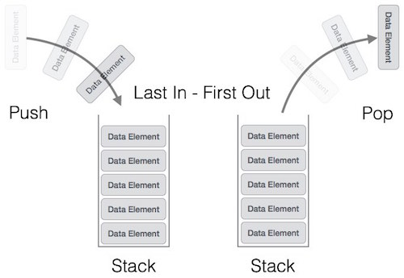
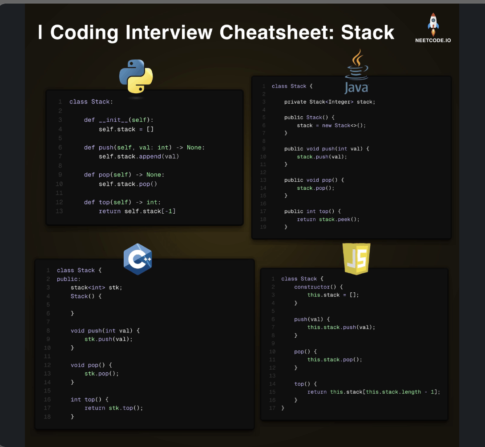

# Stack

> **Scope** — LIFO fundamentals and the canonical stack templates: bracket matching, min-stack, the short monotonic-stack form, explicit-stack traversal and the scope/context ledger.
> **See also**: [stack_expression_parsing.md](./stack_expression_parsing.md) — calculators, decode-string and postfix evaluation, the whole expression-parsing family; [stack_examples.md](./stack_examples.md) — the worked-solution archive behind these templates; [monotonic_stack.md](./monotonic_stack.md) — next-greater / previous-smaller / span problems in depth; [queue.md](./queue.md) — the FIFO counterpart; [iterator.md](./iterator.md) — stack-backed iterators.

## LeetCode Problem Lists

- [Stack](https://leetcode.com/problem-list/stack/)
- [Monotonic Stack](https://leetcode.com/problem-list/monotonic-stack/)

## Time Complexity

| Data structure | Search   | Insert   | Delete   | Min/Max  |
| -------------- | -------- | -------- | -------- | -------- |
| Stack          | O(n)     | O(1)     | O(1)     | O(n)     |

> Insert = push, Delete = pop, peek — all at the top, all **O(1)**. Min/Max can be made **O(1)** with an auxiliary min/max-stack ([monotonic_stack.md](./monotonic_stack.md)). Space is **O(n)**.

## Overview

<p align="center"></p>

**Stack** is a data structure with Last-In-First-Out (LIFO) property. Each operation adds/removes from the top of the stack.

### Key Properties
- **Complexity**: see the [Time Complexity](#time-complexity) table above
- **Core Principle**: Last element added is the first one removed
- **Use Case**: Problems involving order reversal, pattern matching, or maintaining context

<p align="center"></p>

### References

- Ref
    - [fuck-Algorithm - single stack](https://github.com/labuladong/fucking-Algorithm/blob/master/%E6%95%B0%E6%8D%AE%E7%BB%93%E6%9E%84%E7%B3%BB%E5%88%97/%E5%8D%95%E8%B0%83%E6%A0%88.md)
    - [fuck-Algorithm - implement array via stack / stack via array ](https://github.com/labuladong/fucking-Algorithm/blob/master/%E6%95%B0%E6%8D%AE%E7%BB%93%E6%9E%84%E7%B3%BB%E5%88%97/%E9%98%9F%E5%88%97%E5%AE%9E%E7%8E%B0%E6%A0%88%E6%A0%88%E5%AE%9E%E7%8E%B0%E9%98%9F%E5%88%97.md)
    - [Java Stack](https://blog.csdn.net/oChangWen/article/details/72859556) — low level: array
- Video
    - [Stack Fundamentals](https://www.bilibili.com/list/525438321?sort_field=pubtime&spm_id_from=333.999.0.0&oid=779764003&bvid=BV1my4y1Z7jj)

## Recognition

| Signal in the statement | Constraint cue | Reach for | Not this if |
|---|---|---|---|
| "remove adjacent duplicates", "backspace", "undo the last" | n ≤ 10⁵ → one O(n) pass | [Template 1](#template-1-cancel-against-the-top--lc-1047) cancel against the top | a run must reach length k first → `[char, count]` pairs ([stack_examples.md](./stack_examples.md)) |
| "valid / balanced parentheses" with several bracket types | n ≤ 10⁴ → O(n) | [Template 2](#template-2-bracket-matching--lc-20-) bracket matching | one bracket type only → a balance counter, O(1) space |
| "minimum removals / longest valid" parentheses | n ≤ 10⁵ | [Template 2 § LC 1249](#bracket-repair-variant--push-the-index-not-the-char-lc-1249-) index stack | |
| "next greater / warmer / taller", "days until", "nearest smaller" | n ≤ 10⁵ → O(n²) scan times out | [Template 3](#template-3-monotonic-stack--next-greater--smaller--lc-739-) monotonic stack | max of every window of width k → [monotonic_queue.md](./monotonic_queue.md) |
| "retrieve the minimum in constant time" alongside push / pop | every op O(1) | [Template 4](#template-4-min-stack--o1-getmin--lc-155-) per-layer aggregate | deletions from anywhere, not LIFO → [heap.md](./heap.md) with lazy deletion |
| "iteratively", "without recursion" over a tree | skewed depth up to 10⁵ overflows recursion | [Template 5](#template-5-explicit-stack--iterative-traversal--lc-144-lc-145-) explicit stack | "level by level" → a queue ([bfs.md](./bfs.md)) |
| tab-indented paths, `start` / `end` logs, "who is running now" | n ≤ 10⁴ → O(n) | [Template 6](#template-6-scope--context-ledger--lc-388-lc-636-) scope ledger | the nesting must be *evaluated* → [stack_expression_parsing.md](./stack_expression_parsing.md) |
| "basic calculator", "decode string", "reverse Polish notation" | | [stack_expression_parsing.md](./stack_expression_parsing.md) | |

## Problem Categories

Ten shapes cover almost every stack question. The **Where** column says which template
below owns the code, or which sheet the worked solutions moved to.

| Category | What the stack holds | LC | Where |
|---|---|---|---|
| **Bracket / nesting validation** | the openers still owed a closer | 20, 921, 1541, 1614 | [Template 2](#template-2-bracket-matching--lc-20-) |
| **Bracket repair / measurement** | *indices* of unmatched brackets | 1249, 32, 856 | [Template 2 § LC 1249](#bracket-repair-variant--push-the-index-not-the-char-lc-1249-), [stack_examples.md](./stack_examples.md) |
| **Monotonic — next greater / smaller** | elements still waiting for an answer | 496, 503, 739, 84, 907, 2104 | [Template 3](#template-3-monotonic-stack--next-greater--smaller--lc-739-), [monotonic_stack.md](./monotonic_stack.md) |
| **Monotonic — greedy removal** | the best prefix built so far | 402, 316, 1081, 1673 | [monotonic_stack.md](./monotonic_stack.md) |
| **Monotonic — span accumulation** | `[value, span]` pairs, streaming | 901, 735 | [monotonic_stack.md](./monotonic_stack.md), [stack_examples.md](./stack_examples.md) |
| **Stack with `[element, count]` pairs** | a run-length-compressed prefix | 1047, 1209, 1544 | [stack_examples.md](./stack_examples.md) |
| **O(1) aggregate on a stack** | one `min` / `max` / delta *state* per layer | 155, 716, 1381, 895 | [Template 4](#template-4-min-stack--o1-getmin--lc-155-) |
| **Expression parsing** | operands / deferred terms / open scopes | 224, 227, 772, 394, 150, 682 | [stack_expression_parsing.md](./stack_expression_parsing.md) |
| **Scope / context ledger** | the *enclosing* context, keyed by depth | 388, 636, 591, 71 | [Template 6](#template-6-scope--context-ledger--lc-388-lc-636-) |
| **Order reversal / paused traversal** | work not yet done | 144, 145, 173, 341, 445 | [Template 5](#template-5-explicit-stack--iterative-traversal--lc-144-lc-145-) |

### Stack Variants Worth Knowing

- Single stack
- Build queue via stack
     - LC 232 (use `2 stack`)
- Build stack via queue
- **Stack with Pair (char, count)**
     - Store `[element, count]` pairs instead of raw elements
     - LC 1047 (k=2 special case, simple pop)
     - LC 1209 (k consecutive duplicates removal)
     - LC 1544 (Make The String Great)
     - LC 394 (Decode String, stack with count for repetition)
     - LC 726 (Number of Atoms)

## Templates & Algorithms

### Template Comparison Table

| Template | Stack element | Loop shape | Complexity | When to Use |
|---|---|---|---|---|
| 1 — Cancel against the top | the unmatched prefix | one pass, pop on a match | O(n) / O(n) | adjacent cancellation, undo, backspace |
| 2 — Bracket matching | opener chars | one pass, pop on closer | O(n) / O(n) | validate nesting, >1 bracket type |
| 3 — Monotonic stack | indices | `while` inside `for` | O(n) / O(n) | next greater / smaller / span |
| 4 — Min stack | value + one aggregate *state* per layer | — | O(1) per op | O(1) `getMin()` / `getMax()`; prefix aggregates, path state |
| 5 — Explicit stack | pending nodes | `while stack` | O(n) / O(h) | iterative traversal, order reversal |
| 6 — Scope ledger | enclosing context per depth | one pass, trim to depth | O(n) / O(depth) | indented input, start/end events |

### Template 1: Cancel Against the Top — LC 1047

**Recognise** — "remove adjacent duplicates", "backspace", "undo", "two neighbours annihilate":
each new item either cancels the most recent survivor or joins the survivors. n ≤ 10⁵ → one
O(n) pass is expected; re-scanning the string after every removal is O(n²).

**Key point** — the stack *is* the answer so far: it holds the prefix with every cancellation
already applied, so the only item a new one can interact with is `stack[-1]`.

```python
# python
# LC 1047 - Remove All Adjacent Duplicates In String
# IDEA: the stack holds the reduced prefix; a char equal to the top cancels it, otherwise it joins
# time = O(n), space = O(n)
def removeDuplicates(s):
    stack = []                       # the reduced prefix, top = last surviving char
    for ch in s:
        if stack and stack[-1] == ch:
            stack.pop()              # ch cancels its neighbour; the char below becomes adjacent
        else:
            stack.append(ch)
    return ''.join(stack)            # bottom -> top is left -> right order
```

```java
// java
// LC 1047 - Remove All Adjacent Duplicates In String
// IDEA: the stack holds the reduced prefix; a char equal to the top cancels it, otherwise it joins
// time = O(n), space = O(n)
public String removeDuplicates(String s) {
    Deque<Character> stack = new ArrayDeque<>();   // top = last surviving char
    for (char ch : s.toCharArray()) {
        if (!stack.isEmpty() && stack.peek() == ch) {
            stack.pop();                           // cancel, and expose the char below
        } else {
            stack.push(ch);
        }
    }
    StringBuilder sb = new StringBuilder();
    while (!stack.isEmpty()) {
        sb.append(stack.pollLast());               // the bottom is the leftmost survivor
    }
    return sb.toString();
}
```

The three operations every template below is built from:

| Operation | Python (`list`) | Java (`Deque<T>` via `ArrayDeque`) | Cost |
|---|---|---|---|
| push | `stack.append(x)` | `stack.push(x)` | O(1) amortised |
| pop | `stack.pop()` — raises on empty | `stack.pop()` — throws on empty | O(1) |
| peek | `stack[-1]` — guard with `if stack` | `stack.peek()` — returns `null` on empty | O(1) |

**Complexity**
- **Time O(n)**: the `for ch in s` loop runs once per character, and each character is pushed at
  most once and popped at most once.
- **Space O(n)**: `stack.append(ch)` keeps every survivor; `"abcd"` cancels nothing.

**Dry run**

```text
s = "abbaca"
ch   action          stack
a    push            a
b    push            a b
b    cancels top     a
a    cancels top     (empty)    <- the cancel exposed 'a', which the next 'a' then cancels
c    push            c
a    push            c a        -> "ca"
```

**Traps**
- Re-scanning after each removal (`while "aa" in s: s = s.replace(...)`) is O(n²) on
  `"abcddcba"`-style inputs, where each removal exposes a new pair.
- In Java, `Stack<Character>` iterates bottom → top but `ArrayDeque` iterates top → bottom;
  building the answer by iterating an `ArrayDeque` reverses it. Drain from the bottom with `pollLast()`.
- Java's `stack.peek() == ch` is safe only because `ch` is a primitive `char`; two boxed
  `Character`s compared with `==` compare references.

**Not this if** — the run must reach length k before it disappears (LC 1209) → push
`[char, count]` pairs instead of single chars ([stack_examples.md](./stack_examples.md)).

**Drill** — LC 1047 · LC 844 *(backspace: `#` pops instead of a match)* · LC 1544 *(cancel
on same letter, opposite case)* · LC 232 *(two stacks make a queue)* · LC 1209 *(`[char, count]` pairs)*

---

### Template 2: Bracket Matching — LC 20 ⭐⭐⭐⭐⭐

**Recognise** — "valid parentheses", "well-formed", "balanced", "properly nested", with **more
than one** bracket or tag type. n ≤ 10⁴ → one O(n) pass.

**Key point** — the stack holds exactly the openers still owed a closer, innermost on top; a
closer is legal only if it matches the top, because the innermost open scope must close first.

```python
# python
# LC 20 - Valid Parentheses
# IDEA: STACK — push openers, pop-and-verify on closers, stack must end empty
# time = O(n), space = O(n)
class Solution(object):
    def isValid(self, s):
        pairs = {')': '(', ']': '[', '}': '{'}
        stack = []
        for c in s:
            # closer: needs a non-empty stack AND the matching partner on top
            if c in pairs:
                if not stack or stack.pop() != pairs[c]:
                    return False
            # opener
            else:
                stack.append(c)
        # leftover openers were never closed
        return not stack
```

```java
// java
// LC 20 - Valid Parentheses
// IDEA: STACK — push openers, pop-and-verify on closers, stack must end empty
// time = O(n), space = O(n)
public boolean isValid(String s) {

    // closer -> its matching opener
    Map<Character, Character> pairs = new HashMap<>();
    pairs.put(')', '(');
    pairs.put(']', '[');
    pairs.put('}', '{');

    Deque<Character> st = new ArrayDeque<>();

    for (char c : s.toCharArray()) {
        if (pairs.containsKey(c)) {
            if (st.isEmpty()) {
                return false;            // a closer with nothing open
            }
            char top = st.pop();         // unbox to char before comparing
            if (top != pairs.get(c)) {
                return false;            // wrong partner
            }
        } else {
            st.push(c);
        }
    }

    return st.isEmpty();                 // leftover openers -> invalid
}
```

**Complexity**
- **Time O(n)**: the single `for c in s` loop; each character is pushed or popped once.
- **Space O(n)**: `stack.append(c)` can hold every character, e.g. `"(((((("`.

**Traps**
- `")"` alone: popping before checking `not stack` raises / throws. Check empty first.
- `"(]"`: a closer needs **both** checks — non-empty *and* the matching partner on top.
- `"((("`: the loop never fails, so returning `True` after it is wrong. The stack must end empty.
- Java: `st.pop() != pairs.get(c)` with both sides boxed `Character` compares references.
  Unbox one side into a `char` first.

**Not this if** — only **one** bracket type (LC 921, LC 1541, LC 1614) → a running balance
counter is enough, O(1) space. The *position* of the offender is needed (LC 1249, LC 32) →
push **indices**, below.

**Drill** — LC 20 ⭐ · LC 1614 *(max depth = max balance)* · LC 921 *(counter only)* ·
LC 1249 *(index stack, below)* · LC 856 *(stack of partial scores)* · LC 32 *(index stack with a `-1` base)*

**The bracket family — four twists on the same template** (where each is worked is linked in the row):

| LC | Twist | Stack holds |
|----|-------|-------------|
| 1249 | repair, not just validate — [below](#bracket-repair-variant--push-the-index-not-the-char-lc-1249-) | *indices* of unmatched `(` — or no stack: two counter scans, one per direction |
| 921 | one bracket type only, so a counter suffices — O(1) space ([greedy_examples § 7](./greedy_examples.md#7-minimum-add-to-make-parentheses-valid--lc-921--a-balance-counter)) | nothing (the stack degenerates to its size) |
| 32 | length of the longest valid run ([stack_examples § LC 32](./stack_examples.md#longest-valid-parentheses--lc-32-)) | indices plus a `-1` **base** sentinel |
| 856 | fold a score out of the nesting ([stack_examples § LC 856](./stack_examples.md#score-of-parentheses--lc-856)) | the partial **result** of each depth |

#### Bracket Repair Variant — push the **index**, not the char (LC 1249) ⭐⭐⭐⭐

> **Key point** — LC 20 only answers *yes / no*, so the stack can hold the opener
> characters and forget where they were. LC 1249 must **erase** the offenders, so it needs their
> *positions* — push the **index** of each `(`. There is only one bracket type, so nothing has
> to be compared on a pop: any open `(` matches any `)`.

**Reduces to**: [Template 2](#template-2-bracket-matching--lc-20-) — the stack holds indices instead of characters.

| | LC 20 — validate | LC 1249 — repair |
|---|---|---|
| Stack holds | opener **chars** | **indices** of unmatched `(` |
| `)` with an empty stack | `return False` | mark index `i` for removal, keep scanning |
| `)` with a non-empty stack | pop, check it is the partner | pop — the pair is kept |
| End of scan | stack must be empty | every index **left on the stack** is an unmatched `(` → remove it too |
| Output | a boolean | `s` minus the marked positions |

**Why it is the minimum.** A `)` with no `(` open before it can never be matched by anything to
its right, and an `(` still on the stack at the end has no `)` after it. Each removal is forced,
and everything else pairs up, so nothing is removed that did not have to be.

The worked solution (Python and Java, mark-then-rebuild, with its traps) is
[string.md Template 7](./string.md#template-7-in-place-char-array--mark-then-rebuild--lc-1249-);
the stack-free **two counter scans** (left→right drops the surplus `)`, right→left drops the
surplus `(` — the follow-up an interviewer asks next) are
[stack_examples.md § LC 1249](./stack_examples.md#minimum-remove-to-make-valid-parentheses--lc-1249).

---

### Template 3: Monotonic Stack — Next Greater / Smaller — LC 739 ⭐⭐⭐⭐

**Recognise** — "next greater / warmer / taller to the right", "how many days until", "nearest
smaller on each side". n ≤ 10⁵ → the O(n²) scan-right-for-each-element times out; O(n) expected.

**Key point** — the stack holds the indices **still waiting for an answer**, their values strictly
decreasing bottom → top; the first value that beats the top is, by that order, the answer for
every index it pops.

This sheet keeps **one** short form. The full family (previous-smaller, spans, histogram,
subarray min/max sums, and the greedy-removal variants) is
[monotonic_stack.md](./monotonic_stack.md)'s subject, and its worked solutions are there too.

```python
# python
# LC 739 - Daily Temperatures (next greater element, as a distance)
# IDEA: the stack holds indices still waiting for a warmer day; a warmer `val` answers every one it pops
# time = O(n), space = O(n)
def daily_temperatures(temperatures):
    n = len(temperatures)
    res = [0] * n                 # 0 = no warmer day ahead
    stack = []                    # indices, temperatures strictly decreasing bottom -> top
    for i, val in enumerate(temperatures):
        while stack and temperatures[stack[-1]] < val:
            j = stack.pop()
            res[j] = i - j        # i is the first warmer day after j
        stack.append(i)
    return res
```

```java
// java
// LC 739 - Daily Temperatures (next greater element, as a distance)
// IDEA: the stack holds indices still waiting for a warmer day; a warmer value answers every one it pops
// time = O(n), space = O(n)
public int[] dailyTemperatures(int[] temperatures) {
    int n = temperatures.length;
    int[] res = new int[n];                    // 0 = no warmer day ahead
    Deque<Integer> stack = new ArrayDeque<>(); // indices, temperatures strictly decreasing

    // Traverse the array from left to right
    for (int i = 0; i < n; i++) {
        while (!stack.isEmpty() && temperatures[stack.peek()] < temperatures[i]) {
            int j = stack.pop();
            res[j] = i - j;                    // i is the first warmer day after j
        }
        stack.push(i);
    }
    return res;
}
```

Flip the comparison to flip the direction:

| Want | Pop while | Read the answer | LC |
|---|---|---|---|
| next **greater** element / warmer day | `top < cur` | when `cur` pops `top` | 496, 503, 739 |
| next **smaller** element, or left+right bounds | `top > cur` | when `cur` pops `top` | 84, 907, 2104 |
| **span** back to the last bigger value | `top <= cur`, accumulating the popped spans | the accumulated count | 901 |
| **circular** array | same, over `nums * 2` with `idx % n` | same | 503 |

**Complexity**
- **Time O(n)**: the inner `while` looks nested, but every index is pushed once by
  `stack.append(i)` and popped at most once, so the pops total at most n across the whole run.
- **Space O(n)**: a strictly decreasing input (`[5, 4, 3, 2, 1]`) never pops, so the stack holds all n.

**Dry run**

```text
temperatures = [73, 74, 75, 71, 69, 72, 76, 73]
i  val   pops (j -> res[j])          stack (indices)
0  73    -                           [0]
1  74    0 -> 1                      [1]
2  75    1 -> 1                      [2]
3  71    -                           [2, 3]
4  69    -                           [2, 3, 4]
5  72    4 -> 1, 3 -> 2              [2, 5]
6  76    5 -> 1, 2 -> 4              [6]
7  73    -                           [6, 7]      -> [1, 1, 4, 2, 1, 1, 0, 0]
```

**Traps**
- Pushing values instead of indices: `[73, 74]` can then say *that* a warmer day exists but
  not *how far*. Push the index; read the value through it.
- `<` vs `<=`: with `<=`, equal temperatures `[70, 70, 71]` pop the first 70 on the second
  and report 1 day, though 70 is not warmer. "Strictly greater" means pop on strictly less.
- Indices left on the stack at the end have no answer; they keep the default `0` (or `-1`
  for LC 496 / 503), so initialise `res` with it.

**Not this if** — the answer is a max or min over a **sliding window** of fixed width (LC 239)
→ a monotonic *deque*, which also expires from the front ([monotonic_queue.md](./monotonic_queue.md)).

**Drill** — LC 739 ⭐ · LC 496 · LC 503 *(circular: walk `2n`)* · LC 901 *(online spans)* ·
LC 907 *(contribution counting)* · LC 84 *(next smaller on both sides)*

---

### Template 4: Min Stack — O(1) getMin — LC 155 ⭐⭐⭐⭐

**Recognise** — "design a stack that supports `push`, `pop`, `top` and retrieving the minimum
element **in constant time**". Every operation O(1), up to 3·10⁴ calls.

**Key point** — `min_values[i] == min(stack[0..i])`: a second array mirrors the stack layer for
layer and holds the answer for everything at or below that layer, so popping a layer pops its
answer and the layer below already knows its own.

The trick is a **second array that mirrors the stack layer for layer**, holding not the
elements but *the answer to the query for everything at or below that layer*. For LC 155 the
query is "minimum", so `min_values` holds each layer's minimum. This is the design-problem
face of a [prefix aggregate](./prefix_sum.md), and the same idea shows up far outside stacks —
see [the classics table](#the-same-idea-beyond-stacks--the-classics-) at the end of this template.

```python
# python
# LC 155 - Min Stack
# IDEA: 2 ARRAYS — stack holds the elements, min_values holds each layer's minimum
# time = O(1) per operation, space = O(n)
class MinStack(object):

    def __init__(self):
        self.stack = []
        # min_values[i] == min(stack[0..i]) — a STATE per layer, not the elements sorted
        self.min_values = []

    def push(self, val):
        self.stack.append(val)
        if not self.min_values:
            self.min_values.append(val)
        else:
            self.min_values.append(min(val, self.min_values[-1]))

    def pop(self):
        # the popped layer's state leaves with it — no comparison needed
        self.min_values.pop()
        return self.stack.pop()

    def top(self):
        return self.stack[-1]

    def getMin(self):
        # the top layer's state IS the current minimum — O(1)
        return self.min_values[-1]
```

```java
// java
// LC 155 - Min Stack
// IDEA: 2 STACKS — stack holds the elements, minValues holds each layer's minimum
// time = O(1) per operation, space = O(n)
class MinStack {
    private final Deque<Integer> stack = new ArrayDeque<>();
    private final Deque<Integer> minValues = new ArrayDeque<>();   // one entry per layer

    public void push(int val) {
        stack.push(val);
        if (minValues.isEmpty()) {
            minValues.push(val);
        } else {
            minValues.push(Math.min(val, minValues.peek()));
        }
    }

    public void pop() {
        stack.pop();
        minValues.pop();          // the layer's state leaves with it
    }

    public int top() {
        return stack.peek();
    }

    public int getMin() {
        return minValues.peek();  // the top layer's state is the answer
    }
}
```

**Complexity**
- **Time O(1) per operation**: `push` combines two numbers in `min(val, self.min_values[-1])`;
  `getMin` reads one cell, `self.min_values[-1]`. No operation scans.
- **Space O(n)**: `self.min_values.append(...)` adds one entry per pushed element.

**Dry run**

```text
push -2, 0, -3        then pop()
  stack      = [-2,  0, -3]      stack      = [-2,  0]
  min_values = [-2, -2, -3]      min_values = [-2, -2]   <- getMin() = -2, nothing recomputed
                  ^    ^    ^
                  |    |    min of all three
                  |    min of the first two (0 did not beat -2)
                  min of the first one
```

**Traps**
- One `self.min` variable instead of an array: after `push 1, push 0, pop`, the min must go
  back to 1, and a single variable has already overwritten it. Restoring it is an O(n) rescan.
- The space-saving variant that pushes only *new* minima must compare with `<=`:
  `push 0, push 0, pop` with `<` leaves the min-stack empty while the stack still holds a 0
  (see [the space-saving variant](#space-saving-variant--a-second-stack-of-minima-only) below).
  The per-layer array above needs no comparison in `pop` at all.
- Java, space-saving variant: `stack.peek() == minStack.peek()` on boxed `Integer`s compares
  references, so a pushed `128` never matches itself. Compare with `.equals`, or unbox first.

**Not this if** — the minimum must survive deletions from the **middle** or arbitrary order
(not LIFO) → a heap with lazy deletion ([heap.md](./heap.md)); the window slides from the front
(LC 239) → two such stacks as a queue, or a monotonic deque (classics table below).

**Drill** — LC 155 ⭐ · LC 1381 *(lazy increment per layer)* · LC 1026 *(the recursion stack as
the stack)* · LC 716 *(max stack, `popMax`)* · LC 895 *(one stack per frequency)*

| Approach | `push` | `pop` | `getMin` | Why it falls short |
|---|---|---|---|---|
| one `self.min` variable | O(1) | **O(n)** | O(1) | after popping the min, the previous min has to be rescanned |
| heap (`heapq`) | O(log n) | O(log n) with lazy deletion | O(1) | pays a log for an ordering the stack never uses |
| `{value: count}` map | O(1) | O(1) | **O(n)** | `min(counts)` is a scan (this is `min-stack.py`'s V0-1) |
| **per-layer `min_values`** | O(1) | O(1) | O(1) | the answer for the current top was fixed when the top was pushed |

#### The general form — one aggregate per layer

```text
Invariant:  min_values[i] = min(stack[0], stack[1], ..., stack[i])
            -> min_values is NOT the elements sorted; it is a STATE per layer

push(v):    min_values.append(min(v, min_values[-1]))   # new layer, new state
pop():      min_values.pop()                             # the popped layer's state goes with it
getMin():   min_values[-1]                               # the top layer's state IS the answer
```

Three consequences fall straight out of the invariant:

- **The two arrays are always the same length** — every `push` appends to both, every
  `pop` removes from both. No `if` in `pop()`, no comparing the popped value against the
  min: `min_values[-1]` is a *state* that belongs to the layer, not a copy of an element,
  so popping the layer is the whole job. That is why the template above does not need the
  `stack.pop() == mins[-1]` check that the space-saving variant needs.
- **Duplicates are free.** `push(0); push(0); pop()` leaves `min_values = [0]`, because
  each `0` got its own layer. The variant that stores only *new* minima has to write `<=`
  to get this right — the classic LC 155 bug (see
  [the space-saving variant](#space-saving-variant--a-second-stack-of-minima-only) below).
- **Any aggregate that is a function of the prefix works the same way** — `max`, a running
  sum, a running GCD, a pending delta (LC 1381), a frequency count (LC 895). Replace
  `min(...)` in `push` and nothing else changes.

The same invariant fits in one stack of `(value, min_so_far)` tuples — one structure instead
of two, same bounds:

```python
# python
# LC 155 - Min Stack, one stack of (value, min_so_far) tuples
# IDEA: each layer carries its own minimum next to its value
# time = O(1) per operation, space = O(n)
class MinStack(object):

    def __init__(self):
        self.stack = []

    def push(self, x):
        if not self.stack:
            self.stack.append((x, x))
        else:
            self.stack.append((x, min(x, self.stack[-1][1])))

    def pop(self):
        self.stack.pop()

    def top(self):
        return self.stack[-1][0]

    def getMin(self):
        return self.stack[-1][1]
```

#### Space-saving variant — a second stack of minima only

The minima stack does not need an entry per layer: push onto it only when the new value is a
new minimum **or ties it**, and pop from it only when the popped value equals its top. Its values
are then non-increasing bottom → top and its top is still the live minimum. It saves space when
most pushes do not lower the minimum, and it is the version interviewers most often see written,
so know its one trap: the comparison on push must be `<=`.

```python
# python
# LC 155 - Min Stack, auxiliary non-increasing stack
# IDEA: mins holds only the values that were a minimum when pushed; '<=' keeps duplicate minima
# time = O(1) per operation, space = O(n) worst case
class MinStack(object):

    def __init__(self):
        self.stack = []
        self.mins = []                 # non-increasing bottom -> top; top = current minimum

    def push(self, val):
        self.stack.append(val)
        if not self.mins or val <= self.mins[-1]:
            self.mins.append(val)      # '<=': a second copy of the minimum gets its own entry

    def pop(self):
        if self.stack.pop() == self.mins[-1]:
            self.mins.pop()            # the minimum is leaving, so its entry leaves too

    def top(self):
        return self.stack[-1]

    def getMin(self):
        return self.mins[-1]
```

```java
// java
// LC 155 - Min Stack, auxiliary non-increasing stack
// IDEA: mins holds only the values that were a minimum when pushed; '<=' keeps duplicate minima
// time = O(1) per operation, space = O(n) worst case
class MinStack {
    private final Deque<Integer> stack = new ArrayDeque<>();
    private final Deque<Integer> mins = new ArrayDeque<>();   // non-increasing

    public void push(int val) {
        stack.push(val);
        if (mins.isEmpty() || val <= mins.peek()) {
            mins.push(val);
        }
    }

    public void pop() {
        int v = stack.pop();                  // unbox before comparing
        if (v == mins.peek()) {
            mins.pop();
        }
    }

    public int top() {
        return stack.peek();
    }

    public int getMin() {
        return mins.peek();
    }
}
```

The classic bug is pushing a new minimum only on strict `<`: `push(0); push(0); pop()` removes
the single stored `0` from `mins`, and `getMin()` then fails on an empty stack although a `0` is
still in the stack.

#### Why O(1) — the state was computed at push time

`getMin()` reads one array cell. There is no scan, because the work was moved to `push`,
and `push` only has to combine **two** numbers: the new value and the answer for the layer
below. That is the whole argument — each operation touches the top of two arrays and
nothing else.

The point of *keeping every layer's state* instead of one `self.min` variable is `pop()`.
A single variable can be lowered when a smaller value arrives, but cannot be **raised**
back when that value leaves — the earlier minimum was overwritten. The array remembers it,
because it was never overwritten; it was one layer down the whole time.

#### The same idea beyond stacks — the classics ⭐⭐⭐⭐

The invariant needs a container that **only changes at one end**, so that "the state one
layer down" is still valid when the top goes away. Four things in the LC catalogue behave
like that. Read the table by the first column: find what is playing the stack in your
problem, and the aggregate you need to carry per layer follows.

| What plays the stack | Per-layer state | Query it answers | Classic LC |
|---|---|---|---|
| **an explicit stack** | `min` / `max` so far | `getMin()` / `getMax()` in O(1) | **155** Min Stack, **716** Max Stack (`peekMax`) |
| | a pending delta for everything below | bulk `increment(k, val)` in O(1) | **1381** Design a Stack With Increment Operation |
| | one stack per frequency level | pop the most frequent in O(1) | **895** Maximum Frequency Stack |
| **two stacks forming a queue** (LC 232) | `min` / `max` so far in *each* stack | window min / max in amortised O(1), without a monotonic deque | **239** Sliding Window Maximum, **1438** Longest Continuous Subarray With Absolute Diff ≤ Limit |
| **an array that only grows** — index = layer | prefix `min` / `max` / `sum` / `product` | "best value at or before `i`" for every `i` | **121** Best Time to Buy and Sell Stock, **2016** Maximum Difference Between Increasing Elements, **42** Trapping Rain Water, **238** Product of Array Except Self, **303** Range Sum Query, **769** Max Chunks To Make Sorted, **915** Partition Array into Disjoint Intervals, **1477** Find Two Non-overlapping Sub-arrays Each With Target Sum |
| **the recursion stack** — the root-to-node path | `(lo, hi)` / `max` / prefix value along the path | a per-node answer about its ancestors | **1026** Maximum Difference Between Node and Ancestor, **98** Validate Binary Search Tree, **1448** Count Good Nodes in Binary Tree, **129** Sum Root to Leaf Numbers |

Two rules decide how much of the state to keep:

- **Keep the whole array when a later query asks about a layer that is not the top.**
  LC 42 needs `left_max[i]` for *every* `i` on the second pass; LC 238 needs every prefix
  product; LC 769 / 915 compare a prefix max against a suffix min at each split. One
  variable cannot answer for a layer it has already moved past.
- **Collapse it to one variable when only the top is ever queried and nothing pops.**
  LC 121 asks "min so far" once per index and never goes back, so `min_values` is a single
  `lo` — the array's last cell, kept and the rest thrown away. LC 155 cannot do this
  because `pop()` *does* go back.

```python
# LC 239 (as a min queue) / LC 1438 - a queue built from two min stacks
# IDEA: a queue is two stacks (LC 232). Give each stack its per-layer min and the
#       queue's min is the smaller of the two tops — no monotonic deque needed.
#       Swap min -> max for LC 239 itself; run one of each for LC 1438.
# time = O(1) amortised per operation, space = O(n)
class MinQueue(object):

    def __init__(self):
        self.inbox, self.outbox = [], []      # each entry: (value, min_so_far)

    @staticmethod
    def _push(st, v):
        st.append((v, v if not st else min(v, st[-1][1])))

    def push(self, v):
        self._push(self.inbox, v)

    def pop(self):
        if not self.outbox:                   # refill: each element moves once
            while self.inbox:
                self._push(self.outbox, self.inbox.pop()[0])
        return self.outbox.pop()[0]

    def getMin(self):
        return min(st[-1][1] for st in (self.inbox, self.outbox) if st)
```

```python
# LC 1026 - Maximum Difference Between Node and Ancestor
# IDEA: the recursion stack IS the stack; (lo, hi) is that layer's aggregate over the
#       root-to-node path. Returning from the call pops it — no bookkeeping at all.
# time = O(n), space = O(h)
def maxAncestorDiff(root):
    def dfs(node, lo, hi):
        if not node:
            return hi - lo
        lo, hi = min(lo, node.val), max(hi, node.val)
        return max(dfs(node.left, lo, hi), dfs(node.right, lo, hi))
    return dfs(root, root.val, root.val)
```

Where the depth lives for each row: the LC 1381 delta trick in
[design_examples.md § LC 1381](./design_examples.md#design-a-stack-with-increment-operation--lc-1381),
the deque form of LC 239 in
[monotonic_queue.md](./monotonic_queue.md#template-1-sliding-window-maximum-decreasing-deque--lc-239),
prefix arrays in [prefix_sum.md](./prefix_sum.md), LC 121 in
[stock_trading.md](./stock_trading.md), and the `(lo, hi)` bounds pattern in
[bst_advanced.md](./bst_advanced.md).

---

### Template 5: Explicit Stack — Iterative Traversal — LC 144, LC 145 ⭐⭐⭐⭐

**Recognise** — "iteratively", "without recursion", "follow-up: recursive solution is trivial,
could you do it iteratively?", or a tree / list deep enough (n up to 10⁵ on a skewed tree) to
overflow the call stack.

**Key point** — the stack holds the work not yet done, and a stack hands work back in reverse
order of arrival: push `right` before `left` and `left` is processed first. Postorder is
preorder run as `root → right → left`, reversed.

The *paused* form of the same stack — an iterator that must stop between elements — is
LC 173 in [bst_advanced.md § Template 5b](./bst_advanced.md#template-1-lazy-in-order-iterator--lc-173-)
and LC 341 in [iterator.md § 2-2](./iterator.md#2-2-flatten-nested-list-iterator--lc-341), and the
wider family is [iterator.md](./iterator.md).

```python
# python
# LC 144 - Binary Tree Preorder Traversal
# IDEA: EXPLICIT STACK — push RIGHT before LEFT so LEFT is popped first
# time = O(n), space = O(h)
class Solution(object):
    def preorderTraversal(self, root):
        if not root:
            return []
        res, stack = [], [root]
        while stack:
            node = stack.pop()
            res.append(node.val)
            # right first -> left ends up on TOP
            if node.right:
                stack.append(node.right)
            if node.left:
                stack.append(node.left)
        return res


# LC 145 - Binary Tree Postorder Traversal
# IDEA: preorder variant (root -> RIGHT -> LEFT), then REVERSE => left-right-root
# time = O(n), space = O(h)
class Solution(object):
    def postorderTraversal(self, root):
        if not root:
            return []
        res, stack = [], [root]
        while stack:
            node = stack.pop()
            res.append(node.val)
            # mirrored push order compared with preorder
            if node.left:
                stack.append(node.left)
            if node.right:
                stack.append(node.right)
        return res[::-1]   # root-right-left  ->  left-right-root
```

```java
// java
// LC 144 - Binary Tree Preorder Traversal
// IDEA: EXPLICIT STACK — push RIGHT before LEFT so LEFT is popped first
// time = O(n), space = O(h)
public List<Integer> preorderTraversal(TreeNode root) {
    List<Integer> res = new ArrayList<>();
    if (root == null) {
        return res;
    }
    Deque<TreeNode> st = new ArrayDeque<>();
    st.push(root);
    while (!st.isEmpty()) {
        TreeNode node = st.pop();
        res.add(node.val);
        // right pushed FIRST, so left is popped FIRST
        if (node.right != null) {
            st.push(node.right);
        }
        if (node.left != null) {
            st.push(node.left);
        }
    }
    return res;
}

// LC 145 - Binary Tree Postorder Traversal
// IDEA: preorder with LEFT/RIGHT swapped (root-right-left), then REVERSE
// time = O(n), space = O(h)
public List<Integer> postorderTraversal(TreeNode root) {
    LinkedList<Integer> res = new LinkedList<>();
    if (root == null) {
        return res;
    }
    Deque<TreeNode> st = new ArrayDeque<>();
    st.push(root);
    while (!st.isEmpty()) {
        TreeNode node = st.pop();
        res.addFirst(node.val);   // addFirst == "append, then reverse", done incrementally
        if (node.left != null) {
            st.push(node.left);
        }
        if (node.right != null) {
            st.push(node.right);
        }
    }
    return res;
}
```

**Complexity**
- **Time O(n)**: `while stack` pops each node exactly once, and each pop pushes at most two children.
- **Space O(h)** on the stack: it holds at most the pending siblings along one root-to-leaf
  path — O(log n) when balanced, O(n) on a skewed tree. The `res[::-1]` copy for postorder is
  output, O(n), not working space.

**Traps**
- Pushing `left` before `right` in preorder gives `root → right → left`; on `[1, 2, 3]`
  (2 left, 3 right) it returns `[1, 3, 2]`.
- `root = None` pushed onto the stack crashes on `node.val`; return `[]` first.
- Postorder's reversal trick yields the *values*; it cannot be used when each node must be
  *processed* after its children with side effects in that order (e.g. freeing them) — use a
  `(node, visited)` flag instead.

**Not this if** — the problem wants nodes level by level ("level order", "right side view",
"minimum depth") → a FIFO queue, not a stack ([bfs.md](./bfs.md)).

**Drill** — LC 144 · LC 145 · LC 94 *(inorder: walk left, pop, go right)* · LC 173 *(paused
inorder as an iterator)* · LC 341 *(paused traversal of nested lists)*

---

### Template 6: Scope / Context Ledger — LC 388, LC 636 ⭐⭐⭐⭐⭐

**Recognise** — tab-indented or nested input ("file system as a string", "tags"), or
`start` / `end` event logs ("exclusive time", "call stack"); any "who is my parent right now?"
question answered in one left-to-right scan. Input length ≤ 10⁴ → O(n).

**Key point** — stack index == nesting depth: `stack[d]` holds the context accumulated at depth
`d` (a path prefix, a running function), so the parent of whatever is being read is always
`stack[depth]` / `stack[-1]`.

This is the pattern behind the highest-frequency Google stack questions, and it is *not*
bracket matching: the "brackets" are implicit (indentation depth, start/end log events).

```python
# python
# LC 388 - Longest Absolute File Path
# IDEA: SCOPE STACK indexed by DEPTH — stack[d] = length of the path prefix at depth d
# time = O(n), space = O(depth)
class Solution(object):
    def lengthLongestPath(self, input):
        res = 0
        stack = [0]   # stack[d] = prefix length at depth d (trailing '/' included)

        for line in input.split('\n'):
            name = line.lstrip('\t')
            depth = len(line) - len(name)   # number of leading tabs

            # we left deeper scopes -> trim the stack back to this depth
            while len(stack) > depth + 1:
                stack.pop()

            if '.' in name:
                # file: measure, never push (a file has no children)
                res = max(res, stack[depth] + len(name))
            else:
                # dir: becomes the prefix for depth+1, +1 for the '/'
                stack.append(stack[depth] + len(name) + 1)

        return res
```

```java
// java
// LC 388 - Longest Absolute File Path
// IDEA: SCOPE STACK indexed by DEPTH — stack.get(d) = length of the path prefix at depth d
// time = O(n), space = O(depth)
public int lengthLongestPath(String input) {

    int res = 0;

    // stack.get(d) = length of "dir1/dir2/.../" for the current branch at depth d,
    // trailing '/' included -> the index in the list IS the nesting depth
    List<Integer> stack = new ArrayList<>();
    stack.add(0); // depth 0 has an empty prefix

    for (String line : input.split("\n")) {

        // depth = number of leading '\t'
        int depth = 0;
        while (depth < line.length() && line.charAt(depth) == '\t') {
            depth++;
        }
        String name = line.substring(depth);

        // we LEFT the previous deeper scopes -> pop back to `depth`
        while (stack.size() > depth + 1) {
            stack.remove(stack.size() - 1);
        }

        if (name.contains(".")) {
            // a FILE never becomes a parent -> just measure it
            res = Math.max(res, stack.get(depth) + name.length());
        } else {
            // a DIRECTORY becomes the context of depth+1 (+1 for the '/')
            stack.add(stack.get(depth) + name.length() + 1);
        }
    }

    return res;
}
```

**Complexity**
- **Time O(n)**: `for line in input.split('\n')` touches each character a constant number of
  times; the trim `while` pops each pushed directory at most once.
- **Space O(depth)**: `stack.append(...)` grows only while the input nests deeper, one entry per open directory.

**Dry run**

```text
"dir\n\tsubdir2\n\t\tfile.ext"
line         depth   stack after            res
"dir"        0       [0, 4]      ("dir/")
"subdir2"    1       [0, 4, 12]  ("dir/subdir2/")
"file.ext"   2       [0, 4, 12]             12 + 8 = 20
```

**Traps**
- Forgetting the trim: `"a\n\tb\nc\n\td.txt"` would measure `d.txt` under `a/b/` instead of `c/`.
- Pushing a file: a file never has children, so a later sibling would read the wrong prefix.
- Forgetting the `+ 1` for `/`: `"dir\n\tfile.ext"` returns 11 instead of 12.
- No file at all (`"a"`): the answer is `0`, not the longest directory path.

**Not this if** — the nesting is written with explicit brackets and must be *validated* →
[Template 2](#template-2-bracket-matching--lc-20-); it must be *evaluated* (calculators,
decode string) → [stack_expression_parsing.md](./stack_expression_parsing.md).

**Drill** — LC 388 · LC 71 *(`..` pops the parent dir)* · LC 636 · LC 591 *(open-tag stack plus CDATA rules)*

#### Variant: overwrite the depth slot instead of popping — LC 388

> **Key point** — the input is a pre-order listing, so a line at depth `d` reads only
> `path_len[d]`, and the last write to that slot was made by its own parent. Deeper stale slots
> are never read before they are rewritten, so the ledger is really *the last write per depth*.

**Reduces to**: [Template 6](#template-6-scope--context-ledger--lc-388-lc-636-) — with the trim
loop dropped. This is the form README files LC 388 under Hash_table. Same `O(n)`.

```python
# python
# LC 388 - Longest Absolute File Path
# IDEA: HASH MAP by DEPTH — path_len[d] = prefix length for children at depth d; overwrite, never pop
# time = O(n), space = O(depth)
class Solution(object):
    def lengthLongestPath(self, input):
        res = 0
        path_len = {0: 0}   # depth-0 entries have an empty prefix

        for line in input.split('\n'):
            name = line.lstrip('\t')
            depth = len(line) - len(name)

            if '.' in name:
                res = max(res, path_len[depth] + len(name))
            else:
                # overwrite the slot for depth+1 — a stale deeper slot is rewritten before it is read
                path_len[depth + 1] = path_len[depth] + len(name) + 1

        return res
```

```java
// java
// LC 388 - Longest Absolute File Path
// IDEA: HASH MAP by DEPTH — pathLen[d] = prefix length for children at depth d; overwrite, never pop
// time = O(n), space = O(depth)
public int lengthLongestPath(String input) {
    int res = 0;
    Map<Integer, Integer> pathLen = new HashMap<>();
    pathLen.put(0, 0); // depth-0 entries have an empty prefix

    for (String line : input.split("\n")) {
        int depth = line.lastIndexOf('\t') + 1;   // tabs are leading and contiguous
        String name = line.substring(depth);

        if (name.contains(".")) {
            res = Math.max(res, pathLen.get(depth) + name.length());
        } else {
            // overwrite the slot for depth+1 — a stale deeper slot is rewritten before it is read
            pathLen.put(depth + 1, pathLen.get(depth) + name.length() + 1);
        }
    }
    return res;
}
```

#### Exclusive Time of Functions — LC 636

> **Key point** — the stack is the call stack the problem describes, so its top is the function
> on the CPU *right now*; `prev` is the first time unit nobody has been credited for yet. Every
> log line closes the slice `[prev, …]`, credits it to the old top, then moves the cursor.

**Reduces to**: [Template 6](#template-6-scope--context-ledger--lc-388-lc-636-) — the context is
"which function is running", and an `end` event pops it.

```python
# python
# LC 636 - Exclusive Time of Functions
# IDEA: SCOPE STACK of function ids — the RUNNING function is always the stack top
# time = O(n), space = O(n)
class Solution(object):
    def exclusiveTime(self, n, logs):
        res = [0] * n
        stack = []    # ids of functions currently RUNNING (top = executing now)
        prev = 0      # start of the current time slice

        for log in logs:
            fid, typ, t = log.split(':')
            fid, t = int(fid), int(t)

            if typ == 'start':
                # the caller ran on [prev, t) before being preempted
                if stack:
                    res[stack[-1]] += t - prev
                stack.append(fid)
                prev = t
            else:
                # 'end' timestamp is INCLUSIVE -> [prev, t] => + 1
                res[stack.pop()] += t - prev + 1
                prev = t + 1

        return res
```

```java
// java
// LC 636 - Exclusive Time of Functions
// IDEA: SCOPE STACK of function ids — the RUNNING function is always the stack top
// time = O(n), space = O(n)
public int[] exclusiveTime(int n, List<String> logs) {

    int[] res = new int[n];
    Deque<Integer> stack = new ArrayDeque<>(); // ids of functions currently RUNNING
    int prev = 0;  // timestamp where the current "run slice" started

    for (String log : logs) {
        String[] p = log.split(":");       // {id, "start"|"end", timestamp}
        int id = Integer.parseInt(p[0]);
        int t = Integer.parseInt(p[2]);

        if (p[1].equals("start")) {
            // the caller (stack top) ran during [prev, t) -> credit it, then it is PREEMPTED
            if (!stack.isEmpty()) {
                res[stack.peek()] += t - prev;
            }
            stack.push(id);
            prev = t;
        } else {
            // "end at t" is INCLUSIVE -> the slice is [prev, t], hence `+ 1`; the caller resumes at t + 1
            res[stack.pop()] += t - prev + 1;
            prev = t + 1;
        }
    }

    return res;
}
```

```text
n = 2, logs = ["0:start:0","0:start:2","0:end:5","1:start:6","1:end:6","0:end:7"]

log          credit (to stack top)        stack      prev   res
0:start:0    (stack empty)                [0]        0      [0, 0]
0:start:2    res[0] += 2 - 0     = 2      [0, 0]     2      [2, 0]   <- recursive call, same id
0:end:5      res[0] += 5 - 2 + 1 = 4      [0]        6      [6, 0]
1:start:6    res[0] += 6 - 6     = 0      [0, 1]     6      [6, 0]   <- zero-length slice, harmless
1:end:6      res[1] += 6 - 6 + 1 = 1      [0]        7      [6, 1]
0:end:7      res[0] += 7 - 7 + 1 = 1      []         8      [7, 1]   -> answer [7, 1]
```

> **Why `+ 1` only on `end`.** `start:t` means *the beginning* of unit `t`, `end:t` means *the
> end* of unit `t`. So a start boundary sits at `t` and an end boundary sits at `t + 1`. Convert
> `end:t` to boundary `t + 1` the moment you parse it and both branches become the same
> half-open `[prev, boundary)` subtraction — the form below. Same `O(n)`; the reason to know it
> is that the off-by-one disappears instead of being remembered.

```python
# python
# LC 636 - Exclusive Time of Functions
# IDEA: normalise every log to a half-open BOUNDARY (end:t -> t + 1), so one formula credits both
# time = O(n), space = O(n)
class Solution(object):
    def exclusiveTime(self, n, logs):
        res = [0] * n
        stack = []
        prev = 0      # boundary where the current slice began
        for log in logs:
            fid, typ, t = log.split(':')
            fid, t = int(fid), int(t)
            boundary = t if typ == 'start' else t + 1
            if stack:
                # the stack top ran on [prev, boundary)
                res[stack[-1]] += boundary - prev
            if typ == 'start':
                stack.append(fid)
            else:
                stack.pop()
            prev = boundary
        return res
```

Pitfalls specific to LC 636:

- **Credit before you push or pop.** The slice that just ended belongs to the *old* top; pushing
  first hands the caller's time to the callee.
- **One frame per call, not one entry per id.** A function can call itself (example 2), so a
  `{id: start_time}` map overwrites the outer call. Two frames with the same id is correct.
- **`prev` is one global cursor, not a per-function start time.** The alternative keeps
  `[id, resume_time]` frames and rewrites the caller's `resume_time = t + 1` after each pop —
  the same idea with the cursor stored on the frame, and one more line to forget.
- **A zero-length slice is fine.** `1:start:6` right after `prev = 6` credits `0`; no special case.

---

## Drill Path

| Stage | Problems (easy → hard) | What it adds |
|---|---|---|
| **Core** ⭐ | LC 20 · LC 155 · LC 739 | bracket matching, a per-layer aggregate, the monotonic stack — one each |
| **Practice** | LC 1047 · LC 144 · LC 232 · LC 1249 · LC 636 · LC 388 | cancel against the top, explicit traversal, two stacks as a queue, an index stack, the scope ledger twice |
| **Stretch** | LC 895 · LC 32 · LC 591 | one stack per frequency; the `-1` base sentinel; a full tag grammar |

## Summary & Quick Reference

### Decision Table — Which Stack Pattern?

| Problem Type | Pattern | Key Idea | Examples |
|--------------|---------|----------|----------|
| Find **next greater/smaller** element | Monotonic Stack | Maintain increasing/decreasing order | LC 496, 503, 739 |
| **Remove adjacent duplicates** | Stack with Pair [element, count] | Track counts, pop when k reached | LC 1047, 1209, 1544 |
| **Decode strings** with brackets | Stack with Count | Use pairs for nested repetitions | LC 394, 726 |
| **Arithmetic expressions** | Stack with Operators | Handle precedence and evaluation | LC 224, 227 |
| **Remove k digits** for min number | Greedy + Monotonic | Pop larger digits when beneficial | LC 402 |
| **Lexicographically smallest** with duplicates | Monotonic + Last Occurrence | Greedy removal with "appears later" check | LC 316, 1081 |
| **Streaming/online** frequency | Stack with Span Pairs | Accumulate counts in pairs | LC 901 |
| **FIFO from LIFO** | Two Stacks | Use input/output stacks for queue | LC 232 |
| **O(1) min / max** alongside push / pop | Per-layer aggregate | `min_values[i] = min(stack[0..i])`, popped with its layer | LC 155, 716, 1381 |
| **Balanced-bracket** validation | Bracket Matching | Push openers, pop-and-verify on closers | LC 20, 1249, 32 |
| **Nesting context** (indent, start/end events) | Scope / Context Ledger | `stack[depth]` = the enclosing context | LC 388, 636, 591 |
| **Reverse** a forward-only sequence | Push-all, then pop | Popping yields reverse order | LC 445, 234, 143 |
| **Iterative** traversal / lazy iterator | Explicit Stack | Stack holds work not yet done | LC 144, 145, 173, 341 |
| **Postfix / RPN** evaluation | Operand Stack | Operator pops two, pushes the result | LC 150, 682 |

**How to read**: Find your problem goal in the leftmost column, then use the pattern and examples as a starting point.

### Pattern Complexity

Per-*pattern* cost. The per-*operation* cost of the structure itself is the
[Time Complexity](#time-complexity) table at the top.

| Pattern | Time | Space | Why |
|---|---|---|---|
| Bracket matching | O(n) | O(n), or O(1) with one bracket type | one pass, each char pushed at most once |
| Monotonic stack | O(n) | O(n) | each element pushed once, popped at most once |
| Greedy removal (`k` drops) | O(n) | O(n) | same amortised argument; `k` bounds the pops |
| `[element, count]` pairs | O(n) | O(n) | the stack is a run-length encoding of the prefix |
| Min stack | O(1) per op | O(n) | one auxiliary entry per push |
| Explicit-stack traversal | O(n) | O(h) | only the current root-to-node path is pending |
| Scope ledger | O(n) | O(depth) | one entry per open scope |
| Expression parsing | O(n) | O(n) | stack depth = nesting depth |

### Common Traps

- **Monotonic Stack**: Critical pattern for problems involving "next greater/smaller" — check if the pattern requires increasing or decreasing order
- **Stack with Pair**: For adjacent duplicate removal or nested counting problems, store `[element, count]` pairs
- **Greedy Removal**: Some problems benefit from greedily removing elements while maintaining an invariant
- **Empty-stack check first**: every `pop()` / `peek()` driven by a closer needs `!stack.isEmpty()` in front of it.
- **`Character` vs `char` in Java**: `!=` on two boxed `Character`s compares references — unbox before comparing.
- **Integer division truncates toward zero** in these problems; Python's `//` *floors*, so use `int(a / b)`.
- **Push children in reverse** when a stack must yield left-to-right order.

### Where the Rest Lives

| Looking for | File |
|---|---|
| Calculators (LC 224 / 227 / 772), decode string (LC 394), postfix (LC 150) | [stack_expression_parsing.md](./stack_expression_parsing.md) |
| Worked solutions for the problems named above | [stack_examples.md](./stack_examples.md) |
| Next-greater / previous-smaller / histogram theory | [monotonic_stack.md](./monotonic_stack.md) |
| Iterator design (LC 173, 341, 284) | [iterator.md](./iterator.md) |
| FIFO, deque, monotonic queue | [queue.md](./queue.md), [monotonic_queue.md](./monotonic_queue.md) |

