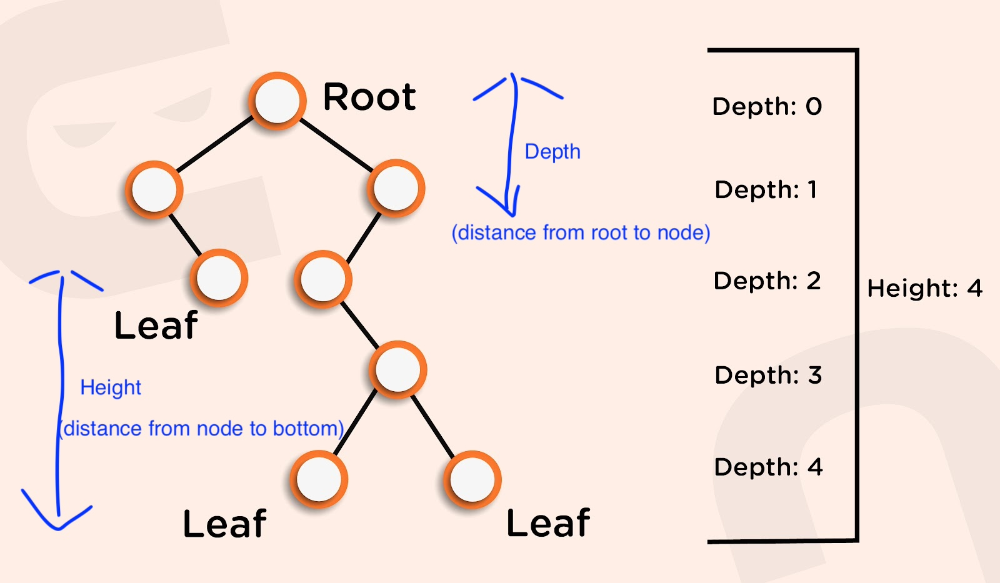
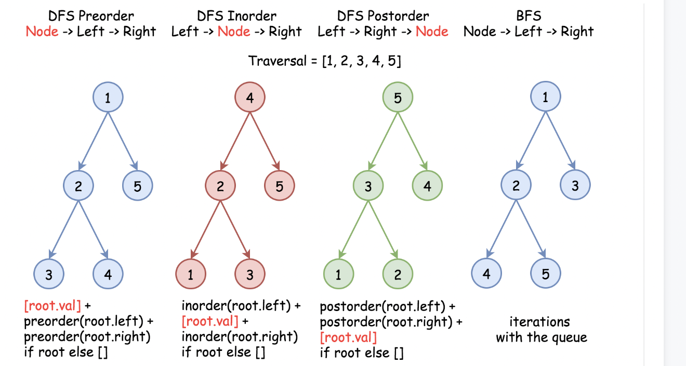

# Tree Data Structure - Concepts & Patterns

> **Scope** — Tree concepts, tree types and traversal-order *strategy* — the **why** and **which**, plus the advanced techniques that are not per-pattern templates (Morris threading, binary lifting, re-rooting). The templates themselves live in [tree2.md](./tree2.md).
> **See also** — *deep dives split out of this file*: [tree_lca_distance.md](./tree_lca_distance.md) — LCA, node distance, parent maps and root-to-leaf path templates; [tree_codec.md](./tree_codec.md) — subtree serialization and tree ⟷ string codecs; [tree_construction.md](./tree_construction.md) — building a tree from traversals, strings and index ranges; [tree_examples.md](./tree_examples.md) — the worked LC archive for the patterns taught here.
> *Neighbouring sheets*: [tree2.md](./tree2.md) — one numbered, copy-paste template per pattern; [binary_tree.md](./binary_tree.md) — binary-tree DFS state-flow and structural templates; [bst.md](./bst.md) — ordered trees; [tree_backtrack.md](./tree_backtrack.md) — root→leaf path problems that undo state on the way back up.

## LeetCode Problem Lists

- [Tree](https://leetcode.com/problem-list/tree/)
- [Binary Tree](https://leetcode.com/problem-list/binary-tree/)
- [Depth-First Search](https://leetcode.com/problem-list/depth-first-search/)

## Time Complexity

| Data structure | Search   | Insert   | Delete   | Min/Max  |
| -------------- | -------- | -------- | -------- | -------- |
| Tree (general) | O(n)     | O(n)     | O(n)     | O(n)     |

> General tree (no ordering guarantee) — every operation may visit all nodes. A *balanced* tree drops these to **O(log n)**. Space is **O(n)** for storage plus **O(h)** for the recursion stack. For an **ordered** tree with O(log n) operations see [bst.md](./bst.md).

## Overview

**Tree** is a hierarchical data structure consisting of nodes connected by edges, with one root node and no cycles. Trees are fundamental in computer science for organizing data efficiently.

### Key Properties
- **Nodes**: Elements that store data and references to children
- **Root**: The topmost node with no parent
- **Leaves**: Nodes with no children  
- **Height**: Distance from root to deepest leaf
- **Depth**: Distance from root to a specific node
- **Complexity**: see the [Time Complexity](#time-complexity) table above

### Tree Array Representation
Trees can be efficiently represented using arrays, especially for complete binary trees:

```text
# Tree Structure
      1
     / \
    2   3
   / \  
  4   5

# Array Representation: [1, 2, 3, 4, 5]
# Index mapping:
# - Root at index 0
# - For node at index i:
#   - Left child at index 2*i + 1  
#   - Right child at index 2*i + 2
#   - Parent at index (i-1)/2
```

### References
- [Neetcode Tree Types](https://www.linkedin.com/posts/neetcodeio_must-know-tree-structures-in-coding-interviews-activity-7301790861690892288-_0ni)
- [Array Representation Guide](https://www.prepbytes.com/blog/tree/array-representation-of-binary-tree/)
- [GeeksforGeeks Implementation](https://www.geeksforgeeks.org/binary-tree-array-implementation/)

## Recognition

Most tree problems route **out** of this sheet: it owns the traversal *choice* and three
techniques no per-pattern template covers. Constraint cues come from the
[constraint ruler](./complexity_cheatsheet.md).

| Signal in the statement | Constraint cue | Reach for | Not this if |
|---|---|---|---|
| "the answer for **every** node as the root", "sum of distances from each node" | n ≤ 3 · 10⁴ → O(n), not n DFS runs | [Template 3](#template-3-re-rooting-dp--lc-834) re-rooting DP | one best root ("minimum height trees", LC 310) → leaf trimming, [topology_sorting § Template 7](./topology_sorting.md#template-7-tree-centroid-finding-leaf-trimming-for-undirected-trees-) |
| "k-th ancestor", many LCA queries on a tree that never changes | n, q ≤ 5 · 10⁴ → O(log n) per query | [Template 2](#template-2-binary-lifting--lc-1483-) binary lifting | a single LCA query → one O(n) DFS, [tree_lca_distance.md](./tree_lca_distance.md) |
| "O(1) extra space", "without recursion or a stack", "flatten in place" | a follow-up, rarely the first ask | [Template 1](#template-1-morris-in-order-traversal--lc-94) Morris threading | the tree may not be modified even briefly (shared, read-only) → iterative stack, [tree2 1.2)](./tree2.md#12-inorder-template--lc-94-) |
| a path, a depth or a running max the parent must hand down | nodes ≤ 10⁵ → one O(n) pass | [0-3) top-down](#0-3-top-down-vs-bottom-up-dfs--two-strategies-for-tree-problems-) | the node needs both children's answers → bottom-up |
| "height", "balanced", "diameter" — needs both children first | nodes ≤ 10⁴ | [0-3) bottom-up](#0-3-top-down-vs-bottom-up-dfs--two-strategies-for-tree-problems-), then [binary_tree.md](./binary_tree.md) | the value comes from above (depth) → top-down |
| "level by level", "right side view", "minimum depth" | nodes ≤ 10⁴ | BFS, [tree2 1.4)](./tree2.md#14-bfs-template-level-order--lc-102-) | |
| "root-to-leaf path", "lowest common ancestor", "distance between nodes" | nodes ≤ 10⁵ | [tree_lca_distance.md](./tree_lca_distance.md) | the tree is a BST → walk by value, [bst.md](./bst.md) |
| "valid BST", "k-th smallest" | nodes ≤ 10⁴ | in-order, [bst.md](./bst.md) | an unordered tree → no sorted order to lean on |
| "serialize / deserialize", "duplicate subtrees" | nodes ≤ 10⁴ | [tree_codec.md](./tree_codec.md) | |

## 0) Core Concepts

### 0-1) Tree Types Classification

#### **Basic Tree Types**
| Type | Description | Key Properties | Use Cases |
|------|-------------|----------------|-----------|
| **General Tree** | Node with any number of children | Flexible structure | File systems, org charts |
| **[Binary Tree](https://github.com/yennanliu/CS_basics/blob/master/doc/cheatsheet/binary_tree.md)** | Each node has ≤ 2 children | Simple structure, recursive | Expression trees, decision trees |
| **Complete Binary Tree** | All levels filled except possibly last | Efficient array representation | Heaps, priority queues |
| **Perfect Binary Tree** | All levels completely filled | 2^h - 1 nodes | Theoretical analysis |
| **[BST](https://github.com/yennanliu/CS_basics/blob/master/doc/cheatsheet/bst.md)** | Left < Root < Right ordering | O(log n) search/insert/delete | Search operations, databases |
| **[Heap](https://github.com/yennanliu/CS_basics/blob/master/doc/cheatsheet/heap.md)** | Parent-child ordering property | Fast min/max extraction | Priority queues, sorting |
| **[Trie](https://github.com/yennanliu/CS_basics/blob/master/doc/cheatsheet/trie.md)** | Prefix tree for strings | Efficient string operations | Auto-complete, spell check |

### 0-2) Common Tree Patterns ⭐⭐⭐⭐

The nine recurring shapes. Each row names the **one** place the code for that pattern lives —
no pattern is written out twice in this family of sheets.

| # | Pattern | Core idea | Code lives in | Examples |
|---|---------|-----------|---------------|----------|
| 1 | **Path-Based** | carry the accumulated value (sum, max-so-far, path) DOWN through DFS parameters | [tree_lca_distance.md](./tree_lca_distance.md) — root-to-leaf path templates | LC 112, 113, 257, 437, 1448 |
| 2 | **Subtree Validation** | post-order — validate both children before deciding for the parent | [tree2 1.3)](./tree2.md#13-postorder-template--lc-145) | LC 98, 101, 110 |
| 3 | **Height vs Depth** | height is computed bottom-up (post-order); depth is carried top-down (pre-order) | [0-3) Top-Down vs Bottom-Up](#0-3-top-down-vs-bottom-up-dfs--two-strategies-for-tree-problems-) | LC 104, 111, 543 |
| 4 | **Tree Construction** | one traversal gives the structure, the other gives the position; or split an index range at the chosen root | [tree_construction.md](./tree_construction.md) | LC 105, 106, 654, 108 |
| 5 | **Serialization** | encode = DFS that **returns a string**; decode = recursive descent that **consumes a prefix** | [tree_codec.md](./tree_codec.md) | LC 297, 449, 606, 536 |
| 6 | **Move Parent** | build a parent map, treat the tree as an undirected graph, then BFS in all directions | [tree_lca_distance.md](./tree_lca_distance.md) — move-parent pattern | LC 863, 742, 1740 |
| 7 | **Node Path** | fingerprint each subtree as `val,left,right` with `#` for null, then hash the string | [tree_codec.md](./tree_codec.md) | LC 652, 572, 508 |
| 8 | **Node Deletion with State** | carry `isDeleted` for the node and `isParentDeleted` for its parent; a survivor whose parent died becomes a forest root | [tree_examples.md](./tree_examples.md) — LC 1110 | LC 1110, 1325, 669 |
| 9 | **Get Node Distance** | pre-order DFS carrying `depth` DOWN, returning it UP on a hit; `-1` is the not-found sentinel because `0` is a valid answer | [tree_lca_distance.md](./tree_lca_distance.md) — distance between nodes | LC 1740, 863, 1123 |

> Patterns 2 and 3 are the two halves of every tree recursion, so they are spelled out below; the
> other seven are one hop away in the sheet named in the table.
> **Reference** (pattern 2): [Subtree Validation Video](https://www.bilibili.com/video/BV1ue4y1Y7Mf/)

### 0-3) Top-Down vs Bottom-Up DFS — Two Strategies for Tree Problems ⭐⭐⭐⭐⭐

<p align="center"></p>

> Reference: [MaximumDepthOfBinaryTree.java](https://github.com/yennanliu/CS_basics/blob/master/leetcode_java/src/main/java/LeetCodeJava/Recursion/MaximumDepthOfBinaryTree.java)

**Core Distinction:**
- **Top-down**: Pass state **down** from parent to children via parameters. The answer accumulates during traversal (pre-order position).
- **Bottom-up**: Collect results **up** from children to parent via return values. The answer is built after subtrees are solved (post-order position).

```text
Top-Down (Pre-order)                Bottom-Up (Post-order)
─────────────────────               ──────────────────────
      1  ← start here                    1  ← combine here
     / \  pass depth=1                  / \  return heights
    2   3  depth=2                     2   3  left=1, right=1
   / \     depth=3                    / \     left=2, right=0
  4   5  → update global max        4   5  → return max+1
```

**Pattern 1: Top-Down (pass state down, pre-order)**

The parent passes accumulated state (depth, path, max-so-far) to children. Typically uses a **global variable** or **output parameter** to collect the final answer.

```java
// LC 104 — Top-Down: pass depth down, update global max
// 3 variants: (a) void helper + global var, (b) void helper + depth param, (c) return depth param

// Variant A: void helper + global var (simplest top-down)
int maxDepth = 0;

public int maxDepth_topDown(TreeNode root) {
    dfs(root, 1);       // start at depth 1
    return maxDepth;
}

private void dfs(TreeNode root, int depth) {
    if (root == null) return;

    // Pre-order position: update answer with current state
    maxDepth = Math.max(maxDepth, depth);

    // Pass depth+1 DOWN to children
    dfs(root.left, depth + 1);
    dfs(root.right, depth + 1);
}
```

**Pattern 2: Bottom-Up (collect results up, post-order)**

Each node asks its children for their results, then combines them. The return value carries the answer upward. **No global variable needed.**

```java
// LC 104 — Bottom-Up: children return their depth, parent adds 1
public int maxDepth_bottomUp(TreeNode root) {
    if (root == null) return 0;

    // Post-order: solve children FIRST
    int leftDepth  = maxDepth_bottomUp(root.left);
    int rightDepth = maxDepth_bottomUp(root.right);

    // Combine: take max of children, add 1 for current node
    return 1 + Math.max(leftDepth, rightDepth);
}
```

**Comparison:**

| Aspect | Top-Down | Bottom-Up |
|--------|----------|-----------|
| Direction | Root → Leaves (pre-order) | Leaves → Root (post-order) |
| State passing | Via **parameters** (depth, path, max) | Via **return values** |
| Global variable | Often needed | Usually not needed |
| Return type of helper | Often `void` | Returns computed value |
| Mental model | "What do I know so far?" | "What did my children find?" |
| Code simplicity | More verbose (extra params) | More concise |

**When to Use Which:**

```text
Use TOP-DOWN when:
  → You need to pass parent/ancestor info to children
  → Path tracking: carry path, sum, or max-so-far downward
  → Early termination: can stop when condition met at a node
  → Examples: LC 112 (Path Sum), LC 129 (Sum Root to Leaf),
              LC 1448 (Count Good Nodes), LC 257 (Binary Tree Paths)

Use BOTTOM-UP when:
  → Answer depends on BOTH children's results
  → Need to compute subtree properties (height, size, balance)
  → Validation: check property holds for entire subtree
  → Examples: LC 104 (Max Depth), LC 110 (Balanced Tree),
              LC 543 (Diameter), LC 124 (Max Path Sum),
              LC 236 (LCA), LC 652 (Find Duplicate Subtrees),
              LC 968 (Binary Tree Cameras)
```

**LC Problems by Strategy:**

| LC # | Problem | Top-Down | Bottom-Up | Notes |
|------|---------|:--------:|:---------:|-------|
| 104 | Maximum Depth | Yes | Yes | Both work; bottom-up is simpler |
| 111 | Minimum Depth | Yes | Yes | Bottom-up needs null-child guard |
| 110 | Balanced Binary Tree | - | Yes | Must check subtree heights first |
| 112 | Path Sum | Yes | - | Carry remaining sum downward |
| 113 | Path Sum II | Yes | - | Top-down + backtracking |
| 124 | Max Path Sum | - | Yes | Combine left+right at each node |
| 129 | Sum Root to Leaf Numbers | Yes | - | Carry running number downward |
| 236 | Lowest Common Ancestor | - | Yes | Find targets in subtrees first |
| 257 | Binary Tree Paths | Yes | - | Carry path string downward |
| 543 | Diameter of Binary Tree | - | Yes | Track max(left+right) globally |
| 968 | Binary Tree Cameras | - | Yes | Greedy 3-state: 0=uncovered, 1=camera, 2=covered |
| 1448 | Count Good Nodes | Yes | - | Carry max-so-far downward |

**Hybrid Pattern: Bottom-Up + Global Variable**

Some problems use bottom-up return values to compute subtree info, but also maintain a global variable to track a cross-subtree answer (e.g., diameter, max path sum).

```java
// LC 543 — Diameter: bottom-up height + global max update
int diameter = 0;

public int diameterOfBinaryTree(TreeNode root) {
    height(root);
    return diameter;
}

private int height(TreeNode root) {
    if (root == null) return 0;

    int left  = height(root.left);   // bottom-up: get children's height
    int right = height(root.right);

    // Global update: diameter passes THROUGH this node
    diameter = Math.max(diameter, left + right);

    // Return value: height of subtree (for parent to use)
    return 1 + Math.max(left, right);
}
```

**Interview Tip:**
> LC 104 (Max Depth) is the best problem to practice both strategies. Start with bottom-up (3 lines), then rewrite as top-down (global var + void helper). Understanding both unlocks the full tree problem toolkit.

### 0-4) Traversal Order Selection Strategy ⭐⭐⭐⭐⭐

```text
When to use which traversal:

1. No specific root processing needed?
   → Any order works (preorder/inorder/postorder)

2. Need parent data for children?
   → Use PREORDER (root → left → right)

3. Need children data for parent?
   → Use POSTORDER (left → right → root)

4. Processing sorted data (BST)?
   → Use INORDER (left → root → right)

5. Level-by-level processing?
   → Use BFS/Level-order traversal

6. Need to move upward (to parent) or explore all directions?
   → Use MOVE PARENT pattern (Build parent map + BFS)

7. Need to compare or identify subtrees?
   → Use NODE PATH pattern (Subtree serialization with post-order)
```

#### Pre-order vs Post-order for Leaf Collection (LC 872)

> Reference: [LeafSimilarTrees.java](https://github.com/yennanliu/CS_basics/blob/master/leetcode_java/src/main/java/LeetCodeJava/Stack/LeafSimilarTrees.java)

When collecting leaf nodes (e.g., LC 872 Leaf-Similar Trees), **any DFS order that visits left before right** produces the same left-to-right leaf sequence. However, there are practical differences:

**Pre-order (recommended for leaf collection):**
```java
private void getLeafSeq(TreeNode root, List<Integer> list) {
    if (root == null) return;

    // Check leaf BEFORE recursing into children
    if (root.left == null && root.right == null) {
        list.add(root.val);
        return;  // ← Early exit: skip 2 unnecessary null-child calls
    }

    getLeafSeq(root.left, list);
    getLeafSeq(root.right, list);
}
```

**Post-order (also correct, but slightly wasteful):**
```java
private void getLeafSeq(TreeNode root, List<Integer> list) {
    if (root == null) return;

    getLeafSeq(root.left, list);   // ← calls null, returns immediately
    getLeafSeq(root.right, list);  // ← calls null, returns immediately

    // Check leaf AFTER recursing (children were both null)
    if (root.left == null && root.right == null) {
        list.add(root.val);
    }
}
```

**Why both produce the same result:** The leaf sequence depends only on left-before-right visitation order, NOT on when the leaf check happens. Since a leaf has no children, post-order's recursive calls to `null` return immediately before the leaf check — the leaf is still added in the same left-to-right order.

**Why pre-order is preferred:**

| Aspect | Pre-order | Post-order |
|--------|-----------|------------|
| Leaf sequence | Left → Right | Left → Right (same) |
| Early exit at leaf | Yes (`return` after adding) | No (already recursed into null children) |
| Unnecessary null calls per leaf | 0 | 2 |
| Best for | Leaf collection, path building | Height, subtree properties |

**Interview answer:**
> "I chose pre-order because it allows an immediate return once a leaf is identified, avoiding two redundant recursive calls to null children. Any DFS that visits left before right produces the same leaf sequence."

**Related problems where traversal order matters for leaf/path collection:**

| LC # | Problem | Recommended Order | Why |
|------|---------|-------------------|-----|
| 872 | Leaf-Similar Trees | Pre-order | Early exit at leaf |
| 257 | Binary Tree Paths | Pre-order | Build path top-down |
| 112 | Path Sum | Pre-order | Carry remaining sum down |
| 104 | Maximum Depth | Post-order | Need children's height first |
| 110 | Balanced Binary Tree | Post-order | Validate subtree heights |

### 0-5) Traversal Quick-Reference Table (Interview Cheat Sheet) ⭐⭐⭐⭐

> Inspired by LC 113 Path Sum II — key insight: the traversal choice determines the algorithm structure.

| Traversal  | Order              | Core Use Case                              | When to Choose                                                      |
|------------|--------------------|--------------------------------------------|---------------------------------------------------------------------|
| Pre-order  | root → left → right | Build path **top-down**                  | root-to-leaf paths, carry parent info to children, DFS + backtrack  |
| Post-order | left → right → root | Compute subtree results **bottom-up**    | height/depth, subtree sum, max path, DP on trees                    |
| In-order   | left → root → right | Process nodes in **sorted order**        | BST validation, kth smallest, sorted traversal                      |
| BFS        | level by level      | Level-by-level processing                | min depth, zigzag, right side view, connect next pointer            |

#### Interview Quick-Check Tips

**Step 1 — What does the problem ask for?**

| Problem asks for...                                    | Use                                                    |
|--------------------------------------------------------|--------------------------------------------------------|
| All root-to-leaf paths / path with sum                 | Pre-order DFS + backtracking                           |
| Count paths (any start/end) with target sum            | Pre-order DFS + prefix sum HashMap                     |
| Tree height / max depth                                | Post-order DFS                                         |
| Subtree property (sum, size, max)                      | Post-order DFS                                         |
| Identify / compare subtrees by structure               | Post-order DFS + serialize `val,left,right` + HashMap  |
| Find duplicate subtrees                                | Post-order DFS + subtree serialization + HashMap count |
| BST sorted order / kth smallest                        | In-order DFS                                           |
| Validate BST                                           | In-order DFS                                           |
| Level-by-level / min depth                             | BFS                                                    |
| Connect same-level nodes                               | BFS                                                    |


**Interview Trick (from LC 113):**
> If the problem asks for **"root → leaf path"**, it is **almost always pre-order DFS + backtracking**.

**Interview Trick (from LC 437):**
> If the path **does NOT need to start/end at root/leaf** and asks for count,
> use **Pre-order DFS + Prefix Sum HashMap** (the "2-sum on tree" pattern).
> The full template — why the map must be **undone** on the way back up, the two
> spellings of the base case, and the `long` overflow trap in Java — is
> [Template 14 in prefix_sum_advanced.md](./prefix_sum_advanced.md#template-14-prefix-sum-on-a-tree-dfs--hashmap--backtrack---lc-437).

#### Classic LC Problems by Traversal Type

**Pre-order DFS + Backtracking (root → leaf path)**

| LC #  | Problem                        | Key Idea                                      |
|-------|--------------------------------|-----------------------------------------------|
| 112   | Path Sum                       | Pre-order DFS, check leaf with remaining sum  |
| 113   | Path Sum II                    | Pre-order DFS + backtrack, collect all paths  |
| 257   | Binary Tree Paths              | Pre-order DFS + backtrack, build string paths |
| 437   | Path Sum III                   | Pre-order DFS + prefix sum HashMap, 2-sum trick: check (curSum-target) in map — [template](./prefix_sum_advanced.md#template-14-prefix-sum-on-a-tree-dfs--hashmap--backtrack---lc-437) |
| 129   | Sum Root to Leaf Numbers       | Pre-order DFS, carry running number           |
| 404   | Sum of Left Leaves             | Pre-order DFS, carry an `isLeft` flag down; add value only at a leaf reached as a left child |

**Post-order DFS (bottom-up subtree computation)**

| LC #  | Problem                              | Key Idea                                                     |
|-------|--------------------------------------|--------------------------------------------------------------|
| 104   | Maximum Depth of Binary Tree         | Post-order, return max(left, right) + 1                      |
| 543   | Diameter of Binary Tree              | Post-order, track max left+right at each node                |
| 124   | Binary Tree Maximum Path Sum         | Post-order, track global max through root                    |
| 110   | Balanced Binary Tree                 | Post-order, return height or -1 if unbalanced                |
| 572   | Subtree of Another Tree              | Post-order serialization or recursive match                  |
| 236   | Lowest Common Ancestor               | Post-order, return node when both targets found              |
| 652   | Find Duplicate Subtrees              | Post-order + serialize subtree → `val,left,right` + HashMap |
| 968   | Binary Tree Cameras                  | Post-order greedy, 3 states: uncovered/camera/covered        |
| 563   | Binary Tree Tilt                     | Post-order, return subtree SUM upward while accumulating `abs(leftSum - rightSum)` into a global — classic "return one thing, collect another" |

**In-order DFS (BST / sorted order)**

| LC #  | Problem                              | Key Idea                                         |
|-------|--------------------------------------|--------------------------------------------------|
| 98    | Validate Binary Search Tree          | In-order, check ascending order                  |
| 230   | Kth Smallest Element in BST          | In-order traversal, count to k                   |
| 501   | Find Mode in BST                     | In-order, track current/prev with count          |
| 538   | Convert BST to Greater Tree          | Reverse in-order (right → root → left)           |
| 700   | Search in a Binary Search Tree       | In-order search leveraging BST property          |

**BFS / Level-order**

| LC #  | Problem                              | Key Idea                                         |
|-------|--------------------------------------|--------------------------------------------------|
| 102   | Binary Tree Level Order Traversal    | BFS with queue, collect each level               |
| 111   | Minimum Depth of Binary Tree         | BFS, return level when first leaf found          |
| 116   | Populating Next Right Pointers       | BFS level-order, connect siblings                |
| 199   | Binary Tree Right Side View          | BFS, take last node of each level                |
| 103   | Zigzag Level Order Traversal         | BFS + alternate direction per level              |
| 117   | Populating Next Right Pointers II    | Level linking on a NON-perfect tree — dummy-head sweep, O(1) space (see Template 4-1) |
| 637   | Average of Levels in Binary Tree     | BFS, sum each level then divide by `levelSize`   |
| 987   | Vertical Order Traversal             | Tag `(col, row, val)`, sort col → row → val (see Template 4-2) |

## 1) Tree Templates & Algorithms

### 1.2) Template Selection Guide ⭐⭐⭐⭐

| Pattern | Template | When to Use | Example Problems |
|---------|----------|-------------|------------------|
| **DFS Recursive** | Standard recursion | Most tree problems | LC 104, 110, 226 |
| **DFS Iterative** | Stack-based | Avoid recursion depth limits | LC 94, 144, 145 |
| **BFS Level-order** | Queue-based | Level processing needed | LC 102, 199, 515 |
| **Divide & Conquer** | Bottom-up recursion | Need subtree results | LC 124, 543, 687 |
| **Path Tracking** | DFS with path state | Path-related problems | LC 112, 257, 437 |
| **Move Parent** | Parent map + BFS | Bidirectional exploration | LC 863, 742, 1740 |
| **Node Path** | Subtree serialization | Subtree comparison/detection | LC 652, 572 |

### 1.3) Core Operations

#### 1.3.1) Tree Traversal Strategies

**Two Main Approaches:**

1. **Depth-First Search (DFS)** - Go deep before going wide
   - **Preorder**: Root → Left → Right (top-down processing)
   - **Inorder**: Left → Root → Right (sorted order for BST)  
   - **Postorder**: Left → Right → Root (bottom-up processing)

2. **Breadth-First Search (BFS)** - Process level by level
   - **Level-order**: Process all nodes at depth d before depth d+1

<p align="center"></p>

### 1.4) Choosing a Traversal

The four basic traversals are **written out** in
[tree2.md](./tree2.md) — that sheet is the numbered template catalogue, in Python and Java,
one per pattern. What belongs here is the question that comes first: which one.

| The answer depends on… | Traversal | Because | Template |
|---|---|---|---|
| the **parent**, before the children are known | **Pre-order** — root → left → right | state flows *down*: a path, a depth, a running prefix | [tree2 1.1) — LC 144](./tree2.md#11-preorder-template--lc-144) |
| the tree being a **BST**, and you want sorted order | **In-order** — left → root → right | in-order on a BST *is* the sorted sequence, which is why LC 98 and LC 230 are one line each | [tree2 1.2) — LC 94](./tree2.md#12-inorder-template--lc-94-) |
| **both children**, before the node can answer | **Post-order** — left → right → root | state flows *up*: a height, a sum, a "is this subtree valid" verdict | [tree2 1.3) — LC 145](./tree2.md#13-postorder-template--lc-145) |
| **distance from the root**, or a per-level answer | **Level-order (BFS)** | the first time you meet a node is via a shortest path, and a level is a queue-length snapshot | [tree2 1.4) — LC 102](./tree2.md#14-bfs-template-level-order--lc-102-) |
| the level, but **alternating direction** | **BFS + direction flag** | reverse the row, do not reverse the traversal | [tree2 1.5) — LC 103](./tree2.md#15-bfs--direction-template--lc-103) |

**The one-line test**: ask *"can this node answer without hearing from its children?"* Yes →
pre-order. No → post-order. "I need the whole row at once" → BFS.

<p align="center"></p>

### 1.4-1) Traversals that do not need the queue

Two techniques get an ordinary traversal's answer without its space cost. They are not
per-pattern templates, so they stay here rather than in the catalogue:

- **O(1)-space level linking** — when the node already has a `next` pointer, the level itself
  can act as the queue. Written out at
  [tree2 8.1) — LC 116 / LC 117](./tree2.md#81-o1-space-level-linking-template--lc-117-).
- **Coordinate-annotated traversal** — carry `(row, col)` through any traversal and sort at the
  end; the traversal order stops mattering, which is what makes DFS and BFS interchangeable for
  vertical order, top/bottom view, and LC 662-style width indexing.
  [tree2 8.3) — LC 987](./tree2.md#83-coordinate-map-traversal-template--lc-987).
- **Morris traversal** — below.


#### Template 1: Morris In-order Traversal — LC 94

**Recognise** — an in-order (or pre-order) traversal with the follow-up "can you do it in
**O(1) extra space**?" or "without recursion **and** without a stack". The time bound stays
O(n); only the O(h) stack goes. Nodes ≤ 10⁴, so this is about the follow-up, not about speed.

**Key point** — a node with a left child is visited **twice**. The first time, the rightmost
node of its left subtree (its in-order predecessor) has `right == None`, so point it back at
the node and go left. The second time, that thread is how you got back, so cut it and emit
the node. Every thread made is unmade, so the tree ends exactly as it started.

```python
# python
# LC 94 - Binary Tree Inorder Traversal
# IDEA: thread each node's in-order predecessor back to it; follow the thread up instead of popping a stack
# time = O(n), space = O(1)   output list not counted
def inorderTraversal(root):
    result = []
    curr = root
    while curr:
        if curr.left is None:
            result.append(curr.val)          # nothing on the left: emit, go right
            curr = curr.right
            continue
        pred = curr.left                     # find the in-order predecessor
        while pred.right is not None and pred.right is not curr:
            pred = pred.right
        if pred.right is None:               # first visit: make the thread, go left
            pred.right = curr
            curr = curr.left
        else:                                # second visit: we came back up the thread
            pred.right = None                # restore the tree
            result.append(curr.val)
            curr = curr.right
    return result
```

```java
// java
// LC 94 - Binary Tree Inorder Traversal
// IDEA: thread each node's in-order predecessor back to it; follow the thread up instead of popping a stack
// time = O(n), space = O(1)   output list not counted
public List<Integer> inorderTraversal(TreeNode root) {
    List<Integer> result = new ArrayList<>();
    TreeNode curr = root;
    while (curr != null) {
        if (curr.left == null) {
            result.add(curr.val);            // nothing on the left: emit, go right
            curr = curr.right;
            continue;
        }
        TreeNode pred = curr.left;           // find the in-order predecessor
        while (pred.right != null && pred.right != curr) {
            pred = pred.right;
        }
        if (pred.right == null) {            // first visit: make the thread, go left
            pred.right = curr;
            curr = curr.left;
        } else {                             // second visit: we came back up the thread
            pred.right = null;               // restore the tree
            result.add(curr.val);
            curr = curr.right;
        }
    }
    return result;
}
```

**Complexity**
- **Time O(n)**: the inner `while pred.right ...` looks nested, but it walks each left
  subtree's right spine exactly twice (once to thread, once to unthread), and the spines of
  different nodes do not share edges, so all the walks together cover each edge at most twice.
- **Space O(1)**: `curr` and `pred` are the only state. The threads live in `right` pointers
  that were `None` anyway, which is why there is no stack.

| Traversal Method | Time | Space | Modifies Tree |
|-----------------|------|-------|---------------|
| Recursive | O(n) | O(h) | No |
| Iterative Stack | O(n) | O(h) | No |
| **Morris** | O(n) | **O(1)** | Temporarily (restored) |

**Dry run**

```text
tree   2          curr  pred   action                       out
      / \         2     1      1.right = 2, go left         []
     1   3        1     -      no left: emit, go right (2)  [1]
                  2     1      1.right is 2: cut, emit       [1, 2]
                  3     -      no left: emit, go right       [1, 2, 3]
```

**Traps**
- `while pred.right:` without `is not curr` follows the thread back into `curr` and loops for
  ever on any node with a left child: `[2, 1, 3]` hangs.
- Emitting on the **first** visit gives pre-order, not in-order: `[2, 1, 3]` returns
  `[2, 1, 3]` instead of `[1, 2, 3]`. That is the whole pre-order variant (LC 144), so say
  which one you are writing.
- Returning early (say, at the k-th smallest) leaves threads in place. LC 230 with k = 1 on
  `[2, 1, 3]` leaves `1.right == 2`, a cycle the caller can loop on. Finish the walk, or
  unthread before returning.
- Post-order needs the right spines reversed. It is rarely asked; use the iterative stack.

**Not this if** — the tree is shared or read-only while you walk it (another thread reads it,
or the interviewer says "do not modify the input"). Morris writes to the tree, even if only
briefly. Use the iterative stack, [tree2 1.2)](./tree2.md#12-inorder-template--lc-94-).

**Drill** — LC 94 · LC 144 *(emit on the first visit)* · LC 114 *(rewire, below)* ·
LC 99 *(recover a BST in O(1) space: the two out-of-order nodes show up in the Morris order)*

##### Morris **threading family** — temporary thread vs. permanent rewire

Both the Morris traversal in Template 1 and the O(1) **flatten** (LC 114) share the **same core step**: from the current node, find the **rightmost node of its left subtree** (the in-order predecessor) and use its empty `right` pointer to "thread" somewhere. They differ only in what they do with that thread:

| Variant | Thread points to | Restored? | Purpose | Example |
|---------|------------------|-----------|---------|---------|
| **Morris traversal** | in-order successor (`curr`) | ✅ yes (unthread on 2nd visit) | Visit nodes O(1) space | LC 94, 144 |
| **Morris rewire (flatten)** | original right subtree (`curr.right`) | ❌ no (permanent) | Restructure tree in-place | LC 114 |

```python
# python
# LC 114 - Flatten Binary Tree to Linked List
# IDEA: Morris REWIRE - splice the right subtree onto the left subtree's rightmost node, permanently
# time = O(n), space = O(1)
def flatten(root):
    curr = root
    while curr:
        if curr.left:
            # find left subtree's rightmost node (in-order predecessor)
            rightmost = curr.left
            while rightmost.right:
                rightmost = rightmost.right
            # splice: predecessor.right -> original right subtree (PERMANENT, not restored)
            rightmost.right = curr.right
            curr.right = curr.left   # move left subtree to the right
            curr.left = None         # clear left
        curr = curr.right            # advance down the new right spine
```

**Mental model:** for each node with a left child, the left subtree is "inserted" between the node and its original right subtree, because the left subtree's pre-order traversal must come immediately after the node and before the right subtree. The rightmost node of the left subtree is exactly where the right subtree should re-attach.

```text
   curr                 curr
   /  \                    \
  L    R     ───►          L            (curr.right = curr.left)
   \                        \
    ...                     ...
      \                       \
     L_rightmost            L_rightmost
                              \
                               R         (L_rightmost.right = R)
```

> The recursive counterpart — post-order where each call **returns the tail** of the subtree it flattened, so the parent knows where to splice — is worked through in [tree_examples 16)](./tree_examples.md#16-flatten-binary-tree-to-linked-list--lc-114), including why the tail is checked right → left → node.

> **When to reach for this:** any "in-place, O(1) space, restructure a tree along its right spine" problem. The `while rightmost.right` predecessor-finding step is the signature. Recognize it as the **same machinery** as Morris traversal — only the thread's destination and whether you restore it change.

---


### 1.5) Tree Node Initialization

```python
# Python TreeNode Class
class TreeNode:
    def __init__(self, val=0, left=None, right=None):
        self.val = val
        self.left = left
        self.right = right

# Create a simple tree
root = TreeNode(1)
root.left = TreeNode(2)
root.right = TreeNode(3)
root.left.left = TreeNode(4)
root.left.right = TreeNode(5)
```

```java
// Java TreeNode Class
public class TreeNode {
    int val;
    TreeNode left;
    TreeNode right;
    
    TreeNode() {}
    TreeNode(int val) { this.val = val; }
    TreeNode(int val, TreeNode left, TreeNode right) {
        this.val = val;
        this.left = left;
        this.right = right;
    }
}
```

## 2) Problems by Pattern Classification

### 2.1) Problem Categories & Templates ⭐⭐⭐⭐

#### **Tree Traversal Problems**
| Problem | LC # | Pattern | Template | Difficulty |
|---------|------|---------|----------|------------|
| Binary Tree Preorder Traversal | 144 | DFS Preorder | Preorder Template | Easy |
| Binary Tree Inorder Traversal | 94 | DFS Inorder | Inorder Template | Easy |
| Binary Tree Postorder Traversal | 145 | DFS Postorder | Postorder Template | Easy |
| Binary Tree Level Order Traversal | 102 | BFS Level-order | BFS Template | Medium |
| Binary Tree Zigzag Level Order | 103 | BFS with alternating | BFS + Direction | Medium |

#### **Tree Property Problems**
| Problem | LC # | Pattern | Template | Difficulty |
|---------|------|---------|----------|------------|
| Maximum Depth of Binary Tree | 104 | DFS Bottom-up | Postorder Height | Easy |
| Minimum Depth of Binary Tree | 111 | BFS/DFS | BFS Early Stop | Easy |
| Balanced Binary Tree | 110 | DFS Height Check | Height Validation | Easy |
| Symmetric Tree | 101 | DFS Comparison | Mirror Validation | Easy |
| Same Tree | 100 | DFS Comparison | Tree Comparison | Easy |

#### **Path-Based Problems**
| Problem | LC # | Pattern | Template | Difficulty |
|---------|------|---------|----------|------------|
| Binary Tree Maximum Path Sum | 124 | DFS Path Tracking | Global Max Update | Hard |
| Path Sum | 112 | DFS Path Validation | Path Accumulation | Easy |
| Path Sum II | 113 | DFS Path Collection | Path + Backtrack | Medium |
| Path Sum III | 437 | DFS Prefix Sum | Path Count Tracking | Medium |
| Sum Root to Leaf Numbers | 129 | DFS Path Calculation | Path Value Building | Medium |
| Count Good Nodes in Binary Tree | 1448 | DFS Path Max | Path State Tracking | Medium |
| Diameter of Binary Tree | 543 | DFS Path Length | Longest Path | Easy |
| Longest Univalue Path | 687 | DFS Path Pattern | Same Value Path | Medium |

#### **Distance and LCA Problems**
| Problem | LC # | Pattern | Template | Difficulty |
|---------|------|---------|----------|------------|
| Lowest Common Ancestor | 236 | DFS Post-order | LCA Standard | Medium |
| LCA of BST | 235 | BST Property | Value Comparison | Easy |
| Distance in Binary Tree | 1740 | LCA + Distance | Path Distance | Medium |
| All Nodes Distance K | 863 | Graph + BFS | Tree to Graph | Medium |
| Smallest Subtree w/ Deepest Nodes | 865/1123 | LCA + Depth Comparison | Result(node, dist) DFS | Medium |

#### **Height and Depth Problems**
| Problem | LC # | Pattern | Template | Difficulty |
|---------|------|---------|----------|------------|
| Maximum Depth | 104 | DFS Bottom-up | Height Calculation | Easy |
| Minimum Depth | 111 | BFS/DFS | Depth to Leaf | Easy |
| Balanced Binary Tree | 110 | DFS Height Validation | Balance Check | Easy |
| Find Bottom Left Tree Value | 513 | BFS Level-order | Leftmost at Depth | Medium |

#### **Tree Construction Problems**
| Problem | LC # | Pattern | Template | Difficulty |
|---------|------|---------|----------|------------|
| Construct Binary Tree from Preorder and Inorder | 105 | Divide & Conquer | Tree Building | Medium |
| Construct Binary Tree from Inorder and Postorder | 106 | Divide & Conquer | Tree Building | Medium |
| Serialize and Deserialize Binary Tree | 297 | Tree Encoding | String Conversion | Hard |
| Construct String from Binary Tree | 606 | DFS String Building | String Construction | Easy |

#### **Tree Modification Problems**
| Problem | LC # | Pattern | Template | Difficulty |
|---------|------|---------|----------|------------|
| Invert Binary Tree | 226 | DFS Node Swapping | Tree Inversion | Easy |
| Flatten Binary Tree to Linked List | 114 | DFS Restructuring | Tree Flattening | Medium |
| Merge Two Binary Trees | 617 | DFS Combination | Tree Merging | Easy |
| Delete Nodes And Return Forest | 1110 | DFS + State Tracking | Tree Deletion + Forest Formation | Medium |

#### **Subtree Comparison Problems (Node Path Pattern)**
| Problem | LC # | Pattern | Template | Difficulty |
|---------|------|---------|----------|------------|
| Find Duplicate Subtrees | 652 | Node Path Serialization | Subtree Hashing | Medium |
| Subtree of Another Tree | 572 | Node Path Comparison | Subtree Matching | Easy |
| Count Univalue Subtrees | 250 | Node Path Validation | Subtree Property Check | Medium |

### 2.2) Pattern Selection Guide

```text
Problem Analysis Decision Tree:

1. Need to process all nodes?
   ├── Yes: Choose appropriate traversal (preorder/inorder/postorder/level-order)
   └── No: Continue

2. Need information from children for parent?
   ├── Yes: Use POSTORDER traversal
   └── No: Continue

3. Need information from parent for children?
   ├── Yes: Use PREORDER traversal
   └── No: Continue

4. Processing level by level?
   ├── Yes: Use BFS/Level-order traversal
   └── No: Continue

5. Need to move upward (to parent) or explore multi-directionally?
   ├── Yes: Use MOVE PARENT pattern (Build parent map + BFS)
   └── No: Continue

6. Need to compare or find duplicate subtrees?
   ├── Yes: Use NODE PATH pattern (Subtree serialization)
   └── No: Continue

7. Working with BST and need sorted order?
   ├── Yes: Use INORDER traversal
   └── No: Use any suitable approach
```

## Advanced Tree Techniques — Binary Lifting and Re-rooting

Two techniques that answer *many* questions about one fixed tree faster than one DFS per
question. Both are rarely the first thing an L3 interviewer asks; both are the standard answer
when the follow-up is "now do it for every node" or "now answer 10⁵ queries".

### Template 2: Binary Lifting — LC 1483 ⭐⭐⭐

**Recognise** — "the **k-th ancestor** of a node", or LCA / path questions asked **many times**
on a tree that does not change. n, q ≤ 5 · 10⁴, so O(n) per query (walking up one parent at a
time) is 2.5 · 10⁹ steps; O(log n) per query is what fits.

**Key point** — `up[j][v]` is the 2^j-th ancestor of `v`, and `up[j][v] = up[j-1][up[j-1][v]]`
because 2^j = 2^(j-1) + 2^(j-1). Any k is a sum of distinct powers of two, so jumping once
per set bit of k lands exactly k levels up.

```python
# python
# LC 1483 - Kth Ancestor of a Tree Node
# IDEA: up[j][v] = the 2^j-th ancestor of v; any k is a sum of powers of two, so jump once per set bit
# time = O(n log n) build, O(log n) per query; space = O(n log n)
from collections import deque

class TreeAncestor:
    def __init__(self, n, parent):
        self.LOG = max(1, n.bit_length())
        self.up = [parent[:]]                    # up[0][v] = direct parent, -1 above the root
        for j in range(1, self.LOG):
            prev = self.up[j - 1]
            row = [-1] * n
            for v in range(n):
                mid = prev[v]
                if mid != -1:
                    row[v] = prev[mid]           # 2^j = 2^(j-1) + 2^(j-1)
            self.up.append(row)
        # depth of every node, for lca(); parent[i] is not guaranteed < i, so BFS from the root
        children = [[] for _ in range(n)]
        root = 0
        for v, p in enumerate(parent):
            if p == -1:
                root = v
            else:
                children[p].append(v)
        self.depth = [0] * n
        queue = deque([root])
        while queue:
            u = queue.popleft()
            for c in children[u]:
                self.depth[c] = self.depth[u] + 1
                queue.append(c)

    def getKthAncestor(self, node, k):
        j = 0
        while k and node != -1:
            if k & 1:
                node = self.up[j][node] if j < self.LOG else -1
            k >>= 1
            j += 1
        return node

    def lca(self, u, v):
        if self.depth[u] < self.depth[v]:
            u, v = v, u
        u = self.getKthAncestor(u, self.depth[u] - self.depth[v])   # same depth first
        if u == v:
            return u
        for j in range(self.LOG - 1, -1, -1):    # largest jumps first, never onto a common node
            if self.up[j][u] != self.up[j][v]:
                u = self.up[j][u]
                v = self.up[j][v]
        return self.up[0][u]
```

```java
// java
// LC 1483 - Kth Ancestor of a Tree Node
// IDEA: up[j][v] = the 2^j-th ancestor of v; any k is a sum of powers of two, so jump once per set bit
// time = O(n log n) build, O(log n) per query; space = O(n log n)
class TreeAncestor {
    private final int LOG;
    private final int[][] up;

    public TreeAncestor(int n, int[] parent) {
        LOG = Math.max(1, 32 - Integer.numberOfLeadingZeros(n));   // bit length of n
        up = new int[LOG][n];
        up[0] = parent.clone();                  // up[0][v] = direct parent, -1 above the root
        for (int j = 1; j < LOG; j++) {
            for (int v = 0; v < n; v++) {
                int mid = up[j - 1][v];
                up[j][v] = (mid == -1) ? -1 : up[j - 1][mid];   // 2^j = 2^(j-1) + 2^(j-1)
            }
        }
    }

    public int getKthAncestor(int node, int k) {
        for (int j = 0; k > 0 && node != -1; j++, k >>= 1) {
            if ((k & 1) == 1) {
                node = (j < LOG) ? up[j][node] : -1;
            }
        }
        return node;
    }
}
```

**Complexity**
- **Time O(n log n) to build, O(log n) per query**: the double loop `for j … for v …` fills
  `LOG × n` cells, one O(1) lookup each. A query jumps once per bit of `k`, at most `LOG` times;
  `lca` does one such jump to equalise depths and one top-down sweep over `j`.
- **Space O(n log n)**: the `up` table itself, `LOG` rows of `n`.

**Dry run**

```text
parent = [-1, 0, 0, 1, 1, 2, 2]          getKthAncestor(6, 3):  k = 3 = 0b11
        0                                 bit 0 set: node = up[0][6] = 2
       / \                                bit 1 set: node = up[1][2] = -1  (2's grandparent)
      1   2          up[1] = [-1,-1,-1,0,0,0,0]
     / \ / \                              -> -1: node 6 has only 2 ancestors
    3  4 5  6
```

**Traps**
- Sizing the table by `log2(n)` rounded down misses the top bit: with `n = 5`, `k = 4` on the
  chain `[-1, 0, 1, 2, 3]` needs `up[2]`, which `int(log2(5)) = 2` rows do not have. Use the bit
  length of `n`.
- Not stopping at `-1`: indexing `up[j][-1]` in Python silently reads the **last** node's
  ancestor and returns a wrong node instead of `-1`. Guard every jump.
- In `lca`, sweeping `j` upward (small jumps first) can overshoot the meeting point and is
  wrong; sweep from the largest jump down, and only jump when the two ancestors **differ**.
- `parent[i] < i` is not promised, so depth cannot be filled in index order; BFS from the root.

**Not this if** — there is only one query. A single O(n) DFS answers one LCA
([tree_lca_distance.md](./tree_lca_distance.md)) and building the table costs more than it saves.

**Drill** — LC 1483 · LC 236 *(the same LCA, asked q times)* · LC 2836 *(jump k steps along a
functional graph)* · LC 2846 *(per-query path counts: lift a count table with the ancestors)*

### Template 3: Re-rooting DP — LC 834

**Recognise** — "return an array where `answer[i]` is … **when the tree is rooted at i**" or "the
sum of distances from **each** node to all others". n ≤ 3 · 10⁴, so one DFS per root (O(n²),
9 · 10⁸) is too slow; two passes in total is the target.

**Key point** — rooting at 0 gives `size[v]` (nodes under `v`) and `ans[0]`. Moving the root across
one edge `u → v` changes every distance by exactly ±1: the `size[v]` nodes on `v`'s side get 1
closer, the other `n − size[v]` get 1 farther. So `ans[v] = ans[u] − size[v] + (n − size[v])`,
an O(1) update per edge.

```python
# python
# LC 834 - Sum of Distances in Tree
# IDEA: pass 1 (children first) roots the tree at 0: size[u] = nodes under u, ans[0] = sum of depths.
#       pass 2 (parents first) moves the root across edge u -> v: the size[v] nodes under v get 1 closer,
#       the other n - size[v] get 1 farther, so ans[v] = ans[u] - size[v] + (n - size[v]).
# time = O(n), space = O(n)
def sumOfDistancesInTree(n, edges):
    graph = [[] for _ in range(n)]
    for u, v in edges:
        graph[u].append(v)
        graph[v].append(u)

    # one iterative DFS from 0 records a parents-before-children order (no recursion limit)
    order, parent = [], [-1] * n
    seen = [False] * n
    seen[0] = True
    stack = [0]
    while stack:
        u = stack.pop()
        order.append(u)
        for v in graph[u]:
            if not seen[v]:
                seen[v] = True
                parent[v] = u
                stack.append(v)

    size = [1] * n
    ans = [0] * n
    for u in reversed(order):                    # pass 1: children before parents
        for v in graph[u]:
            if v != parent[u]:
                size[u] += size[v]
                ans[u] += ans[v] + size[v]       # every node under v is 1 deeper from u

    for u in order:                              # pass 2: parents before children
        for v in graph[u]:
            if v != parent[u]:
                ans[v] = ans[u] - size[v] + (n - size[v])
    return ans
```

```java
// java
// LC 834 - Sum of Distances in Tree
// IDEA: pass 1 roots the tree at 0 (size[], ans[0]); pass 2 re-roots across each edge:
//       ans[v] = ans[u] - size[v] + (n - size[v])
// time = O(n), space = O(n)
public int[] sumOfDistancesInTree(int n, int[][] edges) {
    List<List<Integer>> graph = new ArrayList<>();
    for (int i = 0; i < n; i++) {
        graph.add(new ArrayList<>());
    }
    for (int[] e : edges) {
        graph.get(e[0]).add(e[1]);
        graph.get(e[1]).add(e[0]);
    }

    // iterative DFS from 0: a parents-before-children order, no recursion depth limit
    int[] order = new int[n];
    int[] parent = new int[n];
    Arrays.fill(parent, -1);
    boolean[] seen = new boolean[n];
    Deque<Integer> stack = new ArrayDeque<>();
    stack.push(0);
    seen[0] = true;
    int idx = 0;
    while (!stack.isEmpty()) {
        int u = stack.pop();
        order[idx++] = u;
        for (int v : graph.get(u)) {
            if (!seen[v]) {
                seen[v] = true;
                parent[v] = u;
                stack.push(v);
            }
        }
    }

    int[] size = new int[n];
    int[] ans = new int[n];
    Arrays.fill(size, 1);
    for (int i = n - 1; i >= 0; i--) {           // pass 1: children before parents
        int u = order[i];
        for (int v : graph.get(u)) {
            if (v != parent[u]) {
                size[u] += size[v];
                ans[u] += ans[v] + size[v];      // every node under v is 1 deeper from u
            }
        }
    }
    for (int i = 0; i < n; i++) {                // pass 2: parents before children
        int u = order[i];
        for (int v : graph.get(u)) {
            if (v != parent[u]) {
                ans[v] = ans[u] - size[v] + (n - size[v]);
            }
        }
    }
    return ans;
}
```

**Complexity**
- **Time O(n)**: the DFS and both passes visit each node once and each edge twice (once from each
  end, filtered by `v != parent[u]`). The re-root step is one O(1) formula per edge.
- **Space O(n)**: `graph`, `order`, `parent`, `size` and `ans` are each O(n); the explicit `stack`
  replaces the recursion stack, which on a 3 · 10⁴-node path would overflow Python's limit.

**Dry run**

```text
edges 0-1, 0-2, 2-3, 2-4, 2-5        pass 1 (root 0): size = [6,1,4,1,1,1], ans[0] = 1+1+2+2+2 = 8
      0                              pass 2:
     / \                               ans[1] = 8 - 1 + (6 - 1) = 12
    1   2                              ans[2] = 8 - 4 + (6 - 4) = 6
      / | \                             ans[3] = 6 - 1 + (6 - 1) = 10   (same for 4, 5)
     3  4  5                         -> [8, 12, 6, 10, 10, 10]
```

**Traps**
- Running pass 2 in the same order as pass 1 (children first) reads `ans[u]` before it has been
  re-rooted: `ans[3]` would be computed from the pass-1 `ans[2] = 3`, giving 7 instead of 10.
  Pass 1 is children-first, pass 2 is parents-first.
- Only `ans[0]` is a full answer after pass 1; every other `ans[u]` is a subtree sum. Reading
  `ans[2]` there gives 3, not 6.
- Recursive DFS on a path of 3 · 10⁴ nodes hits Python's recursion limit (1000 by default);
  record the order iteratively, as above.
- An undirected edge list has no parent/child direction, so every neighbour loop needs the
  `v != parent[u]` filter, or the parent is counted as a child.

**Not this if** — the question wants **one** best root, not a value for every root. "Minimum
height trees" (LC 310) peels leaves layer by layer until one or two centres remain:
[topology_sorting § Template 7](./topology_sorting.md#template-7-tree-centroid-finding-leaf-trimming-for-undirected-trees-).

**Drill** — LC 834 · LC 2581 *(count the roots that satisfy ≥ k guesses: re-root a guess count)* ·
LC 2858 *(edge reversals: re-root a count of edges pointing the wrong way)* ·
LC 3241 *(time to mark all nodes: re-root the top two child depths)*

### Tree Serialization / Deserialization

LC 297 lives in [tree_codec.md](./tree_codec.md): the pre-order + null-marker codec (Python and
Java), the parenthesis format (LC 606 / 536) and the depth-prefix format (LC 1028).

## Drill Path

| Stage | Problems (easy → hard) | What it adds |
|---|---|---|
| **Core** ⭐ | LC 104 ⭐ · LC 102 ⭐ · LC 297 ⭐ | the traversal choice once each: bottom-up and top-down, level-order, pre-order with null markers |
| **Practice** | LC 872 · LC 94 · LC 114 · LC 1483 | pre-order leaf collection; Morris threading and rewiring; binary lifting |
| **Stretch** | LC 99 · LC 834 · LC 2581 | Morris on a broken BST; re-rooting DP, then re-rooting a count |

## 3) Summary & Quick Reference

### 3.1) Tree Algorithm Complexity Summary

| Operation | Balanced Tree | Unbalanced Tree | Space Complexity |
|-----------|---------------|------------------|------------------|
| **Search** | O(log n) | O(n) | O(h) recursion |
| **Insert** | O(log n) | O(n) | O(h) recursion |
| **Delete** | O(log n) | O(n) | O(h) recursion |
| **Traversal** | O(n) | O(n) | O(h) recursion |
| **Height Calculation** | O(n) | O(n) | O(h) recursion |

### 3.2) Traversal Quick Reference

| Traversal | Order | Use Case | Key Characteristics |
|-----------|-------|----------|-------------------|
| **Preorder** | Root → Left → Right | Tree copying, serialization | Process parent before children |
| **Inorder** | Left → Root → Right | BST sorted output | Process left, then root, then right |
| **Postorder** | Left → Right → Root | Tree deletion, calculations | Process children before parent |
| **Level-order** | Level by level | Tree printing, shortest path | Use queue, process by levels |

### 3.3) Problem-Solving Templates

The root-to-leaf path template (pre-order, append, recurse, pop) is a pattern card in
[tree_lca_distance.md](./tree_lca_distance.md), which owns every path problem in this family.

### 3.4) Common Patterns & Tricks

#### **Height vs Depth Pattern**
```python
# Height (bottom-up, postorder)
def height(node):
    if not node:
        return 0
    return 1 + max(height(node.left), height(node.right))

# Depth (top-down, preorder)
def calculate_depth(node, depth=0):
    if not node:
        return
    
    node.depth = depth  # Assign depth to node
    calculate_depth(node.left, depth + 1)
    calculate_depth(node.right, depth + 1)
```

#### **Global Variable Pattern**
```python
class Solution:
    def __init__(self):
        self.max_sum = float('-inf')  # Global result
    
    def max_path_sum(self, root):
        def dfs(node):
            if not node:
                return 0
            
            left_max = max(0, dfs(node.left))   # Ignore negative paths
            right_max = max(0, dfs(node.right))
            
            # Update global maximum
            self.max_sum = max(self.max_sum, node.val + left_max + right_max)
            
            # Return maximum path through this node
            return node.val + max(left_max, right_max)
        
        dfs(root)
        return self.max_sum
```

### 3.5) Common Mistakes & Tips ⭐⭐⭐⭐

**🚫 Common Mistakes:**
- Forgetting base cases in recursion
- Modifying tree structure incorrectly during traversal
- Not handling null nodes properly
- Using wrong traversal order for the problem
- Stack overflow due to deep recursion (use iterative approach)

**✅ Best Practices:**
- Always check for null nodes first
- Use helper functions to pass additional parameters
- Consider iterative solutions for very deep trees
- Validate input and handle edge cases
- Use meaningful variable names (left_result, right_result)
- Test with balanced and unbalanced trees

### 3.6) Interview Tips

1. **Clarify the Problem**: Ask about null inputs, tree structure, expected output format
2. **Start with Recursive Solution**: Most tree problems have elegant recursive solutions
3. **Consider Iterative Alternative**: If recursion depth might be an issue
4. **Trace Through Examples**: Walk through small examples to verify logic
5. **Analyze Complexity**: Always discuss time and space complexity
6. **Handle Edge Cases**: Empty tree, single node, very deep trees

### 3.7) Related Topics
- **Binary Search Trees**: Ordering property enables efficient operations
- **Heaps**: Complete binary trees with heap property
- **Tries**: Prefix trees for string operations  
- **Segment Trees**: For range query problems
- **Graph Algorithms**: Trees are special cases of graphs
