# Spark & Hadoop Interview Question Bank

> **Scope** — the classic Spark / Hadoop interview questions, each answered in the few sentences you would say out loud, plus the troubleshooting walk-throughs, pipeline-design prompts and study plan that turn them into a drill. The mechanism behind each answer lives in the deep dive [`../de/spark.md`](../de/spark.md); this file links there rather than repeating it.
> **See also**: [`../de/spark.md`](../de/spark.md) — Spark internals in depth; [`../de/hadoop.md`](../de/hadoop.md) — HDFS, YARN and MapReduce in depth; [`../de/stream_pipeline.md`](../de/stream_pipeline.md) — streaming semantics and engines; [`./faq_hadoop.md`](./faq_hadoop.md) and [`./faq_mapreduce.md`](./faq_mapreduce.md) — reading lists.

Every answer opens with a **bold sentence — the one to say first** — then the two or three facts
an interviewer expects next. Configuration names and defaults are Spark 3.5's. Section 0 pairs
this file with the deep dive and sets the review order; section 14 is the study plan and the
mock question bank.

---

## 0) How to Use the Two Spark Docs

### 0-1) Which doc does what

**Two documents cover Spark here. This one, the question bank, says what to answer;
[`de/spark.md`](../de/spark.md), the deep dive, explains why the answer is true. Use them as
a pair rather than one after the other.**

| | This file: the question bank | [`de/spark.md`](../de/spark.md): the deep dive |
|---|---|---|
| Each section gives | the few sentences you say out loud | the mechanism, and the trade-off the interviewer pushes on next |
| Only here | troubleshooting walk-throughs (§12), design prompts (§13), study plan and mock bank (§14) | PySpark (§10), writes and table formats (§11), tuning checklist (§13), Spark UI symptoms (§14) |
| Open it when | you are drilling, or it is the night before | an answer here does not survive "why?" |
| Sections run | in the order interviews ask | in the order Spark is built |

The two files number their sections in different orders, so neither works as a front-to-back
read on its own. [0-2](#0-2-review-order) lines them up. For neighbouring topics, see
[`de/hadoop.md`](../de/hadoop.md) for HDFS and YARN, [`de/stream_pipeline.md`](../de/stream_pipeline.md)
for streaming beyond Spark, and the [`faq_hadoop.md`](./faq_hadoop.md) and
[`faq_mapreduce.md`](./faq_mapreduce.md) reading lists.

### 0-2) Review order

**Take the steps in order. For each step, answer the "Say it" sections out loud, read the
"Understand it" sections for whatever you could not explain, then answer again.**

| Step | Phase | Topic | Say it — this file | Understand it — [`de/spark.md`](../de/spark.md) |
|---|---|---|---|---|
| 1 | 1 · Foundations | What Spark is, and Spark vs MapReduce | [1-1](#1-1-what-is-apache-spark), [1-2](#1-2-spark-vs-hadoop-mapreduce), [1-4](#1-4-why-is-spark-usually-faster-than-mapreduce) | [1-1](../de/spark.md#1-1-the-one-paragraph-answer), [1-2](../de/spark.md#1-2-spark-vs-mapreduce), [1-3](../de/spark.md#1-3-spark-vs-the-alternatives) |
| 2 |  | Driver, executors, `spark-submit` | [2-1](#2-1-driver-executors-workers-and-the-cluster-manager), [2-2](#2-2-what-happens-after-spark-submit), [2-3](#2-3-the-spark-submit-command-and-adding-external-jars) | [2-1](../de/spark.md#2-1-driver-cluster-manager-executors), [2-2](../de/spark.md#2-2-deploy-modes-and-spark-submit) |
| 3 |  | Job → stage → task, narrow vs wide, partitions | [3-1](#3-1-application-job-stage-and-task), [3-2](#3-2-how-does-spark-split-a-job-into-stages), [3-3](#3-3-narrow-vs-wide-dependencies), [3-4](#3-4-what-is-a-partition) | [2-3](../de/spark.md#2-3-job--stage--task-and-the-two-schedulers), [3-3](../de/spark.md#3-3-narrow-vs-wide-dependencies), [6-1](../de/spark.md#6-1-partitions-in-memory) |
| 4 |  | RDD vs DataFrame, transformations vs actions | [4-2](#4-2-rdd-vs-dataframe-vs-dataset), [4-3](#4-3-transformations-actions-and-lazy-evaluation), [4-5](#4-5-reducebykey-vs-groupbykey-vs-combinebykey) | [3-1](../de/spark.md#3-1-the-comparison), [3-2](../de/spark.md#3-2-transformations-vs-actions-and-lazy-evaluation), [3-4](../de/spark.md#3-4-rdd-era-questions-that-still-get-asked) |
| 5 | 2 · Performance core | Shuffles | [5-1](#5-1-what-is-a-shuffle-and-what-triggers-one), [5-2](#5-2-why-is-a-shuffle-expensive-and-how-is-it-implemented), [5-3](#5-3-how-do-you-minimise-data-transfer-in-a-spark-job) | [5-1](../de/spark.md#5-1-what-a-shuffle-actually-does), [5-2](../de/spark.md#5-2-how-to-avoid-or-shrink-a-shuffle), [5-3](../de/spark.md#5-3-sparksqlshufflepartitions), [9-5](../de/spark.md#9-5-a-shuffle-byte-by-byte) |
| 6 |  | `repartition`, `coalesce`, file layout, small files | [3-5](#3-5-repartition-vs-coalesce), [12-3](#12-3-the-output-has-50000-tiny-files) | [6-2](../de/spark.md#6-2-repartition-vs-coalesce), [6-3](../de/spark.md#6-3-partitionby-on-write-and-the-small-files-problem), [6-4](../de/spark.md#6-4-bucketing) |
| 7 |  | Join strategies and data skew | [5-5](#5-5-broadcast-join-vs-shuffle-joins), [6-1](#6-1-what-is-data-skew-and-how-do-you-spot-it), [6-2](#6-2-how-do-you-fix-data-skew), [12-2](#12-2-one-task-takes-850-seconds-and-the-rest-take-ten) | [7-1](../de/spark.md#7-1-the-join-strategies), [7-2](../de/spark.md#7-2-join-types-and-their-traps), [7-3](../de/spark.md#7-3-data-skew-spotting-it-and-fixing-it) |
| 8 |  | Caching and checkpointing | [7-1](#7-1-cache-vs-persist), [7-2](#7-2-what-storage-levels-are-there), [7-3](#7-3-cache--persist-vs-checkpoint) | [8-1](../de/spark.md#8-1-when-to-cache), [8-2](../de/spark.md#8-2-storage-levels), [8-3](../de/spark.md#8-3-cache-vs-checkpoint-vs-writing-to-storage) |
| 9 |  | Memory, sizing and OOM | [8-1](#8-1-how-is-executor-memory-laid-out), [8-2](#8-2-how-do-you-prevent-and-fix-out-of-memory-errors), [8-3](#8-3-what-is-a-spill-and-is-it-a-problem) | [9-1](../de/spark.md#9-1-unified-memory-management), [9-2](../de/spark.md#9-2-sizing-executors), [15-1](../de/spark.md#15-1-out-of-memory) |
| 10 | 3 · Engine and production | Fault tolerance | [9-1](#9-1-an-executor-or-node-fails--what-happens), [9-2](#9-2-what-if-the-driver-fails) | [2-4](../de/spark.md#2-4-fault-tolerance-lineage-retries-and-speculation) |
| 11 |  | Catalyst, AQE, reading a plan | [10-1](#10-1-how-does-the-catalyst-optimiser-work), [10-2](#10-2-how-do-you-read-a-physical-plan), [10-3](#10-3-what-is-aqe-and-how-is-it-different-from-catalyst), [10-4](#10-4-predicate-pushdown-and-column-pruning) | [4-1](../de/spark.md#4-1-catalyst-how-a-query-becomes-a-plan), [4-2](../de/spark.md#4-2-tungsten-the-execution-engine), [4-3](../de/spark.md#4-3-adaptive-query-execution-aqe), [4-4](../de/spark.md#4-4-reading-a-physical-plan) |
| 12 |  | PySpark: workers, UDFs, Arrow | — | [10-1](../de/spark.md#10-1-how-pyspark-runs), [10-2](../de/spark.md#10-2-udfs-vs-pandas-udfs-vs-built-ins), [10-3](../de/spark.md#10-3-arrow-topandas-and-collect) |
| 13 |  | Writes, save modes, table formats | — | [11-1](../de/spark.md#11-1-spark-sql-and-the-catalog), [11-2](../de/spark.md#11-2-save-modes-and-dynamic-partition-overwrite), [11-3](../de/spark.md#11-3-delta-lake--iceberg--hudi-with-spark), [11-4](../de/spark.md#11-4-reading-data-well) |
| 14 |  | Structured Streaming | [11-1](#11-1-spark-streaming-dstreams-vs-structured-streaming), [11-2](#11-2-event-time-watermarks-and-output-modes), [11-3](#11-3-checkpoints-and-exactly-once) | [12-1](../de/spark.md#12-1-the-model) |
| 15 |  | Tuning and the Spark UI | [12-1](#12-1-a-job-got-slow--where-do-you-start), [12-4](#12-4-which-configurations-are-worth-knowing-by-name) | [13-1](../de/spark.md#13-1-in-the-order-you-would-check), [13-2](../de/spark.md#13-2-the-configs-worth-knowing-by-name), [14-1](../de/spark.md#14-1-where-to-look), [14-2](../de/spark.md#14-2-reading-the-symptoms), [15-2](../de/spark.md#15-2-other-errors-worth-recognising) |
| 16 | 4 · Rehearse | Pipeline design | [13-1](#13-1-design-a-kafka--spark--lakehouse--warehouse-pipeline), [13-2](#13-2-design-an-idempotent-re-runnable-daily-batch) | [15-3](../de/spark.md#15-3-exactly-once-is-your-job-in-batch-too), [16-2](../de/spark.md#16-2-design-question-process-10-tb-of-daily-clickstream) |
| 17 |  | Mock round: answer out loud, then self-check | [14-2](#14-2-the-question-bank-by-difficulty), [14-3](#14-3-self-check-before-the-interview) | [16-1](../de/spark.md#16-1-quick-fire-answers) |

- Steps 1–9 are the P0 and P1 core from [14-1](#14-1-what-to-learn-first). Most interviews
  never get past them.
- Steps 12 and 13 exist only in the deep dive. PySpark and table-format questions come up in
  data-engineering loops far more than in general SWE ones.

### 0-3) How much time do you have?

**Spend the time on the steps, not on the files front to back.**

| Time | Plan |
|---|---|
| One evening | Steps 1–9, "Say it" column only, then the mock bank [14-2](#14-2-the-question-bank-by-difficulty) |
| A week | Day 1: phase 1. Days 2–3: phase 2. Days 4–5: phase 3. Day 6: phase 4. Day 7: redo every step you stumbled on |
| The night before | [14-2](#14-2-the-question-bank-by-difficulty) out loud and the [14-3](#14-3-self-check-before-the-interview) checklist; nothing new |

---

## 1) Spark, Hadoop and MapReduce ⭐⭐⭐⭐

### 1-1) What is Apache Spark?

**Spark is a distributed compute engine: you describe a computation over a dataset, Spark
turns it into a plan of parallel tasks, runs them across a cluster, and recomputes any lost
piece from its lineage.**

- **Unified** — batch SQL / DataFrames, Structured Streaming, MLlib and GraphX share one engine.
- **Not a database and not a queue** — it stores nothing durably. It reads from and writes to
  HDFS, S3 / GCS / ADLS, JDBC, Kafka and table formats such as Delta and Iceberg.
- **Languages** — Scala, Java, Python (PySpark), SQL and R.

| Property | What it means |
|---|---|
| Distributed | data is split into partitions processed in parallel on many executors |
| In-memory first | intermediate results stay in memory between stages when they fit |
| Lazy | transformations only build a plan; an action runs it |
| Fault tolerant | a lost partition is recomputed from lineage, not restored from a replica |
| Horizontally scalable | more executors means more parallel tasks |

### 1-2) Spark vs Hadoop MapReduce

**MapReduce writes to HDFS between every job, so a ten-step pipeline is ten disk round trips;
Spark plans the whole pipeline as one DAG and keeps intermediate data in memory or local disk
between its stages.**

| | Spark | Hadoop MapReduce |
|---|---|---|
| Execution model | DAG of stages, narrow steps fused into one task | one map phase, one reduce phase per job |
| Intermediate data | memory, spilling to local disk | HDFS between jobs, local disk inside a job |
| Iterative work (ML, graphs) | fast — reuse a cached dataset | slow — re-read from HDFS each iteration |
| APIs | DataFrame, SQL, RDD, streaming, ML | map and reduce functions, plus Hive / Pig on top |
| Streaming | Structured Streaming (micro-batch) | not suited to it |
| Storage | none of its own | ships with HDFS |

- **Hadoop is more than MapReduce.** It is HDFS (storage) + YARN (resources) + MapReduce
  (compute). Spark replaced the compute layer and often still runs on YARN over HDFS.
- **"Spark needs everything in memory" is a myth.** Operators spill to disk when memory runs
  out, and a dataset is in memory only if you `cache()` it. Data far larger than the cluster's
  memory is routine for Spark — it just runs slower. So "use MapReduce when data is very large"
  is not a reason anyone gives today.

<p align="center">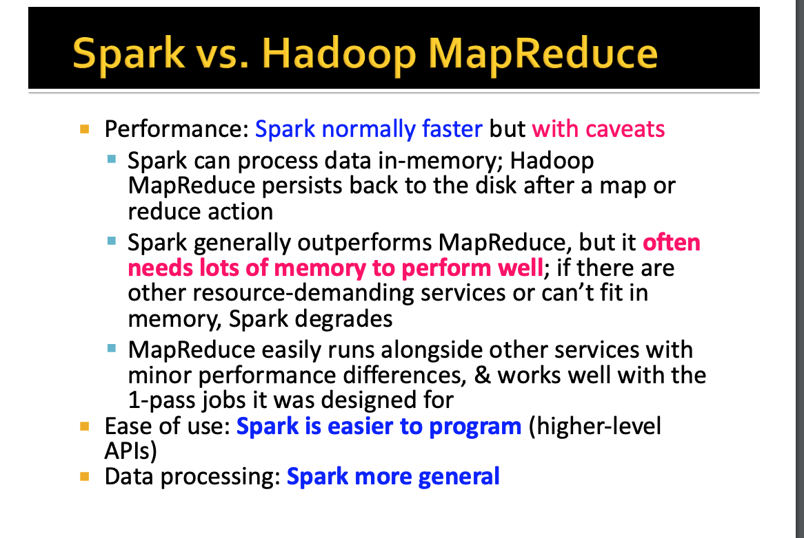</p>

### 1-3) What is the MapReduce programming model?

**Map turns each input record into key-value pairs, the framework groups all pairs by key
(the shuffle), and reduce folds each key's values into a result.**

- You write only `map` and `reduce`; partitioning, sorting, shuffling and retries are the
  framework's job.
- A **combiner** is an optional map-side reduce — it shrinks what the shuffle moves, which is
  exactly what `reduceByKey` does for you in Spark (see [4-5](#4-5-reducebykey-vs-groupbykey-vs-combinebykey)).
- **Strengths**: a simple model, scales linearly, survives node failure.
  **Weaknesses**: verbose, one map + one reduce per job, and every job round-trips through HDFS.

<p align="center">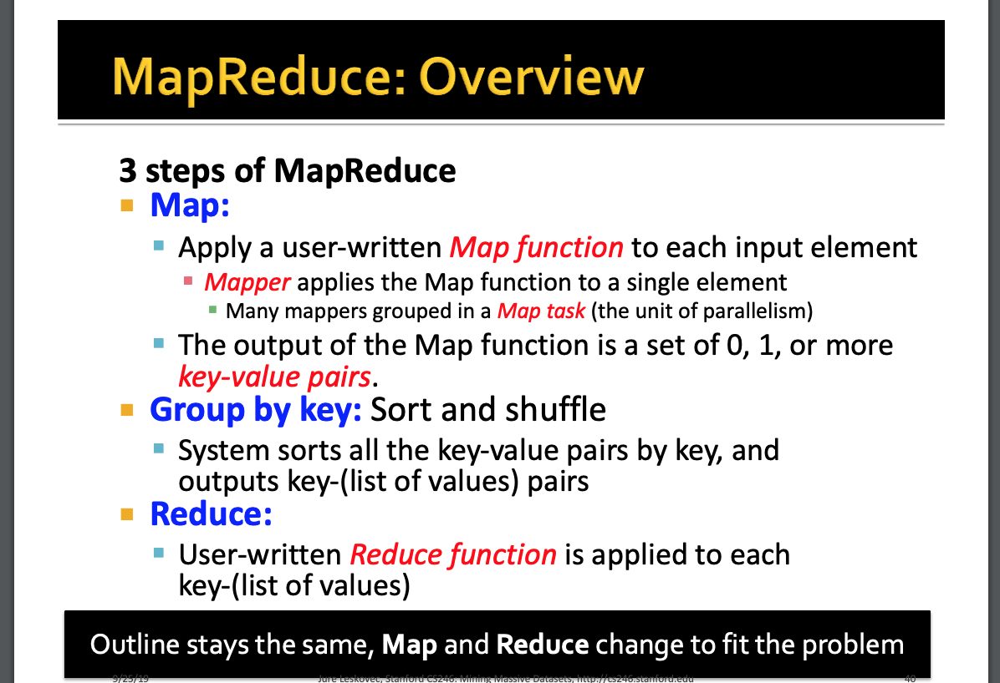</p>

<p align="center">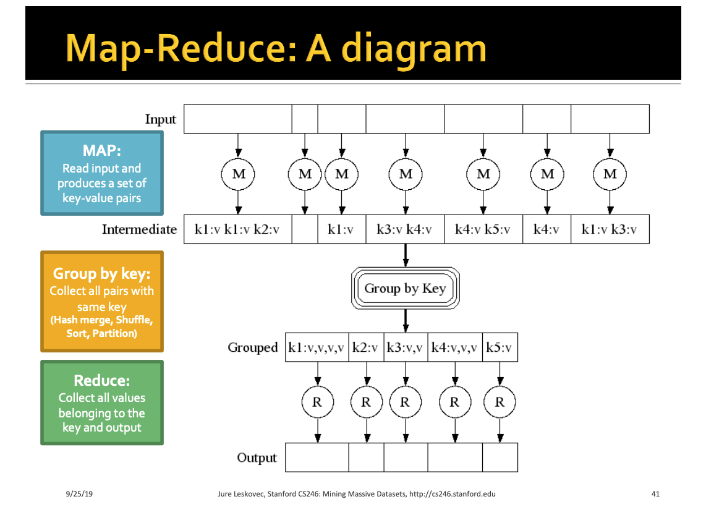</p>

<p align="center">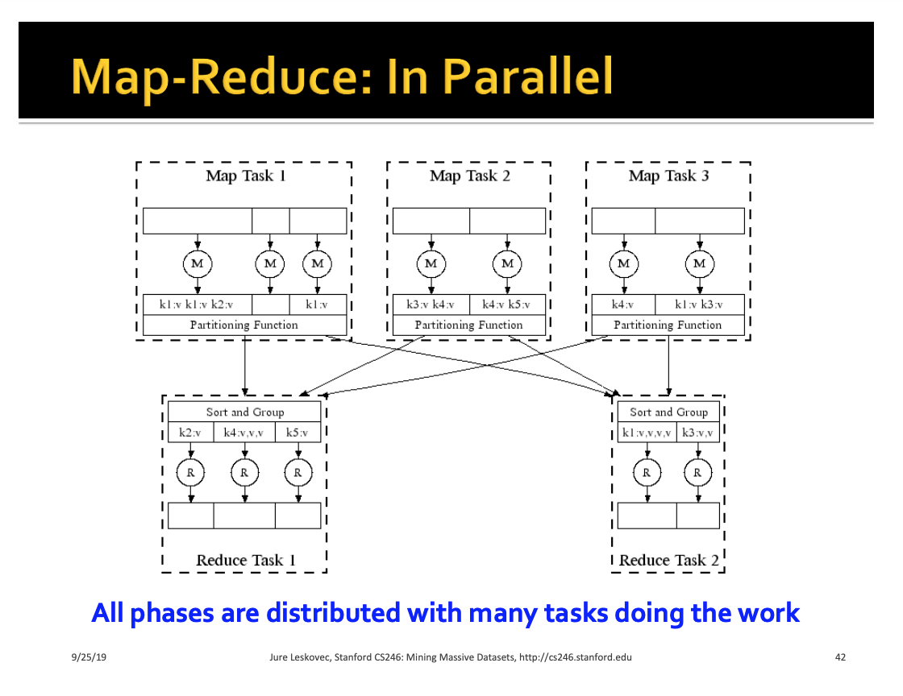</p>

<p align="center">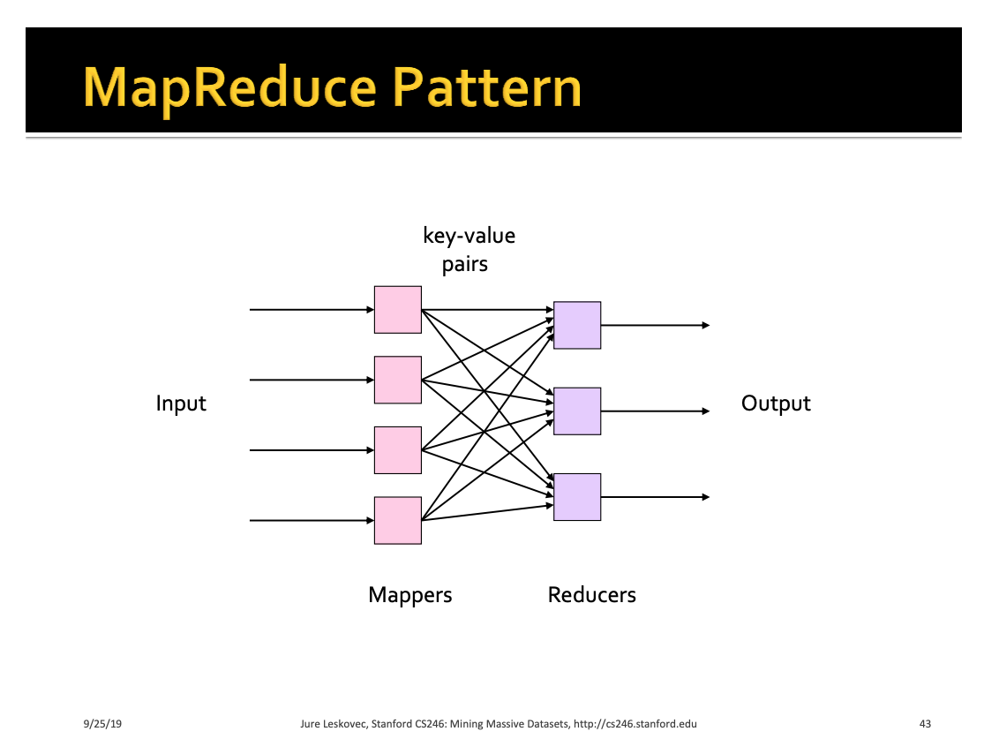</p>

### 1-4) Why is Spark usually faster than MapReduce?

**Because it avoids the per-job HDFS round trip and plans the whole computation at once — not
because everything lives in memory.**

1. **One DAG, not a chain of jobs** — a multi-step pipeline is one Spark job whose stages pass
   data through local shuffle files, not through replicated HDFS writes.
2. **Pipelining** — narrow transformations (`map`, `filter`, `select`) are fused into one task
   per partition, so the rows are never materialised between them.
3. **Caching** — iterative algorithms reuse a dataset from memory instead of re-reading it.
4. **The optimiser** — Catalyst rewrites the plan (pushdown, pruning, join choice) and Tungsten
   generates compact JVM code over binary rows.
5. **Cheap tasks** — executors are long-lived JVMs that run many tasks; MapReduce starts a JVM
   per task.

### 1-5) Is MapReduce still worth learning?

**Yes, as a model — map, shuffle by key, reduce is exactly what a Spark `groupBy` does — but
not as an API you will write.**

- Every distributed aggregation, join and sort is still "partition by key, then combine", so
  the shuffle questions in section 5 are MapReduce questions in disguise.
- The engines on top moved on: Hive runs on Tez rather than MapReduce, and Pig is
  effectively retired. HDFS and YARN are still common, especially on-premise.

### 1-6) What are Spark's weaknesses?

**Shuffles and memory pressure dominate its cost, it is micro-batch rather than truly
per-record for streaming, and it has many knobs.**

- **Memory hungry** — wide operations, caching and broadcasts all compete for executor memory;
  OOMs and spills are the most common production failures.
- **Small files** — many writers produce many small files unless output is sized deliberately.
- **Streaming latency** — Structured Streaming's default trigger is micro-batch, so latency is
  in the hundreds of milliseconds to seconds; Flink is the usual choice below that.
- **Python overhead** — row-at-a-time Python UDFs serialise every row to a Python process.
- **Tuning surface** — partition counts, executor sizing and join strategies matter, and the
  wrong defaults are expensive.

### 1-7) When would you not use Spark?

**When the data fits on one machine, when you need per-event low latency with large state, or
when the warehouse can already run the SQL.**

| Need | Better fit | Why |
|---|---|---|
| TB-scale batch ETL, large joins, ML feature pipelines | **Spark** | mature batch engine, rich APIs |
| Sub-second, stateful, event-time streaming | **Flink** | record-at-a-time, first-class state and event time |
| Stream processing inside a Kafka-centric service | **Kafka Streams** | a library, no cluster to run |
| One pipeline definition for batch and streaming | **Apache Beam** (on Dataflow / Flink / Spark) | portable programming model |
| SQL over data already in the warehouse | **BigQuery / Snowflake / Redshift** | no cluster to size or tune |
| A few GB on one machine | **pandas / Polars / DuckDB** | no distribution overhead |

Spark vs Flink in one line each: **Spark** is batch-first with micro-batch streaming and the
larger batch ecosystem; **Flink** is streaming-first with record-at-a-time processing,
checkpointed state and stronger event-time handling. More in [`../de/stream_pipeline.md`](../de/stream_pipeline.md).

---

## 2) Architecture and Deployment ⭐⭐⭐⭐⭐

### 2-1) Driver, executors, workers and the cluster manager

**The driver plans and schedules; executors run tasks and hold cached data; the cluster
manager hands out the machines; a worker is a node that hosts executors.**

| Component | What it does |
|---|---|
| **Driver** | runs your `main()`, holds the `SparkSession`, builds the plan, splits it into jobs, stages and tasks, schedules tasks and tracks their results |
| **Executor** | a JVM on a worker node that runs tasks (one per core at a time), stores cached partitions and serves shuffle files |
| **Cluster manager** | allocates CPU and memory to applications — Standalone, YARN or Kubernetes |
| **Worker node** | any machine that can host executors |

- The **driver is a process, not a node**, and it is not the master. In `client` mode it runs
  where you submitted; in `cluster` mode the cluster manager starts it inside the cluster.
  Several applications — each with its own driver — share one cluster manager.
- The driver does **not** process your data — unless you pull it there: `collect()` and
  `toPandas()` send the whole result to the driver, which is the classic driver OOM.
- **Executors are per application.** Two applications never share an executor, so they cannot
  share a cache either.

<p align="center">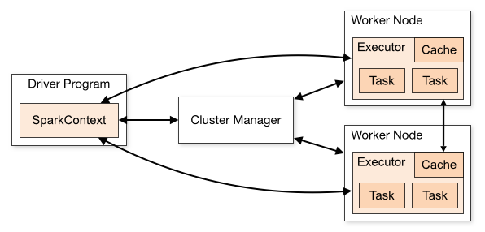</p>

Deep dive: [`../de/spark.md` §2-1](../de/spark.md#2-1-driver-cluster-manager-executors).

### 2-2) What happens after `spark-submit`?

**The driver starts, asks the cluster manager for executors, turns your code into a DAG of
stages when an action runs, and sends each stage's tasks to the executors until the job ends.**

1. `spark-submit` launches the driver (locally in `client` mode, in the cluster in `cluster` mode).
2. The driver creates the `SparkSession` / `SparkContext` and registers with the cluster manager.
3. The cluster manager launches executors on worker nodes; they register back with the driver.
4. Your code runs. Transformations only build a logical plan.
5. An **action** creates a **job**. Catalyst optimises the plan into a physical plan, and the
   **DAGScheduler** cuts it into **stages** at every shuffle.
6. The **TaskScheduler** sends each stage's tasks (one per partition) to executors, preferring
   executors that already hold the data (locality).
7. Executors run the tasks, write shuffle output for the next stage, and report status. Failed
   tasks are retried (see [9-1](#9-1-an-executor-or-node-fails--what-happens)).
8. When `main()` finishes or `spark.stop()` is called, the executors are released.

```text
User code ─► SparkSession ─► logical plan ─► Catalyst ─► physical plan
                                                              │
               executors ◄─ TaskScheduler ◄─ stages ◄─ DAGScheduler
                   │
                   └─► results to the driver, or output to storage
```

### 2-3) The `spark-submit` command, and adding external jars

**Name the cluster manager with `--master`, where the driver runs with `--deploy-mode`, size
the driver and executors, and ship dependencies with `--jars` or `--packages`.**

```bash
./bin/spark-submit \
  --master yarn \
  --deploy-mode cluster \
  --driver-memory 4g \
  --executor-memory 8g \
  --executor-cores 4 \
  --num-executors 20 \
  --conf spark.sql.shuffle.partitions=400 \
  --jars /libs/postgresql.jar,/libs/extra.jar \
  --packages org.apache.spark:spark-sql-kafka-0-10_2.12:3.5.1 \
  --class com.example.DailyEtl \
  daily-etl.jar 2026-11-06
```

- `--jars` takes a **comma-separated** list of local or remote jars, added to both the driver
  and executor classpaths.
- `--packages` resolves Maven coordinates (and their transitive dependencies) at submit time.
- For PySpark, `--py-files` ships `.py` / `.zip` / `.egg` files; a packed virtual environment
  goes with `--archives`.
- A fat (uber) jar that bundles its dependencies avoids classpath surprises in production.

### 2-4) `SparkSession` vs `SparkContext`

**`SparkSession` (Spark 2.0+) is the single entry point for DataFrames, SQL and the catalog;
it wraps the older `SparkContext`, which is still the entry point for RDDs, broadcasts and
accumulators.**

- `SparkSession` replaced `SQLContext` and `HiveContext`; `enableHiveSupport()` adds the
  Hive metastore.
- One `SparkContext` per JVM; `spark.sparkContext` reaches it from a session.
- In `spark-shell` and `pyspark` the objects are pre-created as `spark` and `sc`.

```python
# python
from pyspark.sql import SparkSession

spark = SparkSession.builder.appName("daily-etl").getOrCreate()
sc = spark.sparkContext            # the underlying SparkContext
```

### 2-5) Cluster managers: Standalone, YARN, Kubernetes (and Mesos)

**The cluster manager only allocates resources — the driver still schedules the tasks — so the
choice is about where the cluster already lives.**

| Manager | Use it when | Notes |
|---|---|---|
| **Standalone** | a dedicated Spark-only cluster | Spark's own master and workers; simplest |
| **YARN** | a Hadoop cluster (EMR, on-prem) | each application gets an ApplicationMaster; external shuffle service available |
| **Kubernetes** | a container platform | driver and executors are pods; dynamic allocation uses shuffle tracking |
| **Mesos** | legacy only | deprecated in Spark 3.2 and removed in 4.0 |

`--master local[*]` runs everything in one JVM with one thread per core — for tests and
notebooks, not a cluster manager.

### 2-6) How do you make the Standalone master highly available?

**Run standby masters coordinated by ZooKeeper; if the active master dies, a standby takes
over and the running applications keep going.**

- **ZooKeeper mode** (`spark.deploy.recoveryMode=ZOOKEEPER`) — production. Leader election
  picks the active master; workers and applications re-register with the new one. Running
  applications are unaffected, only new submissions wait for the failover.
- **File-system mode** (`spark.deploy.recoveryMode=FILESYSTEM`) — single-node recovery: the
  master's state is written to a local directory and recovered when it restarts.
- On YARN or Kubernetes this question disappears: their own control planes provide HA.

Reference: [Spark Standalone — High Availability](https://spark.apache.org/docs/latest/spark-standalone.html#high-availability).

---

## 3) Jobs, Stages, Tasks and Partitions ⭐⭐⭐⭐⭐

### 3-1) Application, job, stage and task

**An application is one `SparkSession`; every action starts a job; the job is cut into stages
at each shuffle; each stage runs one task per partition.**

From largest to smallest:

```text
Application  →  Job  →  Stage  →  Task
   1 : many      1 : many  1 : many  1 task : 1 partition
```

| Level | Created by | Count |
|---|---|---|
| **Application** | one `SparkSession` / `SparkContext` | one per `spark-submit` |
| **Job** | an **action** — `count`, `collect`, `show`, `write`, `foreach` | one per action (some, like `show` or schema inference, run more) |
| **Stage** | a **shuffle boundary** inside the job | number of shuffles + 1 |
| **Task** | one **partition** of the stage | partitions of that stage |

- A task runs the stage's **whole fused pipeline** over one partition — `read → filter → map`
  is one task per partition, not three.
- Each task runs on one executor core. The scheduler submits a stage as a **TaskSet** — that
  is how a stage is scheduled, not what it is.

Worked example:

```python
# python
df = spark.read.parquet("s3://bucket/events/")           # 400 input partitions
result = (df.filter("age > 18")
            .groupBy("country")
            .count())
result.show()                                            # the action: one job
```

```text
Job 0 (show)
├── Stage 0: scan → filter → partial count      400 tasks, writes shuffle files
│            ── shuffle by country (Exchange) ──
└── Stage 1: final count per country            spark.sql.shuffle.partitions tasks,
                                                which AQE usually coalesces to a few
```

Catalyst, AQE and the data source can change the exact counts — `explain()` and the Spark UI
are the ground truth.

<p align="center"></p>

<p align="center">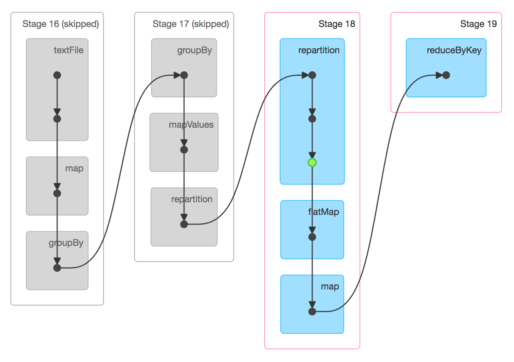</p>

#### Is a task a process?

**No. The executor is the process (one JVM per executor); a task is a unit of work that runs
on one of the executor's threads.**

| | Executor | Task |
|---|---|---|
| What it is | a JVM process on a worker node | the stage's pipeline applied to one partition |
| Lives for | the whole application, unless dynamic allocation releases it | until its partition is done: milliseconds to minutes |
| Memory | its own heap, `spark.executor.memory` | shares that heap with every other task running in the executor |
| How many | `spark.executor.instances`, or whatever dynamic allocation picks | one per partition of the stage |

- The driver serialises each task (the closure plus the partition it should read) and sends
  it to an executor, which runs it on a thread from its task pool. A task never needs a new executor
  JVM, and when a task finishes the executor takes the next one.
- Tasks in one executor share its heap, its cached blocks and its broadcast variables. That
  is why one oversized task can run the whole executor out of memory and fail the tasks next
  to it.
- In OS terms: the application is the program, the executor is a process, and a task is a
  job handed to one of that process's worker threads.
- PySpark adds one wrinkle. A task that runs Python code (a Python UDF, or an RDD lambda)
  hands it to a Python worker process the executor starts beside its JVM. A DataFrame task
  that uses only built-in expressions never needs one. Workers are reused by default
  (`spark.python.worker.reuse=true`). With `false`, each such task starts its own worker.
  Either way the driver still schedules and retries the task, and the executor JVM runs it
  and reports its status.

#### How many tasks run at once?

**Each executor can run at most ⌊`spark.executor.cores` ÷ `spark.task.cpus`⌋ tasks at a
time. The division rounds down: 5 cores with `spark.task.cpus=2` give 2 slots, not 2.5.
Because `spark.task.cpus` defaults to 1, the cluster's ceiling on concurrent tasks is about
executors × cores per executor. A stage with fewer tasks than slots leaves the rest idle.**

Two executors with two cores each give four slots, so a stage of eight tasks runs in about
two waves:

```text
Stage 0: 8 tasks, 4 slots (2 executors x 2 cores)

             slot 1     slot 2
Executor 1   T0 -> T4   T1 -> T5
Executor 2   T2 -> T6   T3 -> T7

wave 1: T0-T3   wave 2: T4-T7      8 tasks / 4 slots = 2 waves
```

- "Waves" is an approximation. A slot takes the next pending task as soon as it is free,
  without waiting for the others, and the scheduler prefers the executor that already holds
  the data (`spark.locality.wait`), so the real assignment is not strict round-robin.
- The partitions set the task count ([3-4](#3-4-what-is-a-partition)); the cluster sets the
  slot count. Aim for at least two to three tasks per core
  ([12-4](#12-4-which-configurations-are-worth-knowing-by-name)), so that no slot sits idle
  and the last wave is not a single straggler.

#### If you add executors, do you get more tasks?

**Usually not. The number of tasks comes from the number of partitions; more executors only
add slots, so the same tasks finish in fewer waves.**

| | Before | After |
|---|---|---|
| Executors | 2 | 10 |
| Cores per executor | 2 | 2 |
| Partitions in the stage | 100 | 100 |
| Tasks in the stage | 100 | 100 |
| Concurrent slots | 4 | 20 |
| Waves (tasks / slots) | 25 | 5 |

- More executors help only while there are more tasks than slots. A stage with 8 partitions
  keeps 8 of the 20 slots busy and leaves 12 idle. To use them, raise the partition count:
  `repartition`, `spark.sql.shuffle.partitions`, or a smaller
  `spark.sql.files.maxPartitionBytes` for the scan.
- That is why the answer is "usually" and not "never". When `spark.default.parallelism` is
  unset, it defaults to the total cores registered on the cluster, so `sc.parallelize` with
  no slice count gets more partitions, and more tasks, on a bigger cluster. Shuffles mostly do
  not change: with that setting unset, an RDD `reduceByKey` keeps the largest upstream
  partition count, and DataFrame shuffles use `spark.sql.shuffle.partitions`.

#### Where each level shows up in the Spark UI

**The UI follows the same hierarchy. The Jobs tab has one row per job, a job's page lists
its stages, a stage's page has one row per task, and the Executors tab shows the slots the
tasks ran in.**

Screenshots are from the Apache Spark docs, [Web UI](https://spark.apache.org/docs/latest/web-ui.html)
(Apache License 2.0). The demo runs in local mode, so its only executor is the `driver`.

1. **Jobs tab: one row per action.** Job 0 is `count at web-ui-docs-demo.py:25`. A Stages
   cell like `1/1 (1 skipped)` means the job reused shuffle output an earlier job had already
   written, so that stage did not run again ([3-2](#3-2-how-does-spark-split-a-job-into-stages)).

<p align="center">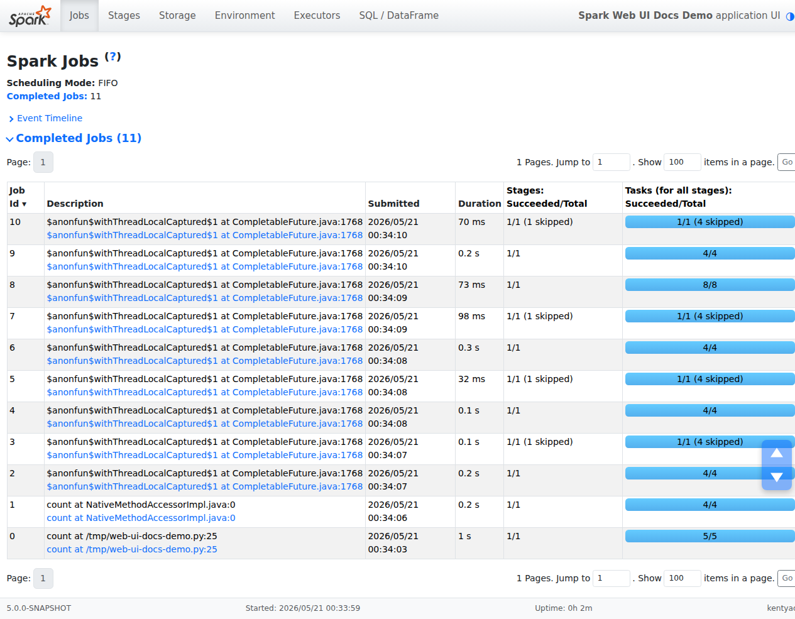</p>

2. **Job page: the job's stages.** Job 0 has no shuffle, so it has one stage. That stage's
   `5/5` tasks are its five partitions.

<p align="center">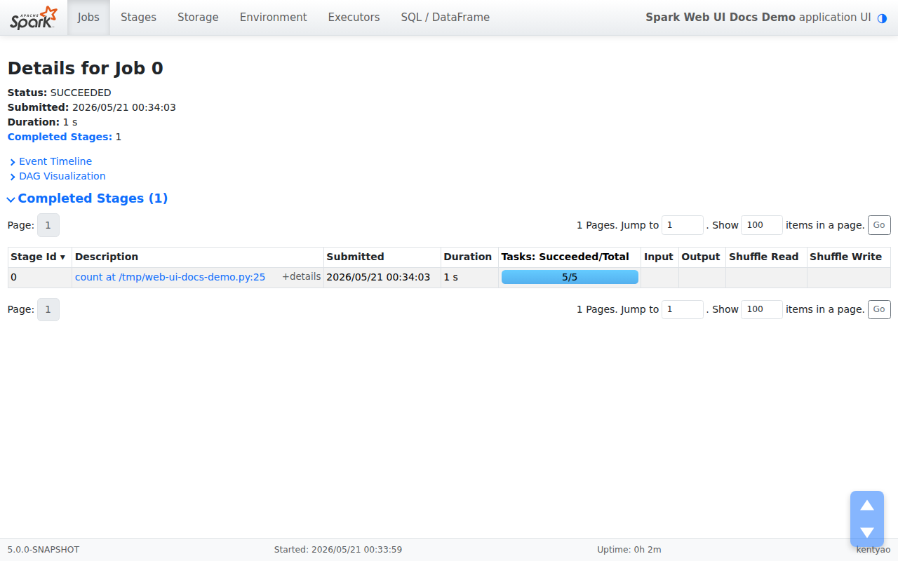</p>

3. **Stage page: one row per task.** `Index` is the partition the task processed, and
   `Executor ID` is the executor that ran it. The Summary Metrics row is where skew shows
   up: a `Max` duration far above the `Median` ([6-1](#6-1-what-is-data-skew-and-how-do-you-spot-it)).

<p align="center">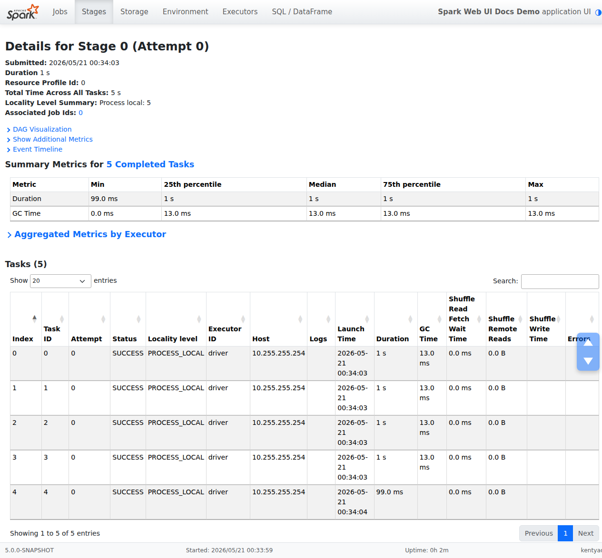</p>

4. **Executors tab: the slots.** `Cores` is the executor's core count. With the default
   `spark.task.cpus=1`, that is also how many tasks it can run at once. `Active Tasks` is how
   many it is running now. Here 37 tasks went through one executor with
   4 cores, which shows that a task is a unit of work, not a process.

<p align="center">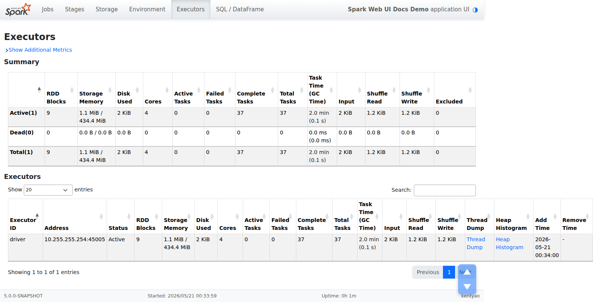</p>

### 3-2) How does Spark split a job into stages?

**The DAGScheduler walks back from the action and cuts the graph at every wide (shuffle)
dependency; everything between two cuts is one stage.**

- Narrow dependencies stay inside a stage and are pipelined.
- Stages that feed a shuffle are **shuffle map stages**; the last stage, which produces the
  action's result, is the **result stage**.
- A stage runs only after all its parent stages finish, because it reads their shuffle output.
- If shuffle output is already there from an earlier job, the stage is **skipped** — it shows
  greyed out in the Spark UI.

### 3-3) Narrow vs wide dependencies

**Narrow: each parent partition feeds at most one child partition, so no data moves. Wide:
a parent partition feeds many child partitions, which requires a shuffle and a new stage.**

| | Narrow | Wide |
|---|---|---|
| Examples | `map`, `filter`, `flatMap`, `select`, `union`, `coalesce` | `groupByKey`, `reduceByKey`, `distinct`, `repartition`, most joins |
| Data movement | none | shuffle over the network |
| Stage boundary | no — pipelined | yes |
| Recovery of a lost partition | recompute one parent partition | may recompute many parent partitions |

- A join whose inputs are **already co-partitioned** (same partitioner, same partition count)
  is narrow — no shuffle is needed.
- Judge from the physical plan, not the API name: an `Exchange` node is a shuffle.

<p align="center">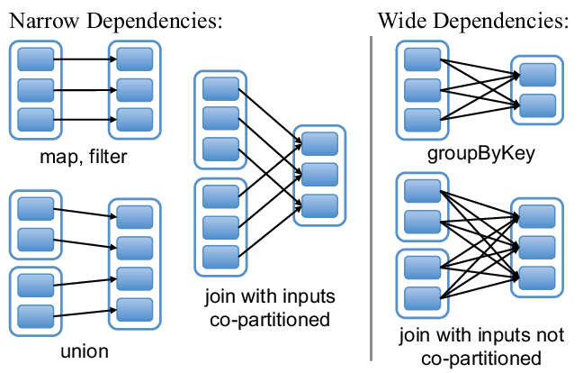</p>

### 3-4) What is a partition?

**A partition is one chunk of a distributed dataset and the unit of parallelism: one task
processes one partition on one core.**

- **Partition count sets parallelism** — 4 partitions on 16 cores leaves 12 cores idle.
- **Partition size sets per-task memory and time** — aim for roughly 100–200 MB per
  partition; far smaller wastes time on scheduling, far larger spills or OOMs.
- **Where counts come from** — file scans split input into about
  `spark.sql.files.maxPartitionBytes` (128 MB) each; shuffles produce
  `spark.sql.shuffle.partitions` (200) partitions unless AQE coalesces them; RDD operations
  default to `spark.default.parallelism`.
- **Locality** — the scheduler prefers to run a task where its partition's data already is.

<p align="center">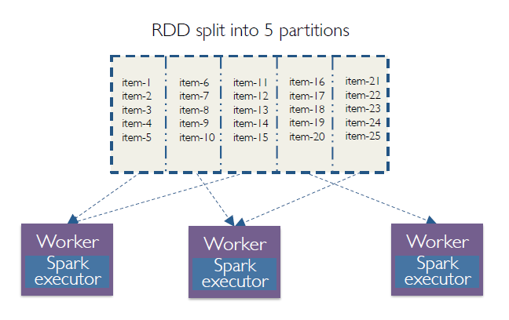</p>

### 3-5) `repartition` vs `coalesce`

**`repartition(n)` does a full shuffle and can raise or lower the count with evenly sized
output; `coalesce(n)` merges existing partitions without a shuffle and can only lower it.**

```text
coalesce(2) — no shuffle, neighbours merged       repartition(3) — full shuffle, rebalanced
[P1] ─┐                                            [P1] ─┐ ┌─► [N1]
[P2] ─┴─► [M1]                                     [P2] ─┼─┼─► [N2]
[P3] ─┐                                            [P3] ─┘ └─► [N3]
[P4] ─┴─► [M2]
```

| | `repartition(n)` / `repartition(col)` | `coalesce(n)` |
|---|---|---|
| Shuffle | always | no |
| Raise the count | yes | no |
| Output balance | even (hash or round-robin) | as uneven as the inputs |
| Typical use | fix skewed or too few partitions; cluster by a column before writing | reduce output file count after a big `filter` |

- **Trap**: `coalesce(1)` before a write pulls the *whole upstream stage* down to one task,
  not just the write. If upstream work is heavy, `repartition(1)` keeps the work parallel and
  pays one shuffle instead.
- `repartitionAndSortWithinPartitions(partitioner)` (RDD) repartitions and sorts inside the
  shuffle itself — cheaper than a `repartition` followed by a sort.

### 3-6) How do you optimise with a custom partitioner?

**Partition both sides of repeated joins or lookups by the same key once, so later operations
on that key find matching rows already co-located and skip the shuffle.**

```scala
// scala — RDD API
import org.apache.spark.HashPartitioner

val users = usersRdd.partitionBy(new HashPartitioner(200)).persist()
val joined = users.join(eventsRdd)      // only eventsRdd is shuffled; users stays put
```

- Persist after `partitionBy`, or the partitioning is recomputed — and lost — every time.
- `map` drops the partitioner (keys might change); `mapValues` and `flatMapValues` keep it.
- **DataFrames** get the same effect from **bucketing** (`bucketBy` on write) for repeated
  joins, and from `repartition(col)` within one job.

---

## 4) RDDs, DataFrames and Operators ⭐⭐⭐⭐

### 4-1) What is an RDD, and how is it different from HDFS blocks?

**An RDD (Resilient Distributed Dataset) is an immutable, partitioned collection plus the
recipe — its lineage — for recomputing any partition, so a lost partition is rebuilt rather
than restored from a replica.**

- **Resilient** — fault tolerance through lineage. **Distributed** — partitions spread across
  executors. **Dataset** — a collection of records.
- An RDD is **lazy and logical**: it is a plan, not data in memory. It is materialised only
  when an action runs, and kept only if you `cache()` it.
- **HDFS vs RDD**: HDFS stores data durably as replicated blocks (three copies by default);
  an RDD is a computation over such data, and survives failure by recomputing, not replicating.
  The two work together — RDD partitions are often created one per HDFS block, so tasks can run
  where the block lives.

### 4-2) RDD vs DataFrame vs Dataset

**Use DataFrames (or Spark SQL) by default: they carry a schema, so Catalyst and Tungsten can
optimise them. Drop to RDDs only for logic the DataFrame API cannot express.**

| | RDD | DataFrame | Dataset |
|---|---|---|---|
| Schema | none — opaque objects | yes — named, typed columns | yes |
| Optimisation | none — runs your lambdas as written | Catalyst + Tungsten | Catalyst + Tungsten (lambdas are opaque) |
| Type safety | compile time (Scala) | runtime — a wrong column fails at analysis | compile time (Scala / Java) |
| Languages | all | all | Scala and Java only |
| Use for | low-level control, unstructured data | almost everything | typed Scala pipelines |

In Scala a DataFrame **is** `Dataset[Row]`. PySpark has no typed Dataset — a PySpark
`DataFrame` is the untyped API. Deep dive: [`../de/spark.md` §3-1](../de/spark.md#3-1-the-comparison).

### 4-3) Transformations, actions and lazy evaluation

**Transformations return a new dataset and only add a step to the plan; actions return a value
to the driver or write output, and they are what make Spark run anything.**

| Transformations (lazy) | Actions (run a job) |
|---|---|
| `map`, `flatMap`, `filter`, `select`, `withColumn` | `count`, `collect`, `take(n)`, `first` |
| `groupBy`, `join`, `distinct`, `union`, `sample` | `show`, `reduce`, `foreach` |
| `repartition`, `coalesce`, `sortBy` | `write…save`, `saveAsTextFile` |

**Why lazy?** Seeing the whole chain before running lets Spark fuse narrow steps into one
pass, push filters and column selection into the scan, pick join strategies, and skip work
whose result is never used.

```python
# python
df = spark.read.parquet("s3://bucket/events/")
adults = df.filter("age > 18")            # nothing runs
slim = adults.select("user_id", "age")    # nothing runs
slim.show()                               # one job: scan only two columns, filter in the scan
```

- "Spark operators" (a common phrasing) means exactly these two families.
- Because nothing runs until the action, an error in a transformation surfaces **at the
  action**, often lines later — a frequent source of confusion when debugging.

### 4-4) `map` vs `flatMap`, `map` vs `mapPartitions`, `reduce` vs `reduceByKey`

**`map` is one-to-one, `flatMap` is one-to-many; `mapPartitions` calls your function once per
partition instead of once per row; `reduce` is an action returning one value, `reduceByKey`
is a transformation returning one value per key.**

```python
# python
lines = sc.parallelize(["a b", "c"])
lines.map(lambda s: s.split(" ")).collect()       # [['a', 'b'], ['c']]
lines.flatMap(lambda s: s.split(" ")).collect()   # ['a', 'b', 'c']

def enrich(rows):
    client = make_client()          # one expensive setup per partition, not per row
    for row in rows:
        yield client.lookup(row)

enriched = records.mapPartitions(enrich)
```

- `mapPartitions` pays off when there is per-call setup — a DB connection, a model load.
  Its trap: building a list of the whole partition instead of yielding row by row loads the
  partition into memory and can OOM the executor.
- `reduce(f)` brings one value to the driver; `reduceByKey(f)` stays distributed and shuffles.

### 4-5) `reduceByKey` vs `groupByKey` vs `combineByKey`

**Prefer `reduceByKey`: it combines values on the map side before the shuffle, so only one
partial result per key per partition crosses the network. `groupByKey` ships every value and
then holds all of a key's values in memory at once.**

```scala
// scala
val sums1 = pairs.reduceByKey(_ + _)                 // map-side combine, then shuffle
val sums2 = pairs.groupByKey().mapValues(_.sum)      // shuffles every value; a hot key can OOM
```

- `combineByKey(createCombiner, mergeValue, mergeCombiners)` is the general form both are built
  on; use it when the result type differs from the value type — an average needs
  `(sum, count)` per key.
- `aggregateByKey(zero)(seqOp, combOp)` is the same idea with a zero value.
- `groupByKey` is right only when you truly need every value together — and then watch skew.
- In DataFrames this choice disappears: `groupBy().agg()` does partial aggregation automatically
  (`HashAggregate` → `Exchange` → `HashAggregate` in the plan).

### 4-6) What does polyglot mean for Spark?

**One engine, several language front ends: Scala, Java, Python, R and SQL all build the same
logical plan, so a DataFrame query runs at the same speed whichever language wrote it.**

The exception is code Spark cannot see into: a Python UDF or a Python RDD lambda runs in a
separate Python worker, row by row, with serialisation in between. Built-in functions and
pandas (Arrow) UDFs avoid most of that cost — see [`../de/spark.md` §10-2](../de/spark.md#10-2-udfs-vs-pandas-udfs-vs-built-ins).

### 4-7) What is a sparse vector?

**A vector that stores only its non-zero entries — size, indices, values — instead of every
element; MLlib uses it for high-dimensional features such as one-hot or TF-IDF columns.**

```python
# python
from pyspark.ml.linalg import Vectors

dense = Vectors.dense([0.0, 3.0, 0.0, 4.0])
sparse = Vectors.sparse(4, [1, 3], [3.0, 4.0])     # the same vector, two stored values
```

---

## 5) Shuffles, Broadcasts and Joins ⭐⭐⭐⭐⭐

### 5-1) What is a shuffle, and what triggers one?

**A shuffle redistributes rows across partitions so that all rows with the same key land
together; it is triggered by grouping, joining, de-duplicating, sorting or repartitioning on a
key.**

```text
Before (partitioned by file)        groupBy("user_id").sum("amount")      After
P0: (A,100) (B,200)                 every map task writes its rows          P0': A → 400
P1: (A,300) (C,400)        ──────►  bucketed by hash(user_id), every  ──►   P1': B → 700
P2: (B,500)                         reduce task fetches its bucket          P2': C → 400
```

- Triggers: `groupBy` / `*ByKey`, joins (unless broadcast or co-partitioned), `distinct`,
  `orderBy`, `repartition`, window functions with `partitionBy`.
- In the physical plan a shuffle is an **`Exchange`** node; in the Spark UI it is the
  **Shuffle Write / Shuffle Read** columns of a stage.

### 5-2) Why is a shuffle expensive, and how is it implemented?

**Every shuffled row is serialised, written to local disk, sent over the network and read
back — and the map side has to finish before the reduce side can start.**

- **Sort-based shuffle** (the default): each map task sorts its output by target partition
  and writes **one data file plus one index file**, instead of one file per reducer. The
  older hash shuffle created M × R files and was removed.
- **Bypass-merge path**: when there are at most `spark.shuffle.sort.bypassMergeThreshold`
  (200) reduce partitions and no map-side aggregation, Spark writes one file per reducer and
  concatenates them, skipping the sort.
- **Costs**: serialisation CPU, disk I/O, network I/O, and memory for sort buffers — which
  spill to disk when full.
- `spark.shuffle.file.buffer` (32 KB) is the in-memory buffer per shuffle file writer;
  raising it to 64 KB–1 MB cuts disk syscalls on very large shuffles.
- The **external shuffle service** serves shuffle files after the executor that wrote them is
  gone, which is what makes dynamic allocation safe on YARN.

Deep dive: [`../de/spark.md` §5-1](../de/spark.md#5-1-what-a-shuffle-actually-does), and
[§9-5](../de/spark.md#9-5-a-shuffle-byte-by-byte) for one row's path through serialisation, disk and network.

### 5-3) How do you minimise data transfer in a Spark job?

**Move less data: filter and select early, broadcast small tables, combine before shuffling,
and shuffle once rather than repeatedly.**

1. **Filter early, select only needed columns** — with Parquet / ORC, Catalyst pushes these
   into the scan so the data is never read. Check the plan for `PushedFilters`.
2. **Broadcast join** a small side instead of shuffling the big one ([5-5](#5-5-broadcast-join-vs-shuffle-joins)).
3. **Combine on the map side** — `reduceByKey` over `groupByKey`; DataFrame aggregations do this
   for you.
4. **Reuse partitioning** — partition or bucket once by the join key when the same key is joined
   repeatedly ([3-6](#3-6-how-do-you-optimise-with-a-custom-partitioner)).
5. **Avoid needless `repartition` / `distinct` / `orderBy`** — each is a full shuffle.
6. **Use a compact serialiser** — Kryo for RDD jobs; DataFrames already use Tungsten's binary format.

Accumulators, sometimes listed here, do **not** reduce data transfer — they are write-only
counters sent back to the driver.

### 5-4) Broadcast variables and accumulators

**A broadcast variable ships a read-only value to each executor once instead of with every
task; an accumulator is a counter that tasks add to and only the driver reads.**

```python
# python
country_names = sc.broadcast({"TW": "Taiwan", "US": "United States"})
bad_rows = sc.accumulator(0)

def label(row):
    if row.country not in country_names.value:
        bad_rows.add(1)
        return None
    return (row.user_id, country_names.value[row.country])

labelled = events.rdd.map(label).filter(lambda r: r is not None)
labelled.count()               # the action; bad_rows.value is now filled in
```

- A broadcast must fit in driver **and** executor memory; `unpersist()` / `destroy()` frees it.
- **Accumulator trap**: updates made inside a **transformation** can be counted more than once
  if a task is retried or a stage recomputed; only updates inside an **action** (`foreach`) are
  guaranteed exactly once. Treat transformation-side counts as approximate.

### 5-5) Broadcast join vs shuffle joins

**If one side is small, broadcast it and join without shuffling the large side; otherwise
Spark shuffles both sides by the join key and sort-merges them.**

| Strategy | When Spark picks it | Shuffle |
|---|---|---|
| **Broadcast hash join** | one side under `spark.sql.autoBroadcastJoinThreshold` (10 MB), or a `broadcast()` hint | none for the large side |
| **Sort-merge join** | the default for two large sides on an equi-join | both sides |
| **Shuffle hash join** | one side much smaller per partition; preferred by AQE when it fits | both sides, no sort |
| **Broadcast nested loop join** | non-equi joins with a small side | none, but O(n × m) comparisons |
| **Cartesian** | cross joins | everything — avoid |

```python
# python
from pyspark.sql.functions import broadcast

joined = large_orders.join(broadcast(small_countries), "country_code")
```

- **Trap**: a full outer join cannot use a broadcast hash join at all; a left outer join can
  broadcast only the right side.
- **Trap**: the size estimate can be wrong (a filtered table looks small, a UDF output looks
  unknown). AQE fixes it at runtime by switching to a broadcast join once it sees real sizes.

Deep dive: [`../de/spark.md` §7-1](../de/spark.md#7-1-the-join-strategies).

---

## 6) Data Skew ⭐⭐⭐⭐⭐

### 6-1) What is data skew, and how do you spot it?

**Skew is when a few keys hold most of the rows, so a few tasks do most of the work and the
whole stage waits for them.**

```text
Stage 3 task durations            Stage 3 shuffle read per task
task 0      12 s                  task 0       110 MB
task 1      11 s                  task 1       105 MB
task 2      13 s                  task 2       118 MB
task 199   850 s   ◄── straggler  task 199     9.6 GB  ◄── one hot key
```

How to confirm it, in order:

1. Spark UI → **Stages** → the slow stage → **Summary Metrics**: compare *max* to *median*
   for duration and shuffle read size. Max ≫ 75th percentile is skew.
2. Rule out the alternatives: a slow node (the same executor is always slow), GC (high GC
   time), or spill (large *spill (disk)*).
3. Find the hot keys:

```python
# python
(df.groupBy("join_key").count()
   .orderBy("count", ascending=False)
   .show(20))
```

Typical culprits: `NULL` or empty-string keys, a default value like `0` or `"unknown"`, a
celebrity user, a country, a bot.

### 6-2) How do you fix data skew?

**Turn on AQE skew-join handling first, broadcast if one side is small, and salt the hot keys
when neither is enough.**

| Fix | When | How |
|---|---|---|
| **Drop or isolate junk keys** | the hot key is `NULL` / `"unknown"` | filter it out, or process it separately and `union` back |
| **AQE skew join** | sort-merge join, Spark 3.0+ | `spark.sql.adaptive.skewJoin.enabled=true` (on by default with AQE) splits oversized partitions |
| **Broadcast join** | the other side is small | `broadcast(small_df)` — no shuffle, so no skewed partition |
| **Two-stage (salted) aggregation** | skewed `groupBy` with an associative aggregate | aggregate by `(key, salt)`, then by `key` |
| **Salted join** | large-large join with a few hot keys | random salt on the skewed side, replicate the other side across all salt values |
| **Split hot keys** | a handful of known hot keys | broadcast-join the hot keys, sort-merge the rest, `union` |

Two-stage aggregation:

```python
# python
from pyspark.sql import functions as F

SALT_BUCKETS = 16
partial = (df.withColumn("salt", (F.rand() * SALT_BUCKETS).cast("int"))
             .groupBy("user_id", "salt")
             .agg(F.sum("amount").alias("partial_sum"),
                  F.count("*").alias("partial_cnt")))
totals = (partial.groupBy("user_id")
                 .agg(F.sum("partial_sum").alias("total"),
                      F.sum("partial_cnt").alias("cnt")))
```

This works only for aggregates that can be combined from parts — `sum`, `count`, `min`, `max`;
an average is `sum / count` computed after stage two, and `countDistinct` needs another approach.

Salted join — the big side gets a random salt, the small side is exploded across every salt:

```python
# python
from pyspark.sql import functions as F

SALT_BUCKETS = 16
big_salted = big.withColumn("salt", (F.rand() * SALT_BUCKETS).cast("int"))
small_salted = small.withColumn(
    "salt", F.explode(F.array([F.lit(i) for i in range(SALT_BUCKETS)])))
joined = big_salted.join(small_salted, ["join_key", "salt"]).drop("salt")
```

The cost is replicating the smaller side `SALT_BUCKETS` times — salt only the hot keys when
that side is not small. Deep dive: [`../de/spark.md` §7-3](../de/spark.md#7-3-data-skew-spotting-it-and-fixing-it).

---

## 7) Caching, Persistence and Checkpointing ⭐⭐⭐⭐

### 7-1) `cache` vs `persist`

**`cache()` is `persist()` at the default storage level; `persist(level)` lets you choose
memory, disk, serialised or replicated. Both are lazy — nothing is stored until an action runs.**

- Default level: **`MEMORY_ONLY`** for RDDs, **`MEMORY_AND_DISK`** for DataFrames / Datasets
  (shown as `MEMORY_AND_DISK_DESER` in PySpark).
- The block manager on each executor stores the partitions; the driver tracks which blocks
  live where. Cached data stays across jobs in the same application, not across applications.
- `unpersist()` releases it. Unused cached data is evicted least-recently-used under memory
  pressure.
- **Cache when** a dataset is reused by two or more actions, or in an iterative loop, and it is
  expensive to recompute. **Do not cache** something used once, or something so large it evicts
  everything else — re-reading Parquet is often cheaper.

### 7-2) What storage levels are there?

**Choose along three axes — memory and / or disk, deserialised objects or serialised bytes,
and one copy or two.**

| Level | Where | What happens when it does not fit |
|---|---|---|
| `MEMORY_ONLY` | memory, deserialised objects | missing partitions are **recomputed** when needed |
| `MEMORY_AND_DISK` | memory, then disk | partitions that do not fit are written to disk and read back |
| `MEMORY_ONLY_SER` | memory, serialised bytes | smaller, but costs CPU to deserialise; recomputes the rest |
| `MEMORY_AND_DISK_SER` | memory serialised, then disk | spills the rest instead of recomputing |
| `DISK_ONLY` | local disk only | — |
| `OFF_HEAP` | serialised, outside the JVM heap | needs `spark.memory.offHeap.enabled` and a size |
| `…_2` (e.g. `MEMORY_AND_DISK_2`) | two replicas on different executors | faster recovery, double the memory |

In PySpark, data is always stored serialised on the JVM side, so the `_SER` variants make no
difference there.

### 7-3) Cache / persist vs checkpoint

**Persisting keeps the lineage and stores data on executors for the life of the application;
checkpointing writes the data to reliable storage and cuts the lineage, so it survives executor
loss and keeps the plan short.**

| | `persist` / `cache` | `checkpoint` |
|---|---|---|
| Stored on | executor memory / local disk | reliable storage — HDFS, S3 (`sc.setCheckpointDir`) |
| Lineage | kept — a lost block is recomputed | truncated — the checkpoint becomes the new source |
| Lifetime | ends with the application | files stay until you delete them |
| Cost | cheap | an extra full write; recomputes the data unless it is persisted first |
| Use for | reuse within a job | very long lineages (iterative ML, graph algorithms), streaming state |

- `persist(DISK_ONLY)` is on **local disk**, not RAM — and still lost with its executor.
- `rdd.checkpoint()` runs a **separate job** after the next action, which recomputes the RDD —
  so persist it before checkpointing. `DataFrame.checkpoint()` is eager by default.
- `localCheckpoint()` truncates lineage while storing on executors: faster, not fault tolerant.
- Structured Streaming's `checkpointLocation` is a different thing: offsets and state for
  recovery (see [11-3](#11-3-checkpoints-and-exactly-once)).

### 7-4) How do you clean up accumulated metadata?

**Spark's `ContextCleaner` removes shuffle files, broadcasts and cached RDDs once the driver no
longer references them; for long-running applications you help it by unpersisting and dropping
references.**

- `spark.cleaner.ttl`, the answer in older interview lists, was **removed in Spark 2.0**.
- Call `unpersist()` / `destroy()` explicitly when done with a cached dataset or broadcast.
- `spark.cleaner.periodicGC.interval` (30 min) forces a driver GC so weak references are found
  in a long-running driver.
- Very long lineages (an iterative loop of thousands of steps) bloat the driver's plan:
  `checkpoint()` periodically, or write intermediate results to storage and read them back.

---

## 8) Memory and OOM ⭐⭐⭐⭐⭐

### 8-1) How is executor memory laid out?

**The JVM heap holds 300 MB reserved, a user region for your objects, and a unified region that
execution and storage share; outside the heap sits the memory overhead.**

```text
Executor container (YARN container / K8s pod)
├── spark.executor.memoryOverhead       max(384 MB, 10% of executor memory): JVM internals,
│                                       thread stacks, NIO buffers, Python workers
└── spark.executor.memory (JVM heap)
    ├── Reserved memory                 300 MB, fixed
    ├── User memory                     (1 − spark.memory.fraction) × (heap − 300 MB)
    │                                   your data structures, UDF objects
    └── Unified memory                  spark.memory.fraction (0.6) × (heap − 300 MB)
        ├── Storage                     cache, broadcasts; spark.memory.storageFraction (0.5)
        │                               of it is protected from eviction
        └── Execution                   shuffles, joins, sorts, aggregations
```

- **Borrowing**: execution can take free storage memory and evict cached blocks above the
  protected part; storage can borrow free execution memory but can never evict it.
- **Off-heap** (`spark.memory.offHeap.enabled` + `.size`) moves Tungsten's buffers out of the
  heap, away from GC.

Worked numbers for `--executor-memory 8g`: unified = 0.6 × (8192 − 300) MB ≈ 4.6 GB, of which
≈ 2.3 GB is protected storage; user ≈ 3.1 GB; overhead = 819 MB, so the container asks for
≈ 8.8 GB. Deep dive: [`../de/spark.md` §9-1](../de/spark.md#9-1-unified-memory-management).

### 8-2) How do you prevent and fix out-of-memory errors?

**First find out whose memory ran out — the driver's, an executor's heap, or the container's
overhead — because each has a different fix.**

| Symptom | Usual cause | Fix |
|---|---|---|
| Driver `OutOfMemoryError: Java heap space` | `collect()` / `toPandas()` of a large result; broadcasting a big table; huge plans | write to storage instead of collecting; `take(n)`; smaller broadcasts; raise `spark.driver.memory` |
| `Total size of serialized results … is bigger than spark.driver.maxResultSize` | the same, caught early | stop collecting; raise the limit only if the result is genuinely needed |
| Executor `OutOfMemoryError` in one or two tasks | a skewed partition; `groupByKey` on a hot key | fix the skew (section 6), more partitions |
| Executor OOM across many tasks | partitions too large; too many cores sharing one heap | raise `spark.sql.shuffle.partitions`; fewer cores per executor; more memory |
| `Container killed … exceeding memory limits` / exit code 137 | **overhead**, not heap — Python workers, off-heap, native buffers | raise `spark.executor.memoryOverhead` |
| `GC overhead limit exceeded`, long GC times | too many live objects | fewer cached objects, DataFrames over RDDs, smaller partitions |

The habit that prevents most of them: never pull a large dataset to the driver, keep
partitions around 100–200 MB, and fix skew rather than throwing memory at it.

Further reading: [Spark OOM error closeup](https://medium.com/swlh/spark-oom-error-closeup-462c7a01709d).

### 8-3) What is a spill, and is it a problem?

**A spill is an operator writing its in-memory buffer to local disk because execution memory
filled up; it keeps the task alive but makes it much slower.**

- The UI shows it per task as **Spill (memory)** and **Spill (disk)**.
- Occasional spill is fine. Large spill on every task means partitions are too big — raise the
  partition count. Large spill on a few tasks means skew.
- An OOM happens when something **cannot** spill: one huge record, a shuffle-hash build side,
  a Python worker, or exhausted overhead.

---

## 9) Fault Tolerance and Failures ⭐⭐⭐⭐

### 9-1) An executor or node fails — what happens?

**Spark reruns the lost tasks elsewhere and recomputes lost partitions from lineage; if shuffle
output was lost too, it reruns the map stage that produced it.**

1. **Task failure** — retried on another executor, up to `spark.task.maxFailures` (4) times;
   the fourth failure fails the stage and the job.
2. **Executor lost** — its running tasks are rescheduled; its cached blocks are recomputed when
   next needed.
3. **Shuffle files lost** — reducers hit a `FetchFailedException`; the scheduler resubmits the
   parent map stage to regenerate them. The external shuffle service avoids this when only the
   executor, not the node, died.
4. **A bad node** — `spark.excludeOnFailure.enabled` stops scheduling on executors or nodes
   that keep failing.
5. **Stragglers** — `spark.speculation=true` launches a duplicate of a slow task and keeps
   whichever finishes first. Use it only when output writes are idempotent.

**When the cause is overload** (the node was killed for memory, or heartbeats timed out under
GC): retries will fail the same way, so fix the load — more partitions, fix skew, raise memory
overhead, smaller executors — rather than raising `maxFailures`.

### 9-2) What if the driver fails?

**The application dies with it — executors are owned by the driver — so recovery comes from the
cluster manager restarting it and the job being safe to rerun.**

- YARN `cluster` mode retries the ApplicationMaster (`spark.yarn.maxAppAttempts`); Standalone
  `cluster` mode has `--supervise`.
- A restarted batch job starts over, so its writes must be idempotent ([13-2](#13-2-design-an-idempotent-re-runnable-daily-batch)).
- A restarted streaming query resumes from its checkpoint ([11-3](#11-3-checkpoints-and-exactly-once)).

---

## 10) Spark SQL, Catalyst and AQE ⭐⭐⭐⭐

### 10-1) How does the Catalyst optimiser work?

**Catalyst turns a query into a tree and rewrites it in four phases — analysis, logical
optimisation, physical planning and code generation — before any data is read.**

1. **Analysis** — resolve table and column names against the catalog: an unresolved logical plan
   becomes a resolved one, or fails with `AnalysisException`.
2. **Logical optimisation** — rule-based rewrites: predicate pushdown, column pruning, constant
   folding, combining filters, simplifying expressions.
3. **Physical planning** — generate physical plans (which join strategy, which aggregation) and
   choose one, using statistics and the cost model where available.
4. **Code generation** — **whole-stage codegen** compiles a chain of operators into one JVM
   function per stage, avoiding per-row virtual calls.

**Tungsten** is the execution side: compact binary rows (`UnsafeRow`), off-heap buffers, and
that generated code. Deep dive: [`../de/spark.md` §4-1](../de/spark.md#4-1-catalyst-how-a-query-becomes-a-plan).

### 10-2) How do you read a physical plan?

**Read `explain()` bottom-up: the scan, then filters and projections, then every `Exchange`
(a shuffle) and the join and aggregate strategies around it.**

```python
# python
df.explain("formatted")
```

| Node | What it tells you |
|---|---|
| `FileScan parquet … PushedFilters: […], ReadSchema: …` | pushdown and pruning worked — or did not |
| `Filter`, `Project` | row filtering and column selection |
| `Exchange hashpartitioning(key, 200)` | a **shuffle** on `key` into 200 partitions |
| `BroadcastExchange` + `BroadcastHashJoin` | a broadcast join |
| `Sort` + `SortMergeJoin` | a shuffle join |
| `HashAggregate` → `Exchange` → `HashAggregate` | partial aggregation, shuffle, final aggregation |
| `*(n)` prefix | operators fused by whole-stage codegen into stage `n` |
| `AdaptiveSparkPlan isFinalPlan=true` | AQE re-planned this query at runtime |

### 10-3) What is AQE, and how is it different from Catalyst?

**Catalyst plans before running from estimates; Adaptive Query Execution re-plans during the
run, at each shuffle boundary, from the real sizes the finished stages report.** It is on by
default since Spark 3.2.

AQE does three things:

1. **Coalesces shuffle partitions** — merges many tiny post-shuffle partitions into fewer
   right-sized ones, so `spark.sql.shuffle.partitions` can be set high safely.
2. **Switches join strategy** — turns a sort-merge join into a broadcast join when one side
   turns out small.
3. **Splits skewed partitions** — breaks an oversized join partition into several tasks.

```python
# python
spark.conf.set("spark.sql.adaptive.enabled", "true")
spark.conf.set("spark.sql.adaptive.coalescePartitions.enabled", "true")
spark.conf.set("spark.sql.adaptive.skewJoin.enabled", "true")
```

AQE cannot help before the first shuffle (a scan reading too many small files), nor with skew
inside a `groupBy` — those are still yours to fix.

### 10-4) Predicate pushdown and column pruning

**Pushdown moves a filter into the data source and pruning reads only the columns you use, so
the skipped data is never read from disk.**

- **Parquet / ORC** keep min / max statistics per row group, so a pushed filter skips whole row
  groups; being columnar, they read only the selected columns.
- **Partition pruning** skips whole directories: `WHERE dt = '2026-11-06'` on a table
  partitioned by `dt` lists one folder.
- **Dynamic partition pruning** (3.0+) applies a filter on a dimension table to a partitioned
  fact table at runtime.
- **What breaks it**: a UDF in the filter, a cast on the filtered column, or CSV / JSON sources
  with no statistics. Confirm with `PushedFilters` in the plan.

---

## 11) Streaming ⭐⭐⭐⭐

### 11-1) Spark Streaming (DStreams) vs Structured Streaming

**DStreams is the legacy RDD-based streaming API; Structured Streaming treats a stream as an
unbounded table, runs it through the SQL engine, and is the one to use.**

| | DStreams | Structured Streaming |
|---|---|---|
| API | RDDs per batch interval | DataFrames / SQL |
| Optimiser | none | Catalyst + Tungsten |
| Event time and watermarks | manual | built in |
| End-to-end exactly-once | build it yourself | with a replayable source + idempotent or transactional sink |
| Status | legacy, no new features | current |

Execution is **micro-batch** by default — each trigger processes the new data as a small batch
job. An experimental **continuous** mode reaches millisecond latency for map-like queries only.

```python
# python
events = (spark.readStream.format("kafka")
          .option("kafka.bootstrap.servers", "broker:9092")
          .option("subscribe", "events")
          .load())

query = (events.selectExpr("CAST(value AS STRING) AS json")
         .writeStream.format("parquet")
         .option("path", "s3://bucket/output/")
         .option("checkpointLocation", "s3://bucket/checkpoints/events/")
         .outputMode("append")
         .start())
```

### 11-2) Event time, watermarks and output modes

**Event time is when the event happened, processing time is when Spark saw it; a watermark says
how late an event may arrive and still count, which is also what lets Spark drop old state.**

```python
# python
from pyspark.sql import functions as F

counts = (events
          .withWatermark("event_time", "10 minutes")
          .groupBy(F.window("event_time", "5 minutes"), "country")
          .count())
```

- Watermark = max event time seen − 10 minutes. A window is finalised, and its state dropped,
  once the watermark passes its end. Data older than the watermark **may** be dropped — the
  guarantee is only that data within the threshold is never dropped.
- Without a watermark, state for a windowed aggregation or a stream–stream join grows forever.

| Output mode | Emits | Works with |
|---|---|---|
| `append` | only rows that will never change | aggregations only with a watermark |
| `update` | rows changed in this trigger | aggregations; the sink must upsert |
| `complete` | the whole result table every trigger | aggregations only; state never shrinks |

### 11-3) Checkpoints and exactly-once

**The checkpoint stores the source offsets and operator state for every micro-batch, so a
restarted query resumes exactly where it stopped; exactly-once output additionally needs a
replayable source and an idempotent or transactional sink.**

- **Source** — must be replayable (Kafka, files) so a batch can be re-read after a crash.
- **Checkpoint** — offsets are written before a batch runs and committed after; one directory
  per query, on durable storage, never shared.
- **Sink** — the file sink and Delta / Iceberg commit atomically per batch; for `foreachBatch`
  you make the write idempotent yourself, for example a `MERGE` keyed on the batch id or a
  business key.
- A checkpoint is tied to the query's shape: changing aggregations or state schema usually means
  a new checkpoint and a backfill.

### 11-4) What errors happen in Spark streaming, and how do you fix them?

**Most streaming incidents are one of: the batch takes longer than its trigger, state grows
without bound, the source lost data before it was read, or a restart produced duplicates.**

| Symptom | Cause | Fix |
|---|---|---|
| Batch duration > trigger interval, lag keeps growing | input rate above throughput; a skewed or shuffle-heavy batch | more executors or partitions; `maxOffsetsPerTrigger` to cap batch size; simplify the query |
| Executors OOM after hours or days | unbounded state — no watermark, or a long `dropDuplicates` window | add a watermark; RocksDB state store (`spark.sql.streaming.stateStore.providerClass`) |
| `OffsetOutOfRangeException` / data loss warning | Kafka retention deleted offsets the query had not read | longer retention; alert on lag; `failOnDataLoss` only as a conscious choice |
| Duplicates after a restart | a non-idempotent sink in `foreachBatch` | idempotent write keyed on batch id or business key |
| Query will not restart after a code change | an incompatible change to the checkpointed state | new checkpoint location plus a backfill |
| Too many small files | a file sink with short triggers | longer triggers; compaction (`OPTIMIZE`) on Delta / Iceberg |

### 11-5) Caching in Spark Streaming (DStreams)

**A DStream can be `persist()`ed like an RDD, which helps when the same stream is used by
several operations; network receivers (Kafka, sockets) already store received data replicated
on two nodes by default.**

Structured Streaming has no per-stream cache — inside `foreachBatch`, `persist()` the batch
DataFrame if it feeds several writes, and `unpersist()` at the end.

---

## 12) Troubleshooting Walk-throughs ⭐⭐⭐⭐⭐

The questions that separate a Spark user from a Spark engineer are open-ended: "this job is
slow — what do you do?" Answer with an order of investigation, not a list of configs.

### 12-1) A job got slow — where do you start?

**Find the slow stage in the Spark UI, find out whether the time goes to one task or to all of
them, and let that pick the fix.**

1. **Jobs / Stages** — which stage dominates the wall-clock time?
2. **Task summary for that stage** — compare max to median duration.
   - **A few tasks far slower** → skew (section 6) or a bad node.
   - **All tasks slow** → too much data per task, or too much work per row.
3. **Per-task metrics** — input size, shuffle read, spill, GC time.
   - Large **spill** → partitions too big: raise the partition count.
   - High **GC time** → memory pressure: fewer cached objects, more memory, fewer cores per executor.
   - Huge **shuffle** → a join or aggregation that could be broadcast, pre-aggregated or avoided.
4. **SQL tab** — the physical plan: missing `PushedFilters`, an unexpected `SortMergeJoin`, a
   `CartesianProduct`, an `Exchange` you did not expect.
5. **Executors tab** — failed tasks, lost executors, one executor much slower than the rest.
6. **Then** change one thing and measure again.

```text
Symptom in the UI                          Most likely cause → fix
max task time ≫ median                     skew → AQE skew join, broadcast, salting
every task spills                          partitions too big → more partitions
thousands of tasks of a few ms             partitions too small / small files → coalesce, compact
one stage reads far more than it outputs   no pushdown → filter early, fix the predicate
job fine yesterday, slow today             input grew or a new hot key → check sizes and key counts
```

### 12-2) One task takes 850 seconds and the rest take ten

**That is a straggler — compare its shuffle read size to the others to tell skew from a slow
machine.**

- **Its shuffle read is much larger** → a hot key. Find it with a `groupBy(key).count()`, then
  apply section 6.
- **Its input is normal but it ran on a slow or busy executor** → a node problem; speculation
  or excluding the node helps.
- **Its spill or GC time is huge** → the partition is too big for the memory per core.
- **It ran fine on retry** → transient (a noisy neighbour, a slow S3 read); consider speculation.

### 12-3) The output has 50,000 tiny files

**Too many writer tasks each wrote a few MB; size the output deliberately before the write, and
compact what is already there.**

| Layout | 10 GB as | Effect |
|---|---|---|
| A | 10,000 files × 1 MB | slow listing, high per-file metadata and API cost, one task per file on read |
| B | 100 files × 100 MB | fast to list and read |

- **Before the write**: `repartition(n)` or `repartition("dt")` so each output partition is
  around 128 MB–1 GB; `coalesce(n)` when reducing a little after a filter.
- **Cap file size**: `spark.sql.files.maxRecordsPerFile`.
- **Let AQE coalesce** the last shuffle (`spark.sql.adaptive.advisoryPartitionSizeInBytes`).
- **Compact afterwards**: `OPTIMIZE` on Delta, `rewrite_data_files` on Iceberg, or a periodic
  compaction job on plain Parquet.
- **Do not** `partitionBy` a high-cardinality column — one directory per user ID is a
  small-files factory; cluster or bucket by it instead.

### 12-4) Which configurations are worth knowing by name?

**A handful of settings explain most tuning conversations; know what each controls, and say you
look at the Spark UI before changing any of them.**

| Configuration | Default | Controls |
|---|---|---|
| `spark.executor.memory` / `.cores` / `.instances` | 1g / 1 (YARN) / 2 | executor heap, task slots per executor, executor count |
| `spark.executor.memoryOverhead` | max(384 MB, 10%) | off-heap headroom — raise for PySpark |
| `spark.driver.memory` | 1g | driver heap — raise only for genuinely large plans or results |
| `spark.sql.shuffle.partitions` | 200 | partitions after a DataFrame shuffle |
| `spark.default.parallelism` | total cores | partitions for RDD shuffles |
| `spark.sql.adaptive.enabled` | true (3.2+) | AQE |
| `spark.sql.autoBroadcastJoinThreshold` | 10 MB | the automatic broadcast-join size limit |
| `spark.sql.files.maxPartitionBytes` | 128 MB | input split size for file scans |
| `spark.memory.fraction` | 0.6 | heap share for execution + storage |
| `spark.dynamicAllocation.enabled` | false | scale executors with the workload |
| `spark.serializer` | Java | set to `KryoSerializer` for RDD-heavy jobs |

Rules of thumb: 4–5 cores per executor; shuffle partitions ≈ shuffle data ÷ 128–200 MB, at least
2–3 × total cores, then let AQE coalesce. Deep dive: [`../de/spark.md` §13-2](../de/spark.md#13-2-the-configs-worth-knowing-by-name).

---

## 13) Pipeline Design Prompts ⭐⭐⭐⭐

Design questions test whether you can place Spark in a system. Open with the shape of the
answer, then go stage by stage.

### 13-1) Design a Kafka → Spark → lakehouse → warehouse pipeline

**Land raw events once, refine them in layers with Spark, and serve aggregates to BI — every
layer replayable from the one below it.**

Requirements to restate: ~1 TB of events a day, near-real-time dashboards, the ability to
reprocess history, no data loss on failure, data-quality checks.

```text
Event producers
      │
      ▼
   Kafka ─────────────────────────────┐
      │ Structured Streaming          │ (retention = the replay window)
      ▼                               │
Bronze: raw events, append-only       │  Delta / Iceberg on S3 / GCS, partitioned by ingest date
      │ batch or streaming Spark
      ▼
Silver: parsed, typed, deduplicated, quality-checked
      │ batch Spark
      ▼
Gold: business aggregates (daily revenue, sessions)
      │
      ▼
BigQuery / Redshift / Snowflake ──► BI dashboards
```

| Layer | Holds | Spark's job |
|---|---|---|
| **Bronze** | raw data exactly as received | append from Kafka with a checkpoint; keep the payload untouched |
| **Silver** | cleaned, conformed, deduplicated | parse with an explicit schema, dedupe on `event_id`, quarantine bad rows |
| **Gold** | business-level aggregates | joins and aggregations; publish to the warehouse |

Points to raise without being asked:

| Concern | Answer |
|---|---|
| Reliability | checkpoints on every streaming query; Kafka retention long enough to replay an outage |
| Duplicates | Kafka is at-least-once: dedupe in Silver ([13-3](#13-3-deduplicate-a-stream)), idempotent sinks |
| Reprocessing | Bronze is the replay source; Silver and Gold are rebuilt from it by date |
| Data quality | schema, null, range and uniqueness checks before a layer is published |
| Small files | streaming writes compacted by a scheduled `OPTIMIZE` |
| Cost | autoscaling or spot executors for batch; size streaming clusters for peak, not average |
| Monitoring | input rate vs processing rate, batch duration, consumer lag, row-count checks per layer |

### 13-2) Design an idempotent, re-runnable daily batch

**Make every run a pure function of its logical date: read exactly one input partition, and
replace exactly one output partition atomically — so running it twice gives the same result
as running it once.**

```text
Job: daily_transactions(run_date = 2026-11-06)
input : s3://raw/transactions/dt=2026-11-06/
output: s3://gold/transactions/dt=2026-11-06/   (replaced, never appended to)
```

1. **Parameterise by logical date** from the orchestrator — never `current_date()` inside the job.
2. **Read only that date's partition**, with an explicit schema.
3. **Deterministic transformations** — no `rand()` or wall-clock time in output values.
4. **Overwrite, do not append**: dynamic partition overwrite
   (`spark.sql.sources.partitionOverwriteMode=dynamic`), Delta `replaceWhere`, or a `MERGE` on a
   business key.
5. **Atomic publish** — a table format's commit, or write to staging and swap.
6. **Record the run** — run ID, input version, row counts — so a backfill is auditable.
7. **Backfill** by rerunning the same job over a date range; nothing else changes.

```python
# python
spark.conf.set("spark.sql.sources.partitionOverwriteMode", "dynamic")

(daily_df
 .write
 .mode("overwrite")
 .partitionBy("dt")
 .parquet("s3://gold/transactions/"))      # replaces only the dt partitions present in daily_df
```

### 13-3) Deduplicate a stream

**Deduplicate on a unique event ID inside a watermark, so the state Spark keeps for "IDs seen"
stays bounded — and make the sink idempotent for anything that slips past.**

```python
# python
deduped = (events
           .withWatermark("event_time", "10 minutes")
           .dropDuplicates(["event_id", "event_time"]))
```

- Including the event-time column lets Spark drop state once the watermark passes. Spark 3.5
  adds `dropDuplicatesWithinWatermark(["event_id"])`, which does not need the timestamp to match.
- A duplicate arriving after its state was dropped is **not** caught — so the sink still needs a
  `MERGE` on `event_id` (or a primary key) as the final guard.

### 13-4) Managed Spark on AWS and GCP

**Know which managed service runs Spark and what surrounds it, so a design answer names real
components.**

| Cloud | Service | Role |
|---|---|---|
| AWS | **EMR** (on EC2, EKS or Serverless) | managed Spark / Hadoop clusters |
| AWS | **Glue** | serverless Spark ETL plus the Glue Data Catalog |
| AWS | S3 · MSK · Redshift | storage · managed Kafka · warehouse |
| GCP | **Dataproc** (clusters or Serverless) | managed Spark / Hadoop |
| GCP | **Dataflow** | managed Apache Beam — the alternative to Spark for pipelines |
| GCP | GCS · Pub/Sub · BigQuery | storage · messaging · warehouse |
| Any | **Databricks** | managed Spark with Delta Lake |

Cost levers to mention: ephemeral clusters per job, autoscaling, spot / preemptible executors
for batch, right-sized partitions so the cluster is not idle waiting on stragglers.

---

## 14) Study Plan and Question Bank ⭐⭐⭐

### 14-1) What to learn first

**Architecture, the job → stage → task model, shuffles, skew and joins come up in nearly every
Spark interview; master those before tuning knobs or table formats.**

| Priority | Topic | Here |
|---|---|---|
| P0 | Architecture, `spark-submit`, driver vs executor | [2-1](#2-1-driver-executors-workers-and-the-cluster-manager), [2-2](#2-2-what-happens-after-spark-submit) |
| P0 | Job / stage / task, narrow vs wide | [3-1](#3-1-application-job-stage-and-task), [3-3](#3-3-narrow-vs-wide-dependencies) |
| P0 | Shuffle and partitions | [5-1](#5-1-what-is-a-shuffle-and-what-triggers-one), [3-4](#3-4-what-is-a-partition) |
| P0 | Data skew | [6-1](#6-1-what-is-data-skew-and-how-do-you-spot-it), [6-2](#6-2-how-do-you-fix-data-skew) |
| P0 | Join strategies | [5-5](#5-5-broadcast-join-vs-shuffle-joins) |
| P1 | Catalyst and AQE | [10-1](#10-1-how-does-the-catalyst-optimiser-work), [10-3](#10-3-what-is-aqe-and-how-is-it-different-from-catalyst) |
| P1 | Memory model and OOM | [8-1](#8-1-how-is-executor-memory-laid-out), [8-2](#8-2-how-do-you-prevent-and-fix-out-of-memory-errors) |
| P1 | Spark UI troubleshooting | [12-1](#12-1-a-job-got-slow--where-do-you-start) |
| P1 | Structured Streaming, watermarks, checkpoints | [11-2](#11-2-event-time-watermarks-and-output-modes), [11-3](#11-3-checkpoints-and-exactly-once) |
| P2 | Table formats and pipeline design | [13-1](#13-1-design-a-kafka--spark--lakehouse--warehouse-pipeline), [13-2](#13-2-design-an-idempotent-re-runnable-daily-batch) |
| P2 | Managed Spark in the cloud | [13-4](#13-4-managed-spark-on-aws-and-gcp) |

### 14-2) The question bank, by difficulty

**Answer each out loud in under a minute, then check against the linked section.**

| # | Question | Level | Answer |
|---|---|---|---|
| 1 | What is Spark, and how does it differ from MapReduce? | basic | [1-1](#1-1-what-is-apache-spark), [1-2](#1-2-spark-vs-hadoop-mapreduce) |
| 2 | What are the driver and the executors? | basic | [2-1](#2-1-driver-executors-workers-and-the-cluster-manager) |
| 3 | Transformation vs action — why is Spark lazy? | basic | [4-3](#4-3-transformations-actions-and-lazy-evaluation) |
| 4 | What is an RDD? RDD vs DataFrame vs Dataset? | basic | [4-1](#4-1-what-is-an-rdd-and-how-is-it-different-from-hdfs-blocks), [4-2](#4-2-rdd-vs-dataframe-vs-dataset) |
| 5 | `cache` vs `persist`; which storage levels exist? | basic | [7-1](#7-1-cache-vs-persist), [7-2](#7-2-what-storage-levels-are-there) |
| 6 | Job, stage, task — how are stages split? | intermediate | [3-1](#3-1-application-job-stage-and-task), [3-2](#3-2-how-does-spark-split-a-job-into-stages) |
| 7 | Narrow vs wide dependencies? | intermediate | [3-3](#3-3-narrow-vs-wide-dependencies) |
| 8 | Is a task a process? Do more executors mean more tasks? | intermediate | [3-1](#3-1-application-job-stage-and-task) |
| 9 | What triggers a shuffle, and why is it expensive? | intermediate | [5-1](#5-1-what-is-a-shuffle-and-what-triggers-one), [5-2](#5-2-why-is-a-shuffle-expensive-and-how-is-it-implemented) |
| 10 | `repartition` vs `coalesce`? | intermediate | [3-5](#3-5-repartition-vs-coalesce) |
| 11 | `reduceByKey` vs `groupByKey`? | intermediate | [4-5](#4-5-reducebykey-vs-groupbykey-vs-combinebykey) |
| 12 | Broadcast variables and accumulators — any caveat? | intermediate | [5-4](#5-4-broadcast-variables-and-accumulators) |
| 13 | Cache vs checkpoint? | intermediate | [7-3](#7-3-cache--persist-vs-checkpoint) |
| 14 | What happens when an executor dies? | intermediate | [9-1](#9-1-an-executor-or-node-fails--what-happens) |
| 15 | Event time vs processing time; what is a watermark? | intermediate | [11-2](#11-2-event-time-watermarks-and-output-modes) |
| 16 | How do you detect and fix data skew? | advanced | [6-1](#6-1-what-is-data-skew-and-how-do-you-spot-it), [6-2](#6-2-how-do-you-fix-data-skew) |
| 17 | Broadcast join vs sort-merge join — how would you optimise a 10 TB join? | advanced | [5-5](#5-5-broadcast-join-vs-shuffle-joins), [6-2](#6-2-how-do-you-fix-data-skew) |
| 18 | How does Catalyst work? What does AQE add? | advanced | [10-1](#10-1-how-does-the-catalyst-optimiser-work), [10-3](#10-3-what-is-aqe-and-how-is-it-different-from-catalyst) |
| 19 | Read this physical plan — where are the shuffles? | advanced | [10-2](#10-2-how-do-you-read-a-physical-plan) |
| 20 | Driver OOM vs executor OOM vs container killed? | advanced | [8-2](#8-2-how-do-you-prevent-and-fix-out-of-memory-errors) |
| 21 | A job is slow — walk me through debugging it. | advanced | [12-1](#12-1-a-job-got-slow--where-do-you-start), [12-2](#12-2-one-task-takes-850-seconds-and-the-rest-take-ten) |
| 22 | How do you get exactly-once output from Structured Streaming? | advanced | [11-3](#11-3-checkpoints-and-exactly-once) |
| 23 | A streaming job's lag keeps growing — what do you check? | advanced | [11-4](#11-4-what-errors-happen-in-spark-streaming-and-how-do-you-fix-them) |
| 24 | How do you deal with small files? | advanced | [12-3](#12-3-the-output-has-50000-tiny-files) |
| 25 | Design a TB-scale pipeline from Kafka to the warehouse. | design | [13-1](#13-1-design-a-kafka--spark--lakehouse--warehouse-pipeline) |
| 26 | Design an idempotent daily batch job with backfills. | design | [13-2](#13-2-design-an-idempotent-re-runnable-daily-batch) |
| 27 | Spark or Flink for this use case? | design | [1-7](#1-7-when-would-you-not-use-spark) |

### 14-3) Self-check before the interview

**You are ready when you can do each of these without notes.**

- [ ] Draw the driver, cluster manager and executors, and narrate `spark-submit` end to end.
- [ ] Given a short DataFrame program, say how many jobs and stages it runs, and where the shuffles are.
- [ ] Say why a task is not a process, and how many tasks a given cluster runs at once.
- [ ] Explain why `reduceByKey` beats `groupByKey`, and why DataFrames make the question moot.
- [ ] Name every join strategy and when Spark picks each.
- [ ] Diagnose skew from a Spark UI task table, and write a salted aggregation from memory.
- [ ] Lay out executor memory, and say which OOM a given error message points to.
- [ ] Read an `explain()` output and point at pushdown, `Exchange` and the join strategy.
- [ ] Explain watermarks, output modes and what end-to-end exactly-once needs.
- [ ] Design a re-runnable daily batch, and say how you would backfill a month.
- [ ] Say when you would choose Flink, a warehouse or DuckDB instead of Spark.

---

## References

- [Spark documentation — RDD programming guide](https://spark.apache.org/docs/latest/rdd-programming-guide.html)
- [Spark documentation — SQL performance tuning](https://spark.apache.org/docs/latest/sql-performance-tuning.html)
- [Spark documentation — Structured Streaming programming guide](https://spark.apache.org/docs/latest/structured-streaming-programming-guide.html)
- [Spark documentation — tuning (memory, serialisation)](https://spark.apache.org/docs/latest/tuning.html)
- [Cluster concepts: jobs, stages and tasks](http://queirozf.com/entries/spark-concepts-overview-clusters-jobs-stages-tasks-etc#stage-vs-task)
- [Stanford CS246 — MapReduce and Spark](http://web.stanford.edu/class/cs246/slides/01-intro.pdf)
- [Cache vs checkpoint (Stack Overflow)](https://stackoverflow.com/questions/35127720/what-is-the-difference-between-spark-checkpoint-and-persist-to-a-disk)
- [spark-submit options](https://sparkbyexamples.com/spark/spark-submit-command/)
- [Wide vs narrow dependencies](https://medium.com/@dvcanton/wide-and-narrow-dependencies-in-apache-spark-21acf2faf031)
